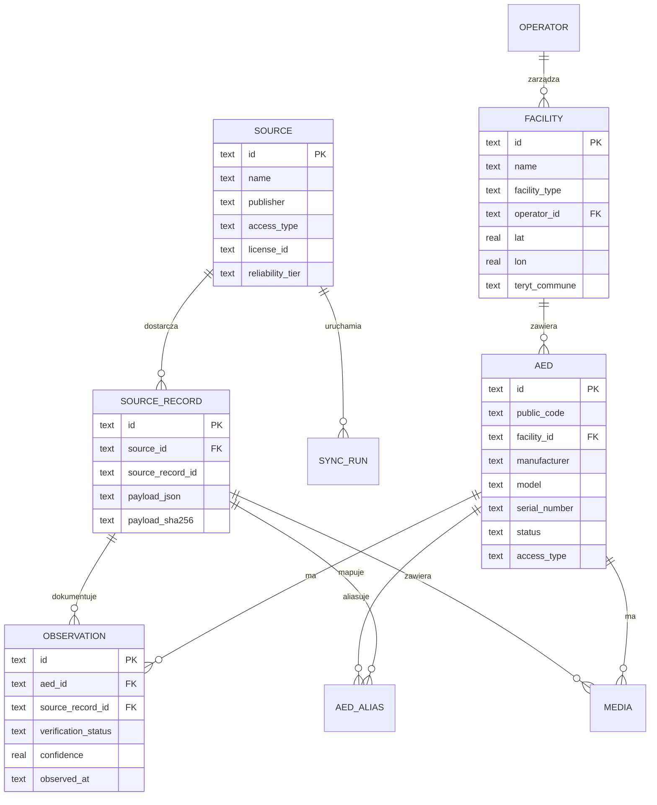
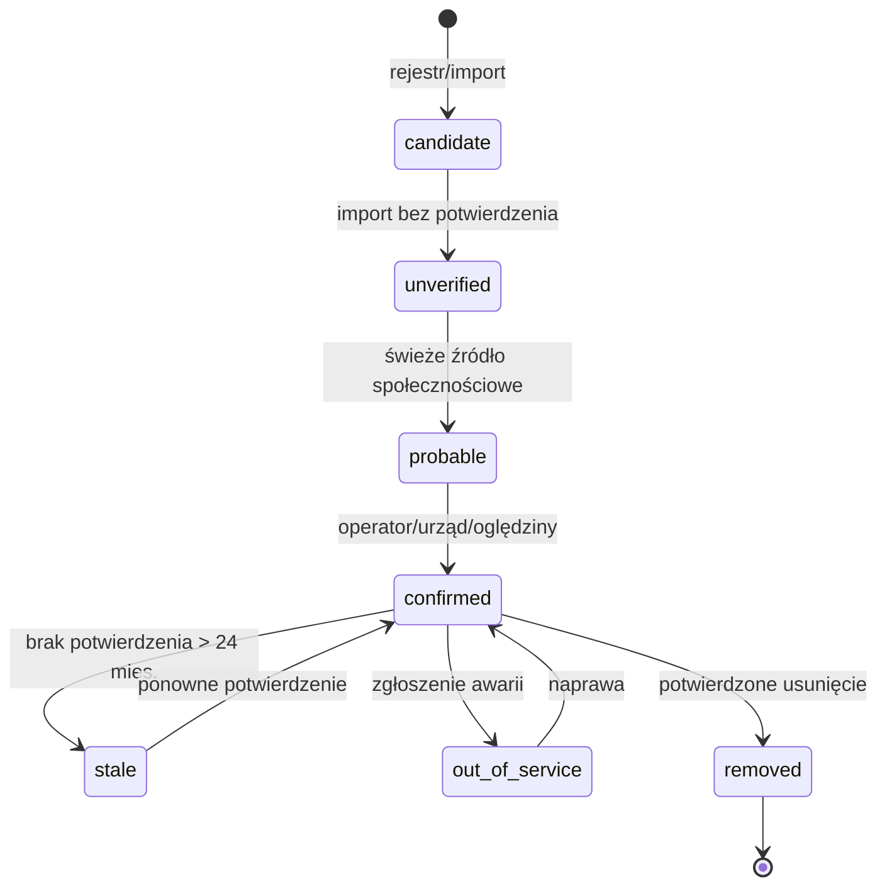

# Wspólny schemat danych AED dla Polski

**Raport z researchu źródeł i projektu modelu kanonicznego**

| | |
| --- | --- |
| Data researchu | 2026-11-21 |
| Autor | zespół projektowy (research równoległy + synteza) |
| Wersja | 1.0 (draft do review) |
| Zakres | publiczne i półpubliczne źródła lokalizacji AED w Polsce |
| Powiązane pliki | [`AED/docs/research/raw/`](./research/raw/) — surowe dowody, logi HTTP, odpowiedzi API |
| Status | dokument roboczy; pola oznaczone `NOT VERIFIED` wymagają potwierdzenia u wydawcy |

> **Legenda pewności**
>
> - **Verified** — potwierdzone realnym zapytaniem HTTP i zachowanym dowodem w `docs/research/raw/`.
> - **Partially verified** — potwierdzone częściowo (np. strona istnieje, ale API wymaga klucza).
> - **Declared** — wynika z dokumentacji/regulaminu, nie z testu danych.
> - **NOT VERIFIED** — nie udało się potwierdzić; nie traktować jako faktu.

---

## 0. TL;DR

1. **Nie ma centralnego, obowiązkowego rejestru AED w Polsce.** Dane są rozproszone między OSM, pojedyncze gminy, rejestry podmiotów i aplikacje komercyjne.
2. **OpenStreetMap jest faktycznym kręgosłupem ekosystemu.** OpenAEDMap publikuje całą Polskę jako GeoJSON (18 298 punktów), a Geoportal.gov.pl i CloudFerro **nie mają publicznej warstwy AED** — służą co najwyżej jako dane referencyjne (PRG, adresy, ortofoto).
3. **Skala OSM w Polsce to ok. 18,3 tys. rekordów** (Taginfo, 2026-11-20; OpenAEDMap: 18 298 features). To największy jednolity zbiór AED w kraju, ale bez statusu działania i z niepełnymi polami operacyjnymi.
4. **Na dane.gov.pl są tylko 4 zbiory AED**: Krosno, Przemyśl, Marki i Warszawa. Każdy ma inny format i inne kolumny; tylko Przemyśl ma w pełni otwarte, udokumentowane API.
5. **Wspólny rdzeń danych jest mały:** identyfikator źródła, nazwa/lokalizacja, współrzędne, adres, zdjęcie, licencja. Reszta (dostęp, godziny, status, operator, model, przeglądy) jest dostępna tylko w niektórych źródłach albo wcale.
6. **Największa luka to nie geometria, lecz informacja operacyjna:** czy AED jest czynne, gdzie dokładnie wejść, czy jest dostępne 24/7 i kto za nie odpowiada.
7. **Rekomendowany model to rekord + obserwacje + proweniencja**, a nie jedna płaska tabela. Pozwala łączyć źródła, rozwiązywać konflikty i uczciwie pokazywać „skąd wiemy”.
8. **Licencje trzeba rozdzielić:** OSM/OpenAEDMap to ODbL 1.0 (share-alike), Przemyśl to CC BY 4.0 (z rozbieżnością CC0 w mirrorze), Krosno to CC0 1.0, Marki i Warszawa to CC BY 4.0.
9. **Najbezpieczniejszy start:** OSM/OpenAEDMap jako warstwa bazowa + Przemyśl jako wzorcowy connector + dane.gov.pl jako kanał publikacji; rejestry KSRG/RPWDL/RSPO jako warstwa kandydatów do ankiet, nie jako dowód posiadania AED.

---

## 1. Wnioski kluczowe

### 1.1 Dominacja OSM i pochodnych

OpenStreetMap definiuje faktyczny standard tagowania AED (`emergency=defibrillator`). OpenAEDMap udostępnia **cały kraj jako GeoJSON** (`/api/v1/countries/PL.geojson`, 18 298 punktów) oraz API pojedynczego węzła. To oznacza:

- jedno źródło prawdy technicznej dla większości punktów,
- wspólny zestaw tagów i wspólne ograniczenia (brak statusu, brak seriali, rzadkie `check_date`),
- konieczność zachowania atrybucji OSM i licencji ODbL w każdej warstwie pochodnej.

**Korekta wobec listy źródeł:** Geoportal.gov.pl **nie publikuje warstwy AED** — jego WMS-y udostępniają PRG, adresy i ortofotomapę. CloudFerro to dostawca chmury IaaS/PaaS i danych obserwacji Ziemi; w publicznych materiałach **nie ma zbioru ani WMS z AED**. Oba źródła mogą być przydatne jako referencja adresowa lub podkład, ale nie jako źródło rekordów AED.

### 1.2 Cztery różne światy formatów lokalnych

| Zbiór | Format | Schemat | Otwartość |
| --- | --- | --- | --- |
| Krosno | CSV | polskie nagłówki, lon/lat w osobnych kolumnach | plik, bez API |
| Przemyśl | JSON / CSV / GeoJSON | 14–19 kolumn, `id`, `name`, adres, galeria | pełne API, bez klucza |
| Marki | CSV / XLSX | CSV z jednym wierszem nagłówkowym i przecinkami w cudzysłowach | plik, bez API |
| Warszawa | JSON przez API | `token_uzytkownika` wymagany, 403 bez tokena | API z kluczem |

Wniosek: **nie da się zbudować wspólnego schematu przez „pobranie CSV i wrzucenie do tabeli”**. Potrzebna jest warstwa connectorów i normalizacji per źródło.

### 1.3 Co realnie można ujednolicić

Można ujednolicić:

- identyfikację rekordu i źródła,
- geometrię i adres,
- nazwę i typ obiektu,
- dostępność i godziny (tam, gdzie są),
- dane urządzenia (tam, gdzie są),
- status i ostatnią weryfikację,
- operatora i kontakt organizacyjny,
- zdjęcie i licencję,
- pełną proweniencję.

Nie można ujednolicić przez samo mapowanie:

- informacji, czy urządzenie faktycznie działa,
- numeru seryjnego i modelu, jeśli źródło ich nie ma,
- dokładnego wejścia/piętra, jeśli źródło go nie opisuje.

Dlatego model musi rozróżniać **„brak danych”** od **„dane negatywne”**: `null`/`unknown` to nie to samo co `false`/`removed`.

### 1.4 Priorytety źródeł

| Priorytet | Źródło | Rola |
| --- | --- | --- |
| P0 | OSM + OpenAEDMap | warstwa bazowa pokrycia ogólnopolskiego |
| P0 | Przemyśl | wzorcowy connector miejski z OpenAPI |
| P1 | dane.gov.pl (4 zbiory) | mirror i kanał publikacji |
| P1 | KSRG/OSP | lista kandydatów z obowiązkiem prawnym od 2026-07-01 |
| P2 | RPWDL/NFZ, RSPO/SIO | wzbogacenie operatora i adresu, nie dowód AED |
| P2 | gminy (Wrocław, Słupsk, Włocławek, Gliwice, inne) | lokalne punkty i weryfikacja |
| P3 | aplikacje komercyjne | potencjalne partnerstwo, brak otwartego API |

---

## 2. Zakres i metodyka

### 2.1 Badane źródła

1. OpenAEDMap / Mapa AED (aed.openstreetmap.org.pl → openaedmap.org)
2. OpenStreetMap (Overpass API, OSM API, Taginfo)
3. Geoportal.gov.pl (GUGiK) — sprawdzony: **brak warstwy AED**; WMS referencyjny (PRG, adresy, ortofoto)
4. CloudFerro WMS — sprawdzony: **brak publicznego WMS/AED**; hosting OpenAEDMap, nie źródło
5. SOS DAE (sosdae.com)
6. Ratuj z Sercem (ratujzsercem.pl)
7. Fundacja „Ratuj Życie” (ratujzycie.eu)
8. aedmapa.pl
9. Ratujemy.com.pl
10. Otwarte Dane Przemyśl (dane.przemysl.eu)
11. Staying Alive
12. mojeIKP (Centrum e-Zdrowia)
13. Info Ratunek
14. Pierwszy Ratownik / Reanimator
15. Ratunek
16. dane.gov.pl — zbiory AED (Krosno, Przemyśl, Marki, Warszawa)
17. KSRG/OSP, RPWDL, NFZ, RSPO/SIO, OLiOC — jako rejestry uzupełniające

### 2.2 Metoda

- realne zapytania HTTP (`curl`) z zapisem statusu, nagłówków i odpowiedzi,
- analiza OpenAPI/JSON Schema tam, gdzie były dostępne,
- analiza przykładowych rekordów i typów pól,
- porównanie schematów i budowa macierzy pokrycia,
- projekt modelu kanonicznego i reguł normalizacji.

### 2.3 Ograniczenia

- **Overpass API był niestabilny w środowisku badawczym** (timeouty). Zamiast tego użyto eksportu krajowego OpenAEDMap (`PL.geojson`, 18 298 features) i statystyk Taginfo (18 321 rekordów OSM w PL). Liczby są spójne; ewentualny własny import PBF/Overpass należy potwierdzić w środowisku produkcyjnym.
- **Geoportal/CloudFerro:** w publicznym katalogu nie znaleziono warstwy AED, a część endpointów WMS zwraca `401`. Nie ma czego mapować; Geoportal pozostaje źródłem referencyjnym adresów/TERYT.
- **Aplikacje mobilne:** audyt obejmował 47 testów HTTP; ocena dotyczy dostępności publicznych endpointów, nie pełnej funkcjonalności aplikacji po zalogowaniu.
- **Rejestry rządowe:** KSRG jest PDF-em bez adresów, RPWDL wymaga reCAPTCHA/Keycloak, RSPO — Basic auth na wniosek, NFZ jest publiczne. Żaden nie zawiera pola AED; ustalenia potwierdzone realnymi zapytaniami, ale dostępy do RPWDL/RSPO pozostają ograniczone.

---

## 3. Inwentarz źródeł

| ID | Źródło | Wydawca / operator | Dostęp | Format | Auth | Licencja | Aktualizacja | AED? | Tier |
| --- | --- | --- | --- | --- | --- | --- | --- | --- | --- |
| `osm` | OpenStreetMap | OSM Foundation / społeczność | API, Overpass | JSON, XML, PBF | nie | ODbL 1.0 | ciągła | tak | community |
| `openaedmap` | OpenAEDMap | OpenAEDMap / OSM PL | MVT, REST node API | MVT, JSON | nie | ODbL 1.0 | ciągła (pochodna OSM) | tak | derived/aggregator |
| `geoportal_wms` | Geoportal.gov.pl — WMS referencyjny (PRG, adresy, ortofoto) | GUGiK | WMS | XML/GML/PNG | nie | otwarte / bez opłat (metadane WMS) | zależna od warstwy | **nie** — brak warstwy AED | reference |
| `cloudferro_wms` | CloudFerro / CREODIAS | CloudFerro | chmura IaaS/PaaS, dane EO | — | — | zależna od zbioru | — | **nie** — brak publicznego AED | not_a_source |
| `przemysl` | Otwarte Dane Przemyśl | Straż Miejska w Przemyślu | REST/OpenAPI | JSON, CSV, GeoJSON | nie | CC BY 4.0 (mirror: CC0) | deklaracja ciągła; plik 2024-11-05 | tak | official_local |
| `krosno` | Defibrylatory w Krośnie | Miasto Krosno (dane.gov.pl) | plik CSV | CSV | nie | CC0 1.0 | jednorazowo 2024 | tak | official_local |
| `marki` | Defibrylatory w Markach | Miasto Marki (dane.gov.pl) | plik CSV/XLSX | CSV, XLSX | nie | CC BY 4.0 | jednorazowo 2025 | tak | official_local |
| `warszawa` | Lokalizacja defibrylatorów (AED) | m.st. Warszawa | REST API | JSON | tak (`token_uzytkownika`) | CC BY 4.0 | 2026-06-01 (metadata) | tak | official_local |
| `dane_gov_pl` | Portal dane.gov.pl | KPRM | REST API 1.4 | JSON:API | nie | per dataset | per dataset | mirror | official_mirror |
| `ksrg_osp` | Wykazy jednostek KSRG/OSP | KG PSP / gov.pl | PDF, portale | PDF | nie | publiczne | okresowa | nie (tylko operator) | register |
| `rpwdl` | RPWDL | Ministerstwo Zdrowia | wewnętrzne API | JSON | recaptcha + Keycloak | publiczne | ciągła | nie | register |
| `nfz` | Dane NFZ — Terminy Leczenia | NFZ | API 1.4 | JSON | nie | regulamin API | miesięczna | nie | register |
| `rspo_sio` | RSPO/SIO | MEN | API (Basic) + XLSX | JSON, XLSX | tak (na wniosek) | regulamin API | ciągła / roczna | nie | register |
| `olioc` | Program OLiOC | MSWiA / gov.pl | dokumenty | PDF/XLSX | nie | publiczne | okresowa | pośrednio (zakupy) | program |
| `sosdae` | SOS DAE | sosdae.com | aplikacja + JSON-LD | HTML/JSON-LD | — | ODbL + ToS zakaz masowego ekstrahowania | `NOT VERIFIED` | tak | app |
| `stayingalive` | Staying Alive | Staying Alive Foundation | aplikacja | brak API AED | — | własna, za zgodą | `NOT VERIFIED` | tak | app |
| `ratujzsercem` | Ratuj z Sercem | ratujzsercem.pl | `DBProxy.aspx` | JSON (293 punkty) | — | brak open licencji | `NOT VERIFIED` | tak | app |
| `ratujzycie` | Fundacja Ratuj Życie | ratujzycie.eu | brak | — | — | brak | domena martwa (`000`) | brak | app |
| `aedmapa` | aedmapa.pl | aedmapa.pl | klient OSM/OpenAEDMap | brak własnego API | — | ODbL | ciągła | tak | derived/app |
| `ratujemy` | Ratujemy.com.pl | Ratujemy.com.pl | mapa (Overpass) | brak własnego API | — | ODbL | ciągła | tak | derived/app |
| `info_ratunek` | Info Ratunek | inforatunek.pl | `/api/aed` | JSON (16 rekordów) | — | brak regulaminu | `NOT VERIFIED` | tak | app |
| `pierwszy_ratownik` | Pierwszy Ratownik / Reanimator | pierwszyratownik.pl | aplikacja | brak API | — | regulamin aplikacji | `NOT VERIFIED` | tak | app |
| `ratunek` | Ratunek | ratunek.eu | aplikacja | brak API | — | regulamin | `NOT VERIFIED` | nie dotyczy | app |
| `mojeikp` | mojeIKP | Centrum e-Zdrowia | aplikacja | brak potwierdzonego API | — | regulamin | planowana mapa AED | tak (plan) | gov_app |

> Szczegóły i dokładne statusy HTTP: [`docs/research/raw/`](./research/raw/). Wszystkie raporty źródłowe (OSM, rejestry, aplikacje, gminy) są już uzupełnione; raport główny je syntetyzuje.

---

## 4. Szczegóły źródeł

### 4.1 OpenStreetMap (OSM)

**Dostęp:** publiczny, bez klucza. Overpass API, OSM API 0.6, pliki PBF, Taginfo.

**Schemat tagów AED (najważniejsze):**

| Tag OSM | Znaczenie | Mapowanie kanoniczne |
| --- | --- | --- |
| `emergency=defibrillator` | obiekt jest AED | `device_type=public_aed` |
| `defibrillator=yes` / `defibrillator:type` | dodatkowa deklaracja typu | `device_type`, `pads_type` (częściowo) |
| `defibrillator:location` | opis miejsca (np. „w budynku przedszkola”) | `entrance_description` / `location_description` |
| `defibrillator:location:pl` | polski opis miejsca | `entrance_description` |
| `access` | dostęp: `yes`, `permissive`, `customers`, `private`, `no` | `access_type` |
| `opening_hours` | godziny dostępności | `opening_hours` |
| `indoor` | wewnątrz/zewnątrz | `indoor` |
| `level` | piętro | `level` |
| `room` | pomieszczenie | `room` |
| `ref` | identyfikator urządzenia | `label` / `device_identifier` |
| `operator` | opiekun | `operator.name` |
| `operator:type` | typ opiekuna | `operator.operator_type` |
| `phone` / `contact:phone` | kontakt | `operator.phone` |
| `manufacturer` | producent | `aed.manufacturer` |
| `model` | model | `aed.model` |
| `serial_number` | numer seryjny | `aed.serial_number` |
| `check_date` | data sprawdzenia | `last_verified_at` |
| `survey:date` | data inwentaryzacji | `last_verified_at` (niższa pewność) |
| `start_date` | data instalacji | `installed_at` |
| `image` | zdjęcie | `photo_url` |
| `description`, `note` | opis | `description` |
| `wheelchair` | dostępność dla wózka | `wheelchair_access` |
| `fee` | opłata | `fee` |
| `locked` | zamknięte | `access_type=key` (częściowo) |

**Przykład realnej odpowiedzi OSM/OpenAEDMap (Verified, 2026-11-21):**

```json
{
  "version": 0.6,
  "copyright": "OpenStreetMap and contributors",
  "attribution": "https://www.openstreetmap.org/copyright",
  "license": "https://opendatacommons.org/licenses/odbl/1-0/",
  "elements": [
    {
      "@photo_id": null,
      "@photo_url": null,
      "@photo_source": null,
      "@timezone_name": "Europe/Warsaw",
      "@timezone_offset": "UTC+01:00",
      "type": "node",
      "id": 13323246101,
      "lat": 52.2275002,
      "lon": 20.9742602,
      "tags": {
        "access": "customers",
        "indoor": "yes",
        "emergency": "defibrillator",
        "check_date": "2025-11-22",
        "defibrillator:location:pl": "w budynku przedszkola"
      },
      "version": 1
    }
  ]
}
```

**OpenAEDMap — eksport krajowy (Verified, najlepszy endpoint do ingestii):**

- `GET https://openaedmap.org/api/v1/countries/PL.geojson` — **18 298 features**, ok. 7,1 MB, `application/geo+json`, EPSG:4326,
- właściwości: `@osm_type`, `@osm_id`, `@osm_version` + **wszystkie tagi OSM** jako stringi,
- `GET https://openaedmap.org/api/v1/node/{node_id}` — pojedynczy węzeł + `@photo_*`, `@timezone_*`,
- `GET https://openaedmap.org/api/v1/countries/names?language=pl` — lista krajów i liczników,
- brak `PL.csv` i `PL.json` (404); historyczny CSV z `aed.openstreetmap.org.pl` miał 15 kolumn i 4 588 rekordów (snapshot 2023-01-07), dziś jest archiwum,
- OpenAEDMap importuje **tylko node** (`node[emergency=defibrillator]`); 2 waye z tym tagiem w Polsce nie trafiają do eksportu.

**OpenAEDMap — kafle MVT (Verified):**

- endpoint: `GET https://openaedmap.org/api/v1/tile/{z}/{x}/{y}.mvt`
- warstwa: `defibrillators`
- atrybuty kafla: `node_id` (OSM node id), `access`, oraz dla klastrów `point_count`, `point_count_abbreviated`
- licencja: ODbL 1.0, atrybucja „© OpenStreetMap contributors”

**Pokrycie pól OSM w Polsce (Taginfo, 2026-11-20):**

| Tag | Pokrycie | Wniosek |
| --- | --- | --- |
| `emergency=defibrillator` | 100% | rdzeń |
| `defibrillator:location` | 67,3% | dobry opis miejsca, ale nie pełny |
| `access` | 92,5% | dostęp często znany |
| `indoor` | 87,3% | indoor/outdoor prawie zawsze |
| `opening_hours` | 37,1% | dostęp nocny często nieznany |
| `level` | 20,2% | piętro rzadko |
| `check_date` | 32,7% | tylko 1/3 ma datę sprawdzenia |
| adresy (`addr:*`) | 0,6% | adresu prawie nie ma; potrzebny Geoportal/Nominatim |
| `operator` | 4 086 unikalnych wartości | trudna agregacja; potrzebny słownik/QID |

**Ograniczenia:**

- brak gwarantowanego statusu „czynne/awaria”,
- `check_date` jest rzadki i nie oznacza pełnej weryfikacji,
- brak numerów seryjnych w większości rekordów,
- jakość zależy od społeczności; możliwe duplikaty i nieaktualne punkty,
- ODbL wymusza share-alike na bazie pochodnej.

**Rekomendacja:** warstwa bazowa P0, ale każdy rekord musi mieć `verification_status=unverified`/`community` i `last_verified_at` z `check_date`, jeśli istnieje.

---

### 4.2 Geoportal.gov.pl i CloudFerro — korekta założenia

**Najważniejszy wniosek:** żadne z tych źródeł nie publikuje dziś warstwy AED.

#### Geoportal.gov.pl (GUGiK)

- W publicznym katalogu WMS/WMTS Geoportalu **nie znaleziono warstwy AED**. Przeszukanie `GetCapabilities` usługi PRG (52 warstwy) nie wykazało nazw zawierających `defibril` ani `aed`; część endpointów WMS zwraca `401`, więc brak warstwy jest bardzo prawdopodobny, ale nie potwierdzony w 100%. **Status: Verified dla braku w zbadanym katalogu; NOT VERIFIED dla absolutnej negacji.**
- Geoportal udostępnia natomiast:
  - **PRG** — granice państwa, województw, powiatów, gmin, miast, jednostek ewidencyjnych,
  - **Krajową Integrację Numeracji Adresowej** — punkty adresowe i ulice,
  - **ortofotomapę** i dane topograficzne.
- To znakomite źródło do **normalizacji adresów i przypisania TERYT**, ale nie do rekordów AED.
- Przykład `GetCapabilities`: `https://mapy.geoportal.gov.pl/wss/service/PZGIK/PRG/WMS/AdministrativeBoundaries?SERVICE=WMS&REQUEST=GetCapabilities` → 200, WMS 1.3.0, 126 647 B.
- CRS: EPSG:2176–2180, 3857, 4326. Dla WMS 1.3.0 i EPSG:4326 obowiązuje kolejność osi **lat,lon** w `BBOX`.
- `AccessConstraints: NONE`, `Fees: NONE` dla PRG; ortofotomapa ma zakaz automatycznego harvestingu obrazów. Licencja prawna danych wymaga analizy regulaminu — metadane WMS nie są licencją.

#### CloudFerro / CREODIAS

- CloudFerro to dostawca chmury IaaS/PaaS i danych obserwacji Ziemi (Sentinel, Landsat, MODIS itd.), a nie krajowy rejestr AED.
- W publicznych materiałach **nie ma zbioru AED, warstwy WMS z AED ani API rekordu AED**; subdomeny `wms`/`maps` zwracają NXDOMAIN. CloudFerro jest natomiast **hostingiem OpenAEDMap**, a nie źródłem danych. **Status: Verified (brak publicznej oferty AED).**
- CloudFerro może hostować WMS-y swoich klientów, ale nie jest to publiczna usługa krajowa z AED. Jeśli projekt potrzebuje referencyjnego WMS dla Polski, właściwym źródłem jest Geoportal (PRG, adresy, ortofoto), nie CloudFerro.

**Rekomendacja:** usunąć Geoportal i CloudFerro z listy źródeł rekordów AED. Geoportal zostawić jako **źródło referencyjne do adresów/TERYT i podkładu**, CloudFerro pominąć.

---

### 4.3 Otwarte Dane Przemyśl (dane.przemysl.eu)

**Status:** `Verified` — pełny raport w [`research/raw/przemysl-open-data.md`](./research/raw/przemysl-open-data.md).

**Najważniejsze fakty:**

- portal to WordPress + autorski plugin `sod/v1` (nie CKAN),
- OpenAPI 3.2.1: `https://dane.przemysl.eu/wp-json/sod/v1/openapi.json`,
- zbiór `dataset_id=13`, `identifier=PRZ-DEFIBRYLATOR`, zasób `resource_id=15`,
- 21 rekordów, geometria `Point` w EPSG:4326,
- licencja CC BY 4.0; mirror na dane.gov.pl deklaruje CC0 1.0 (rozbieżność),
- brak auth, limit 120 req/min,
- CSV **nie zawiera współrzędnych** w API SOD; GeoJSON i `/structured` zawierają. Mirror na dane.gov.pl ma osobny CSV z 17 kolumnami i `geometry` (klucz `long`, wartości string), ale jest to inny format niż API SOD.
- `format=csv` jest **technicznie wadliwy**: zwraca `Content-Type: text/csv`, ale treść jest literałem JSON stringa z escapowanym BOM i `\n`, a nie czystym CSV; domyślny limit to 10 wierszy, więc bez `limit` pobierzesz tylko 10/21 rekordów,
- rzeczywisty plik źródłowy pochodzi z 2024-11-05, mimo „ciągłej” aktualizacji metadanych,
- duplikat numeru AED 7639 w rekordach 757 i 764.

**Schemat (14 kolumn JSON/CSV):**

```
id, name, description, category, city, street, home_number, postcode,
phone, email, www, gallery, attachments, links
```

> **Uwaga integracyjna:** `GET /resources/15/data?format=csv` zwraca `text/csv`, ale body jest JSON-owym literałem stringa. Po `json.loads` dopiero otrzymujesz właściwy CSV (BOM, `\r\n`). Bez `limit` API zwraca 10 z 21 wierszy. Bezpieczniejsza ścieżka to GeoJSON lub `/structured`.

**Schemat rozszerzony (`/structured`, 19 kolumn):**

```
youtube_url, panorama_url, geometry, longitude, latitude
```

**Mapowanie na model kanoniczny:**

| Kanoniczne | Źródło | Transformacja |
| --- | --- | --- |
| `source_record_id` | `id` | `String(id)` |
| `name` | `name` | trim, normalizacja spacji |
| `device_identifier` | `name` | regex `AED\s*-?\s*(\d{4,5})` |
| `location_name` | `name` | usuń prefiks „Defibrylator (AED …)” |
| `lat`, `lon` | `geometry.coordinates[1/0]` | walidacja zakresu |
| `address_city` | `city` | trim |
| `address_street` | `street` | trim |
| `address_number` | `home_number` | `"" → null` |
| `postal_code` | `postcode` | normalizacja |
| `phone`, `email`, `website` | `phone`, `email`, `www` | normalizacja |
| `photo_url` | `gallery[0].url` | pierwsze zdjęcie |
| `license_id` | stała | `CC-BY-4.0` |
| `attribution` | stała | „Miasto Przemyśl — Portal Otwartych Danych, CC BY 4.0” |

**Czego brakuje:** operator, model, status, godziny, 24/7, indoor/outdoor, data przeglądu, dokładne wejście. To typowa luka miejskich zbiorów.

---

### 4.4 dane.gov.pl — cztery zbiory AED

**Status:** `Verified` — API 1.4, realne zapytania z 2026-11-21.

| Dataset ID | Tytuł | Instytucja | Format | Aktualizacja | Uwagi |
| --- | --- | --- | --- | --- | --- |
| `3624` | Defibrylatory zlokalizowane w Mieście Krosno | Miasto Krosno | CSV | jednorazowo, 2024 | 21 rekordów; polskie nagłówki; licencja CC0 1.0 |
| `4581` | Lokalizacje AED — Przemyśl | Urząd Miejski w Przemyślu | GML, GeoJSON, JSON, CSV | „Codziennie”; plik 2024-11-06 | mirror Przemyśla; CC0 1.0; `has_high_value_data=true` |
| `4955` | Defibrylatory zlokalizowane na terenie Miasta Marki | Miasto Marki | CSV, XLSX | jednorazowo, 2025 | 8 rekordów; CSV podwójnie cytowany; licencja CC BY 4.0 |
| `39512` | Lokalizacja defibrylatorów (AED) | m.st. Warszawa | JSON przez API | 2026-06-01 (metadata) | API wymaga `token_uzytkownika`; 403 bez tokena; CC BY 4.0 |

**Krosno — nagłówki CSV:**

```
Długość geograficzna, Szerokość geograficzna, Nazwa, Lokalizacja, Adres, Numer Id
```

> Uwaga: w rzeczywistym pliku cztery nazwy mają wiodące spacje (` Nazwa`, ` Lokalizacja`, ` Adres`, ` Numer Id`). Parser powinien je trimować.

**Marki — nagłówki CSV:**

```
Długość geograficzna, Szerokość geograficzna, Nazwa, Lokalizacja, Adres, Numer Id
```

Plik Marki jest jednak zapisany nietypowo: **każdy wiersz jest dodatkowo owinięty w cudzysłowy**, a wewnętrzne cudzysłowy są podwojone. Standardowy parser CSV zobaczy jeden tekst w pierwszej kolumnie. Potrzebne jest dwustopniowe parsowanie: najpierw zdjąć zewnętrzne cudzysłowy, potem sparsować zawartość.

Dodatkowo **nagłówek Marki jest sprzeczny z danymi**: deklaruje `Długość geograficzna, Szerokość geograficzna` (lon, lat), ale 7 z 8 wierszy ma kolejność **szerokość, długość** (np. `52.326697, 21.107557`). Tylko wiersz `Numer Id=7` jest zgodny z nagłówkiem (`21.7203, 49.7188`) i dlatego wypada poza Marki. To podwójny błąd: niespójna kolejność osi i punkt odstający. Walidacja musi wykryć oba przypadki i skierować je do review, a nie na mapę.

**Warszawa — API:**

```bash
curl -X POST 'https://dane.um.warszawa.pl/api/action/get_scb_lokalizacja_defibrylatorow' \
  -H 'Authorization: token_uzytkownika' \
  -H 'Content-Type: application/json' \
  -d '{"defibrillator_id": "622"}'
```

Bez tokena: HTTP 403 `Access denied: Nieautoryzowany: brak ważnego tokena lub API key`.

**Warszawa — dokładne pola (z dokumentacji API, `scb_lokalizacja_defibrylatorow_pa.json`):**

```text
geometry.type, geometry.coordinates
properties.defibrillator_id
properties.device_access_description
properties.device_availability
properties.device_location
properties.device_manufacturer
properties.device_public_access
properties.location_building
properties.location_city
properties.location_description
properties.location_object_name
properties.location_postcode
properties.location_street
properties.attachment   # Base64 zdjęcia, tylko w szczegółowym pobraniu
```

To **najbardziej kompletny schemat miejski**: ma identyfikator, adres, współrzędne, typ lokalizacji, dostępność, producenta i dostęp publiczny. Brakuje mu statusu działania i daty weryfikacji.

**Wniosek:** dane.gov.pl jest dobrym kanałem publikacji i mirroru, ale **nie narzuca wspólnego schematu rekordów**. Każdy wydawca publikuje własne kolumny.

---

### 4.5 Rejestry rządowe: KSRG/OSP, RPWDL, NFZ, RSPO/SIO, OLiOC

**Status:** `Verified` dla dostępności i braku pola AED w publicznych zbiorach. Pełne dowody: [`research/raw/gov-registers.md`](./research/raw/gov-registers.md).

| Rejestr | Dostęp i format | Co daje | Czego nie daje | Zastosowanie |
| --- | --- | --- | --- | --- |
| **KSRG/OSP** | strona `200`; pełny wykaz to **PDF, 72 strony, 5 363 wiersze**; brak API | `Lp.`, `Województwo`, `KP (M) PSP`, `Gmina`, `Nazwa OSP` | adresu, współrzędnych, potwierdzenia AED | lista kandydatów do ankiet; wymaga geokodowania |
| **Karta OSP / SWD-PSP** | wzór DOCX `200`; dane per jednostka nie są publikowane | pola `AED (min. 1 szt.)`, `Zestaw ratownictwa medycznego R1`, `Numer Jednostki w SWD-PSP`, `Numer KRS` | otwartego, maszynowego zbioru | docelowe źródło potwierdzenia AED po pozyskaniu dostępu |
| **RPWDL** | brak publicznego API; wewnętrzne endpointy wymagają `recaptchaToken` i Keycloak (`500`/`403`) | podmioty lecznicze, komórki organizacyjne, NIP/REGON | AED; otwartego API | pominięte do czasu uzyskania dostępu |
| **NFZ API 1.4** | publiczne, bez auth; JSON; `/queues`, `/providers`, `/places`, `/localities` | `provider`, `place`, `address`, `teryt-place`, `latitude`, `longitude` (nullable) | AED; współrzędne często `null` | warstwa placówek medycznych do ręcznego przypisania AED |
| **RSPO (nowe API)** | od 2026-01-15; HTTP Basic na wniosek; `401` bez auth; JSON | `numerRspo`, `nazwa`, `teryt`, `ulica`, `numerBudynku`, `geolokalizacja[]` (`latitude`/`longitude` jako string) | AED | warstwa szkół do ręcznego przypisania AED |
| **RSPO XLSX** | dane.gov.pl dataset `839`, CC BY 4.0, 55 742 wiersze | adresy, TERYT, REGON, typ placówki | współrzędnych w XLSX; AED | jednorazowy import adresów szkół |
| **OLiOC** | strona `200`; brak API i rejestru zakupów | informacje o programie i finansowaniu | listy AED i współrzędnych | pominięte; ewentualnie dane od MSWiA/JST |

**Kluczowy wniosek:** rejestry są **źródłem lokalizacji i operatora**, nie **źródłem faktu posiadania AED**. W modelu należy oznaczyć takie rekordy jako `verification_status=candidate`, a nie `confirmed`. Informacja o AED w karcie OSP jest dowodem, że dane istnieją w SWD-PSP, ale nie są publiczne.

**Obowiązek OSP:** od 1 lipca 2026 r. jednostki OSP w KSRG mają dysponować zestawem R-1 z AED. To daje podstawę do ankiet i weryfikacji, ale nie zwalnia z potwierdzenia konkretnej lokalizacji i statusu urządzenia.

---

### 4.6 Aplikacje i agregatory

**Status:** `Verified` dla testów HTTP i dostępności publicznych endpointów. Pełny audyt: [`research/raw/aggregator-apps.md`](./research/raw/aggregator-apps.md).

**Najważniejszy wniosek:** nie ma polskiego, publicznego, udokumentowanego API agregującego AED od wszystkich dysponentów. Najlepszą maszynową drogą pozostaje **OpenAEDMap/OSM**.

| Aplikacja | Publiczne API/eksport | Realny test | Pochodzenie danych | Licencja / ToS | Werdykt |
| --- | --- | --- | --- | --- | --- |
| **SOS DAE** | brak API; strony SEO + JSON-LD | `200` strona, `404` dla `/api`, `/swagger`, `/openapi.json` | OSM + OpenAEDMap + rejestry | ODbL na dane, ale ToS zakazuje masowego ekstrahowania bazy | **nie scrapować**; używać OSM/OpenAEDMap |
| **Staying Alive** | brak publicznego API AED | `200` strona i `/wp-json`; brak endpointu AED | własna baza społecznościowa | własna, reprodukcja tylko za zgodą | brak dostępu |
| **Ratuj z Sercem** | nieudokumentowany `DBProxy.aspx?method=GetPoints` | `200 application/json`, **293 punkty**; `GetPointInfo` zwraca HTML | własne ankiety, nie OSM | brak open licencji; wymagana zgoda autorów | technicznie otwarte, prawnie zamknięte |
| **Fundacja Ratuj Życie** | brak | `000` — DNS nie rozwiązuje się | brak | brak | domena martwa; brak źródła |
| **aedmapa.pl** | brak własnego API; klient OSM/OpenAEDMap | `200` strona, `/terms`, `/privacy`; OpenAEDMap `200` | OSM + OpenAEDMap | ODbL | pośredni dostęp przez OSM/OpenAEDMap |
| **Ratujemy.com.pl** | brak własnego API; mapa pyta Overpass | `200` strona; Overpass `200` | OSM (`node["emergency"="defibrillator"]`) | ODbL | używać Overpass/OSM, nie serwisu |
| **Info Ratunek** | nieudokumentowany `GET /api/aed` | `200 application/json`, **tylko 16 rekordów** | własna baza, pochodzenie nieujawnione | brak regulaminu i licencji (`404`) | publiczne, ale małe i bez licencji |
| **Pierwszy Ratownik / Reanimator** | brak publicznego API/eksportu | `200` strona, `/aplikacja/`, `/regulamin/` | nieujawnione; brak wzmianki o OSM | regulamin aplikacji, brak licencji na dane | brak dostępu |
| **Ratunek** | brak | `200` strona i regulamin | nie dotyczy | regulamin usługi | nie jest źródłem AED |
| **mojeIKP** | brak publicznego API AED | `200` strona i karta Google Play; brak wzmianki o AED | zapowiedź integracji z OpenAEDMap (2023) | polityka prywatności, brak licencji na dane | brak potwierdzonej funkcji i API |

**Rekomendacja:** nie budować ingestii na scrapingu aplikacji. Traktować je jako:

1. kanał partnerski (umowa data-sharing), szczególnie SOS DAE i Ratuj z Sercem,
2. źródło sygnałów do weryfikacji („aplikacja X pokazuje AED w tym miejscu”),
3. źródło pochodne OSM, jeśli potwierdzą to regulaminem (aedmapa.pl, Ratujemy.com.pl).

**Uwaga prawna:** SOS DAE ma dane ODbL, ale jego regulamin zakazuje masowego wyciągania bazy w celu odsprzedaży lub budowy konkurencji. Sam status HTTP 200 nie oznacza zgody licencyjnej.

---

### 4.7 Gminy i miasta poza dane.gov.pl

**Status:** `Verified` dla kanałów i formatów; pełne dowody: [`research/raw/municipal-open-data.md`](./research/raw/municipal-open-data.md).

| Miasto | Co opublikowano | Format | Licencja | Współrzędne | Ocena |
| --- | --- | --- | --- | --- | --- |
| **Przemyśl** | 21 rekordów, API SOD | JSON/CSV/GeoJSON | CC BY 4.0 (mirror CC0) | tak | najlepszy wzorzec |
| **Warszawa** | aktywne AED w Warszawie | JSON przez API | CC BY 4.0 | tak | wymaga `token_uzytkownika` |
| **Krosno** | 21 rekordów | CSV | CC0 1.0 | tak | proste, bez API |
| **Marki** | 8 rekordów | CSV/XLSX | CC BY 4.0 | tak, z błędami | podwójne cytowanie i niespójna kolejność współrzędnych |
| **Wrocław** | artykuł z listą **38 stacji Helpbox 365** przy paczkomatach InPost; portal open-data zwraca **403** (FortiADC) | HTML | brak licencji na treść artykułu | brak | brak potwierdzonego zbioru maszynowego; tylko HTML |
| **Słupsk** | strona z listą **25 lokalizacji** AED | HTML | brak | brak | tylko HTML; brak API |
| **Włocławek** | geoportal `200`, ale WMS/WFS tylko EGiB/GESUT/BDOT/RCN; brak warstwy AED | WMS/WFS | brak | brak | brak danych AED |
| **Gliwice** | artykuł z tabelą **95 lokalizacji**; MSIP profil `1000` ma 114 warstw, brak AED; profil `756` może mieć warstwę (do potwierdzenia) | HTML + interaktywna mapa | brak | brak w artykule; geometria tylko w MSIP | brak potwierdzonego publicznego WMS/WFS z AED |

**Wniosek:** krajobraz jest bardzo nierówny. Tylko cztery gminy publikują dane w otwartym, maszynowym formacie. Trzy z nich (Warszawa, Krosno, Marki) mają niemal identyczny schemat opisowy bez pól dostępności i urządzenia. Przemyśl ma najbogatszy schemat kontaktowy i najlepsze API, ale nadal bez pól dostępności, operatora i statusu urządzenia. Wrocław, Słupsk i Gliwice mają dane wyłącznie w HTML lub w zamkniętej mapie — nadają się do ręcznej weryfikacji, nie do automatycznej ingestii.

Docelowo potrzebny jest **rejestr źródeł** z polami: wydawca, TERYT, licencja, format, częstotliwość, dostępność pól.

---

## 5. Macierz pokrycia pól

Legenda: ✅ dostępne bezpośrednio, ⚠️ częściowe/pochodne, ❌ brak, — nie dotyczy.

| Pole kanoniczne | OSM | OpenAEDMap | Przemyśl | Krosno | Marki | Warszawa | KSRG/OSP | NFZ | RSPO |
| --- | --- | --- | --- | --- | --- | --- | --- | --- | --- |
| identyfikator źródła | ✅ `@osm_type/id` | ✅ `@osm_id` | ✅ `id` | ✅ `Numer Id` | ✅ `Numer Id` | ✅ `defibrillator_id` | ✅ `Lp.`/SWD | ✅ `id` | ✅ `numerRspo` |
| nazwa | ⚠️ `description`/`operator` | ⚠️ tagi | ✅ `name` | ✅ `Nazwa` | ✅ `Nazwa` | ✅ | ✅ `Nazwa OSP` | ✅ `place`/`provider` | ✅ `nazwa` |
| lat/lon | ✅ | ✅ | ✅ GeoJSON | ✅ | ✅ (z błędami) | ✅ | ❌ | ⚠️ często `null` | ✅ `geolokalizacja[]` |
| adres | ⚠️ 0,4% | ⚠️ 0,4% | ✅ | ✅ `Adres` | ✅ `Adres` | ✅ | ❌ | ✅ | ✅ |
| TERYT | ❌ | ❌ | ❌ | ❌ | ❌ | ❌ | ✅ | ✅ `teryt-*` | ✅ `*KodTERYT` |
| typ obiektu | ⚠️ | ⚠️ | ⚠️ z nazwy | ⚠️ `Lokalizacja` | ⚠️ `Lokalizacja` | ⚠️ | ✅ OSP | ✅ placówka | ✅ szkoła |
| operator | ⚠️ 32,8% | ⚠️ 32,8% | ❌ | ❌ | ❌ | ⚠️ miasto | ✅ OSP | ✅ | ✅ organ prowadzący |
| kontakt operatora | ⚠️ 24,5% telefon | ⚠️ | ⚠️ 14% | ❌ | ❌ | ❌ | ⚠️ | ⚠️ | ✅ |
| dostęp | ✅ 92,5% | ✅ 92,5% | ❌ | ❌ | ❌ | ❌ | ❌ | ❌ | ❌ |
| godziny / 24-7 | ⚠️ 37,1% | ⚠️ 37,1% | ❌ | ❌ | ❌ | ❌ | ❌ | ❌ | ❌ |
| indoor / level / room | ✅ 87,3% / ⚠️ 20,2% | ✅ | ❌ | ❌ | ❌ | ❌ | ❌ | ❌ | ❌ |
| numer urządzenia | ⚠️ `ref` | ⚠️ | ⚠️ z `name` | ❌ | ❌ | ⚠️ | ❌ | ❌ | ❌ |
| producent / model | ⚠️ 1,9% / 0,8% | ⚠️ | ❌ | ❌ | ❌ | ❌ | ❌ | ❌ | ❌ |
| serial | ⚠️ rzadko | ⚠️ | ❌ | ❌ | ❌ | ❌ | ❌ | ❌ | ❌ |
| status | ❌ | ❌ | ❌ | ❌ | ❌ | ⚠️ „aktywne” w opisie | ❌ | ❌ | ❌ |
| ostatnia weryfikacja | ⚠️ 32,7% `check_date` | ⚠️ | ⚠️ metadane | ❌ | ❌ | ⚠️ | ❌ | ❌ | ❌ |
| instalacja / przegląd | ❌ | ❌ | ❌ | ❌ | ❌ | ❌ | ❌ | ❌ | ❌ |
| zdjęcie | ⚠️ 11,9% | ⚠️ | ✅ 100% | ❌ | ❌ | ❌ | ❌ | ❌ | ❌ |
| licencja | ✅ ODbL | ✅ ODbL | ✅ CC BY 4.0 | ✅ CC0 | ✅ CC BY 4.0 | ✅ CC BY 4.0 | ⚠️ | ⚠️ regulamin | ⚠️ regulamin |

**Kolumny Geoportal i CloudFerro zostały usunięte**, bo nie mają warstwy AED (patrz §4.2). Geoportal może uzupełnić adres i TERYT, ale nie jest źródłem rekordu AED.

**Wniosek:** wspólny schemat musi mieć **pola opcjonalne** i **poziom pewności**. Nie wolno wymagać od każdego źródła tych samych danych.

---

## 6. Wspólny model danych

### 6.1 Zasady projektowe

1. **Rekord kanoniczny ≠ rekord źródłowy.** Kanoniczny AED to urządzenie; źródła dostarczają obserwacji.
2. **Jedno urządzenie = jeden wiersz w `aed`.** Wiele urządzeń w jednym budynku to wiele rekordów `aed` powiązanych z jednym `facility`.
3. **Proweniencja na poziomie pola.** Wiemy nie tylko „skąd rekord”, ale „skąd każde pole”.
4. **Brak danych to `null`/`unknown`, nie `false`.**
5. **Nigdy nie zgadujemy statusu, dostępności ani operatora.**
6. **Idempotencja po `(source_id, source_record_id)`.**
7. **Licencja jest cechą źródła i rekordu, nie globalną stałą.**
8. **Dane osobowe nie są publikowane;** kontakt operatora ma charakter organizacyjny.
9. **Dostęp i godziny mogą być opisane na dwóch poziomach:** `facility.opening_hours` (godziny obiektu) i `aed.access_type` (dostęp do urządzenia). W razie konfliktu wygrywa poziom `aed`, bo dotyczy konkretnego defibrylatora.

### 6.2 Diagram encji



### 6.3 Encje

| Encja | Rola | Kluczowe pola |
| --- | --- | --- |
| `source` | rejestr źródeł | `id`, `publisher`, `access_type`, `license_id`, `reliability_tier` |
| `sync_run` | przebieg pobrania | `source_id`, `status`, `payload_sha256`, liczniki |
| `source_record` | surowy rekord + snapshot | `source_id`, `source_record_id`, `payload_json` |
| `operator` | podmiot odpowiedzialny | `name`, `operator_type`, `nip`, `regon`, `teryt` |
| `facility` | miejsce fizyczne | adres, TERYT, `lat/lon`, `facility_type` |
| `aed` | urządzenie | `label`, `manufacturer`, `model`, `serial_number`, `status`, `access_type` |
| `observation` | dowód/obserwacja | `source_record_id`, `verification_status`, `confidence`, `observed_at` |
| `aed_alias` | mapowanie źródeł | `aed_id`, `source_id`, `source_record_id`, `match_method` |
| `field_provenance` | proweniencja pola | `entity_type`, `entity_id`, `field_name`, `source_record_id` |
| `media` | zdjęcia i dokumenty | `url`, `license_id`, `attribution` |
| `submission` | zgłoszenia użytkowników | `status`, `reviewed_by`, `payload_json` |
| `audit_log` | historia zmian | `entity_type`, `entity_id`, `action`, `actor`, `created_at` |

---

## 7. Słownik pól kanonicznych

### 7.1 Identyfikacja i źródło

| Pole | Typ | Wymagane | Opis | Przykład |
| --- | --- | --- | --- | --- |
| `aed_id` | UUID | tak | wewnętrzny identyfikator urządzenia | `0192f3c4-...` |
| `public_code` | string(32) | tak | czytelny kod publiczny | `PL-AED-14-7K3M9Q2` |
| `ext_ident` | string(36) | tak | identyfikator rekordu w eksporcie (≤36 znaków) | `aed-7f3c9a...` |
| `source` | string | tak | slug źródła | `osm`, `przemysl` |
| `source_record_id` | string | tak | identyfikator rekordu w źródle | `node/13323246101` |
| `source_url` | string | nie | link do rekordu/zbioru | `https://...` |
| `license_id` | string | tak | SPDX/alias licencji | `ODbL-1.0`, `CC-BY-4.0` |
| `attribution` | string | tak | tekst atrybucji | „© OpenStreetMap contributors” |

### 7.2 Lokalizacja

| Pole | Typ | Wymagane | Opis |
| --- | --- | --- | --- |
| `name` | string | tak | nazwa obiektu/urządzenia |
| `facility_type` | enum | tak | typ obiektu (patrz §8.4) |
| `lat` | float | tak | szerokość geograficzna WGS84 |
| `lon` | float | tak | długość geograficzna WGS84 |
| `coord_precision_m` | float | nie | szacowana precyzja w metrach |
| `country_code` | string(2) | tak | `PL` |
| `voivodeship` | string | nie | województwo |
| `county` | string | nie | powiat |
| `commune` | string | nie | gmina |
| `city` | string | nie | miejscowość |
| `district` | string | nie | dzielnica/osiedle |
| `street` | string | nie | ulica |
| `house_number` | string | nie | numer domu/lokalu |
| `postcode` | string | nie | kod pocztowy `XX-XXX` |
| `address_text` | string | nie | pełny adres do wyświetlenia |
| `teryt_voivodeship` | string(2) | nie | TERYT województwa |
| `teryt_county` | string(4) | nie | TERYT powiatu |
| `teryt_commune` | string(7) | nie | TERYT gminy |
| `simc` | string(7) | nie | identyfikator miejscowości |
| `ulic` | string(7) | nie | identyfikator ulicy |
| `indoor` | bool/null | nie | czy wewnątrz |
| `level` | string | nie | piętro |
| `room` | string | nie | pomieszczenie |
| `entrance_description` | string | nie | opis wejścia |

### 7.3 Dostęp

| Pole | Typ | Wymagane | Opis |
| --- | --- | --- | --- |
| `access_type` | enum | tak | patrz §8.1 |
| `opening_hours` | string | nie | składnia OSM `opening_hours` |
| `is_24_7` | bool/null | nie | czy dostępne całą dobę |
| `requires_dispatcher` | bool/null | nie | czy wymaga zgłoszenia dyspozytora |
| `fee` | bool/null | nie | czy wymaga opłaty |
| `wheelchair_access` | enum | nie | `yes`, `limited`, `no`, `unknown` |

### 7.4 Urządzenie

| Pole | Typ | Wymagane | Opis |
| --- | --- | --- | --- |
| `label` | string | nie | numer/etykieta urządzenia (np. `AED 9485`) |
| `manufacturer` | string | nie | producent |
| `model` | string | nie | model |
| `serial_number` | string | nie | numer seryjny (nie do publicznego eksportu) |
| `device_type` | enum | tak | `public_aed`, `trainer`, `unknown` |
| `pads_type` | enum | nie | `adult`, `pediatric`, `dual`, `unknown` |
| `installed_at` | date | nie | data instalacji |
| `battery_expiry` | date | nie | data ważności baterii |
| `pads_expiry` | date | nie | data ważności elektrod |
| `last_inspection_at` | date | nie | ostatni przegląd |
| `next_inspection_at` | date | nie | następny przegląd |

### 7.5 Status i weryfikacja

| Pole | Typ | Wymagane | Opis |
| --- | --- | --- | --- |
| `status` | enum | tak | `active`, `out_of_service`, `removed`, `planned`, `unknown` |
| `status_reason` | string | nie | powód statusu |
| `verification_status` | enum | tak | patrz §8.3 |
| `confidence` | float 0–1 | tak | pewność rekordu |
| `last_verified_at` | datetime | nie | data ostatniego potwierdzenia |
| `last_seen_at` | datetime | nie | ostatnie wystąpienie w źródle |
| `is_public` | bool/null | nie | czy dane mogą być publiczne |

### 7.6 Operator i kontakt

| Pole | Typ | Wymagane | Opis |
| --- | --- | --- | --- |
| `operator_id` | UUID | nie | referencja do `operator` |
| `operator_name` | string | nie | nazwa podmiotu |
| `operator_type` | enum | nie | patrz §8.5 |
| `phone` | string | nie | telefon organizacyjny |
| `email` | string | nie | e-mail organizacyjny |
| `website` | string | nie | strona www |

### 7.7 Media i metadane

| Pole | Typ | Wymagane | Opis |
| --- | --- | --- | --- |
| `photo_url` | string | nie | zdjęcie główne |
| `photo_license` | string | nie | licencja zdjęcia |
| `source_payload_sha256` | string | tak | checksum rekordu źródłowego |
| `fetched_at` | datetime | tak | data pobrania |
| `source_updated_at` | datetime | nie | data modyfikacji w źródle |
| `updated_at` | datetime | tak | data ostatniej zmiany kanonicznej |

---

## 8. Słowniki kontrolowane

### 8.1 `access_type`

| Wartość | Znaczenie | Mapowanie OSM | UI |
| --- | --- | --- | --- |
| `public` | ogólnodostępne | `access=yes`, `public` | zielony |
| `permissive` | dostępne, ale nie publiczne z mocy prawa | `access=permissive` | zielony |
| `customers` | dla klientów | `access=customers` | żółty |
| `private` | prywatne | `access=private`, `no` | szary |
| `key` | na klucz | `locked=yes`, `access=private` | żółty |
| `code` | na kod | `defibrillator:access=code` (jeśli) | żółty |
| `dispatcher` | przez dyspozytora | `defibrillator:access=dispatcher` (jeśli) | żółty |
| `unknown` | brak danych | brak tagu | szary z „?” |

> **Uwaga:** kod dostępu i numer telefonu do dyspozytora nie mogą być publikowane w otwartym eksporcie. Mogą być przechowywane w polu ograniczonym dostępem.

### 8.2 `status`

| Wartość | Znaczenie | Reguła |
| --- | --- | --- |
| `active` | potwierdzone działanie | tylko z weryfikacją |
| `out_of_service` | czasowo wyłączone | tylko z weryfikacją |
| `removed` | usunięte | tylko z weryfikacją lub `disused:` |
| `planned` | planowane | źródło oficjalne |
| `unknown` | brak danych | domyślne |

### 8.3 `verification_status`

| Wartość | Znaczenie | Przykład |
| --- | --- | --- |
| `confirmed` | potwierdzone przez operatora/urząd/oględziny | protokół OSP |
| `probable` | prawdopodobne, świeże źródło społecznościowe | OSM `check_date` < 12 mies. |
| `unverified` | tylko import, brak potwierdzenia | nowy rekord z CSV |
| `stale` | brak potwierdzenia > 24 mies. | OSM bez `check_date` |
| `disputed` | sprzeczne źródła | dwa źródła, różne lokalizacje |
| `candidate` | kandydat z rejestru, nie potwierdzono AED | OSP w KSRG |
| `removed` | potwierdzone usunięcie | zgłoszenie operatora |

### 8.4 `facility_type`

`osp_fire_station`, `psp_fire_station`, `hospital`, `clinic`, `pharmacy`, `school`, `university`, `municipal_office`, `shopping_mall`, `hotel`, `transport_station`, `airport`, `sports_venue`, `workplace`, `park`, `public_space`, `other`, `unknown`.

### 8.5 `operator_type`

`osp_ksrg`, `psp`, `nfz_provider`, `municipality`, `school`, `university`, `business`, `ngo`, `transport_authority`, `government`, `other`, `unknown`.

### 8.6 `device_type` / `pads_type`

- `device_type`: `public_aed`, `trainer`, `unknown`.
- `pads_type`: `adult`, `pediatric`, `dual`, `unknown`.

### 8.7 `coord_precision_m`

| Wartość | Znaczenie |
| --- | --- |
| `5` | pomiar GPS/geodezyjny |
| `15` | centroid budynku |
| `50` | centroid działki/wejścia |
| `200` | centroid ulicy |
| `1000` | centroid miejscowości |
| `null` | nieznana |

---

## 9. Identyfikatory, deduplikacja i scalanie

### 9.1 Format identyfikatorów

| Identyfikator | Format | Przykład | Stabilność |
| --- | --- | --- | --- |
| `source_record_id` (OSM) | `node/{id}`, `way/{id}`, `relation/{id}` | `node/13323246101` | stała w OSM |
| `source_record_id` (OpenAEDMap) | `openaedmap:{node_id}` | `openaedmap:13323246101` | stała |
| `source_record_id` (Przemyśl) | `przemysl:{resource_id}:{row_id}` | `przemysl:15:744` | stała w źródle |
| `source_record_id` (Krosno) | `krosno:{Numer Id}` | `krosno:1` | stała w obrębie snapshotu |
| `source_record_id` (Marki) | `marki:{Numer Id}` | `marki:1` | stała w obrębie snapshotu |
| `source_record_id` (Warszawa) | `warszawa:{defibrillator_id}` | `warszawa:622` | stała w API |
| `aed_id` | UUIDv5(namespace, primary_source_record_id) | `...` | deterministyczna |
| `public_code` | `PL-AED-{woj}-{base32}` | `PL-AED-14-7K3M9Q2` | deterministyczna |
| `ext_ident` | `aed-{32 hex}` | `aed-7f3c9a...` | ≤36 znaków, dla eksportu i harvestera |

**Zasada:** `aed_id` wyliczamy z **najbardziej stabilnego** identyfikatora źródłowego (najlepiej OSM `type/id`). Jeśli urządzenie istnieje tylko w źródle lokalnym, używamy `UUIDv5(namespace, "{source_id}:{source_record_id}")`. Dzięki temu ten sam rekord po ponownym imporcie ma ten sam `aed_id`.

### 9.2 Algorytm deduplikacji

1. **Dokładne dopasowanie źródłowe**
   - to samo `(source_id, source_record_id)` → aktualizacja, nie nowy rekord.
   - ten sam OSM `type/id` w źródłach pochodnych (OpenAEDMap, aedmapa, Ratujemy) → ten sam `aed_id`.

2. **Kandydaci przestrzenni**
   - indeks siatki 50 m / R-tree,
   - porównuj tylko rekordy w promieniu 100 m.

3. **Scoring**

   | Cecha | Punkty |
   | --- | --- |
   | odległość ≤ 15 m | +0,50 |
   | odległość ≤ 50 m | +0,20 |
   | ten sam znormalizowany adres | +0,20 |
   | ten sam operator | +0,15 |
   | ten sam `label`/`serial_number` | +0,15 |
   | podobna nazwa obiektu (≥0,8) | +0,10 |
   | różne `serial_number` | −0,30 |
   | różne `manufacturer`/`model` | −0,10 |

4. **Decyzja**
   - ≥ 0,80 → automatyczne scalenie (alias),
   - 0,60–0,80 → kolejka do przeglądu,
   - < 0,60 → osobne rekordy.

> **Uwaga do scoringu:** wiersze odległości są rozłączne — przy ≤ 15 m nie dodawaj dodatkowo +0,20 za ≤ 50 m. Wynik przycinaj do 1,0. Próg 0,80 jest celowo wysoki; przy wątpliwościach wybieraj review niż fałszywe scalenie.

5. **Wiele urządzeń w jednym budynku**
   - jeśli odległość ≤ 5 m, ale różne `label`/`serial_number` → **nie scalać urządzeń**; utworzyć wiele `aed` pod jednym `facility`.

6. **Konflikty**
   - nie nadpisuj danych „po cichu”; zapisuj `observation` i `field_provenance`,
   - wygrywa źródło o wyższym `reliability_tier`, potem świeższe `last_verified_at`, potem wyższe `confidence`,
   - konflikt oznacz `disputed` i pokaż w UI.

### 9.3 Kolejność scalania

1. OSM/OpenAEDMap (największe pokrycie, stabilne ID).
2. Przemyśl (oficjalne, ale małe pokrycie).
3. dane.gov.pl i gminy (oficjalne, różne formaty).
4. Rejestry (tylko jako `candidate`, nigdy jako `confirmed`).
5. Zgłoszenia użytkowników (po moderacji).

---

## 10. Geoprzestrzeń i adresy

### 10.1 Układ współrzędnych

- W bazie: **EPSG:4326**, kolejność `(lon, lat)` w GeoJSON, `(lat, lon)` w kolumnach.
- Precyzja: 6–7 miejsc po przecinku.
- Walidacja Polski: `lat` 49,00–54,90; `lon` 14,10–24,20. Odrzucaj punkty poza zakresem z powodem `OUT_OF_POLAND`.
- Nie reprojektuj w bazie. EPSG:2180 licz tylko w eksporcie GIS, jeśli potrzebny.

### 10.2 TERYT i adresy

- Normalizuj `ul.`/`ulica`/`AL.`/`pl.` do postaci kanonicznej.
- Uzupełniaj `teryt_commune` (7 znaków), `simc`, `ulic` przez dopasowanie do PRG/TERYT/ULIC.
- Jeśli brak adresu, ale jest geometria: reverse geocoding (UUG/Nominatim) z oznaczeniem `coord_precision_m` i `address_source`.
- Nie twórz adresu z nazwy obiektu, jeśli nie ma go w źródle.

### 10.3 Precyzja

- `5 m` — pomiar geodezyjny/GPS,
- `15 m` — centroid budynku,
- `50 m` — centroid działki/wejścia,
- `200 m` — centroid ulicy,
- `1000 m` — centroid miejscowości,
- `null` — nieznana.

W UI pokazuj `coord_precision_m` jako „dokładność lokalizacji”, a nie ukrywaj jej.

---

## 11. Status, weryfikacja i świeżość

### 11.1 Maszyna stanów



### 11.2 Wzór na `confidence`

```text
confidence = 0.30 * source_tier
           + 0.25 * recency
           + 0.20 * cross_source_agreement
           + 0.15 * verification_method
           + 0.10 * field_completeness
```

gdzie:

- `source_tier`: authoritative=1,0; official_local=0,85; community=0,6; aggregator=0,5; app=0,3.
- `recency`: 1,0 dla ≤ 6 mies.; 0,7 dla ≤ 12 mies.; 0,4 dla ≤ 24 mies.; 0,1 powyżej.
- `cross_source_agreement`: 1,0 jeśli ≥ 2 niezależne źródła zgodne; 0,5 jedno; 0,2 konflikt.
- `verification_method`: field_survey=1,0; operator=0,9; official_register=0,8; community=0,5; import=0,2.
- `field_completeness`: udział wypełnionych pól obowiązkowych.

### 11.3 Zasady świeżości

- `confirmed` wygasa po 24 miesiącach → `stale`.
- `probable` wygasa po 12 miesiącach → `stale`.
- `last_verified_at` nigdy nie jest datą importu; to data potwierdzenia w źródle.
- W UI pokazuj: „Ostatnia weryfikacja: …” oraz „Źródło: …”.

---

## 12. Licencje, atrybucja i publikacja

### 12.1 Mapowanie licencji

| Źródło | Licencja | Atrybucja | Share-alike |
| --- | --- | --- | --- |
| OSM | ODbL 1.0 | „© OpenStreetMap contributors” | tak |
| OpenAEDMap | ODbL 1.0 (pochodna OSM) | „© OpenStreetMap contributors” | tak |
| Geoportal WMS | — (brak warstwy AED) | — | — |
| CloudFerro WMS | — (brak warstwy AED) | — | — |
| Przemyśl | CC BY 4.0 | „Miasto Przemyśl — Portal Otwartych Danych” | nie |
| Przemyśl (mirror dane.gov.pl) | CC0 1.0 (deklaracja) | zalecana atrybucja | nie |
| Krosno | CC0 1.0 | „Miasto Krosno — dane.gov.pl” | nie |
| Marki | CC BY 4.0 | „Miasto Marki — dane.gov.pl” | nie |
| Warszawa | CC BY 4.0 | „m.st. Warszawa — dane.gov.pl” | nie |

### 12.2 Strategia dla bazy mieszanej

**Rekomendacja:** trzymaj OSM-owe i nie-OSM-owe dane w osobnych tabelach/widokach lub publikuj całą bazę na licencji ODbL, jeśli zawiera istotną część OSM.

- OSM/OpenAEDMap → ODbL 1.0; jeśli publikujesz bazę pochodną, musisz udostępnić ją na ODbL.
- Geoportal (PRG/adresy/orto) → dane referencyjne; nie mieszaj ich z rekordami AED bez sprawdzenia regulaminu.
- Przemyśl → CC BY 4.0; wymagana atrybucja, bez share-alike.
- Jeśli łączysz ODbL + CC BY w jednym eksporcie, **najbezpieczniej publikować całość na ODbL** i zachować atrybucje wszystkich źródeł.
- Jeśli nie chcesz ODbL na całości, rozdziel eksporty: `aed-osm.csv` (ODbL) i `aed-local.csv` (CC BY) i opublikuj oba w jednym datasecie z różnymi zasobami.

### 12.3 dane.gov.pl — harvester 1.13

Portal nie przyjmuje danych przez API zapisu. Harwester pobiera feed XML i zasoby. Minimalne mapowanie:

| Element feedu | Wartość dla AED |
| --- | --- |
| `extIdent` | `aed-pl` (≤36 znaków) |
| `title` | „Lokalizacje AED w Polsce” |
| `description` | opis źródła i zakresu |
| `updateFrequency` | `daily` / `continuous` |
| `hasDynamicData` | `true` |
| `categories` | `HEAL` lub `SOCI` (do potwierdzenia) |
| `conditions.dbOrCopyrightedLicenseChosen` | `ODbL 1.0` lub `CC BY 4.0` |
| `resources.resource.url` | `https://.../data/aed.csv`, `.../aed.geojson` |
| `resources.resource.availability` | `remote` |
| `resources.resource.regions.terytIdent` | opcjonalnie TERYT gmin |
| `resources.resource.dataDate` | data danych |
| `resources.resource.lastUpdateDate` | data aktualizacji |

**Ważne:** feed harvestera opisuje **zbiór i zasoby**, nie pojedyncze rekordy. Wspólny schemat rekordów jest naszym kontraktem wewnętrznym i kontraktem plików CSV/GeoJSON.

### 12.4 RODO i dane osobowe

- Publikuj tylko kontakt organizacyjny (np. `sekretariat@...`, telefon instytucji).
- Nie publikuj numerów seryjnych, kodów dostępu, danych osobowych opiekunów.
- Jeśli źródło zawiera e-mail osoby fizycznej, zredaguj go lub przenieś do pola restricted.
- Zgłoszenia użytkowników wymagają regulaminu i podstawy prawnej.

---

## 13. Proponowany schemat SQLite/Drizzle

Poniżej minimalny, ale kompletny model dla `bun:sqlite` + Drizzle. Nazwy tabel i kolumn w `snake_case`.

```sql
-- Rejestr źródeł
CREATE TABLE source (
  id                    TEXT PRIMARY KEY,
  name                  TEXT NOT NULL,
  publisher             TEXT,
  homepage_url          TEXT,
  access_type           TEXT NOT NULL,          -- api | file | wms | wfs | manual | app
  license_id            TEXT,
  license_url            TEXT,
  attribution            TEXT,
  coverage_teryt         TEXT,
  update_frequency       TEXT,
  reliability_tier       TEXT NOT NULL,          -- authoritative | official_local | community | aggregator | derived | app
  is_machine_readable    INTEGER NOT NULL DEFAULT 0,
  requires_auth          INTEGER NOT NULL DEFAULT 0,
  notes                  TEXT,
  last_checked_at        TEXT
);

-- Przebieg pobrania
CREATE TABLE sync_run (
  id                    TEXT PRIMARY KEY,
  source_id             TEXT NOT NULL REFERENCES source(id),
  started_at            TEXT NOT NULL,
  finished_at           TEXT,
  status                TEXT NOT NULL,           -- running | ok | partial | failed
  http_status           INTEGER,
  etag                  TEXT,
  last_modified         TEXT,
  payload_sha256        TEXT,
  records_fetched       INTEGER NOT NULL DEFAULT 0,
  records_accepted      INTEGER NOT NULL DEFAULT 0,
  records_rejected      INTEGER NOT NULL DEFAULT 0,
  error                 TEXT
);

-- Surowy rekord źródłowy
CREATE TABLE source_record (
  id                    TEXT PRIMARY KEY,
  source_id             TEXT NOT NULL REFERENCES source(id),
  source_record_id      TEXT NOT NULL,
  dataset_id            TEXT,
  fetched_at            TEXT NOT NULL,
  source_updated_at     TEXT,
  payload_json          TEXT NOT NULL,
  payload_sha256        TEXT NOT NULL,
  license_id            TEXT,
  UNIQUE (source_id, source_record_id)
);

-- Operator
CREATE TABLE operator (
  id                    TEXT PRIMARY KEY,
  name                  TEXT NOT NULL,
  operator_type         TEXT NOT NULL,
  nip                   TEXT,
  regon                 TEXT,
  rpwdl_code            TEXT,
  teryt                 TEXT,
  phone                 TEXT,
  email                 TEXT,
  website               TEXT,
  source_record_id      TEXT REFERENCES source_record(id)
);

-- Miejsce fizyczne
CREATE TABLE facility (
  id                    TEXT PRIMARY KEY,
  name                  TEXT,
  facility_type         TEXT NOT NULL,
  operator_id           TEXT REFERENCES operator(id),
  country_code          TEXT NOT NULL DEFAULT 'PL',
  voivodeship           TEXT,
  county                TEXT,
  commune               TEXT,
  city                  TEXT,
  district              TEXT,
  street                TEXT,
  house_number          TEXT,
  postcode              TEXT,
  address_text          TEXT,
  teryt_voivodeship     TEXT,
  teryt_county          TEXT,
  teryt_commune         TEXT,
  simc                  TEXT,
  ulic                  TEXT,
  lat                   REAL NOT NULL,
  lon                   REAL NOT NULL,
  coord_precision_m     REAL,
  geom_source           TEXT,
  opening_hours         TEXT,
  access_scope          TEXT,
  indoor                INTEGER,
  level                 TEXT,
  room                  TEXT,
  entrance_description  TEXT,
  created_at            TEXT NOT NULL,
  updated_at            TEXT NOT NULL
);

-- Urządzenie
CREATE TABLE aed (
  id                    TEXT PRIMARY KEY,
  public_code           TEXT NOT NULL UNIQUE,
  facility_id           TEXT NOT NULL REFERENCES facility(id),
  label                 TEXT,
  manufacturer          TEXT,
  model                 TEXT,
  serial_number         TEXT,
  device_type           TEXT NOT NULL DEFAULT 'unknown',
  pads_type             TEXT,
  installed_at          TEXT,
  battery_expiry        TEXT,
  pads_expiry           TEXT,
  last_inspection_at    TEXT,
  next_inspection_at    TEXT,
  status                TEXT NOT NULL DEFAULT 'unknown',
  status_reason         TEXT,
  access_type           TEXT NOT NULL DEFAULT 'unknown',
  is_24_7               INTEGER,
  requires_dispatcher   INTEGER,
  photo_url             TEXT,
  created_at            TEXT NOT NULL,
  updated_at            TEXT NOT NULL
);

-- Obserwacja / dowód
CREATE TABLE observation (
  id                    TEXT PRIMARY KEY,
  aed_id                TEXT REFERENCES aed(id),
  facility_id           TEXT REFERENCES facility(id),
  source_record_id      TEXT REFERENCES source_record(id),
  observed_at           TEXT NOT NULL,
  verification_method   TEXT NOT NULL,           -- official_register | operator | field_survey | community | import
  verification_status   TEXT NOT NULL,           -- confirmed | probable | unverified | stale | disputed | candidate | removed
  confidence            REAL NOT NULL CHECK (confidence BETWEEN 0 AND 1),
  status                TEXT,
  access_type           TEXT,
  notes                 TEXT,
  photo_url             TEXT,
  created_at            TEXT NOT NULL
);

-- Aliasy źródeł
CREATE TABLE aed_alias (
  aed_id                TEXT NOT NULL REFERENCES aed(id),
  source_id             TEXT NOT NULL REFERENCES source(id),
  source_record_id      TEXT NOT NULL,
  match_method          TEXT NOT NULL,           -- exact_id | geo_name | manual
  match_score           REAL,
  PRIMARY KEY (aed_id, source_id, source_record_id)
);

-- Proweniencja pola
CREATE TABLE field_provenance (
  entity_type           TEXT NOT NULL,           -- aed | facility | operator
  entity_id             TEXT NOT NULL,
  field_name            TEXT NOT NULL,
  value_json            TEXT,
  source_record_id      TEXT REFERENCES source_record(id),
  observed_at           TEXT,
  confidence            REAL,
  PRIMARY KEY (entity_type, entity_id, field_name, source_record_id)
);

-- Media
CREATE TABLE media (
  id                    TEXT PRIMARY KEY,
  aed_id                TEXT REFERENCES aed(id),
  facility_id           TEXT REFERENCES facility(id),
  source_record_id      TEXT REFERENCES source_record(id),
  url                   TEXT NOT NULL,
  media_type            TEXT,                    -- photo | panorama | video | document
  license_id            TEXT,
  attribution           TEXT,
  captured_at           TEXT
);

-- Zgłoszenia użytkowników
CREATE TABLE submission (
  id                    TEXT PRIMARY KEY,
  status                TEXT NOT NULL,           -- pending | accepted | rejected | needs_info
  payload_json          TEXT NOT NULL,
  submitted_by           TEXT,
  submitted_at          TEXT NOT NULL,
  reviewed_by           TEXT,
  reviewed_at           TEXT,
  review_note           TEXT
);

-- Audyt
CREATE TABLE audit_log (
  id                    TEXT PRIMARY KEY,
  entity_type           TEXT NOT NULL,
  entity_id             TEXT NOT NULL,
  action                TEXT NOT NULL,
  actor                 TEXT,
  before_json           TEXT,
  after_json            TEXT,
  created_at            TEXT NOT NULL
);

-- Indeksy
CREATE INDEX idx_source_record_source ON source_record(source_id, source_record_id);
CREATE INDEX idx_facility_geo ON facility(lat, lon);
CREATE INDEX idx_facility_teryt ON facility(teryt_commune);
CREATE INDEX idx_aed_facility ON aed(facility_id);
CREATE INDEX idx_aed_status ON aed(status);
CREATE INDEX idx_observation_aed ON observation(aed_id, observed_at);
CREATE INDEX idx_alias_source_record ON aed_alias(source_id, source_record_id);
```

**Drizzle:** mapuj 1:1 na `sqliteTable`; dla `lat`/`lon` użyj `real`, dla `payload_json` `text({ mode: "json" })`, dla timestampów `text` w ISO 8601 (SQLite nie ma `timestamptz`). Włącz WAL i `synchronous=NORMAL` (już jest w `src/db/index.ts`).

---

## 14. Kontrakt eksportu CSV i GeoJSON

### 14.1 CSV (UTF-8, separator `,`, pierwszy wiersz nagłówkowy)

```text
aed_id,public_code,ext_ident,name,facility_type,operator_name,operator_type,
lat,lon,coord_precision_m,country_code,voivodeship,county,commune,city,district,
street,house_number,postcode,address_text,teryt_commune,
access_type,opening_hours,is_24_7,indoor,level,room,entrance_description,
manufacturer,model,label,device_type,pads_type,
status,verification_status,confidence,last_verified_at,
phone,email,website,photo_url,source_url,
license_id,attribution,updated_at,fetched_at
```

**Zasady:**

- `NULL` → puste pole,
- `is_24_7`, `indoor` → `true`/`false`/puste,
- `confidence` → liczba 0–1 z kropką,
- `fetched_at`/`updated_at` → ISO 8601 UTC,
- nie eksportuj `serial_number`, kodów dostępu, prywatnych e-maili; `phone`/`email` tylko kontakt organizacyjny.

### 14.2 GeoJSON (RFC 7946)

```json
{
  "type": "FeatureCollection",
  "name": "aed-pl",
  "license": "ODbL-1.0",
  "attribution": "© OpenStreetMap contributors; Miasto Przemyśl (CC BY 4.0)",
  "features": [
    {
      "type": "Feature",
      "id": "aed-7f3c9a...",
      "geometry": { "type": "Point", "coordinates": [21.0075, 52.2297] },
      "properties": {
        "public_code": "PL-AED-14-7K3M9Q2",
        "name": "AED w Urzędzie Dzielnicy",
        "facility_type": "municipal_office",
        "operator_name": "m.st. Warszawa",
        "access_type": "public",
        "is_24_7": false,
        "status": "active",
        "verification_status": "probable",
        "confidence": 0.72,
        "last_verified_at": "2025-11-22T00:00:00Z",
        "source_url": "https://www.openstreetmap.org/node/13323246101",
        "license_id": "ODbL-1.0",
        "attribution": "© OpenStreetMap contributors"
      }
    }
  ]
}
```

### 14.3 JSON rekord (API aplikacji)

```json
{
  "aed_id": "0192f3c4-...",
  "public_code": "PL-AED-14-7K3M9Q2",
  "name": "AED w Urzędzie Dzielnicy",
  "location": {
    "lat": 52.2297,
    "lon": 21.0075,
    "coord_precision_m": 15,
    "address": {
      "city": "Warszawa",
      "street": "aleja Solidarności",
      "house_number": "1",
      "postcode": "00-001",
      "teryt_commune": "1465011"
    }
  },
  "access": {
    "type": "public",
    "opening_hours": "Mo-Fr 08:00-16:00",
    "is_24_7": false,
    "indoor": true,
    "level": "0",
    "entrance_description": "wejście główne, hol"
  },
  "device": {
    "label": "AED 1234",
    "manufacturer": "ZOLL",
    "model": "AED Plus",
    "device_type": "public_aed",
    "pads_type": "adult"
  },
  "status": {
    "state": "active",
    "verification_status": "probable",
    "confidence": 0.72,
    "last_verified_at": "2025-11-22T00:00:00Z"
  },
  "operator": {
    "name": "m.st. Warszawa",
    "type": "municipality",
    "phone": "+48 22 000 00 00",
    "website": "https://um.warszawa.pl"
  },
  "provenance": {
    "source": "osm",
    "source_record_id": "node/13323246101",
    "source_url": "https://www.openstreetmap.org/node/13323246101",
    "license_id": "ODbL-1.0",
    "attribution": "© OpenStreetMap contributors",
    "fetched_at": "2026-11-21T18:00:00Z"
  }
}
```

---

## 15. Reguły jakości i walidacji

### 15.1 Odrzucenie rekordu (`reject`)

| Kod | Warunek |
| --- | --- |
| `MISSING_COORDS` | brak `lat`/`lon` i brak geometrii |
| `OUT_OF_POLAND` | `lat` poza 49,0–54,9 lub `lon` poza 14,1–24,2 |
| `INVALID_COORDS` | `NaN`, `Infinity`, wartość nieliczbowa |
| `DUPLICATE_SOURCE_ID` | ten sam `(source_id, source_record_id)` w jednym snapshocie |
| `MISSING_NAME` | brak nazwy i brak typu obiektu |
| `BAD_LICENSE` | brak licencji i brak zgody na publikację |

### 15.2 Normalizacja

- trim, usuń podwójne spacje, ujednolić polskie znaki,
- `home_number`: `"" → null`, `12A` zachowaj,
- `postcode`: `XX-XXX`,
- telefon: E.164, jeśli polski numer,
- e-mail: lowercase,
- URL: https, usuń parametry śledzące,
- `status`: tylko z mapowania, nie zgaduj,
- `access_type`: tylko z mapowania, nie zgaduj.

### 15.3 Testy reguł

1. Rekord OSM z `lat/lon` → przyjęty, `verification_status=probable` jeśli `check_date` świeży.
2. Rekord Przemyśl bez współrzędnych w CSV, ale z GeoJSON → przyjęty z GeoJSON.
3. Rekord Marki z nietypowym CSV → przyjęty po dwustopniowym parserze; wiersz z odwróconymi współrzędnymi (`id=7`) → `review`, nie `reject` bez ostrzeżenia.
4. Rekord Warszawa bez tokena → `sync_run.status=failed`, `http_status=403`.
5. Dwa rekordy w odległości 3 m z różnymi `serial_number` → dwa `aed`, jedno `facility`.
6. Ten sam OSM `node_id` w OpenAEDMap i OSM → jeden `aed`, dwa aliasy.
7. Rekord poza Polską → `reject`, powód `OUT_OF_POLAND`.

---

## 16. Rekomendacje i roadmapa

### 16.1 Faza 1 — fundament (P0)

- [ ] Rejestr źródeł (`source`) z licencjami i tierami.
- [ ] Connector OpenAEDMap (`GET /api/v1/countries/PL.geojson`) jako primary; Overpass/OSM API jako fallback i źródło wersji.
- [ ] Connector Przemyśl (OpenAPI, GeoJSON, checksum).
- [ ] Normalizacja do modelu kanonicznego + `source_record`.
- [ ] Eksport CSV/GeoJSON + walidacja.
- [ ] UI: panel szczegółów z `last_verified_at`, `verification_status`, `source_url`, licencją.

### 16.2 Faza 2 — dane lokalne i rejestry (P1)

- [ ] Connectory: Krosno, Marki, Warszawa (API key), dane.gov.pl mirror.
- [ ] Rejestr KSRG/OSP jako warstwa `candidate` (bez oznaczania `confirmed`).
- [ ] RPWDL/RSPO jako enrichment operatora i adresu.
- [ ] Deduplikacja i kolejka review.
- [ ] Raport pokrycia per gmina/TERYT.

### 16.3 Faza 3 — weryfikacja i partnerstwa (P2)

- [ ] Formularz zgłoszeń + moderacja.
- [ ] Ankiety do OSP w KSRG (obowiązek R-1).
- [ ] Współpraca z gminami (Wrocław, Słupsk, Włocławek, Gliwice) i aplikacjami.
- [ ] Publikacja feedu harvester 1.13 na dane.gov.pl.
- [ ] Monitoring świeżości i automatyczne `stale`.

### 16.4 Priorytety wdrożeniowe

| Priorytet | Zadanie | Uzasadnienie |
| --- | --- | --- |
| 1 | OSM/OpenAEDMap + Przemyśl | największe pokrycie + wzorcowe API |
| 2 | Wspólny model + proweniencja | bez tego nie ma wiarygodnej mapy |
| 3 | Dedup + review | unikanie duplikatów i konfliktów |
| 4 | dane.gov.pl + gminy | oficjalne dane i publikacja |
| 5 | KSRG/OSP ankiety | twarda podstawa prawna |
| 6 | Aplikacje/partnerstwa | uzupełnienie luk |

---

## 17. Ryzyka i otwarte pytania

### 17.1 Ryzyka

1. **Brak centralnego rejestru** — dane zawsze będą niekompletne.
2. **Stare dane** — Przemyśl ma plik z 2024-11-05 mimo „ciągłej” aktualizacji; OSM `check_date` bywa rzadki.
3. **Konflikt licencji** — ODbL vs CC BY; potrzebna decyzja o licencji bazy.
4. **Duplikaty** — ten sam numer AED w dwóch lokalizacjach (Przemyśl 7639).
5. **API keys** — Warszawa wymaga tokena; brak tokena = brak danych.
6. **WMS ≠ dane** — Geoportal/CloudFerro nie mają warstwy AED; WMS to obraz, nie baza rekordów.
7. **Dane osobowe** — e-maile/telefony osób fizycznych w źródłach.
8. **Status urządzenia** — prawie nigdzie nie ma potwierdzenia „czynne”.
9. **Zmiany prawne** — obowiązek OSP od 2026-07-01 może zwiększyć liczbę AED, ale też chaos danych.
10. **Pozornie prosty CSV bywa pułapką** — Przemyśl zwraca JSON w `text/csv` z domyślnym limitem 10, a Marki podwójnie cytuje wiersze i ma odstający punkt z odwróconymi współrzędnymi.

### 17.2 Pytania do wydawców

1. Przemyśl: dlaczego ten sam plik ma CC BY 4.0 i CC0 1.0? Czy po 2024-11-05 dodano punkty? Czy 7639 to duplikat?
2. Warszawa: jakie są warunki i limity API? Czy można dostać token na potrzeby otwartego projektu?
3. Krosno/Marki: czy są nowsze pliki niż opublikowane jednorazowo? (Licencje są już zadeklarowane: CC0 1.0 i CC BY 4.0.)
4. GUGiK: czy w innych profilach WMS/WMTS istnieje warstwa AED? Jakie pola zwraca Krajowa Integracja Numeracji Adresowej i jak przypisać TERYT?
5. KG PSP: czy SWD-PSP/Karta OSP może być udostępniona jako otwarty zbiór per jednostka (pole `AED (min. 1 szt.)`)?
6. Aplikacje: czy udostępnią dane na licencji otwartej lub przez API?

---

## 18. Załączniki

### 18.1 Linki

- OpenAEDMap: https://openaedmap.org/
- OpenAEDMap — eksport Polski: https://openaedmap.org/api/v1/countries/PL.geojson
- OSM: https://www.openstreetmap.org/
- OSM Wiki AED: https://wiki.openstreetmap.org/wiki/Key:emergency
- Taginfo: https://taginfo.openstreetmap.org/
- Geoportal: https://www.geoportal.gov.pl/ (źródło referencyjne adresów/TERYT, **nie AED**)
- CloudFerro: https://cloudferro.com/ (hosting, **nie źródło AED**)
- Przemyśl: https://dane.przemysl.eu/zbiory-danych/defibrylatory-aed-na-terenie-miasta-przemysla/
- Przemyśl OpenAPI: https://dane.przemysl.eu/wp-json/sod/v1/openapi.json
- dane.gov.pl API: https://api.dane.gov.pl/1.4/datasets
- dane.gov.pl — Przemyśl: https://api.dane.gov.pl/1.4/datasets/4581
- dane.gov.pl — Krosno: https://api.dane.gov.pl/1.4/datasets/3624
- dane.gov.pl — Marki: https://api.dane.gov.pl/1.4/datasets/4955
- dane.gov.pl — Warszawa: https://api.dane.gov.pl/1.4/datasets/39512

### 18.2 Pliki dowodowe

| Plik | Zawartość |
| --- | --- |
| [`research/raw/przemysl-open-data.md`](./research/raw/przemysl-open-data.md) | pełny raport o Przemyślu |
| [`research/raw/przemysl/`](./research/raw/przemysl/) | surowe odpowiedzi API, OpenAPI, GeoJSON, CSV, JSON-LD |
| [`research/raw/http-log.txt`](./research/raw/http-log.txt) | log realnych zapytań HTTP |
| `research/raw/osm-ecosystem.md` | OSM/OpenAEDMap/Geoportal/CloudFerro — gotowe |
| `research/raw/gov-registers.md` | KSRG/OSP, RPWDL, NFZ, RSPO/SIO, OLiOC — gotowe |
| `research/raw/aggregator-apps.md` | aplikacje i agregatory — gotowe |
| `research/raw/municipal-open-data.md` | gminy i miasta — gotowe |

### 18.3 Reprodukcja

```bash
# OSM/OpenAEDMap
curl -sS https://openaedmap.org/api/v1/node/13323246101
curl -sS https://openaedmap.org/api/v1/countries/PL.geojson -o PL.geojson
curl -sS https://openaedmap.org/api/v1/tile/14/9146/5395.mvt -o tile.mvt

# Przemyśl
BASE=https://dane.przemysl.eu/wp-json/sod/v1
curl -sS "$BASE/datasets/13"
curl -sS "$BASE/resources/15/data?format=geojson"
curl -sS "$BASE/resources/15/data?format=csv"

# dane.gov.pl
curl -sS "https://api.dane.gov.pl/1.4/datasets?q=defibrylator&per_page=50"
curl -sS "https://api.dane.gov.pl/1.4/datasets/4581/resources"

# Warszawa (wymaga tokena)
curl -X POST "https://dane.um.warszawa.pl/api/action/get_scb_lokalizacja_defibrylatorow" \
  -H "Authorization: $TOKEN" -H "Content-Type: application/json" -d '{}'
```

### 18.4 Changelog

| Wersja | Data | Zmiana |
| --- | --- | --- |
| 0.1 | 2026-11-21 | pierwszy draft: inwentarz, model kanoniczny, DDL, kontrakt eksportu |
| 1.0 | 2026-11-21 | integracja wyników 5 lane'ów: OSM/OpenAEDMap, rejestry, aplikacje, gminy; korekta Geoportal/CloudFerro; macierz pokrycia; decyzje licencyjne |

---

> **Uwaga końcowa:** ten raport jest dokumentem roboczym. Przed wdrożeniem należy potwierdzić `NOT VERIFIED` pola u wydawców, sprawdzić ewentualną warstwę AED w innych profilach WMS oraz podjąć decyzję o licencji publikowanej bazy. Model kanoniczny jest zaprojektowany tak, aby te decyzje nie wymagały zmiany rdzenia schematu.
