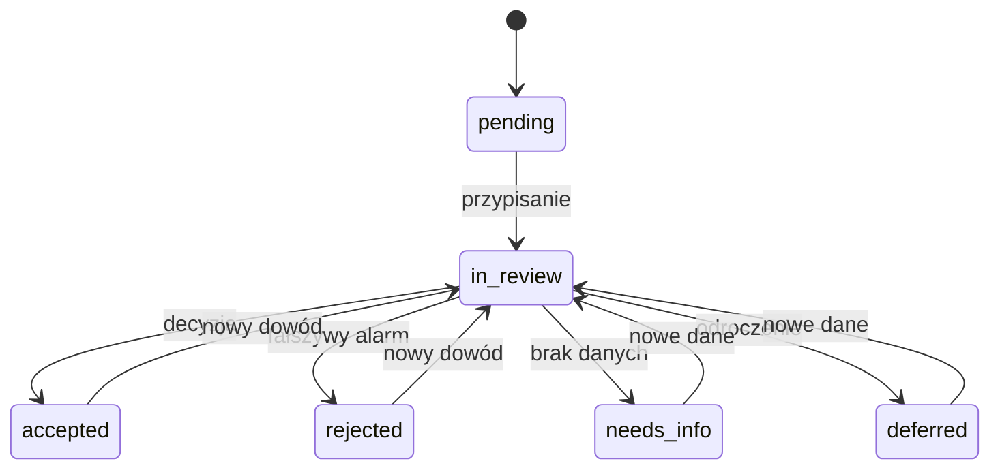

# Deduplikacja, scalanie i kolejka review

**Kontrakt lane'u `dedup-merge` dla modelu kanonicznego AED**

| | |
| --- | --- |
| Data | 2026-11-21 |
| Wersja | 1.0 (projekt do review) |
| Zakres | tożsamość, blocking, scoring, klastrowanie, survivorship, override, review, fixture'y, metryki |
| Dokument bazowy | [`../aed-data-sources-common-schema.md`](../aed-data-sources-common-schema.md) |
| Kontrakt storage | [`persistence.md`](./persistence.md), [`ingestion.md`](./ingestion.md) |
| Fixture'y | [`../fixtures/dedup/`](../fixtures/dedup/) |
| Status | projekt wykonawczy; progi i wagi wymagają kalibracji na gold secie |

> **Zasada nadrzędna:** fałszywe scalenie dwóch różnych urządzeń jest gorsze niż pozostawienie duplikatu do review. Ratownik, który pojedzie do jednego z dwóch AED, może nie znaleźć urządzenia. Automatyczne scalanie wymaga dowodu tożsamości, nie tylko bliskości.

---

## 0. Relacja do innych dokumentów

Dokument bazowy definiuje model kanoniczny i słowniki. `persistence.md` definiuje tabele i niezmienniki zapisu. `ingestion.md` definiuje typy `MatchInput`, `MatchDecision` i `NormalizedCandidate`. Ten dokument definiuje decyzje, których te dokumenty nie rozstrzygają:

1. kiedy dwa rekordy źródłowe opisują to samo urządzenie (`§3`),
2. jak znaleźć kandydatów bez porównywania wszystkich par (`§4`),
3. jak policzyć podobieństwo i kiedy podjąć decyzję (`§5`, `§6`),
4. jak scalić dane i wybrać wartość pola (`§7`),
5. jak ręcznie nadpisać decyzję algorytmu (`§8`),
6. jak pokazać konflikt człowiekowi (`§9`),
7. jak zmierzyć jakość (`§10`, `§11`).

Poza zakresem: pobieranie danych, mapowanie źródłowe, normalizacja adresów, UI mapy i publikacja na dane.gov.pl. Wejściem jest `NormalizedCandidate` z `ingestion.md`.

### 0.1. Zgodność z `persistence.md`

Ten dokument nie zmienia kontraktu storage. Używa tych samych nazw:

- `aed.id` jest `UUIDv5(AED_NAMESPACE, anchor)`. Dla OSM anchor to `node:<id>`, `way:<id>` lub `relation:<id>`. Dla rekordu lokalnego to `<source_id>:<source_record_id>`.
- `aed_alias` ma klucz główny `(source_id, source_record_id)` i kolumny `match_method`, `match_score`, `is_primary`.
- Scalanie zapisuje `aed_merge(from_aed_id, into_aed_id, decision, score, actor, created_at)` i `audit_log`.
- `aed.public_code`, `aed.ext_ident` i `aed.id` nigdy się nie zmieniają.
- Czas w SQLite to UTC epoch ms. W przykładach JSON używamy ISO tylko na granicy API i fixture'ów.

### 0.2. Decyzje zamykane przez ten dokument

| Decyzja | Rozstrzygnięcie |
| --- | --- |
| Czy `aed.id` zmienia się po scaleniu? | Nie. Zmienia się tylko `merged_into_id` scalonego. |
| Czy OpenAEDMap jest niezależnym źródłem? | Nie. To pochodna OSM i nie daje niezależnego potwierdzenia. |
| Czy bliskość wystarcza do auto-scalenia? | Nie. Wymagany jest dowód tożsamości z `§5.5`. |
| Czy jeden budynek to jedno AED? | Nie. Jeden `facility` może mieć wiele `aed`. |
| Czy konflikt pola blokuje publikację? | Nie. Publikujemy wartość preferowaną z `disputed`. Blokuje tylko konflikt tożsamości. |
| Czy override może złamać regułę? | Tak, jawnie i z audytem. Ma pierwszeństwo przed algorytmem. |
| Jaki jest próg review? | `0.60` do `0.80`, zgodnie z `admin-console.md` i `ingestion.md`. |

---

## 1. Pojęcia i niezmienniki

| Pojęcie | Znaczenie |
| --- | --- |
| `source_record` | Rekord źródłowy, klucz `(source_id, source_record_id)`. |
| `observation` | Dowód z jednej wersji `source_record`, z `observed_at` i `payload_sha256`. |
| `aed` | Kanoniczne urządzenie. Jeden fizyczny defibrylator. |
| `facility` | Miejsce fizyczne. Może zawierać wiele `aed`. |
| `alias` | Mapowanie `(source_id, source_record_id) -> aed.id`. |
| `cluster` | Zbiór rekordów źródłowych wskazujących to samo `aed`. |
| `edge` | Para rekordów z oceną i decyzją. |
| `identity anchor` | Wartość, z której wyliczono `aed.id` przy utworzeniu. |
| `survivor` | `aed`, który pozostaje po scaleniu. |
| `override` | Ręczna decyzja człowieka. |
| `conflict` | Sprzeczność wartości lub tożsamości. |
| `review item` | Element kolejki pracy człowieka. |

### 1.1. Niezmienniki

1. Jedno `source_record` wskazuje najwyżej jedno `aed`.
2. `(source_id, source_record_id)` jest unikalne i idempotentne.
3. `aed.id`, `public_code` i `ext_ident` są niezmienne po utworzeniu.
4. Rekordy nie są usuwane fizycznie. `merged_into_id` i status `removed` są tombstone'ami.
5. Każda wartość kanoniczna ma `field_provenance`.
6. `null`/`unknown` nigdy nie nadpisuje znanej wartości.
7. Brak danych nie jest dowodem negatywnym.
8. Ten sam snapshot i `as_of` dają ten sam wynik niezależnie od kolejności rekordów.
9. Override jest częścią wejścia decyzji, nie ukrytą łatką w kodzie.
10. Konflikt tożsamości nigdy nie kończy się cichym scaleniem.

### 1.2. Dwa poziomy dopasowania

| Poziom | Pytanie | Skutek |
| --- | --- | --- |
| `facility` | Czy to to samo miejsce? | Wspólny `facility_id`, budynek, adres. |
| `aed` | Czy to to samo urządzenie? | Wspólny `aed.id`, aliasy, proweniencja. |

Dwa różne urządzenia w jednym budynku mają wspólny `facility_id` i różne `aed.id`. To poprawny wynik, nie duplikat.

---

## 2. Kontrakt integracyjny

`ingestion.md` wymaga funkcji:

```ts
matchCandidate(input: MatchInput): Promise<MatchDecision>
```

Rekomendowany podział:

```text
src/server/dedup/
  matcher.ts      # matchCandidate, orkiestracja block -> score -> guard
  blocking.ts     # klucze i kandydaci
  scoring.ts      # czysta funkcja scorePair
  cluster.ts      # union-find i guard klastra
  survivorship.ts # wybór wartości pól i konflikty
  types.ts        # typy wewnętrzne, bez importu db/http
```

Mapowanie decyzji:

| Sytuacja | `MatchDecision` |
| --- | --- |
| Exact identity I1-I3 | `{ kind: "existing", aedId, method, score: null, isPrimary }` |
| Auto-merge | `{ kind: "existing", aedId, method: "geo_name", score, isPrimary }` |
| Brak kandydata | `{ kind: "create", method: "exact_id", score: null, isPrimary: true }` |
| Score 0.60-0.80, hard conflict lub guard | `{ kind: "review", score, reason }` |

`matchCandidate` dostaje jeden kandydat i samodzielnie znajduje istniejące `aed` przez blocking. Nie zapisuje aliasu. Zapis wykonuje merge engine w jednej transakcji z `aed_alias`, `aed`, `observation` i `field_provenance`.

---

## 3. Tożsamość

### 3.1. Klucze źródłowe

```text
record_key = source_id + ":" + source_record_id
```

Normalizacja:

- OSM: `node/123`, `way/456`, `relation/789`, małe litery, bez zer wiodących.
- OpenAEDMap: `openaedmap:{node_id}` oraz `external_ids.osm = node/{node_id}`.
- Przemyśl: `przemysl:{resource_id}:{row_id}`. Numer AED z `name` nie jest kluczem.
- Krosno, Marki: `{source_id}:{Numer Id}`.
- Warszawa: `warszawa:{defibrillator_id}`.

### 3.2. Hierarchia dowodów

| Poziom | Dowód | Automatycznie | Uwagi |
| --- | --- | --- | --- |
| I1 | To samo `(source_id, source_record_id)` | upsert | To nie deduplikacja. |
| I2 | Ten sam `external_ids.osm` | tak | OpenAEDMap i inne pochodne OSM. |
| I3 | Ten sam jawny `external_id` z unikalnej przestrzeni | tak | Wymaga rejestru namespace'ów. |
| I4 | Ten sam `manufacturer + serial_number` | tak, jeśli <= 250 m | Dalej: review, możliwe przeniesienie. |
| I5 | `label` + `operator` + adres/odległość | tylko review lub auto po score | Sam label nie jest unikalny. |
| I6 | Adres + odległość + nazwa/operator | auto po score | Wymaga evidence gate. |
| I7 | Tylko odległość lub tylko nazwa | nigdy auto | review lub separate. |

### 3.3. `aed.id`, `public_code`, `ext_ident`

```text
OSM:       aed.id = UUIDv5(AED_NAMESPACE, "node:<id>")
Lokalny:   aed.id = UUIDv5(AED_NAMESPACE, "<source_id>:<source_record_id>")
public_code = "PL-AED-" + woj + "-" + base32(first_40_bits(aed.id))
ext_ident   = "aed-" + hex32(aed.id)
```

Zasady:

- Anchor wybierany jest raz, przy tworzeniu `aed`. Kolejność: OSM ref, jawny external id, klucz źródłowy, serial, manual.
- Dołączenie lepszego anchora nie zmienia `aed.id`. Nowy rekord staje się aliasem.
- `public_code` nie zmienia się przy zmianie województwa. Stabilność linku jest ważniejsza.
- Kolizja `public_code` rozszerza base32 o kolejne bity, nie zmienia `aed.id`.
- `aed` przechowuje `identity_anchor_kind` i `identity_anchor_value` tylko diagnostycznie. Nie przelicza ich przy imporcie.

### 3.4. `facility_id`

```text
facility_key =
  teryt_commune + "|" + simc + "|" + ulic + "|" + house_number   # komplet
  else normalized(address_text) + "|" + city
  else geohash7(representative_point)
  else "aed:" + aed.id
facility_id = UUIDv5(FACILITY_NAMESPACE, facility_key)
```

Jeden adres to zwykle jedno `facility`. Dwa różne `facility_type` pod tym samym adresem mogą pozostać jednym miejscem. To grupowanie fizyczne, nie klasyfikacja prawna.

### 3.5. Split, unmerge, przekierowania

- Merge nie usuwa obserwacji. `aed_merge` zapisuje `from_aed_id`, `into_aed_id`, `decision`, `score`, `actor`.
- Scalone `aed` ma `merged_into_id` na survivora i `is_public = 0`. Łańcuch jest spłaszczany w tej samej transakcji.
- Split jest ręczny. Tworzy nowe `aed.id` i przenosi jawne aliasy. Stary `aed` zachowuje resztę.
- Unmerge odwraca merge na podstawie `aed_merge`, `aed_alias` i `observation`. Nie zgaduje z podobieństwa.
- Stare `public_code` scalonego przekierowuje na `public_code` survivora. `aed.id` w API zwraca `sameAs`.

---

## 4. Blocking

### 4.1. Cel

Blocking redukuje pary z `O(n^2)` do `O(n * k)` przy wysokim `candidate recall`. Nie podejmuje decyzji. Domyślny promień kandydatów to 100 m, zgodnie z `ingestion.md`. Scoring obsługuje do 150 m, bo para może zostać znaleziona przez adres, serial lub external id.

### 4.2. Klucze

| Klucz | Definicja | Rola |
| --- | --- | --- |
| `osm` | `external_ids.osm` | Pochodne OSM, najwyższa precyzja. |
| `external` | `namespace:value` | Jawne identyfikatory. |
| `serial` | `manufacturer|serial_number` | Ten sam numer seryjny. |
| `label` | `normalized(label)` + `city` lub `operator` | Lokalne numery AED. |
| `geo` | `geohash7(lat, lon)` i 8 sąsiadów, filtr 100 m | Domyślny promień. Pary z exact/address/serial mogą dojść do 150 m. |
| `address` | `teryt_commune|ulic|house_number` lub `street|house|city` | Działa bez geometrii. |
| `operator` | `nip` lub `regon` lub `normalized(operator_name)` | Ten sam podmiot. |
| `phone` | `E.164(phone)` | Kontakt organizacyjny. |
| `name` | `phonetic_token(name)` + `city` | Fallback bez geometrii. |

Zasady:

- `address` nie zawiera współrzędnych. Rekord z odwróconymi osiami nadal znajdzie kandydata.
- `name` sam nie prowadzi do auto-merge.
- Wartości są normalizowane: małe litery, bez diakrytyków, skrócone białe znaki, ujednolicone skróty ulic.
- `derived` (OpenAEDMap, aedmapa, Ratujemy) nie jest niezależnym źródłem w `f_x`.

### 4.3. Pipeline

```text
1. Upsert source_record i observation.
2. Policz klucze dla nowego lub zmienionego rekordu.
3. Pobierz kandydatów z block_index po każdym kluczu.
4. Odfiltruj ten sam record_key.
5. Zbuduj unikalne pary (min(record_key), max(record_key)).
6. Oznacz exact identity I1-I3 jako same_entity bez scoringu.
7. Dla pozostałych par uruchom scoring.
```

`block_index(block_key, record_key, generated_at)` jest materializowany w SQLite. Przebudowa jest deterministyczna.

### 4.4. Limity

| Sytuacja | Zachowanie |
| --- | --- |
| Blok `geo` > 500 rekordów | `block_overflow`, deterministyczne próbkowanie do 500. |
| Rekord > 2000 kandydatów | Limit po sortowaniu: exact, serial, address, geo, reszta. |
| Brak geometrii i adresu | Użyj `operator` i `name`. Brak obu: `unblockable`. |
| Współrzędne poza Polską | Nie licz `geo`. Zachowaj `address` i `name`. |
| Ten sam `source_id` | Domyślnie nie porównuj różnych rekordów tego samego źródła. |

### 4.5. Kontrakt kandydata (wewnętrzny)

```ts
type BlockedPair = {
  a: string;                  // record_key
  b: string;
  blockKeys: string[];
  reason: "osm" | "external" | "serial" | "label" | "geo" | "address" | "operator" | "phone" | "name";
  rank: number;
};
```

Blocking zwraca powód, bo jest potrzebny w review i metrykach.

---

## 5. Scoring pary

### 5.1. Zasady

1. Score należy do `[0, 1]`.
2. Brak danych obniża score. Wagi są stałe i sumują się do 1.
3. Sprzeczności znanych wartości dają karę i mogą zablokować auto-merge.
4. Score nie jest prawdopodobieństwem. Progi kalibrujemy na gold secie.
5. Score ma `scoring_version`. Zmiana wag wymaga nowej wersji i raportu.

### 5.2. Cechy

| Cecha | Symbol | Wartość 0..1 |
| --- | --- | --- |
| Odległość | `f_d` | 1.0 dla `d_eff <= 5 m`; 0.9 dla <= 15 m; 0.6 dla <= 35 m; 0.3 dla <= 75 m; 0 dla > 150 m. |
| Adres | `f_a` | 1.0 dokładny znormalizowany adres z TERYT; 0.8 `street+house`; 0.5 sama ulica; 0.3 miasto i podobna nazwa; 0 brak lub sprzeczność. |
| Identyfikator | `f_i` | 1.0 `manufacturer+serial`; 0.9 jawny external id; 0.7 label+operator; 0.4 label; 0 brak. |
| Operator | `f_o` | 1.0 NIP/REGON; 0.85 nazwa; 0.5 typ; 0 brak. |
| Nazwa | `f_n` | 1.0 Jaro-Winkler >= 0.92; 0.8 >= 0.80; 0.5 >= 0.65; 0 poniżej. |
| Kontakt | `f_c` | 1.0 telefon lub e-mail; 0.7 domena; 0 brak. |
| Typ miejsca | `f_f` | 1.0 ten sam; 0.5 zgodna grupa; 0 sprzeczność. |
| Typ urządzenia | `f_t` | 1.0 oba `public_aed`; 0.5 brak lub `unknown`; 0 `trainer` vs `public_aed`. |
| Niezależność | `f_x` | 1.0 >= 2 niezależne źródła zgodne w >= 2 silnych polach; 0.5 jedno; 0 pochodne lub to samo źródło. |

Korekta odległości:

```text
p1 = coord_precision_m(record1) or 0
p2 = coord_precision_m(record2) or 0
d_eff = max(0, haversine(record1, record2) - min(50, (p1 + p2) / 2))
```

### 5.3. Wzór

```text
score = clamp01(
    0.28 * f_d
  + 0.22 * f_a
  + 0.20 * f_i
  + 0.10 * f_o
  + 0.08 * f_n
  + 0.04 * f_c
  + 0.04 * f_f
  + 0.02 * f_t
  + 0.02 * f_x
  - penalties
)
```

Kary:

| Sytuacja | Kara | Auto-merge |
| --- | --- | --- |
| Różne znane `serial_number` tego samego producenta | -0.50 | zablokowany |
| Różne znane NIP/REGON | -0.15 | zablokowany, jeśli > 50 m |
| Różne znane `house_number` na tej samej ulicy | -0.10 | zablokowany, jeśli > 50 m |
| `trainer` vs `public_aed` | -0.40 | zablokowany |
| Ten sam label i różne seriale | dodatkowo -0.10 | zablokowany, review tożsamości |
| Różny `manufacturer` lub `model` | -0.10 | nie blokuje sam |
| Ten sam label w różnych miastach | -0.20 | zablokowany |

### 5.4. Decyzje

| Warunek | Decyzja |
| --- | --- |
| Exact identity I1-I3 | `existing` |
| `score >= 0.80`, evidence gate, brak hard conflict | `existing` (auto) |
| `0.60 <= score < 0.80` lub hard conflict do oceny | `review` |
| `score < 0.60` i brak hard conflict | `create` (separate) |
| Hard conflict bez dowodu tożsamości | `create` (separate) |
| Hard conflict z dowodem tożsamości | `review` |

Hard conflict to każda sytuacja zablokowanego auto-merge oraz `d_eff > 250 m` bez exact identity lub dokładnego adresu.

### 5.5. Evidence gate

Auto-merge wymaga co najmniej jednego dowodu:

1. `f_i >= 0.9`,
2. `f_a = 1.0` i `f_d >= 0.6`,
3. `f_d = 1.0` i (`f_o >= 0.85` lub `f_n >= 0.8` lub `f_i >= 0.7`),
4. ręczny `force_merge`.

Samo `score >= 0.80` nie wystarcza. Dwa rekordy z tym samym operatorem i podobną nazwą, ale bez adresu i identyfikatora, nie powinny się automatycznie scalać.

### 5.6. Facility score

```text
facility_score = clamp01(0.45*f_a + 0.35*f_d + 0.10*f_n + 0.10*f_o)
```

| Warunek | Decyzja |
| --- | --- |
| `>= 0.80` i (`f_a = 1.0` lub `f_d >= 0.9`) | `same_facility` |
| `>= 0.55` | `review_facility` |
| inaczej | `separate_facility` |

Auto-merge urządzenia wymusza `same_facility`. `same_facility` bez auto-merge urządzenia daje wiele `aed` pod jednym `facility`.

### 5.7. Przykłady liczbowe

| Przypadek | f_d | f_a | f_i | f_o | f_n | f_c | f_f | f_t | f_x | Score | Decyzja |
| --- | --- | --- | --- | --- | --- | --- | --- | --- | --- | --- | --- |
| Ten sam serial, 20 m, adres | 0.9 | 1.0 | 1.0 | 0.85 | 0.8 | 0 | 1.0 | 1.0 | 0.5 | 0.916 | auto |
| Ten sam label i operator, 20 m, adres | 0.9 | 1.0 | 0.7 | 0.85 | 0.8 | 0 | 1.0 | 1.0 | 0.5 | 0.831 | auto |
| Dwa urządzenia, 3 m, różne seriale | 1.0 | 1.0 | 0 | 0.85 | 0.8 | 0 | 1.0 | 1.0 | 0.5 | 0.834 - 0.50 = 0.334 | osobne, same facility |
| Dwa budynki, 40 m, różne adresy | 0.6 | 0 | 0 | 0 | 0.5 | 0 | 0.5 | 1.0 | 0 | 0.278 | separate |
| Adres bez geometrii, label+operator | 0 | 1.0 | 0.7 | 0.85 | 0.8 | 0 | 1.0 | 1.0 | 0.5 | 0.619 | review |
| Operator i telefon, brak geometrii | 0 | 0 | 0 | 0.85 | 0.5 | 1.0 | 0.5 | 1.0 | 0.5 | 0.286 | separate |

### 5.8. Kalibracja

- `scoring_version = "1.0"` dla tabeli `§5.3`.
- Kalibracja na `dev`, walidacja na `holdout`.
- Nie zmieniaj wag i progów w jednym kroku.
- Próg auto-merge nie może spaść poniżej 0.75 bez zgody właściciela danych.
- Zmiana wymaga raportu z `§11`.

---

## 6. Klastrowanie

### 6.1. Algorytm

```text
clusters = union_find(all records)
apply_all(exact_identity_edges)            # I1-I3, po walidacji aliasu
for edge in auto_edges sorted by (-score, a, b):
    if override_do_not_merge(edge): continue
    if not evidence_gate(edge): queue_review(edge); continue
    if find(a) == find(b): continue
    if not cluster_guard_ok(find(a), find(b), edge):
        queue_review(edge, type="cluster_guard")
        continue
    union(find(a), find(b))
for edge in review_edges sorted by (-score, a, b):
    queue_review(edge)                     # bez unii
for cluster in clusters:
    verify_alias_uniqueness(cluster)
    verify_single_facility(cluster)
```

Review edge nie jest automatycznie akceptowany. Po akceptacji człowieka guard jest sprawdzany ponownie.

### 6.2. Guard klastra

Unia jest odrzucana, jeśli po jej wykonaniu:

1. maksymalna odległość między dowolnymi dwoma członkami przekracza `250 m`,
2. średnica klastra przekracza `400 m`,
3. klaster zawiera dwa różne znane `serial_number` tego samego producenta,
4. klaster ma więcej niż `25` rekordów,
5. klaster ma więcej niż `8` różnych `label` lub `5` różnych `serial_number`,
6. co najmniej dwa rekordy wskazują różne `facility_id` przy odległości > 100 m,
7. rekord ma już alias do innego `aed`.

Guard 3 jest twardy nawet dla exact identity I2. Wtedy powstaje `identity_conflict`, a nie nowe urządzenie.

### 6.3. Determinizm

- Sortowanie: `score` malejąco, `a`, `b`, `edge_kind`.
- Union-find: mniejszy `record_key` jest rootem technicznym.
- Survivor wybierany osobno (`§7.2`).
- Iteracja po rekordach sortowana po `record_key`.
- `as_of` jest jedynym źródłem „teraz”. Zakaz `Date.now()` w scoringu.

### 6.4. Złożoność

Dla `n` rekordów i `k` kandydatów: `O(n*k)` blocking i scoring, guard `O(|cluster|^2)` przy `|cluster| <= 25`. Cel: 100 tys. rekordów w < 5 minut na jednym rdzeniu.

---

## 7. Scalanie i survivorship

### 7.1. Transakcja

```text
1. BEGIN IMMEDIATE.
2. Sprawdź unikalność aliasów i wybierz survivor.
3. Scal facility, jeśli trzeba.
4. Przenieś aliasy, observations, media, field_provenance.
5. Policz wartości kanoniczne i proweniencję (§7.3).
6. Zapisz konflikty i review itemy.
7. Zapisz aed_merge i audit_log.
8. Ustaw merged_into_id scalonego, is_public = 0.
9. COMMIT.
```

Idempotencja: powtórzenie merge nie tworzy nowych aliasów ani obserwacji.

### 7.2. Survivor

Ranking malejąco:

1. `identity_anchor_priority` (OSM > official > community > aggregator > app),
2. `created_at` rosnąco,
3. `public_code` rosnąco,
4. `aed.id` rosnąco.

Survivor nie może być `removed`, chyba że wszystkie są `removed`.

### 7.3. Wartość pola

```text
value_score = 0.50 * source_trust
            + 0.20 * recency
            + 0.20 * verification
            + 0.10 * specificity
```

| Składnik | Wartości |
| --- | --- |
| `source_trust` | authoritative 1.0; official_local 0.85; community 0.60; aggregator 0.50; derived 0.50; app 0.30 |
| `recency` | <= 180 dni 1.0; <= 365 0.85; <= 730 0.65; <= 1460 0.35; starsze 0.10; brak 0.0 |
| `verification` | field_survey 1.0; operator 0.90; official_register 0.80; community 0.50; import 0.20 |
| `specificity` | dokładna 1.0; znormalizowana 0.85; ogólna 0.50; brak 0.0 |

Dodatkowe reguły:

- `derived` nie wygrywa z upstreamem OSM. Pochodna jest aliasem, nie niezależnym dowodem.
- `source_trust` może być modyfikowany per pole, zgodnie z tabelą poniżej.

| Pole | Preferencja | Konflikt |
| --- | --- | --- |
| `lat`, `lon` | field_survey, official_local, community z precyzją | > 50 m: `disputed`, wybierz wyższy score, pokaż oba. |
| `address` | official_local, authoritative | różny `house_number`: `disputed`, wybierz urzędowy. |
| `name` | official_local, authoritative | różne nazwy: `disputed`, wybierz urzędowy, zachowaj alias nazwy. |
| `status` | authoritative, official_local, operator | `active` vs `removed`: `disputed`, `removed` tylko świeże i zweryfikowane. |
| `access_type` | field_survey, community | konflikt: `disputed`, wybierz bardziej restrykcyjny. |
| `opening_hours` | field_survey, community, official_local | konflikt: `disputed`, wybierz świeższy z weryfikacją. |
| `manufacturer`, `model`, `serial_number` | operator, field_survey, official_local | różne seriale: `disputed`, nie nadpisuj, pokaż oba. |
| `operator` | authoritative, official_local | różne NIP: `disputed`, wybierz urzędowy. |
| `photo_url` | wszystkie | Zachowaj wszystkie media, primary według score. |
| `license_id`, `attribution` | wszystkie | Unia licencji i atrybucji, nie wybór. |

### 7.4. Reguły wartości

1. `null`, `unknown`, pusty string i `[]` nigdy nie wygrywają z niepustą wartością.
2. Wszystkie puste: `null` z proweniencją `no_data`.
3. `disputed` nie jest cicho wybierane. Zapisujemy `preferred_value` i `conflict_id`.
4. `removed` wymaga `field_survey`, `operator` lub `official_register` i `observed_at` <= 24 miesiące. Inaczej poprzedni status i `warning`.
5. `access_type` przy konflikcie: `private`, `key`, `code`, `dispatcher`, `customers`, `permissive`, `public`, `unknown`. Bardziej restrykcyjny wygrywa.
6. `is_24_7` tylko z `opening_hours` lub jawnego pola. Nie zgaduj z opisu.
7. `serial_number` jest przechowywany, ale redagowany w eksporcie publicznym.

### 7.5. Tie-breaker

1. wyższy `source_trust`,
2. nowszy `observed_at`,
3. wyższy `confidence`,
4. mniejszy `record_key`.

### 7.6. Proweniencja

Dla każdego pola:

```json
{
  "entity_type": "aed",
  "entity_id": "uuid",
  "field_name": "status",
  "value_json": "\"active\"",
  "source_record_id": "sr-uuid",
  "observed_at": "2026-06-01T00:00:00Z",
  "confidence": 0.82,
  "value_score": 0.74,
  "selection_reason": "highest_value_score",
  "conflict_id": null
}
```

`field_provenance` ma klucz `(entity_type, entity_id, field_name, source_record_id)`. Ręczna edycja to `field_pin` z proweniencją `manual`.

---

## 8. Override

### 8.1. Tabela

```sql
CREATE TABLE merge_override (
  id              TEXT PRIMARY KEY,
  kind            TEXT NOT NULL,          -- force_merge | do_not_merge | field_pin | force_status | ignore_source | ignore_field
  scope           TEXT NOT NULL,          -- pair | cluster | field | source
  subject_a       TEXT NOT NULL,
  subject_b       TEXT,
  field_name      TEXT,
  value_json      TEXT,
  reason          TEXT NOT NULL,
  actor           TEXT NOT NULL,
  created_at      INTEGER NOT NULL,       -- UTC ms
  expires_at      INTEGER,
  active          INTEGER NOT NULL DEFAULT 1
);
```

### 8.2. Rodzaje

| `kind` | Działanie |
| --- | --- |
| `force_merge` | Łączy mimo niskiego score. Guard nadal działa, chyba że `admin` jawnie go ominie. |
| `do_not_merge` | Blokuje unię. Ma pierwszeństwo przed `force_merge`. |
| `field_pin` | Ustawia wartość i blokuje automatyczne nadpisanie. Nowa obserwacja tworzy `field_conflict` info. |
| `force_status` | Wymusza status z datą ważności. |
| `ignore_source` | Wyłącza źródło z głosowania, nie usuwa danych. |
| `ignore_field` | Wyłącza konkretne pole źródła, np. złe współrzędne Marki. |

### 8.3. Precedencja

```text
active field_pin
  > active do_not_merge
  > active force_merge
  > exact identity
  > auto_merge
  > review
```

`do_not_merge` przed `force_merge` jest celowe. Zmiana wymaga osobnej, audytowanej akcji. Wygasły override nie działa, ale pozostaje w historii.

---

## 9. Kolejka review i konflikty

### 9.1. Zgodność z panelem

`admin-console.md` definiuje `review_item.type` i statusy `pending`, `accepted`, `rejected`, `needs_info`. Ten dokument rozszerza tabelę, nie tworzy konkurencyjnej:

- `type`: `duplicate_candidate`, `coordinate_conflict`, `bad_coordinates`, `field_conflict`, `missing_license`, `removed_candidate`, `cluster_guard`, `identity_conflict`, `user_report`, `split_request`.
- `status`: dodajemy `in_review` i `deferred`, zachowując cztery statusy panelu.
- Dodatkowe kolumny: `fingerprint`, `severity`, `priority`, `revision`, `candidate_json`, `conflict_json`, `suggested_action`, `assigned_to`, `occurrences`, `last_seen_at`.

Fixture'y używają pola `kind` jako semantycznej nazwy. W bazie mapujemy je 1:1 na `review_item.type`.

### 9.2. Kiedy tworzyć item

| Sytuacja | `type` | `severity` |
| --- | --- | --- |
| Score 0.60-0.80 | `duplicate_candidate` | warning |
| Guard odrzucił unię | `cluster_guard` | blocking |
| Różne seriale przy tym samym labelu lub external id | `identity_conflict` | blocking |
| Różne wartości pola | `field_conflict` | warning, blocking dla status/access |
| Złe współrzędne | `bad_coordinates` lub `coordinate_conflict` | warning |
| Błąd źródła | `missing_license` lub `source_anomaly` | warning |
| Zgłoszenie użytkownika | `user_report` | warning |
| Split lub unmerge | `split_request` | blocking |
| Nowa obserwacja sprzeczna z pinem | `field_conflict` | info |

### 9.3. Tabele

```sql
CREATE TABLE review_item (
  id              TEXT PRIMARY KEY,
  fingerprint     TEXT NOT NULL UNIQUE,
  type            TEXT NOT NULL,
  status          TEXT NOT NULL,       -- pending | in_review | accepted | rejected | needs_info | deferred
  severity        TEXT NOT NULL,       -- blocking | warning | info
  priority        REAL NOT NULL,
  revision        INTEGER NOT NULL DEFAULT 1,
  aed_id_a        TEXT REFERENCES aed(id),
  aed_id_b        TEXT REFERENCES aed(id),
  source_id       TEXT REFERENCES source(id),
  entity_type     TEXT,
  entity_id       TEXT,
  candidate_json  TEXT NOT NULL,
  conflict_json   TEXT,
  reason_json     TEXT NOT NULL,
  suggested_action TEXT,
  assigned_to     TEXT,
  resolved_by     TEXT,
  resolved_at     INTEGER,
  resolution      TEXT,
  note            TEXT,
  created_at      INTEGER NOT NULL,
  updated_at      INTEGER NOT NULL,
  last_seen_at    INTEGER NOT NULL,
  occurrences     INTEGER NOT NULL DEFAULT 1
);

CREATE TABLE review_conflict (
  id              TEXT PRIMARY KEY,
  review_item_id  TEXT NOT NULL REFERENCES review_item(id),
  conflict_type   TEXT NOT NULL,       -- value | existence | identity | structural | provenance | validation
  field_name      TEXT,
  severity        TEXT NOT NULL,
  candidates_json TEXT NOT NULL,
  preferred_json  TEXT,
  status          TEXT NOT NULL,       -- open | auto_resolved | resolved | deferred
  resolution_json TEXT
);

CREATE TABLE identity_decision (
  id              TEXT PRIMARY KEY,
  fingerprint     TEXT NOT NULL,
  a               TEXT NOT NULL,
  b               TEXT NOT NULL,
  decision        TEXT NOT NULL,       -- merge | separate | split
  actor           TEXT NOT NULL,
  reason          TEXT,
  created_at      INTEGER NOT NULL,
  active          INTEGER NOT NULL DEFAULT 1,
  UNIQUE (fingerprint)
);
```

### 9.4. Fingerprint

```text
fingerprint = sha256(
  type + "|" +
  sorted(member_record_keys).join(",") + "|" +
  coalesce(field_name, "") + "|" +
  normalized_candidate_values
)
```

- Ten sam problem zwiększa `occurrences` i `last_seen_at`.
- Zmiana materiału (nowy kandydat, score o > 0.05, nowa wartość) tworzy `revision += 1` i otwiera item.
- Decyzja człowieka w `identity_decision` jest konsultowana przed algorytmem.
- Zmiana fingerprintu unieważnia starą decyzję. To celowe: nowe dowody mogą zmienić wynik.

### 9.5. Priorytet

```text
priority = 100 * clamp01(
    0.35 * severity
  + 0.25 * impact
  + 0.20 * uncertainty
  + 0.10 * age
  + 0.10 * exposure
)
```

| Składnik | Wartość |
| --- | --- |
| `severity` | blocking 1.0; warning 0.6; info 0.3 |
| `impact` | `min(1, affected_records / 20)` |
| `uncertainty` | merge: `1 - min(1, abs(score - 0.80) / 0.25)`; pole: `1 - min(1, score_gap / 0.20)` |
| `age` | `min(1, days_open / 30)` |
| `exposure` | 1.0 dla status/access/coords lub rekordu publicznego; 0.5 dla opisowych |

SLA: blocking 1 dzień roboczy, warning 5 dni, info 30 dni.

### 9.6. Typy konfliktów

| Typ | Przykład | Rozstrzygnięcie |
| --- | --- | --- |
| `value` | Dwa różne adresy. | wartość, `unknown`, `defer` |
| `existence` | `active` vs `removed`. | status, `disputed`, `force_status` |
| `identity` | Ten sam label, różne seriale. | merge, separate, split; blokuje auto |
| `structural` | Jeden budynek, wiele urządzeń. | same_facility, wiele `aed` |
| `provenance` | CC BY vs CC0. | obie atrybucje, bardziej restrykcyjna licencja eksportu |
| `validation` | Współrzędne poza Polską. | odrzuć z mapy, zachowaj do audytu |

### 9.7. Cykl życia



`accepted`, `rejected` i `deferred` wymagają uzasadnienia. Każda akcja tworzy `audit_log`.

### 9.8. Akcje

| Akcja | Skutek |
| --- | --- |
| `accept_merge` | Merge z guardem. |
| `reject_merge` | `identity_decision=separate` i `do_not_merge`. |
| `accept_value` | Wartość kanoniczna i opcjonalny `field_pin`. |
| `mark_unknown` | `null`/`unknown`, konflikt rozwiązany. |
| `split` | Nowe `aed.id`, przeniesienie aliasów. |
| `defer` | Item otwarty z powodem. |
| `ignore_source_field` | Wyłączenie pola źródła z głosowania. |
| `reopen` | Otwarcie zamkniętego itemu. |

Akcje destrukcyjne (`split`, `force_merge`, `force_status`) wymagają `notes` i roli `admin`. Domyślna akcja dla `identity_conflict` to `separate`. Dla `field_conflict` domyślnie nie nadpisuj, tylko pokaż `disputed`.

### 9.9. UI

Review item pokazuje:

1. dwa rekordy obok siebie z proweniencją i linkiem do źródła,
2. diff pól, nie surowy JSON,
3. mapę z punktami i okręgiem niepewności,
4. breakdown score: cecha, waga, kara, wynik,
5. `block_keys` i powód kandydata,
6. sugerowaną i bezpieczną akcję domyślną,
7. konflikty i severity,
8. historię decyzji.

---

## 10. Fixture'y

### 10.1. Lokalizacja

```text
AED/docs/fixtures/dedup/
  README.md
  fixture.schema.json
  identity.cases.json
  merge.cases.json
  review.cases.json
  metrics.json
```

### 10.2. Format case'a

```json
{
  "version": "1.0",
  "suite": "identity",
  "cases": [
    {
      "id": "id-osm-derived",
      "tags": ["identity", "osm", "exact"],
      "split": "dev",
      "as_of": "2026-11-21T00:00:00Z",
      "records": [],
      "reimport": [],
      "overrides": [],
      "submissions": [],
      "source_anomalies": [],
      "expected": {
        "clusters": [],
        "facility_groups": [],
        "pair_decisions": [],
        "review_items": [],
        "canonical": [],
        "validation_issues": []
      }
    }
  ]
}
```

### 10.3. Kontrakt runnera

1. Ładuje wszystkie `*.cases.json` i waliduje względem `fixture.schema.json`.
2. Dla każdego case'a tworzy izolowany stan.
3. Uruchamia identity, blocking, scoring, clustering, merge i review.
4. Porównuje klastry jako zbiory `record_key`, posortowane po minimum.
5. Porównuje decyzje par i przedziały score.
6. Porównuje review itemy po `kind`, `field_name`, `severity`.
7. Porównuje wskazane pola kanoniczne i proweniencję.
8. Uruchamia case trzy razy z permutacją kolejności i wymaga identycznego wyniku.
9. Zapisuje raport metryk i porównuje z `metrics.json`.

Runner nie używa sieci ani `Date.now()`. `as_of` pochodzi z case'a.

### 10.4. Zakres

| Suita | Zakres |
| --- | --- |
| `identity` | exact, pochodne OSM, dwa urządzenia w budynku, ten sam serial daleko, kolizja labeli, odwrócone osie, adres bez geometrii, operator i telefon bez geometrii, re-import. |
| `merge` | adres, status, dostęp, null vs unknown, licencje, konflikt seriali, świeżość, wiele urządzeń w facility. |
| `review` | Marki, Przemyśl 7639, zgłoszenie użytkownika, field_pin, do_not_merge, force_merge, source anomaly, cluster guard, poza Polską. |

### 10.5. Dev i holdout

- `dev`: 70% przypadków do kalibracji.
- `holdout`: 30% oznaczonych `"split": "holdout"`, tylko do raportu końcowego.
- Po obejrzeniu holdout nie zmieniaj wag. Przenieś błąd do dev i powtórz kalibrację na nowym holdout.
- Gold set rzeczywisty: pary z OSM, OpenAEDMap, Przemyśl, Krosno, Marki i Warszawa, opisane przez dwie osoby i rozstrzygnięte przez adjudykatora. Fixture'y syntetyczne są uzupełnieniem.

---

## 11. Metryki

### 11.1. Definicje

Niech `P` to pary uznane za to samo urządzenie, `T` to pary prawdziwe.

| Metryka | Wzór | Znaczenie |
| --- | --- | --- |
| `pairwise_precision` | `|P ∩ T| / |P|` | jakość scaleń |
| `pairwise_recall` | `|P ∩ T| / |T|` | pokrycie duplikatów |
| `pairwise_f1` | `2PR/(P+R)` | kompromis |
| `b3_precision` | średnia `|pred ∩ true| / |pred|` | jakość klastrów |
| `b3_recall` | średnia `|pred ∩ true| / |true|` | pokrycie klastrów |
| `candidate_recall` | `|candidate ∩ T| / |T|` | czy blocking nie gubi |
| `reduction_ratio` | `1 - |candidate| / |all|` | oszczędność |
| `auto_merge_precision` | poprawne auto-unie / wszystkie auto-unie | bezpieczeństwo |
| `auto_merge_coverage` | poprawne auto-unie / wszystkie prawdziwe pary | automatyzacja |
| `false_merge_rate` | błędne unie / wszystkie unie | ryzyko |
| `false_split_rate` | brakujące pary / prawdziwe pary | pozostałe duplikaty |
| `review_rate` | rekordy w review / wszystkie | obciążenie |
| `review_precision` | potwierdzone / rozpatrzone | szum kolejki |
| `field_accuracy` | poprawne pola / sprawdzone | survivorship |
| `provenance_completeness` | pola z proweniencją / wszystkie | audytowalność |
| `conflict_recall` | wykryte / prawdziwe konflikty | ukrywanie sprzeczności |
| `conflict_precision` | prawdziwe / wykryte konflikty | fałszywe alarmy |
| `decision_stability` | identyczne / permutacje | determinizm |
| `p95_latency_per_10k` | 95. percentyl dla 10 tys. | wydajność |
| `p95_candidates_per_record` | 95. percentyl kandydatów | rozmiar grafu |

### 11.2. Progi

| Metryka | Dev | Holdout | Gate |
| --- | --- | --- | --- |
| `pairwise_precision` | 0.98 | 0.99 | tak |
| `pairwise_recall` | 0.95 | 0.95 | tak |
| `b3_f1` | 0.97 | 0.98 | tak |
| `candidate_recall` | 0.98 | 0.98 | tak |
| `auto_merge_precision` | 1.00 | 1.00 | tak |
| `auto_merge_coverage` | 0.80 | 0.80 | nie |
| `false_merge_rate` | 0.00 | 0.00 | tak |
| `review_rate` | <= 0.08 | <= 0.08 | nie |
| `review_precision` | 0.80 | 0.80 | nie |
| `field_accuracy` | 0.98 | 0.98 | tak |
| `provenance_completeness` | 1.00 | 1.00 | tak |
| `decision_stability` | 1.00 | 1.00 | tak |
| `p95_latency_per_10k` | <= 60 s | <= 60 s | nie |

`auto_merge_precision = 1.00` na fixture'ach jest wymagane. Na produkcji próg operacyjny to `>= 0.995`; każde odchylenie jest incydentem.

### 11.3. Raport

```json
{
  "scoring_version": "1.0",
  "fixture_version": "1.0",
  "as_of": "2026-11-21T00:00:00Z",
  "split": "holdout",
  "metrics": {},
  "thresholds": {},
  "failures": [],
  "cases_total": 0,
  "cases_passed": 0
}
```

Raport jest artefaktem CI. Zmiana wag bez raportu jest niekompletna.

---

## 12. Kolejność wdrożenia

1. Fixture'y i runner.
2. Aliasy, exact identity, `aed_merge`.
3. Blocking i `block_index`.
4. Scoring jako czysta funkcja.
5. Clustering i guard.
6. Merge, survivorship, `field_provenance`.
7. Review queue i override.
8. Kalibracja na gold secie.

### 12.1. Definition of done

- [ ] Wszystkie fixture'y przechodzą z `decision_stability = 1.0`.
- [ ] `auto_merge_precision = 1.0` na dev i holdout.
- [ ] `candidate_recall >= 0.98`.
- [ ] `provenance_completeness = 1.0`.
- [ ] Re-run na tym samym snapshocie nie tworzy nowych rekordów ani itemów.
- [ ] Merge jest idempotentny i odwracalny przez unmerge.
- [ ] Konflikt tożsamości nigdy nie kończy się cichym scaleniem.
- [ ] Każda wartość kanoniczna ma `source_record_id`.
- [ ] Override i decyzje review są w `audit_log`.
- [ ] Eksport nie ujawnia seriali ani danych osobowych.

---

## 13. Otwarte pytania

1. Kalibracja wag `§5.3` na gold secie, bez równoczesnej zmiany progów.
2. Czy jeden adres to zawsze jedno `facility`, czy rozdzielać budynki i wejścia? Rekomendacja: adres/budynek.
3. `public_code` przy zmianie województwa: niezmienny. Alternatywa łamie linki.
4. Serial w bazie: przechowywać, redagować w eksporcie. Potrzebna decyzja prawna.
5. Licencja bazy mieszanej: całość ODbL albo dwa eksporty. Dedup nie może ukryć pochodzenia ODbL.
6. Review rate 8% może być nierealny dla 18 tys. rekordów OSM. Zmierzyć i dostroić blocking.
7. Guard `O(n^2)` przy dużych klastrach: jeśli wąskie gardło, inkrementalny max-distance.

---

## 14. Przykłady

### 14.1. OpenAEDMap i OSM

Ten sam `external_ids.osm=node/123`, 0 m. `existing`, jeden `aed`, `f_x=0`, bo pochodna. OpenAEDMap nie zwiększa zgodności między źródłami.

### 14.2. Dwa AED w jednym budynku

3 m, ten sam adres, różne seriale. Kara -0.50, hard conflict, `create`. Wynik: jedno `facility`, dwa `aed`. To nie jest review tożsamości.

### 14.3. Ten sam serial 5 km dalej

`f_i=1.0`, ale I4 wymaga <= 250 m. Hard conflict z dowodem daje `review` i `identity_conflict`. Możliwe przeniesienie urządzenia lub błąd źródła. Nie zgadujemy.

### 14.4. Przemyśl 7639

Dwa rekordy `label=7639`, 200 m, różne adresy. Score niski, `create`, ale `source_anomaly` review dla duplikatu labela. Nie scalamy.

### 14.5. Marki, wiersz 7

`21.7203, 49.7188` poza Polską. `bad_coordinates`, rekord nie trafia na mapę, pozostaje w bazie z `OUT_OF_POLAND`. Nie tworzy publicznego `aed`.

### 14.6. Konflikt statusu

OSM `active` 2026-01-01, oficjalny `removed` 2025-01-01. Jeśli oficjalny jest świeży i zweryfikowany, `removed` wygrywa z `disputed`. Jeśli starszy niż 24 miesiące, zostaje `active` i `disputed`.

---

## 15. Referencje

- [`../aed-data-sources-common-schema.md`](../aed-data-sources-common-schema.md)
- [`persistence.md`](./persistence.md), [`ingestion.md`](./ingestion.md), [`modules.md`](./modules.md)
- [`../design/admin-console.md`](../design/admin-console.md)
- OSM Wiki, `Key:emergency`: https://wiki.openstreetmap.org/wiki/Key:emergency
- ODbL 1.0: https://opendatacommons.org/licenses/odbl/1-0/
- B-cubed: https://www.aclweb.org/anthology/W14-4337/
