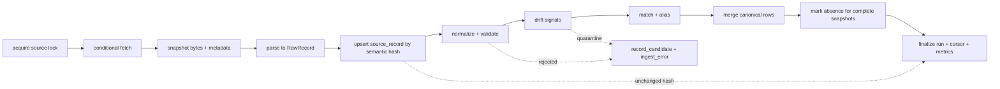

# Ingestion pipeline and idempotency design

Status: design (phase 1) · Owner lane: `storage-pipeline`
Companion docs: [persistence](./persistence.md), [operations](./operations.md), [modules](./modules.md)

The pipeline turns heterogeneous public AED sources into an idempotent stream of
snapshots, source records, normalized candidates, and canonical updates. The
guiding rule is that **every stage is replayable from stored inputs and every
write is keyed by a deterministic identity**.

## 1. Stage graph



Stages are separated by persisted artifacts:

| Stage | Input | Output | Idempotency key |
| --- | --- | --- | --- |
| Fetch | URL + conditional headers | `source_document` + file | `(source_id, run_key)` run + `body_sha256` |
| Parse | document bytes | `RawRecord[]` in memory | document id + connector version |
| Upsert | `RawRecord` | `source_record` | `(source_id, source_record_id)` + `payload_sha256` |
| Normalize | changed `source_record` | `record_candidate` | `(source_record_id, payload_sha256, normalizer_version)` |
| Match | valid candidate | `aed_alias` | `(source_id, source_record_id)` |
| Merge | alias + candidate | `aed`, `facility`, `operator`, `observation`, provenance | deterministic merge of candidate hash |
| Absence | complete document | `is_present`, `missing_streak` | `(last_seen_run_id, document completeness)` |
| Export | canonical rows | files/feed | content hash + data version |

## 2. Interfaces between lanes

These TypeScript shapes are the contract. They live in
`src/server/ingest/types.ts` and are imported by connector, normalize, dedup,
lifecycle, and ops lanes. Keep them free of Drizzle and HTTP details. The
connector family interface follows the config lane's contract
(`docs/ingest-source-config.md` §4.1), extended with the raw body needed for
snapshotting.

```ts
export type SourceTier =
	| "authoritative"
	| "official_local"
	| "community"
	| "aggregator"
	| "derived"
	| "app"
	| "register";

export type ConnectorFamily =
	| "file_static"
	| "http_json"
	| "http_json_api"
	| "google_my_maps_kml"
	| "arcgis_query"
	| "ckan_datastore"
	| "html_table"
	| "manual";

export type ParserKind =
	| "csv"
	| "xlsx"
	| "json"
	| "geojson"
	| "kml"
	| "jsonapi"
	| "html_table";

export type FetchedDocument = {
	url: string;
	finalUrl: string;
	status: number;
	contentType: string | null;
	etag: string | null;
	lastModified: string | null;
	body: Uint8Array;
	notModified: boolean;
	redirectChain: string[];
};

export type RawRecord = {
	/** Stable within the source. Required. */
	sourceRecordId: string;
	datasetId?: string;
	/** Connector-canonical, JSON-serializable, no functions/dates. */
	payload: Record<string, unknown>;
	sourceUpdatedAt?: string | null;
	sourceUrl?: string | null;
	/** Explicit source tombstone, only for incremental sources. */
	deleted?: boolean;
};

export type ParsedDocument = {
	records: RawRecord[];
	/** false when pagination/rows failed after some records were read. */
	complete: boolean;
	cursor?: Record<string, unknown>;
	warnings: string[];
};

export type DriftSignal = {
	layer: "transport" | "schema" | "volume" | "quality" | "axis" | "semantic" | "sample";
	signal: string;
	severity: "warn" | "review" | "fail";
	observed: unknown;
	baseline: unknown;
	action: "continue" | "quarantine" | "disable_source" | "reject_record";
	message: string;
};

export type ConnectorResult = {
	documents: FetchedDocument[];
	records: RawRecord[];
	meta: {
		httpStatus: number;
		contentType: string | null;
		etag: string | null;
		lastModified: string | null;
		payloadSha256: string;
		bytes: number;
		pages: number;
		recordsDeclared?: number;
	};
	complete: boolean;
	warnings: DriftSignal[];
};

export type Connector = {
	family: ConnectorFamily;
	version: string;
	fetch(config: SourceConfig, ctx: FetchContext): Promise<ConnectorResult>;
};

export type SourceConfig = {
	version: 1;
	source: {
		id: string;
		name: string;
		publisher: string;
		homepage_url?: string;
		access_type: "file" | "api" | "html" | "kml" | "manual";
		reliability_tier: SourceTier;
		license: {
			id: string;
			url?: string;
			attribution?: string;
			share_alike?: boolean;
		};
		coverage?: { country?: string; teryt?: string[]; notes?: string };
		update_frequency?:
			| "continuous"
			| "daily"
			| "weekly"
			| "monthly"
			| "quarterly"
			| "once"
			| "unknown";
		enabled?: boolean;
	};
	connector: { family: ConnectorFamily; parser: ParserKind };
	fetch: Record<string, unknown>;
	parse: Record<string, unknown>;
	records: Record<string, unknown>;
	map: Record<string, unknown>;
	validate: Record<string, unknown>;
	drift: Record<string, unknown>;
	publish?: Record<string, unknown>;
};

export type NormalizedCandidate = {
	aed: Record<string, unknown>;
	facility: Record<string, unknown>;
	operator?: Record<string, unknown> | null;
	confidenceInputs: {
		sourceTier: SourceTier;
		verificationMethod:
			| "official_register"
			| "operator"
			| "field_survey"
			| "community"
			| "import";
		observedAt: string | null;
		fieldCompleteness: number;
	};
};

export type ValidationResult =
	| { ok: true; candidate: NormalizedCandidate }
	| {
			ok: false;
			reasonCode: string;
			detail: string;
			/** Kept for ops review but never written canonically. */
			partial?: Record<string, unknown>;
	  };

export type MatchInput = {
	sourceId: string;
	sourceRecordId: string;
	candidate: NormalizedCandidate;
};

export type MatchDecision =
	| {
			kind: "existing";
			aedId: string;
			method: "exact_id" | "osm_derived" | "geo_name" | "manual";
			score: number | null;
			isPrimary: boolean;
	  }
	| {
			kind: "create";
			method: "exact_id" | "osm_derived";
			score: null;
			isPrimary: true;
	  }
	| { kind: "review"; score: number; reason: string };
```

Boundary rules:

- A connector **never** imports `db`, never writes files except through the
  snapshot writer, and never resolves secrets itself. It receives an already
  authenticated `FetchContext` and a validated `SourceConfig`.
- A normalizer is pure: same `RawRecord` + same `normalizer_version` produces the
  same candidate bytes.
- The merge engine is the only code allowed to write canonical tables. It
  receives a `MatchDecision` and a `NormalizedCandidate`.
- The ops API reads canonical tables only; it never triggers per-record writes.

## 3. Source registry and configuration

Sources are declared as entries in the single JSON registry
`backend/ingest/datasources-config.json` and validated against
`backend/ingest/datasources-config.schema.json` (the generated artifact lives at
`src/server/ingest/config/datasources-config.generated.schema.json`). The config
is data, not code: no `eval`, no JS, no network access in the mapping DSL. The
registry loader reads the registry once, validates the family/parser matrix, and
upserts `source` plus an immutable `source_config` row.

```ts
// SourceConfig is one parsed registry entry; config_sha256 is over its exact bytes.
type LoadedSource = {
	config: SourceConfig;
	configJson: string;
	configSha256: string;
	connector: Connector;
	scheduleCron: string | null;
	timezone: string;
	secretEnv: string | null; // from fetch.auth.env
	fullSnapshot: boolean;
	removalGraceRuns: number;
};
```

Parse the JSON registry and use the JSON Schema validator for the shape.
The runtime must validate, not only CI: an invalid config fails the source
before any fetch. Validate that `parser` is allowed for `connector.family`
(the matrix in `docs/ingest-source-config.md` §4.3).

The registry loader performs an idempotent `source` upsert before each run and
stores the exact per-source config and hash in `source_config`. If `config_sha256` or the
connector version changed, the loader forces a full refresh and starts a new
candidate version; it does not reuse incremental cursors across incompatible
config. Historical runs keep their `config_sha256`.

Default grace values are conservative: authoritative full snapshots remove
after 2 complete misses, community and aggregator sources after 3. A partial or
failed document never contributes to removal counts.

Publish gates: `source.allowed_for_ingest` and `source.allowed_for_export`
default to false until an admin reviews the license. A source can be fetched
for research while export remains blocked.

## 4. Fetch stage

1. Select the last successful `source_document` for the same URL. Send
   `If-None-Match` and `If-Modified-Since` when values exist.
2. Enforce per-source rate limit, timeout (default 30 s connect + read), redirect
   limit (5, HTTPS only for remote sources), and maximum body size (default
   25 MiB per document; OpenAEDMap is about 7 MiB).
3. Classify the response:
   - `304`: create a `sync_run` marked `ok / not_modified`, no document, no
     record processing.
   - `2xx`: snapshot and continue.
   - `401/403`: `auth` error, no retry, operator action required.
   - `404/410`: `not_found` error, no retry; retain previous data.
   - `408/425/429/5xx`: retryable with backoff, honor `Retry-After`.
   - other `4xx`: non-retryable configuration error.
4. Validate `Content-Type` against the connector's declared accepted types.
   A mismatch is a parse error, not a successful empty document.
5. Write the snapshot atomically and insert `source_document` with
   `parse_status = 'pending'`.

Conditional requests are an optimisation, not a correctness requirement. A
source that omits `ETag` is refetched and hashed each time.

### Snapshot writer

- Root: `AED_SNAPSHOT_DIR`, default `<AED>/.data/snapshots`.
- Layout: `<source>/<sha256[0:2]>/<sha256>.<ext>.gz`.
- Write to a temp file in the same directory, `fsync`, then `rename`.
- If the target path already exists, verify size and hash (or trust the
  content-addressed name after a one-time check) and reuse it.
- Compress with gzip level 6 by default. The database stores uncompressed
  `body_bytes` and the `body_encoding`.
- Never write outside the root; sanitize source ids and never derive a path from
  a URL.
- Snapshot files are not world-writable; default mode `0640`.

## 5. Parse stage

- Parsers are streaming where possible, but the API accepts an in-memory
  `Uint8Array` because current sources are small. Cap document size.
- CSV parsing uses a real RFC 4180 parser, not `split(",")`. It must handle
  BOM, CRLF, quoted commas, doubled quotes, and leading spaces in headers.
  Marki's double-quoted rows need a documented two-pass unwrap.
- GeoJSON parsing validates `type`, `coordinates`, and coordinate order
  (`[lon, lat]`). Reject `lat/lon` swaps at the normalizer, not silently.
- JSON/XML responses are parsed once; parser errors produce a document-level
  `ingest_error` and `parse_status = 'failed'`.
- A parser may emit `complete: false` when it detects truncation, pagination
  failure, or a row count below a declared `expectedMinimum`. Partial documents
  are valid inputs for upsert but invalid inputs for removal.
- Stable record ids are assigned here. If a source has no id, the connector
  derives one from a documented composite and records that decision in the
  source documentation.

## 6. Record upsert and change detection

For each `RawRecord`:

1. Canonicalize `payload` with a stable stringifier (sorted object keys, arrays
   in source order, `undefined` omitted, dates from the connector already ISO
   strings).
2. Compute `payload_sha256`.
3. Upsert by `(source_id, source_record_id)`:
   - insert: `first_seen_at = now`, `last_changed_at = now`, `is_present = 1`.
   - update with same hash: only `last_seen_at`, `last_seen_run_id`,
     `is_present = 1`, `missing_streak = 0`.
   - update with different hash: write the new payload and hash, set
     `last_changed_at`, reset `is_present`/`missing_streak`.
4. Only changed records enter normalization. Unchanged records are counted as
   `records_unchanged` and skipped. This is the main cost saver on an 18k-row
   OpenAEDMap snapshot.

Use `INSERT ... ON CONFLICT DO UPDATE` in batches of 250–500 records inside one
`BEGIN IMMEDIATE` transaction. Return `id` and `changed` flags so the caller can
normalize without a second read.

## 7. Normalization and validation

- Map source fields to the canonical model per connector documentation. Missing
  values are `null`; `"unknown"` is a controlled enum value only where the model
  defines it.
- Reject, do not repair:
  - coordinates outside Poland (`lat` 49.00–54.90, `lon` 14.10–24.20),
  - non-finite or zero coordinates,
  - malformed dates,
  - a record that claims `active` without evidence,
  - a source row whose stable id is missing or empty.
- Mark axis swaps as `OUT_OF_POLAND` or `COORD_ORDER_SUSPECT` with the raw pair
  retained in `record_candidate.partial`. Marki's 7/8 swapped rows are the
  canonical example.
- Compute `candidate_hash` from the normalized candidate with the same stable
  stringifier.
- `confidence` is computed from the formula in §11 of the research report, but
  only inputs present in the source are used. A missing `last_verified_at` is
  not silently set to the import time.

Rejection rate guard: if a source has more than 10 records and more than 50% are
rejected, the run ends `partial` even if the HTTP fetch succeeded. This catches
schema drift (for example a renamed CSV column) before it marks most of the
source absent.

### 7.5 Drift detection and quarantine

The config lane defines drift layers and thresholds
(`docs/ingest-source-config.md` §5): transport, schema, volume, quality, axis,
semantic, and golden sample. Storage persists each signal as `drift_event` and
applies the resulting action:

| Severity / action | Run status | Publication effect |
| --- | --- | --- |
| `warn` | `ok` or `partial` | publish accepted rows; keep baseline |
| `review` / `quarantine` | `quarantined` | store accepted rows, do **not** replace the published projection, keep old baseline |
| `fail` / `disable_source` | `failed` | retain previous data, set `source.enabled = false` if the config allows auto-disable |

Quarantine is not deletion. The new snapshot and accepted records are stored
for inspection, but the public projection continues to serve the last
published complete snapshot. An operator resolves the review by updating the
config or baseline; a new successful run clears quarantine.

Baseline rules:

- The baseline is stored in `source_config.baseline_json` and only advances on
  `ok` runs.
- `partial` and `quarantined` runs never advance the baseline.
- A config change that alters `map`, `records`, or `parse` starts a new
  `config_sha256`; the first run is compared against a golden sample, not
  against a stale baseline.
- Drift checks compare identity, coordinates, name, and status; cosmetic
  description changes do not block publication.

### 7.6 Publication gate

Only `ok` and `partial` runs may update the published projection. `quarantined`
and `failed` runs leave the previous projection in place. The export lane reads
the last published projection version, not directly from `aed`, so a
quarantined source cannot leak unreviewed data onto the map or dane.gov.pl.

## 8. Matching and merge

### Deterministic matches first

- OSM and OpenAEDMap share `node/<id>`; canonical `aed.id` is
  `UUIDv5(AED_NAMESPACE, "node:<id>")`.
- Local records map to their own source record id. If a record's payload
  contains an OSM reference, use it only when explicitly present.
- A source record that already has an alias keeps it unless a merge/split
  operation explicitly moves it.

### Then spatial scoring

The dedup lane owns the scoring table, but the persistence contract requires:

- candidate search is limited by a bounding box (~100 m) before scoring;
- score ≥ 0.80 creates/keeps an alias automatically;
- 0.60–0.80 creates a review item and does **not** alias;
- distance ≤ 5 m with different serial/label never merges two devices;
- every merge writes `aed_merge`, `audit_log`, and moves aliases in one
  transaction.

The alias primary key prevents double mapping: a source record can point to only
one canonical device. If the matcher wants to move it, that is a merge and must
be explicit.

### Merge precedence

Field precedence is defined by the lifecycle/dedup lanes. Storage guarantees:

- higher `reliability_tier` wins, then fresher `last_verified_at`, then higher
  `confidence`;
- every winning field gets a `field_provenance` row;
- a conflicting authoritative value marks the device `disputed` but does not
  silently overwrite history;
- `aed.public_code`, `aed.ext_ident`, and `aed.id` never change during merge;
- the losing AED row stays with `merged_into_id`, and its aliases move to the
  winner.

## 9. Absence, tombstones, and removal

Two source styles:

- **Complete snapshot** (OSM/OpenAEDMap, CSV downloads): records absent from a
  complete document are missing, not deleted. Set `is_present = 0`, increment
  `missing_streak`, set `missing_since` on the first miss. Do not change
  canonical status in the writer.
- **Incremental/API**: absence has no meaning. Only an explicit source
  tombstone (`deleted: true`) marks the record absent.

The lifecycle lane consumes `missing_streak` and `removalGraceRuns` and decides
whether to mark the canonical AED `removed`. A failed or partial run contributes
nothing to absence counts. This prevents one timeout from wiping the map.

## 10. Idempotency matrix

| Scenario | Expected result |
| --- | --- |
| Same `run_key` invoked twice | second call returns existing run, no HTTP fetch |
| Two workers race for one source | one inserts `running`, the other gets a unique violation and exits `skipped` |
| Same document bytes fetched again | new `source_document` row, same `body_path`, zero changed records |
| Same `source_record_id` with same payload | one row, `last_seen` updated, no new observation |
| Same record replayed with new normalizer version | new candidate and observation version, canonical row unchanged if values equal |
| Process crashes after snapshot, before parse | rerun/replay reuses document, no data loss |
| Process crashes mid-merge | transaction rolls back; alias/observation/canonical rows stay consistent |
| Source returns an empty but complete snapshot | absence counters advance; lifecycle decides removal |
| Source returns an empty partial snapshot | no absence counters advance |
| Drift review triggers | `quarantined`; previous publication remains live |

Additional rules:

- `cursor_json` and `last_success_at` update in the same transaction that marks
  the run `ok`.
- A run marked `failed` never advances the cursor.
- `run_key` uniqueness uses the intended schedule slot in UTC, so daylight
  saving changes do not create duplicate slots.

## 11. Concurrency and transaction boundaries

- Fetching may run with bounded concurrency (default 2) because it is I/O
  bound.
- Canonical writes are serialized by SQLite and by the per-source run lock.
  Different sources can still contend on the same canonical device; start with
  a single canonical writer (or `BEGIN IMMEDIATE` per candidate batch) and
  revisit only if profiling proves it necessary. `busy_timeout` must be set.
- Each document's record upsert batch is transactional. Each candidate
  normalization + alias + canonical merge is one transaction per candidate or a
  small batch; do not hold a transaction across an HTTP call.
- Never hold a write transaction while parsing a large document. Parse first,
  then write.
- Snapshot file writes happen outside the transaction; a leaked file with no DB
  row is harmless and pruned later.

## 12. Error taxonomy and run status

| Code | Stage | Retry | Effect |
| --- | --- | --- | --- |
| `NETWORK`, `TIMEOUT` | fetch | yes | run retry, then failed |
| `HTTP_429`, `HTTP_5XX` | fetch | yes | backoff, honor `Retry-After` |
| `HTTP_408`, `HTTP_425` | fetch | yes | backoff |
| `AUTH`, `HTTP_401`, `HTTP_403` | fetch | no | failed, operator action |
| `NOT_FOUND`, `HTTP_404`, `HTTP_410` | fetch | no | failed, retain old data |
| `CONTENT_TYPE` | fetch/parse | no | failed |
| `PARSE_*` | parse | no | failed or partial |
| `SCHEMA_*` | parse | no | failed; candidate version unchanged |
| `OUT_OF_POLAND`, `INVALID_DATE` | validate | no | record rejected, run continues |
| `DRIFT_REVIEW`, `SCHEMA_DRIFT`, `VOLUME_DRIFT` | drift | no | `quarantined`, baseline unchanged |
| `DRIFT_FAIL` | drift | no | `failed`, retain previous publication |
| `MATCH_*`, `MERGE_*` | match/merge | no | record error, run partial |
| `DB_*` | any write | depends | transaction rollback, retry once |

Run status:

- `ok`: every document complete, no fatal errors, rejection rate below guard.
- `partial`: some records rejected or a document incomplete, but committed data
  is consistent.
- `quarantined`: drift review required; accepted data is stored but the
  published projection is unchanged.
- `failed`: no usable document, auth/config error, or transaction failure.
- `skipped`: lock or duplicate run key.
- `not modified` is represented as `ok` with a `not_modified` flag, not a
  separate status.

## 13. Replay and reprocessing

Commands (details in [operations](./operations.md)):

- `replay --document <id>`: parse a stored document again, with the connector
  version recorded on it. Creates a `replay` run; no network.
- `reprocess --source <id> --normalizer-version <v>`: re-normalize stored
  `source_record` rows without fetching. Useful after a mapping fix.
- `backfill --source <id> --from-snapshot <path>`: import a manually downloaded
  file through the same snapshot and parse path.
- `rebuild --source <id>`: replay the latest complete snapshot and recompute
  aliases. Never touches other sources.

Replay is safe because every downstream row is keyed by hashes and versions.
The expected result of replaying an unchanged document is zero new canonical
rows and zero new observations.

## 14. Acceptance checks

1. OpenAEDMap (18k records) ingests in one run; a second run with the same bytes
   reports 18k unchanged and performs no normalization.
2. Killing the process after snapshot write leaves a reusable document and no
   partial canonical records.
3. A partial CSV (simulated truncation) does not set `is_present = 0` for any
   record.
4. A validation regression that rejects >50% of records marks the run `partial`
   and alerts.
5. Replaying a document after a normalizer bump creates exactly one new
   candidate per record and updates no canonical value that did not change.
6. Two concurrent `run --source osm` invocations result in one fetched run and
   one `skipped` run.
7. A simulated volume drop below the baseline threshold produces a
   `quarantined` run, stores the new records, and leaves the published
   projection byte-identical.
