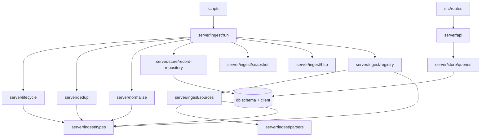

# Module layout and integration points

Status: design (phase 1) · Owner lane: `storage-pipeline`
Companion docs: [persistence](./persistence.md), [ingestion](./ingestion.md), [operations](./operations.md)

The `backend/` and `frontend/` directories are documentation-only placeholders
(see `AGENTS.md`). All executable code stays under `AED/src/` and `AED/scripts/`.
This document defines where ingestion code lives, which module may import which,
and the exact hand-off points for the connector, dedup, lifecycle, and ops lanes.

## 1. Target tree

```text
AED/
├── scripts/
│   ├── ingest.ts                 # CLI entry point (run/replay/status/...)
│   ├── migrate.ts                # runtime migration runner for bun:sqlite
│   └── db-backup.ts              # VACUUM INTO + integrity check
├── src/
│   ├── db/
│   │   ├── index.ts              # bun:sqlite client, pragmas, schema object
│   │   ├── schema.ts             # re-exports the schema modules
│   │   └── schema/
│   │       ├── enums.ts          # TS unions mirrored by SQL CHECK lists
│   │       ├── sources.ts        # source, sync_run, source_document, source_record
│   │       ├── canonical.ts      # operator, facility, aed, aed_alias
│   │       ├── evidence.ts       # observation, field_provenance, media
│   │       ├── ops.ts            # ingest_error, audit_log, submission, aed_merge
│   │       └── index.ts
│   ├── server/
│   │   ├── ingest/
│   │   │   ├── types.ts          # cross-lane contracts (no db/http imports)
│   │   │   ├── errors.ts         # ConfigError, FetchError, ParseError, reason codes
│   │   │   ├── registry.ts       # SourceDefinition[] + registry loader/upsert
│   │   │   ├── run.ts            # orchestration for one source run
│   │   │   ├── lock.ts           # acquire/reap sync_run lock
│   │   │   ├── hash.ts           # stable JSON stringify + sha256
│   │   │   ├── snapshot.ts       # atomic content-addressed snapshot writer
│   │   │   ├── http/
│   │   │   │   ├── client.ts     # fetch wrapper, conditional GET, size cap
│   │   │   │   ├── retry.ts      # backoff + Retry-After
│   │   │   │   ├── rate-limit.ts # token bucket per source
│   │   │   │   ├── secrets.ts    # env-only secret resolution
│   │   │   │   └── redact.ts     # URL/header/JSON redaction
│   │   │   ├── parsers/
│   │   │   │   ├── csv.ts        # RFC 4180 + BOM/CRLF/double-quote handling
│   │   │   │   ├── xlsx.ts
│   │   │   │   ├── geojson.ts
│   │   │   │   ├── kml.ts
│   │   │   │   ├── jsonapi.ts
│   │   │   │   └── html-table.ts
│   │   │   ├── config/
│   │   │   │   ├── loader.ts     # Bun.YAML.parse + JSON Schema + family matrix
│   │   │   │   ├── schema.ts     # runtime shape guards for SourceConfig
│   │   │   │   └── mapping-dsl.ts# whitelisted mapping functions, no eval
│   │   │   ├── connectors/
│   │   │   │   ├── file-static.ts
│   │   │   │   ├── http-json.ts
│   │   │   │   ├── http-json-api.ts
│   │   │   │   ├── google-my-maps-kml.ts
│   │   │   │   ├── arcgis-query.ts
│   │   │   │   ├── ckan-datastore.ts
│   │   │   │   └── html-table.ts
│   │   │   └── drift/
│   │   │       ├── signals.ts    # schema, volume, quality, axis, sample
│   │   │       └── baseline.ts   # baseline compare + advance rules
│   │   ├── normalize/
│   │   │   ├── types.ts          # canonical field object types
│   │   │   ├── normalize.ts      # pure RawRecord -> NormalizedCandidate
│   │   │   ├── validate.ts       # Poland bbox, dates, required fields
│   │   │   ├── ids.ts            # UUIDv5, public_code, ext_ident
│   │   │   ├── address.ts        # trim/case/postcode/TERYT helpers
│   │   │   └── confidence.ts     # §11 formula, input-driven only
│   │   ├── store/
│   │   │   ├── transaction.ts    # BEGIN IMMEDIATE helper + retry on busy
│   │   │   ├── source-repository.ts
│   │   │   ├── run-repository.ts
│   │   │   ├── document-repository.ts
│   │   │   ├── record-repository.ts
│   │   │   ├── candidate-repository.ts
│   │   │   ├── aed-repository.ts
│   │   │   ├── alias-repository.ts
│   │   │   ├── observation-repository.ts
│   │   │   ├── audit-repository.ts
│   │   │   └── queries.ts        # read models for API/export
│   │   ├── dedup/                # owned by dedup-merge lane
│   │   │   ├── matcher.ts
│   │   │   └── scoring.ts
│   │   ├── lifecycle/            # owned by lifecycle-cleansing lane
│   │   │   ├── policy.ts
│   │   │   └── transitions.ts
│   │   ├── jobs/
│   │   │   ├── scheduler.ts      # due-slot calculation, Bun.cron adapter
│   │   │   └── worker.ts
│   │   └── api/
│   │       ├── aed-queries.ts    # server-only read functions
│   │       └── ingest-status.ts  # status DTO for ops UI
│   └── routes/
│       ├── api/aed/index.ts      # public search endpoint
│       └── api/admin/ingest/status.ts
```

`frontend/` code remains in `src/components` and `src/routes`; ingestion never
imports client modules. `src/server/**` is server-only.

## 2. Dependency direction



Hard rules:

1. `types.ts` imports nothing from `db`, `http`, `store`, or routes.
2. `config/*` and `connectors/*` import only `types`, `parsers`, `hash`, and
   small utilities. They never import `store` or `db`. A connector is a pure
   fetch adapter; the config is data.
3. `normalize/*` is pure and deterministic. No `Date.now()`, no network, no DB.
4. `store/*` is the only layer that imports `src/db`. It maps rows to domain
   objects and never contains HTTP or parsing logic.
5. `run.ts` orchestrates but contains no source-specific field mapping.
6. Routes and server functions import `server/api` or `server/store/queries`;
   they never touch connectors or the snapshot filesystem.
7. `scripts/*` may import server modules; browser code must never do so.
8. No barrel file may re-export a server module into a client route. If a type
   is needed by a component, it lives in a `*.types.ts` file with no runtime
   imports.

## 3. Changes to existing files

### `src/db/index.ts`

Keep the current WAL and `synchronous = NORMAL` setup and add:

```ts
sqlite.run("PRAGMA foreign_keys = ON;");
sqlite.run("PRAGMA busy_timeout = 5000;");
sqlite.run("PRAGMA journal_size_limit = 67108864;");
```

Extend the `schema` object with every new table so Drizzle relational queries
and the migrator see them. Do not create additional `Database` instances in
scripts; import the shared client or construct one through a small factory that
sets the same pragmas.

### `src/db/schema.ts`

Keep the existing `todos` export for compatibility and re-export the new schema
modules:

```ts
export * from "./schema/canonical.ts";
export * from "./schema/evidence.ts";
export * from "./schema/ops.ts";
export * from "./schema/sources.ts";
```

`drizzle.config.ts` continues to point at `src/db/schema.ts`, so
`bun run db:generate` sees the full schema.

### `package.json`

Add scripts only after the corresponding files exist:

```json
{
	"ingest": "bun scripts/ingest.ts",
	"ingest:due": "bun scripts/ingest.ts run --due",
	"ingest:worker": "bun scripts/ingest.ts worker",
	"db:migrate:runtime": "bun scripts/migrate.ts",
	"db:backup": "bun scripts/db-backup.ts"
}
```

No new runtime dependencies are required:

- UUIDv5: `node:crypto` `createHash` or `crypto.randomUUID` plus a small UUIDv5
  helper.
- JSON: native.
- CSV: a local parser in `parsers/csv.ts`; avoid adding a dependency unless the
  parser grows beyond the documented sources.
- Scheduling: `Bun.cron` or external cron; no scheduler package.
- CLI parsing: `node:util.parseArgs`.

### `.gitignore`

Add `.data/` (snapshot root) and `backups/` next to the existing ignored
`*.db*`, `.output`, and `.tanstack` entries. Never commit snapshots or backups.

## 4. Cross-lane integration contracts

### 4.1 Connector-config lane

The config lane owns the YAML contract and its validation:

- `backend/ingest/source-config.schema.json` (JSON Schema 2020-12),
- one `backend/ingest/sources/<id>.yaml` per source plus `examples/*.yaml`,
- the family/parser matrix and mapping DSL specification.

Storage consumes:

- `SourceConfig`, `ConnectorFamily`, `ParserKind`, `ConnectorResult`,
  `DriftSignal` from `src/server/ingest/types.ts`,
- `loadRegistry()` that parses with `Bun.YAML.parse`, validates against the
  JSON Schema, rejects an invalid family/parser pair, and upserts `source` +
  `source_config`,
- one connector implementation per family, not per source,
- documented stable `sourceRecordId` assignment in `records.identity`.

Hand-off test: a fake YAML with two static records runs through `runSource()`
and produces the expected `source_record` rows without touching canonical
tables until the normalize lane is implemented.

The runtime validator is required, not optional. A missing field, unknown
canonical key, or invalid family/parser pair fails the source before any fetch.

### 4.2 Dedup-merge lane

Consumes:

- `MatchInput`, `MatchDecision`, `NormalizedCandidate`.
- `aed_alias` primary key `(source_id, source_record_id)`.
- the merge transaction helper in `src/server/store/aed-repository.ts`.

Provides:

- `matchCandidate(input): Promise<MatchDecision>` in `src/server/dedup/matcher.ts`.
- scoring and review-item policy.
- the list of fields and precedence for merge.

Storage guarantees:

- alias creation is atomic with the canonical write,
- merges move aliases and set `merged_into_id` in one transaction,
- `public_code`/`ext_ident` are immutable,
- every field write records provenance.

### 4.3 Lifecycle-cleansing lane

Consumes:

- `ValidationResult`, `record_candidate`, and `ingest_error`.
- `source_record.is_present`, `missing_streak`, `source.removalGraceRuns`.
- `observation.verification_status` and `source.reliabilityTier`.

Provides:

- validators that return reason codes instead of throwing for bad data,
- status/verification state machine and expiry rules,
- confidence and field-completeness calculations,
- policy for when `missing_streak` becomes canonical `removed`.

Storage never guesses these decisions. It persists the inputs and applies the
lane's transition function.

### 4.4 Ops UI/API lane

Consumes read models from `src/server/store/queries.ts`:

```ts
export type AedListItem = {
	id: string;
	publicCode: string;
	name: string;
	lat: number;
	lon: number;
	status: string;
	verificationStatus: string;
	confidence: number;
	accessType: string;
	lastVerifiedAt: string | null;
	sourceId: string;
	licenseId: string;
	attribution: string;
};

export type AedDetail = AedListItem & {
	address: {
		city: string | null;
		street: string | null;
		houseNumber: string | null;
		postcode: string | null;
		terytCommune: string | null;
		addressText: string | null;
	};
	device: {
		label: string | null;
		manufacturer: string | null;
		model: string | null;
		deviceType: string;
		padsType: string | null;
	};
	access: {
		openingHours: string | null;
		is24_7: boolean | null;
		indoor: boolean | null;
		level: string | null;
		room: string | null;
		entranceDescription: string | null;
	};
	operator: { name: string | null; type: string | null } | null;
	photoUrl: string | null;
	provenance: Array<{
		field: string;
		sourceId: string;
		observedAt: string | null;
	}>;
};

export type IngestStatus = {
	sourceId: string;
	enabled: boolean;
	lastStatus: string | null;
	lastSuccessAt: string | null;
	lastErrorCode: string | null;
	consecutiveFailures: number;
	breakerOpenUntil: string | null;
	recordsAccepted: number;
	recordsRejected: number;
};
```

The ops lane owns the HTTP route, auth guard, pagination, and UI. Storage owns
the SQL and the guarantee that `merged_into_id` rows are excluded.

### 4.5 Gov/export lane

Consumes `queries.exportRows()` and `AedDetail`. The export contract in §14 of
the research report is authoritative. Storage responsibilities:

- exclude `serial_number`, private contacts, and merged rows,
- attach per-source `license_id` and `attribution`,
- produce deterministic ordering by `public_code` for stable hashes/MD5,
- never include internal IDs that could leak moderation state.

## 5. Error handling conventions

- Data errors are values (`ValidationResult`, `ingest_error` rows), not thrown
  exceptions.
- Configuration, database, and programmer errors throw and fail the run.
- Every thrown error carries a stable `code`, a redacted `message`, and optional
  `context` without secrets.
- The CLI is the only layer that formats errors for humans; libraries log
  structured events and let the caller decide.

## 6. Testing layout

Tests use `bun test` and live next to the code, per `AGENTS.md`.

| Area | Test |
| --- | --- |
| hash | stable key ordering, Unicode, nested objects/arrays |
| snapshot | atomic write, reuse by hash, path traversal rejection |
| csv parser | BOM, CRLF, quoted commas, doubled quotes, Marki double wrap |
| geojson parser | coordinate order, null geometry, invalid type |
| http retry | 429 `Retry-After`, 5xx backoff, no retry on 403 |
| record upsert | unchanged hash, changed hash, first_seen preservation |
| normalize | Poland bbox, axis swap, missing id, date parsing |
| alias | uniqueness, merge moves aliases, merge cycle rejected |
| run | lock contention, partial snapshot absence protection, replay no-op |
| migration | empty DB -> all migrations -> integrity check |

Use a temporary SQLite file (`mkdtemp` + `DATABASE_URL`) rather than a shared
`dev.db`. Fixtures are small hand-written files under
`src/server/ingest/sources/__fixtures__/`; large research artifacts stay in
`docs/research/raw/` and are not test inputs.

## 7. Implementation order

1. **M1 storage**: schema modules, pragmas, migrations, migration test.
2. **Contracts and primitives**: `types.ts`, `hash.ts`, `errors.ts`, config
   loader with `Bun.YAML.parse` + JSON Schema, CSV/GeoJSON parsers, snapshot
   store.
3. **HTTP layer**: client, retry, rate limit, secrets, redaction, with tests.
4. **First vertical slice**: OpenAEDMap YAML + `file_static`/`geojson` family ->
   parse -> record upsert -> run summary, still without canonical writes.
5. **M2 canonical**: normalize, validate, UUIDs, canonical repository, map read
   query. The first map points can render from `aed` + `facility`.
6. **Second connector**: Przemyśl YAML + `http_json` family, proving the config
   layer rather than a per-source code path.
7. **Dedup**: exact OSM aliases first, spatial review queue second.
8. **Lifecycle**: absence/removal and verification status.
9. **CSV and token sources**: Krosno, Marki (double-quote and axis-swap
   fixtures), then Warszawa once a token is available.
10. **Operations**: scheduler, status queries, prune/reap/verify commands.
11. **Export/gov-api**: consume the read model; separate lane.

Each step keeps `bun run verify` green. Do not land a connector before its
fixture tests; do not land a canonical write before the idempotency test.

## 8. Definition of done for this lane's implementation

- [ ] `bun run db:generate` produced committed migrations and
      `bun run db:migrate` applies them to an empty database.
- [ ] `bun run typecheck` and `bun run check` pass.
- [ ] One source runs end to end from the CLI and a second run reports
      unchanged records.
- [ ] Replay produces no duplicate canonical rows or observations.
- [ ] Lock contention and stale-lock recovery are covered by tests.
- [ ] No secrets, snapshots, databases, or build artifacts are staged.
- [ ] `docs/architecture/*` matches the implemented table and command names.
