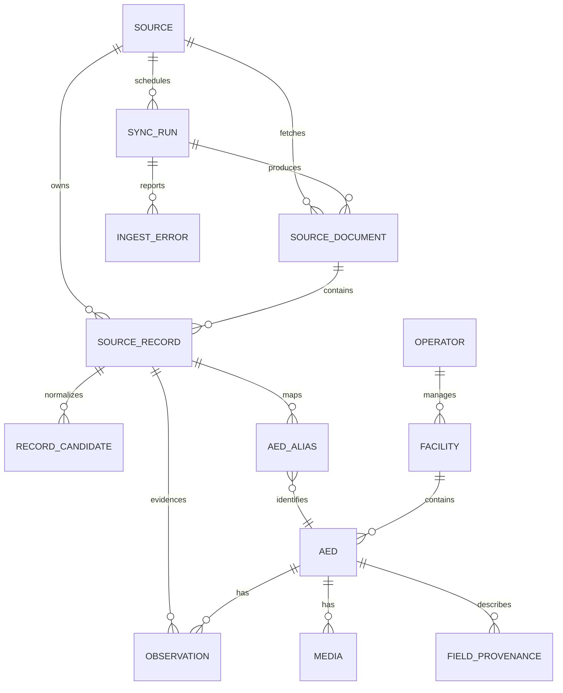

# Persistence design: canonical AED store

Status: design (phase 1) · Owner lane: `storage-pipeline`
Companion docs: [ingestion](./ingestion.md), [operations](./operations.md), [modules](./modules.md)
Source research: [`../aed-data-sources-common-schema.md`](../aed-data-sources-common-schema.md)

This document defines the durable storage contract for AED ingestion. It refines
the draft schema in the research report into tables that can be implemented with
Drizzle on `bun:sqlite`. Other lanes must treat the table names, keys, and
invariants here as the integration boundary.

## 1. Design rules

1. **Raw input and canonical output are separate.** A fetch never writes
   canonical `aed` rows directly. It writes a document snapshot and one
   `source_record` per record. Normalization produces `record_candidate`;
   matching produces `aed_alias`; merging produces canonical rows.
2. **One row per source record.** `UNIQUE (source_id, source_record_id)` is the
   idempotency anchor for the whole pipeline.
3. **One canonical record per physical device.** A canonical `aed` row can have
   many source aliases. Merges never delete identifiers; a merged device keeps
   its row with `merged_into_id` set so old links still resolve.
4. **No data loss on transient failures.** A partial snapshot must not be
   interpreted as "records disappeared". Absence is explicit
   (`is_present = 0`, `missing_streak`), never inferred from a failed run.
5. **Bulk payloads live outside SQLite.** Raw documents go to a
   content-addressed snapshot directory. SQLite stores metadata, hashes, and
   normalized records.
6. **Every mutation is attributable.** Runs, documents, aliases, observations,
   and audit rows record source, time, and algorithm version.
7. **Times are UTC epoch milliseconds in SQLite.** ISO 8601 is used only at API
   and export boundaries. `TEXT` timestamps sort poorly and invite mixed
   formats.

## 2. Entity overview



## 3. Table contract

All primary keys are `TEXT` UUIDs unless stated otherwise. Slugs (`source.id`)
are stable lowercase identifiers from code, never user input at runtime.
Booleans use Drizzle `integer({ mode: "boolean" })`; JSON uses
`text({ mode: "json" })` or compressed text with an explicit codec.

### 3.1 `source` — source registry and configuration

The code registry is authoritative; this table is the runtime mirror plus
per-source state. Rows are upserted by the registry loader at the start of each
run, never edited by hand in production.

| Column | Type | Notes |
| --- | --- | --- |
| `id` | text PK | slug, e.g. `osm`, `przemysl`, `warszawa` |
| `name`, `publisher`, `homepage_url` | text | display metadata |
| `access_type` | text | `api`, `file`, `wms`, `wfs`, `html`, `kml`, `manual`, `app` |
| `connector_family` | text | `file_static`, `http_json`, `http_json_api`, `arcgis_query`, `ckan_datastore`, `google_my_maps_kml`, `html_table`, `manual` |
| `parser` | text | `csv`, `xlsx`, `json`, `geojson`, `kml`, `jsonapi`, `html_table` |
| `base_url` | text | no secrets in URL; tokens go through `secret_env` |
| `license_id`, `license_url`, `attribution` | text | export contract |
| `coverage_teryt` | text | optional comma-separated TERYT list |
| `reliability_tier` | text | `authoritative`, `official_local`, `community`, `aggregator`, `derived`, `app`, `register` |
| `update_frequency` | text | declared cadence, informational |
| `schedule_cron`, `timezone` | text | scheduler contract, default `Europe/Warsaw` |
| `enabled` | bool | disabled sources keep history |
| `requires_auth`, `secret_env` | bool, text | env variable **name**, never the value |
| `allowed_for_ingest`, `allowed_for_export` | bool | license gate, default false until reviewed |
| `config_json` | json | validated connector config; secret-free |
| `config_sha256` | text | hash of the exact `source_config.config_yaml` in force |
| `config_version` | integer | bump forces a full refresh and new candidate version |
| `cursor_json` | json | incremental cursor (page token, last modified, high-water mark) |
| `last_checked_at`, `last_success_at` | timestamp | operational |
| `consecutive_failures` | integer | circuit breaker input |
| `breaker_open_until` | timestamp | skip fetches until then |
| `last_error_code` | text | redacted code only |
| `created_at`, `updated_at` | timestamp | audit |

Constraints: `reliability_tier` and `access_type` are checked in SQL. A source
with `requires_auth = true` must have `secret_env`.

`cursor_json` is written only after a run commits successfully. A crashed run
must resume from the previous cursor, not from a partially advanced one.

#### `source_config` — immutable configuration snapshots

The config lane keeps one YAML file per source. The loader validates it against
`backend/ingest/source-config.schema.json`, then stores the exact bytes here.
This is what makes a historical `sync_run` reproducible after the YAML changes.

| Column | Type | Notes |
| --- | --- | --- |
| `source_id` | text PK FK | one active config per source |
| `version` | integer | config contract version |
| `config_yaml` | text | exact validated YAML |
| `config_sha256` | text | SHA-256 of `config_yaml` |
| `baseline_json` | json | drift baseline (counts, schema, golden sample) |
| `baseline_sha256` | text | hash of baseline |
| `active` | bool | only one active row per source |
| `loaded_at` | timestamp | |

`sync_run.config_sha256` points at the version used for that run. A config
change is a new row or a new hash; never mutate a historical row.

### 3.2 `sync_run` — idempotent execution record

| Column | Type | Notes |
| --- | --- | --- |
| `id` | text PK | run UUID |
| `source_id` | text FK | `source.id` |
| `run_key` | text | idempotency key, see below |
| `trigger` | text | `schedule`, `manual`, `replay`, `backfill` |
| `status` | text | `running`, `ok`, `partial`, `quarantined`, `failed`, `skipped` |
| `stage` | text | latest stage: `fetch`, `parse`, `normalize`, `match`, `merge`, `export` |
| `started_at`, `finished_at` | timestamp | |
| `attempt` | integer | retry attempt of the whole run, starts at 1 |
| `config_version`, `config_sha256`, `connector_version`, `normalizer_version` | text/integer | reproducibility |
| `http_status` | integer | dominant response status, for the ops list |
| `bytes_fetched` | integer | |
| `not_modified` | bool | conditional GET returned 304 |
| `documents_fetched`, `records_seen`, `records_parsed`, `records_declared` | integer | |
| `records_accepted`, `records_rejected`, `records_unchanged` | integer | |
| `records_created`, `records_updated`, `records_removed` | integer | canonical effects |
| `drift_events`, `quarantined` | integer, bool | drift outcome for this run |
| `error_code`, `error_message` | text | fatal run error only |
| `lock_expires_at` | timestamp | stale-lock recovery |

Invariants:

- `UNIQUE (source_id, run_key)`.
- `run_key` is `schedule:<source>:<slot>` for scheduled runs, where `slot` is
  the ISO minute of the intended slot in UTC, or `manual:<uuid>` for explicit
  invocations. Re-running the same slot returns the existing run instead of
  fetching again.
- A partial unique index allows at most one `status = 'running'` row per source:

```sql
CREATE UNIQUE INDEX sync_run_one_active
  ON sync_run(source_id) WHERE status = 'running';
```

The index is the cross-process mutex. A worker that sees the constraint
violation exits with `skipped`; it does not queue unbounded work.

### 3.3 `source_document` — fetched bytes snapshot

| Column | Type | Notes |
| --- | --- | --- |
| `id` | text PK | document UUID |
| `source_id`, `sync_run_id` | text FK | |
| `url` | text | final URL after redirects |
| `http_status`, `content_type` | integer, text | |
| `etag`, `last_modified` | text | conditional-GET state |
| `body_sha256` | text | SHA-256 of the exact stored bytes |
| `body_path` | text | relative path under `AED_SNAPSHOT_DIR` |
| `body_bytes` | integer | uncompressed size |
| `body_encoding` | text | `identity`, `gzip`, or `pruned` |
| `record_count`, `parse_status` | integer, text | `pending`, `ok`, `partial`, `failed` |
| `fetched_at` | timestamp | |
| `metadata_json` | json | headers subset, page/cursor info, redirect chain |

Invariants:

- Snapshot files are written atomically: `tmp` file, fsync, rename.
- `body_sha256` is computed over the bytes as received, before parsing.
- Identical content fetched in a later run reuses the same `body_path` (the
  writer checks for an existing file by hash) but still creates a new document
  row that belongs to the new run. This preserves run history without growing
  the snapshot directory.
- A document with `parse_status = 'partial'` forbids absence-based removal.

Retention is governed in [operations](./operations.md#8-snapshot-retention):
metadata stays, bodies may be pruned only when no run needs replay.

### 3.4 `source_record` — one record as published by a source

| Column | Type | Notes |
| --- | --- | --- |
| `id` | text PK | internal UUID |
| `source_id` | text FK | |
| `source_record_id` | text | stable ID within source, e.g. `node/13323246101` |
| `dataset_id` | text | optional dataset/resource discriminator |
| `document_id` | text FK | latest document that contained it |
| `payload_json` | json | connector-canonical payload, sorted keys |
| `payload_sha256` | text | SHA-256 of canonical JSON (semantic hash) |
| `source_updated_at` | timestamp | from source, nullable |
| `source_url` | text | deep link, nullable |
| `fetched_at` | timestamp | first fetch of this version |
| `first_seen_at`, `last_seen_at`, `last_changed_at` | timestamp | |
| `last_seen_run_id` | text FK | |
| `is_present` | bool | current presence in a complete snapshot |
| `missing_since` | timestamp | first complete snapshot without it |
| `missing_streak` | integer | consecutive complete snapshots without it |

Invariants:

- `UNIQUE (source_id, source_record_id)`.
- `payload_json` is connector output, not the raw HTML/CSV row. It must contain
  only fields the connector could actually parse; unparseable cells become
  `null`, never `""` or guesses.
- `payload_sha256` is computed with a stable JSON stringifier (object keys
  sorted, `undefined` omitted, dates normalized to ISO UTC). Arrays keep order
  unless the connector declares them as sets.
- If the hash is unchanged, the writer updates `last_seen_at`,
  `last_seen_run_id`, `is_present`, and `missing_streak` only. It does not
  create a new observation or re-run normalization.

Stable-ID rules per source (connector responsibility):

| Source | `source_record_id` |
| --- | --- |
| OSM | `node/<id>` |
| OpenAEDMap | `node/<osm_id>` |
| Przemyśl | `<resource_id>:<row_id>` |
| Krosno | `<Numer Id>` |
| Marki | `<Numer Id>` |
| Warszawa | `<defibrillator_id>` |
| Local CSV without ID | `<filename>:<line-number>` is **not** stable; connector must derive a hash of normalized address+coordinates and document the trade-off |

### 3.5 `record_candidate` — normalized, validated candidate

| Column | Type | Notes |
| --- | --- | --- |
| `id` | text PK | |
| `source_record_id` | text FK | |
| `payload_sha256` | text | source version this candidate came from |
| `normalizer_version` | text | algorithm version |
| `status` | text | `valid` or `rejected` |
| `reason_code`, `reason_detail` | text | rejection is data, not an exception |
| `candidate_json` | json | normalized field object |
| `candidate_hash` | text | hash of `candidate_json` |
| `created_at` | timestamp | |

`UNIQUE (source_record_id, payload_sha256, normalizer_version)` makes
re-normalization idempotent. A new normalizer version creates new candidates;
old candidates stay for audit. Rejected rows are retained so the ops UI can
show why a record never reached the map.

### 3.6 `operator`, `facility`, `aed`

These are the canonical projection consumed by the map, API, and export. The
full field list follows §7 of the research report; the storage-critical parts
are:

**`operator`**: `id`, `name`, `operator_type`, `nip`, `regon`, `rpwdl_code`,
`teryt`, `phone`, `email`, `website`, `source_record_id`, timestamps. Keep
public contact only; personal data never enters this table.

**`facility`**: `id`, `name`, `facility_type`, `operator_id`, full address and
TERYT fields, `lat`, `lon`, `coord_precision_m`, `geom_source`, access fields
(`opening_hours`, `access_scope`, `indoor`, `level`, `room`,
`entrance_description`), `merged_into_id`, timestamps. A facility is the
physical place; multiple AEDs in one building share it.

**`aed`**: `id`, `public_code` (unique, immutable), `ext_ident` (unique, ≤36
chars for the dane.gov.pl harvester), `facility_id`, device fields
(`label`, `manufacturer`, `model`, `serial_number` restricted,
`device_type`, `pads_type`, expiries), `status`, `status_reason`,
`access_type`, `is_24_7`, `requires_dispatcher`, `fee`, `photo_url`,
`is_public`, `merged_into_id`, timestamps. A merged loser keeps its row with
`merged_into_id` set and `is_public = 0`; the dedup lane owns that transition.

Canonical identity rules:

- `aed.id` is a UUID. For a device whose primary source is OSM/OpenAEDMap it is
  `UUIDv5(AED_NAMESPACE, "node:<id>")`; for a local-only device it is
  `UUIDv5(AED_NAMESPACE, "<source_id>:<source_record_id>")`. This is
  deterministic and survives re-imports.
- `public_code` and `ext_ident` are derived from `aed.id` and never change.
- `merged_into_id` forms a redirect chain. Queries follow at most one level
  because merges flatten transitively in the same transaction. A merged row is
  never physically deleted.
- `serial_number` is stored but excluded from public export and API responses.

Indexes:

```sql
CREATE INDEX facility_geo_bbox ON facility(lat, lon);
CREATE INDEX facility_teryt ON facility(teryt_commune);
CREATE INDEX facility_merged ON facility(merged_into_id);
CREATE INDEX aed_facility ON aed(facility_id);
CREATE INDEX aed_status ON aed(status) WHERE merged_into_id IS NULL;
CREATE INDEX aed_merged ON aed(merged_into_id);
```

`(lat, lon)` is a bounding-box index. SQLite has no built-in spatial type.
Nearest-neighbour queries first filter a latitude band and longitude range,
then compute haversine in SQL or application code. If the dataset grows beyond
a few hundred thousand rows, add an R*Tree virtual table in a later migration;
do not add it pre-emptively because it must be maintained by triggers.

### 3.7 `aed_alias` — source identity to canonical identity

| Column | Type | Notes |
| --- | --- | --- |
| `aed_id` | text FK | canonical device |
| `source_id` | text FK | |
| `source_record_id` | text | |
| `match_method` | text | `exact_id`, `osm_derived`, `geo_name`, `manual`, `seed` |
| `match_score` | real | null for deterministic matches |
| `is_primary` | bool | one primary alias per AED |
| `created_at`, `updated_at` | timestamp | |

Invariants:

- `PRIMARY KEY (source_id, source_record_id)` means a source record maps to one
  canonical device at a time.
- `UNIQUE (aed_id) WHERE is_primary = 1`.
- Moving an alias to another AED is a merge/split operation and must write
  `audit_log` and `aed_merge` history.

### 3.8 `observation` — evidence from a source version

| Column | Type | Notes |
| --- | --- | --- |
| `id` | text PK | |
| `aed_id`, `facility_id` | text FK | |
| `source_id`, `source_record_id` | text FK | |
| `payload_sha256` | text | exact source version observed |
| `normalizer_version` | text | |
| `observed_at` | timestamp | source time or fetch time (explicitly labelled) |
| `verification_method` | text | `official_register`, `operator`, `field_survey`, `community`, `import` |
| `verification_status` | text | `confirmed`, `probable`, `unverified`, `stale`, `disputed`, `candidate`, `removed` |
| `confidence` | real | `0..1`, check constraint |
| `status`, `access_type` | text | source-reported values, nullable |
| `notes`, `photo_url` | text | |
| `created_at` | timestamp | |

`UNIQUE (source_record_id, payload_sha256, normalizer_version)` keeps replay
from duplicating evidence. Only changed source payloads create new observations.

### 3.9 `field_provenance`, `media`, `submission`, `audit_log`

- `field_provenance`: `(entity_type, entity_id, field_name, source_record_id)`
  primary key, plus `value_json`, `observed_at`, `confidence`, `updated_at`.
  The merge engine writes one row per winning field, so the UI can answer
  "where did this value come from?".
- `media`: `id`, optional `aed_id`/`facility_id`, `source_record_id`, `url`,
  `media_type`, `license_id`, `attribution`, `captured_at`, `created_at`.
- `submission`: user suggestions with moderation state. Never auto-merges.
- `audit_log`: `id`, `entity_type`, `entity_id`, `action`, `actor`,
  `before_json`, `after_json`, `created_at`. Append-only.
- `aed_merge`: `from_aed_id`, `into_aed_id`, `decision`, `score`, `actor`,
  `created_at`; records every merge for reversal and audit.

### 3.10 `drift_event` — schema, volume, and quality signals

Drift is a first-class storage object, not a log line.

| Column | Type | Notes |
| --- | --- | --- |
| `id` | text PK | |
| `source_id` | text FK | |
| `sync_run_id` | text FK | |
| `layer` | text | `transport`, `schema`, `volume`, `quality`, `axis`, `semantic`, `sample` |
| `signal` | text | machine key |
| `severity` | text | `warn`, `review`, `fail` |
| `observed`, `baseline` | text | JSON or scalar evidence |
| `action` | text | `continue`, `quarantine`, `disable_source`, `reject_record` |
| `message` | text | redacted explanation |
| `created_at` | timestamp | |

`severity = review` sets `sync_run.status = 'quarantined'` and forbids replacing
the published projection; accepted records are stored but not published until
an operator updates the baseline.

### 3.11 `ingest_error` — bounded error reporting

| Column | Type | Notes |
| --- | --- | --- |
| `id` | text PK | |
| `sync_run_id` | text FK | |
| `source_record_id` | text FK, nullable | null for document-level errors |
| `stage` | text | `fetch`, `parse`, `normalize`, `validate`, `match`, `merge`, `export` |
| `reason_code` | text | stable machine code, e.g. `OUT_OF_POLAND`, `PARSE_CSV` |
| `message` | text | redacted human message |
| `payload_sha256` | text | optional content discriminator |
| `created_at` | timestamp | |

Cap errors per run (for example first 1,000 per reason code) and keep aggregate
counts in `sync_run`. This prevents a broken source from filling the disk while
still giving operators a useful sample.

### 3.12 Admin extension tables (owned by ops lane)

The ops/admin lane needs these tables on top of the core model. Storage defines
their keys and invariants here so migrations can be generated once:

- `review_item`: `id`, `type` (`duplicate_candidate`, `coordinate_conflict`,
  `bad_coordinates`, `field_conflict`, `missing_license`,
  `removed_candidate`), `status`, `priority`, `aed_id_a`, `aed_id_b`,
  `source_record_id`, `score`, `reason`, `evidence_json`, `created_at`,
  `resolved_by`, `resolved_at`, `resolution_note`.
- `license`: `id`, `name`, `url`, `spdx`, `share_alike`,
  `attribution_required`, `commercial_ok`, `derivative_ok`, `notes`.
- `license_alert`: `id`, `source_id`, `license_id`, `severity`, `status`,
  `message`, `created_at`, `resolved_at`.
- `user_role`: `user_id`, `role` (`admin`, `editor`, `steward`, `viewer`),
  primary key `(user_id, role)`.
- `metric_snapshot`: `id`, `captured_at`, `payload_json` for health dashboards.
- `export_run`: `id`, `started_at`, `finished_at`, `status`, `data_sha256`,
  `row_count`, `license_mode`, `feed_sha256`, `error`.
- `merge_override`: `id`, `kind` (`force_merge`, `do_not_merge`, `field_pin`,
  `force_status`, `ignore_source`, `ignore_field`), `subject_json`, `reason`,
  `actor`, `created_at`, `expires_at`, `active`. Owned by dedup-merge; the merge
  engine reads it before applying automatic decisions.

These are append-only or role-guarded; the merge engine never writes them.

## 4. Drizzle mapping notes

- Add tables to `src/db/schema.ts` directly or re-export from
  `src/db/schema/*.ts`; `drizzle.config.ts` keeps pointing at
  `src/db/schema.ts`.
- Use `integer("...", { mode: "timestamp_ms" })` for times,
  `integer("...", { mode: "boolean" })` for booleans, and
  `text("...", { mode: "json" }).$type<T>()` for JSON.
- Declare indexes and constraints in the table callback:
  `uniqueIndex`, `index`, `primaryKey`, `check`. Do not rely on application
  code for uniqueness.
- SQLite does not enforce enum types. Every enum-ish column gets a `CHECK`
  constraint in the generated migration. Keep the allowed values in one
  TypeScript union and one SQL check list, and add a test that they match.
- `src/db/index.ts` must add `PRAGMA foreign_keys = ON;` and
  `PRAGMA busy_timeout = 5000;` alongside the existing WAL and synchronous
  settings. Foreign keys are off by default in SQLite.
- Enable `PRAGMA journal_size_limit = 67108864;` so a long ingestion transaction
  cannot leave an unbounded WAL file on a small machine.
- Drizzle Kit does not model partial unique indexes or expression indexes.
  Add them in a generated migration with `drizzle-kit generate --custom` and
  keep the SQL under version control.

## 5. Migration policy

1. Every schema change is generated with `bun run db:generate`; generated SQL
   and `drizzle/meta/*` are committed. Never hand-edit an applied migration.
2. Migrations are **forward-only** and additive. SQLite's `ALTER TABLE` is
   limited; destructive changes use the expand/migrate/contract pattern:
   add new column/table, backfill in a separate data migration, switch reads,
   then drop in a later release.
3. Apply with `bun run db:migrate`. For the Bun runtime the equivalent is
   `migrate(db, { migrationsFolder: "drizzle" })` from
   `drizzle-orm/bun-sqlite/migrator`.
4. Do not run migrations automatically from request handlers. A guarded
   startup migration is acceptable only in a single-node dev process behind
   `AED_AUTO_MIGRATE=1`; production runs the explicit command in the deploy
   step.
5. Before a migration that rewrites canonical tables, take a consistent
   backup (`sqlite3 dev.db ".backup 'backup.db'"` or `VACUUM INTO`). Retention
   of the last N backups is an ops concern.
6. Seed reference sources idempotently from the code registry with
   `INSERT ... ON CONFLICT(id) DO UPDATE`, not with brittle migration inserts.
   Only immutable lookup data may live in migrations.
7. Migrations run inside a transaction where SQLite supports it. DDL is
   transactional in SQLite, so a failed migration must leave the schema
   unchanged. Verify with a temp database in CI: apply all migrations from
   empty, then run `PRAGMA integrity_check`.

### Migration phases

| Phase | Contents | Unblocks |
| --- | --- | --- |
| M1 | `source`, `source_config`, `sync_run`, `source_document`, `source_record`, `ingest_error` | fetch/parse skeleton, replay |
| M2 | `record_candidate`, `operator`, `facility`, `aed`, `aed_alias` | normalize, dedup, map reads |
| M3 | `observation`, `field_provenance`, `media`, `audit_log`, `aed_merge`, `drift_event` | lifecycle, drift quarantine, provenance UI |
| M4 | `submission`, `review_item`, `license`, `license_alert`, `user_role`, `metric_snapshot`, `export_run`, FTS/R*Tree (if needed) | admin panel, export, scale |

Each phase is independently deployable. M2 does not require lifecycle rules to
exist yet; rejected candidates simply remain unmerged.

## 6. Retention and backup

- `source_document` metadata: keep indefinitely (small).
- Snapshot bodies: keep at least the last successful snapshot per source plus
  90 days of history; failed-run bodies 14 days. A CLI prune command enforces
  the policy and refuses to delete a body referenced by a replay-pinned run.
- `sync_run` and `ingest_error`: keep 180 days, aggregate older counts into a
  monthly table if needed.
- Canonical rows and audit history: keep indefinitely.
- Backups: `VACUUM INTO` or the SQLite backup API before migrations and on a
  daily schedule; snapshot directory is backed up separately and is
  content-addressed, so incrementals are cheap.

## 7. Invariants to test

1. Applying all migrations from an empty database yields the expected schema
   and passes `PRAGMA integrity_check` and `PRAGMA foreign_key_check`.
2. Replaying the same document twice produces zero new canonical rows and zero
   new observations.
3. A duplicate `(source_id, source_record_id)` upserts and preserves
   `first_seen_at`.
4. A failed run cannot set `is_present = 0`.
5. Merging two AEDs moves aliases, sets `merged_into_id`, writes audit rows,
   and leaves `public_code` of the surviving row unchanged.
6. Concurrent runs for one source: exactly one `running` row succeeds; the
   other is `skipped` without a fetch.
7. `PRAGMA foreign_keys` is on in every connection used by scripts and the app.
