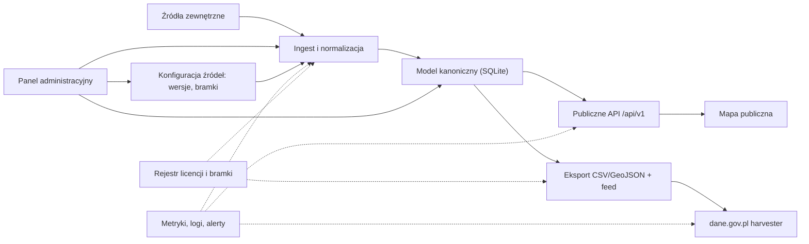

# Projekt techniczny: panel administracyjny, API publiczne, eksploatacja i wdrożenie

| | |
| --- | --- |
| Data | 2026-11-21 |
| Wersja | 1.0 (projekt do review) |
| Zakres | warstwa administracyjna, kontrakt publiczny, observability, licencje, rollout i testy |
| Dokument bazowy | [`../aed-data-sources-common-schema.md`](../aed-data-sources-common-schema.md) |
| Status | dokument projektowy; nie zastępuje modelu kanonicznego, tylko go operacjonalizuje |

## 1. Po co jest ten zestaw dokumentów

Model kanoniczny z dokumentu bazowego odpowiada na pytanie **jak wygląda rekord AED**. Ten zestaw odpowiada na pytania, których model nie rozstrzyga:

1. **Kto i jak zarządza źródłami i przebiegami pobierania** ([`admin-console.md`](./admin-console.md)).
2. **Co dokładnie widzi mapa i publiczne API** oraz jakie filtry są częścią kontraktu ([`public-api-and-filters.md`](./public-api-and-filters.md)).
3. **Jak wykrywamy awarie, starzenie danych i naruszenia licencji** ([`observability-licensing.md`](./observability-licensing.md)).
4. **Jak wdrażamy, testujemy i odbieramy rozwiązanie** ([`rollout-testing-acceptance.md`](./rollout-testing-acceptance.md)).
5. **Jak źródła powstają, są wersjonowane i aktywowane** przez kreator, dry-run, shadow i bramki ([`source-config-lifecycle.md`](./source-config-lifecycle.md)).

Dokumenty są pisane pod implementację w istniejącym stacku: TanStack Start, Bun, `bun:sqlite`, Drizzle, better-auth, MapLibre. Nie wprowadzają nowej infrastruktury poza opcjonalnym zewnętrznym zbieraniem metryk.

## 2. Zasady nadrzędne

1. **Jedno źródło prawdy o rekordzie.** Publiczne API i eksporty czytają z tych samych widoków kanonicznych. Panel administracyjny nie omija modelu.
2. **Proweniencja jest częścią kontraktu, nie metadanym dodatkiem.** Każdy publiczny rekord wskazuje źródło, licencję, atrybucję i datę weryfikacji.
3. **Brak danych nie jest danymi negatywnymi.** `unknown` nigdy nie staje się `false`, `active` ani `public`.
4. **Prawo przed techniką.** Źródło bez jasnej licencji nie wchodzi do automatycznego pobierania. Wyjątek wymaga pisemnej zgody i wpisu w rejestrze źródeł.
5. **Administrator nie jest autorem prawdy.** Panel pokazuje dowody, konflikty i historię, a nie tylko pola do nadpisania.
6. **Wszystko, co publiczne, jest dostępne bez logowania i czytelne maszynowo.** Panel administracyjny jest jedyną częścią wymagającą sesji.
7. **Dostępność i responsywność dotyczą także panelu.** WCAG 2.2 AA i szerokość 320 px obowiązują w obu warstwach.

## 3. Decyzje projektowe (skrót)

| ID | Decyzja | Uzasadnienie | Dokument |
| --- | --- | --- | --- |
| D1 | Role: `admin`, `editor`, `steward`, `viewer`; publiczny użytkownik bez roli | Rozdziela odpowiedzialność prawną od redakcji i opieki nad urządzeniem | admin |
| D2 | Rejestr źródeł jest tabelą konfiguracyjną, ale zmiana pól licencyjnych wymaga roli `admin` i wpisu w audycie | Licencja to decyzja prawna, nie ustawienie UI | admin, ops |
| D3 | Przebieg pobierania jest niezmiennym zapisem (`sync_run`), a ponowienie tworzy nowy przebieg | Odtwarzalność i uczciwe liczniki | admin |
| D4 | Publiczne API jest wersjonowane pod `/api/v1`, tylko do odczytu, z ETag i limitem | Stabilny kontrakt dla mapy, harwestera i partnerów | api |
| D5 | Filtry publiczne są tym samym zbiorem parametrów w API i w URL mapy | Deep link, testowalność, spójność | api |
| D6 | Baza publikowana w całości na ODbL 1.0 albo rozdzielona na zasoby ODbL i CC BY | ODbL ma share-alike; nie miesza się jej po cichu z CC BY | ops |
| D7 | Źródła typu aplikacja (SOS DAE, Ratuj z Sercem, InfoRatunek) są domyślnie zablokowane do ingestii | Regulaminy i brak licencji; HTTP 200 nie jest zgodą | ops |
| D8 | Każdy przebieg ma budżet błędów i alert po przekroczeniu progu odrzuceń lub spadku wolumenu | Cicha degradacja danych jest groźniejsza niż głośna awaria | ops |
| D9 | Wydanie jest fazowe: P0 OSM/OpenAEDMap + Przemyśl, P1 gminy, P2 rejestry i zgłoszenia | Zgodne z roadmapą modelu kanonicznego | rollout |
| D10 | Odbioru dokonujemy na lokalnej instancji dane.gov.pl, nie tylko na mockach | Harwester, MD5 i XSD to realne wymagania portalu | rollout |
| D11 | Źródła mają `managed_by = code \| runtime`; rejestr kodowy jest ziarnem, źródła runtime są wersjonowane w bazie | Dodawanie źródeł bez deployu bez zrywania kontraktu rejestru | config |
| D12 | Konfiguracja jest niezmiennym JSON z `revision` i `config_sha256`; `version: 1` to wersja schematu | Odtwarzalność i porównywanie wersji | config |
| D13 | Cykl wersji `draft -> validated -> dry_run_passed -> shadowing -> ready -> active` z gałęziami `rejected`/`revoked`/`paused` | Nie da się przeskoczyć bramki | config |
| D14 | Dry-run i shadow nie tworzą `source_record`, `record_candidate`, `observation`, `aed_alias` ani `aed` | Izolacja testów od danych publicznych | config |
| D15 | Aktywacja wymaga `admin`, świeżego raportu bramek i minimum udanych shadow | Chroni przed nieprzetestowanym wdrożeniem | config, rollout |
| D16 | Rollback jest natychmiastowy, przebieg w toku kończy na przypiętej wersji, dane wycofuje `retract` | Odtwarzalność i brak osieroconych aliasów | config |
| D17 | Sekrety to referencje `AED_*`; opcjonalny sejf AES-256-GCM, wartość nigdy nie jest zwracana | Zgodność z `operations.md` i bezpieczeństwo UI | config, ops |
| D18 | Hosty źródeł przechodzą politykę URL i allowlistę; produkcja przez proxy egress | SSRF przy onboardingu jest realnym wektorem | config, ops |
| D19 | Zmiana mapowania unieważnia kandydatów przez `config_revision` i wymusza pełny refresh | Inaczej nowe mapowanie nie utworzy kandydatów | config, storage |
| D20 | Licencja, pierwsza aktywacja runtime i rollback po incydencie `license`/`security` wymagają czterech oczu, jeśli są dwaj admini | Prawo i bezpieczeństwo przed wygodą | config |

## 4. Mapa dokumentów

| Dokument | Odbiorca | Najważniejsze artefakty |
| --- | --- | --- |
| [`admin-console.md`](./admin-console.md) | zespół backendu i frontendu, redakcja | role, trasy, ekrany, maszyna stanów przebiegu, API administracyjne |
| [`source-config-lifecycle.md`](./source-config-lifecycle.md) | backend, security, redakcja | CRUD i wersjonowanie konfiguracji, kreator, inferencja, dry-run, shadow, bramki, SSRF, sekrety, audyt, rollback |
| [`public-api-and-filters.md`](./public-api-and-filters.md) | frontend mapy, partnerzy, harwester | endpointy, parametry filtrów, koperta odpowiedzi, widoczność pól, stany UI |
| [`observability-licensing.md`](./observability-licensing.md) | ops, prawo, redakcja | logi, metryki, SLO, katalog alertów, bramki licencyjne, RODO |
| [`rollout-testing-acceptance.md`](./rollout-testing-acceptance.md) | cały zespół, oceniający | fazy, testy, kryteria akceptacji, rollback, definicja ukończenia |

## 5. Zakres i poza zakresem

**W zakresie projektu:**

- panel administracyjny: źródła, przebiegi, kolejka review, zgłoszenia, audyt,
- publiczny kontrakt API i mapy wraz z filtrami,
- obserwowalność, alerty i bramki licencyjne,
- plan wdrożenia, testów i odbioru.

**Poza zakresem tego zestawu:**

- kod implementacji (osobne lane'y),
- identyfikacja wizualna i księga znaku kampanii (osobny dokument),
- treść prezentacji konkursowej,
- umowy partnerskie i korespondencja z wydawcami.

## 6. Słownik pojęć

| Pojęcie | Znaczenie |
| --- | --- |
| źródło (`source`) | wydawca lub kanał danych, np. `osm`, `openaedmap`, `przemysl` |
| przebieg (`sync_run`) | jedno pobranie źródła, z licznikami i statusem |
| obserwacja (`observation`) | dowód pochodzący z rekordu źródłowego |
| rekord kanoniczny (`aed`) | urządzenie po normalizacji i deduplikacji |
| kolejka review | rekordy wymagające decyzji człowieka: konflikt, złe współrzędne, duplikat |
| bramka licencyjna | warunek, bez którego źródło nie może być pobierane lub eksportowane |
| wersja konfiguracji | niezmienny, numerowany dokument konfiguracji źródła z hashem treści |
| bramka aktywacji | warunek z dowodem, który musi przejść konfiguracja przed zapisem danych kanonicznych |
| shadow | pełny pipeline w izolacji, bez zapisu danych kanonicznych |
| świeżość | czas od `last_verified_at` lub od ostatniego udanego przebiegu, zależnie od kontekstu |

## 7. Powiązania z istniejącym kodem

| Obszar | Obecny stan | Dokument docelowy |
| --- | --- | --- |
| Routing | `/`, `/api/auth/$`, `/api/pmtiles` | admin i API dodają nowe trasy opisane w D2 i D3 |
| Baza | tabela `todos` | model z sekcji 13 dokumentu bazowego plus tabele administracyjne |
| Auth | e-mail/hasło, brak ról | role i guardy z `admin-console.md` |
| Mapa | podkład Protomaps, brak AED | warstwa, filtry i panel z `public-api-and-filters.md` |
| Testy | brak | plan z `rollout-testing-acceptance.md` |
| Konfiguracja źródeł | brak | wersjonowany CRUD, kreator i bramki z `source-config-lifecycle.md` |
| CI | krok `TODO` | realne `typecheck`, `check`, `test`, walidacja feedu |

## 8. Otwarte pytania

1. Czy publikujemy całą bazę na ODbL, czy rozdzielamy zasoby na ODbL i CC BY? Rekomendacja: rozdzielić, żeby nie zarażać danych miejskich share-alike.
2. Czy panel administracyjny ma być dostępny publicznie pod tym samym adresem, czy na osobnej ścieżce `/admin` z dodatkowym rate limitem? Rekomendacja: `/admin` z limitem i bez indeksowania.
3. Czy zgłoszenia użytkowników zbieramy anonimowo, czy wymagamy konta? Rekomendacja: anonimowe zgłoszenie z opcjonalnym e-mailem do kontaktu, moderacja przed publikacją.
4. Kto pełni rolę `admin` w demo i w produkcji? Rekomendacja: dwie osoby, zasada czterech oczu przy zmianie licencji.
5. Czy potrzebny jest zewnętrzny zbieracz metryk, czy wystarczy tabela `metric_snapshot` i health endpoint? Rekomendacja: na prototyp tabela plus eksport Prometheus, bez zależności od chmury.

## 9. Jak czytać ten zestaw

- Implementator backendu zaczyna od `admin-console.md` (sekcje 5 i 8) oraz `public-api-and-filters.md` (sekcje 3 i 4).
- Implementator konfiguracji źródeł zaczyna od `source-config-lifecycle.md` (sekcje 5, 7, 10 i 12).
- Implementator frontendu zaczyna od `public-api-and-filters.md` (sekcje 6 i 7).
- Osoba oceniająca zaczyna od `rollout-testing-acceptance.md` (sekcja 6, tabela kryteriów).
- Ops i prawo zaczynają od `observability-licensing.md` (sekcje 4 i 6).

Każdy dokument kończy się listą decyzji do podjęcia i zadań implementacyjnych, żeby dało się je rozdzielić między lane'y bez ponownego czytania całości.
