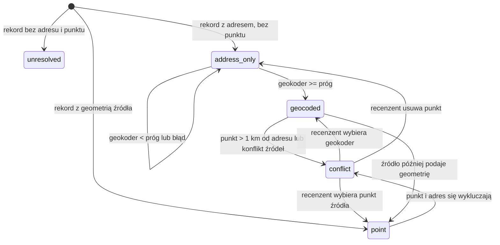

# Źródła adresowe bez geometrii: model, geokodowanie i publikacja

| | |
| --- | --- |
| Data | 2026-11-21 |
| Wersja | 1.0 (projekt do review) |
| Zakres | model rekordu z `lat/lon = NULL`, pipeline geokodowania, weryfikacja, publikacja, konfiguracja źródła |
| Dokument bazowy | [`../aed-data-sources-common-schema.md`](../aed-data-sources-common-schema.md), sekcje 6, 7, 10, 13, 14, 15 |
| Powiązane | [`aed-data-quality-spec.md`](./aed-data-quality-spec.md), [`source-config-lifecycle.md`](./source-config-lifecycle.md), [`public-api-and-filters.md`](./public-api-and-filters.md), [`address-only-source-priority.md`](./address-only-source-priority.md) |
| Status | projekt; nie zmienia kontraktu publicznego bez migracji opisanej w sekcji 10 |

## 0. TL;DR

1. **Geometria jest opcjonalna, ale nie jest zgadywana.** Rekord może istnieć bez `lat/lon` jako `location_status=address_only`. Brak punktu nie jest błędem krytycznym, jeśli istnieje adres.
2. **Adres jest dowodem lokalizacji, nie dowodem urządzenia.** Geokodowanie tworzy `location_status=geocoded`, ale nie zmienia `verification_status` i nie daje `confirmed`.
3. **Trzy osobne pojęcia:** `location_status` (skąd punkt), `verification_status` (czy urządzenie potwierdzone) i `confidence` (jakość rekordu). Nie wolno ich mieszać.
4. **Domyślnie adresowe rekordy nie trafiają na mapę ani do GeoJSON.** Są widoczne w panelu, w wewnętrznym CSV i w API tylko z jawnym `include_address_only=true`.
5. **Geokoder musi być deterministyczny i wersjonowany.** Zapisujemy provider, wersję, wejście, wynik, confidence i precyzję. Ten sam adres i ta sama wersja dają ten sam punkt.
6. **Geokodowanie tylko z adresu.** Nazwa obiektu, sama miejscowość albo „centrum gminy” nie wystarcza do punktu na mapie.
7. **Punkt z geokodera nie może wyprzedzić źródła.** Jeśli źródło ma współrzędne, wygrywa źródło. Geokodowanie jest fallbackiem, nie korektą.
8. **Listy B i B- są najpierw narzędziem weryfikacji OSM, potem kandydatami.** Nie zasypujemy mapy punktami z geokodowania bez porównania z OpenAEDMap.
9. **Licencja jest bramką.** 53 źródła B/B- nie mają otwartej licencji. Do czasu zgody wydawcy wolno je przetwarzać tylko wewnętrznie (`publish.enabled=false`), a nie publikować.
10. **Priorytety są jawnie scoringowane.** Kolejność wdrożenia opisuje [`address-only-source-priority.md`](./address-only-source-priority.md), a nie „wielkość gminy”.

## 1. Problem

W rejestrze źródeł jest 44 list klasy B i 9 klasy B-. Większość podaje nazwę obiektu i adres, ale nie współrzędne. Obecny model kanoniczny wymaga `lat` i `lon`, a walidacja traktuje `MISSING_COORDS` jako `fatal`. To wypycha wartościowe dowody poza system albo zachęca do tworzenia fałszywych punktów z centroidu gminy.

Jednocześnie część źródeł ma geometrię, ale niepełny adres. Potrzebny jest model, który:

- przyjmuje adres bez punktu,
- przyjmuje punkt bez adresu,
- rozróżnia punkt ze źródła od punktu z geokodera,
- nie publikuje adresu jako punktu bez oznaczenia,
- pozwala użyć listy adresowej do weryfikacji istniejącego rekordu OSM,
- nie tworzy duplikatów ani fałszywej pewności.

## 2. Zasady nadrzędne

1. **Brak geometrii to `NULL`, nie `0,0` i nie centroid.** `0,0` jest błędem `geo.coord.null_island`.
2. **Brak adresu i brak geometrii to `unresolved`, nie `address_only`.** Nie ma czego geokodować.
3. **Adres bez numeru nie daje punktu budynku.** Maksymalnie ulica (`200 m`) albo miejscowość (`1000 m`), a miejscowość nie jest publikowana jako punkt AED.
4. **Punkt z geokodera jest zawsze oznaczony w UI.** Ikona „lokalizacja przybliżona”, `coord_precision_m` i `location_status=geocoded`.
5. **Geokodowanie nie jest weryfikacją.** `verification_status` zależy od dowodu istnienia urządzenia, nie od jakości adresu.
6. **`confidence` rekordu nie rośnie od samego geokodowania.** Rośnie od niezależnego potwierdzenia (operator, urząd, oględziny, drugie źródło).
7. **Proweniencja per pole.** `lat`, `lon`, `address_text` i `coord_precision_m` mają własne `field_provenance`.
8. **Idempotencja.** Ten sam adres, ten sam geokoder i ta sama wersja reguł dają ten sam wynik.
9. **Widoczność jest domyślnie zamknięta.** Adresowe rekordy nie wychodzą publicznie bez decyzji i bramki jakości.

## 3. Model danych

### 3.1 Nowe i zmienione pola

| Pole | Typ | Wymagane | Znaczenie |
| --- | --- | --- | --- |
| `location_status` | enum | tak | `point`, `geocoded`, `address_only`, `unresolved`, `conflict` |
| `geom_source` | enum | warunkowo | `source`, `geocode`, `registry`, `survey`, `derived`, `none` |
| `lat` | float/null | warunkowo | wymagane tylko dla `point` i `geocoded` |
| `lon` | float/null | warunkowo | wymagane tylko dla `point` i `geocoded` |
| `coord_precision_m` | float/null | nie | tylko dla `point` i `geocoded`; `null` dla `address_only` |
| `address_text` | string/null | nie | pełny adres do wyświetlenia, nie nadpisuje pól strukturalnych |
| `address_kind` | enum | nie | `building`, `street`, `locality`, `object_only`, `none` |
| `address_confidence` | float/null | nie | jakość dopasowania adresu, 0-1 |
| `address_source` | enum | nie | `source`, `registry`, `geocode`, `derived` |
| `geocode_provider` | string/null | nie | np. `uug`, `prg`, `nominatim` |
| `geocode_version` | string/null | nie | wersja danych i algorytmu geokodera |
| `geocode_confidence` | float/null | nie | confidence dopasowania geokodera, 0-1 |
| `geocoded_at` | datetime/null | nie | czas obliczenia, nie czas weryfikacji |
| `geocode_input_sha256` | string/null | nie | hash znormalizowanego adresu wejściowego |
| `geocode_note` | string/null | nie | powód braku punktu lub wybrany poziom dopasowania |
| `publish_state` | enum | tak | `published`, `quarantined`, `archived` (z quality spec) |

`location_status` jest polem wyprowadzanym, ale zapisywanym, żeby API, eksport i panel nie musiały powtarzać logiki.

### 3.2 Niezmienniki bazy

```sql
-- facility
lat REAL,
lon REAL,
CHECK (
  (lat IS NULL AND lon IS NULL)
  OR (lat IS NOT NULL AND lon IS NOT NULL)
),
CHECK (
  location_status IN ('point','geocoded','address_only','unresolved','conflict')
),
CHECK (
  (location_status IN ('point','geocoded') AND lat IS NOT NULL AND lon IS NOT NULL)
  OR (location_status IN ('address_only','unresolved','conflict'))
),
CHECK (
  (location_status = 'point' AND geom_source IN ('source','registry','survey','derived'))
  OR (location_status = 'geocoded' AND geom_source = 'geocode')
  OR (location_status IN ('address_only','unresolved','conflict'))
)
```

Dodatkowo:

- `aed.facility_id` pozostaje `NOT NULL`. Urządzenie zawsze ma miejsce, nawet jeśli miejsce nie ma punktu.
- `facility.lat/lon` przestaje być `NOT NULL`. To rozluźnienie ograniczenia, nie zmiana destrukcyjna: istniejące wiersze zostają.
- Indeks `idx_facility_geo` działa tylko dla `lat IS NOT NULL`; zapytania mapowe dodają warunek `location_status IN ('point','geocoded')`.
- `field_provenance` dla `lat/lon` wskazuje `source_record_id` źródła albo rekord `geocode_attempt`.

### 3.3 Diagram stanów lokalizacji



### 3.4 Znaczenie stanów

| `location_status` | `lat/lon` | `geom_source` | Publikacja mapowa | Typowe użycie |
| --- | --- | --- | --- | --- |
| `point` | tak | `source`, `registry`, `survey`, `derived` | tak, jeśli reszta bramek przeszła | OSM, KML, CSV z współrzędnymi |
| `geocoded` | tak | `geocode` | tak, ale z ikoną przybliżenia i tylko confidence >= 0.8 | adres z listy B/B+ |
| `address_only` | `NULL` | `none` | nie | lista adresowa bez geokodera lub poniżej progu |
| `unresolved` | `NULL` | `none` | nie | tylko nazwa obiektu, brak adresu |
| `conflict` | zależnie | zależnie | nie, do review | punkt i adres się wykluczają |

## 4. Reguły dopuszczania rekordu

### 4.1 Macierz decyzji

| Adres | Punkt źródła | Wynik importu | `location_status` | Publikacja |
| --- | --- | --- | --- | --- |
| pełny (ulica + numer) | tak, spójny | accept | `point` | tak |
| pełny | nie | accept, geocode | `geocoded` lub `address_only` | tak tylko po geocode >= 0.8 |
| ulica bez numeru | nie | accept | `address_only` | nie |
| tylko miejscowość | nie | accept jako `unresolved`/`address_only` | `address_only` | nie |
| tylko nazwa obiektu | nie | review, brak geokodowania | `unresolved` | nie |
| brak adresu | tak | accept | `point` | tak |
| brak adresu | nie | quarantine z `geo.location.missing` | `unresolved` | nie |
| pełny | tak, > 5 km | quarantine | `conflict` | nie |
| pełny | tak, <= 5 km | accept, warning | `point` | tak |

### 4.2 Kody błędów i wag

| Kod | Waga | Znaczenie |
| --- | --- | --- |
| `geo.location.missing` | `quarantine` | brak adresu i punktu; rekord zostaje jako dowód, nie do publikacji |
| `geo.address.partial` | `warning` | adres bez numeru lub bez kodu pocztowego |
| `geo.address.object_only` | `quarantine` | tylko nazwa obiektu, brak adresu |
| `geo.geocode.low_confidence` | `warning` | geokoder poniżej progu publikacji |
| `geo.geocode.no_match` | `warning` | brak dopasowania, `address_only` |
| `geo.geocode.provider_error` | `warning` | błąd dostawcy, retry później |
| `geo.geocode.out_of_poland` | `fatal` | wynik geokodera poza Polską |
| `geo.geocode.source_area_far` | `quarantine` | wynik poza obszarem źródła |
| `geo.geocode.address_far` | `quarantine` | wynik > 5 km od adresu z listy |
| `geo.geocode.conflict_with_source` | `quarantine` | punkt źródła i geokoder się wykluczają |
| `geo.address.conflict` | `quarantine` | dwa różne adresy dla tego samego urządzenia |
| `geo.coord.null_island` | `fatal` | `0,0` lub współrzędne równe zeru |

Zmiana względem quality spec: `MISSING_COORDS` przestaje być `fatal`, gdy istnieje adres. Dla adresu bez punktu decyzja to `accept` z `location_status=address_only`, a nie `reject`. `MISSING_LOCATION` (brak adresu i punktu) pozostaje `quarantine`, nie `fatal`, bo rekord może być dowodem do ręcznego uzupełnienia.

### 4.3 Wpływ na `confidence`

- `address_only` obniża `field_completeness` o brak geometrii, ale nie zeruje rekordu.
- `geocoded` nie dodaje punktów za lokalizację. Może dodać maksymalnie `+0.05` za spójność adresu z istniejącym rekordem.
- `point` ze źródła zachowuje normalne scoring.
- `conflict` nie publikuje i trafia do review z priorytetem P1.

## 5. Deduplikacja bez geometrii

Blocking i scoring z [`../architecture/dedup.md`](../architecture/dedup.md) już przewidują klucz `address`. Uzupełnienie:

1. **Klucz adresowy** `teryt_commune|ulic|house_number` lub `street|house|city` działa bez `lat/lon`.
2. **Para address-only z address-only** może dojść do `0.85` tylko przy zgodnym adresie, nazwie i operatorze. Sama zgodność adresu daje maksymalnie `0.60`, czyli review, nie auto-merge.
3. **Para address-only z point**:
   - adres zgodny i odległość punktu od geokodu adresu <= 50 m: `+0.20`,
   - adres zgodny, ale punkt > 1 km: `conflict.location.implausible` / `quarantine`,
   - brak adresu w punkcie: tylko `name` + `city`, maksymalnie review.
4. **Jedno `facility`, wiele `aed`** nadal obowiązuje. Lista adresowa z jednym adresem i dwoma etykietami tworzy dwa `aed`.
5. **Geokodowane punkty nie są niezależnym dowodem w `f_x`.** Dwa rekordy geokodowane z tego samego adresu nie mogą się wzajemnie „potwierdzić”.
6. **Alias bez punktu** jest poprawny. `aed_alias` wiąże `source_record` z `aed`; geometria nie jest wymagana.

## 6. Pipeline geokodowania

### 6.1 Etapy

```text
1. Zbierz adres z pól strukturalnych, nie z address_text, jeśli pola istnieją.
2. Znormalizuj: ulica, numer, kod, miejscowość, gmina, TERYT.
3. Sprawdź gotowość: miejscowość + (ulica lub pełny adres). Inaczej address_only.
4. Rozwiąż TERYT/SIMC/ULIC przez PRG.
5. Uruchom kaskadę geokoderów według konfiguracji źródła.
6. Odfiltruj wyniki poza Polską, poza obszarem źródła i na morzu.
7. Porównaj z istniejącymi AED w promieniu 1 km.
8. Zapisz geocode_attempt, provenance i location_status.
9. Jeśli confidence poniżej progu: address_only + review.
10. Jeśli wynik spójny: geocoded, ale verification_status bez zmian.
```

### 6.2 Kaskada providerów

| Kolejność | Provider | Rola | Precyzja | Uwagi |
| ---: | --- | --- | --- | --- |
| 1 | PRG/TERYT (GUS) | walidacja gminy, miejscowości, ulicy, SIMC/ULIC | miejscowość, ulica | dane referencyjne, nie punkt AED |
| 2 | UUG / Krajowa Integracja Numeracji Adresowej | punkt adresowy | budynek | sprawdzić warunki i licencję usługi |
| 3 | PRG adresy / państwowy rejestr granic | punkt adresowy | budynek | preferowany dla adresów urzędowych |
| 4 | Nominatim/OSM | fallback ulica/budynek | ulica, budynek | rate limit, atrybucja ODbL, cache |
| 5 | Geoportal WMS `Defibrylatory` | wyłącznie overlay OSM | brak | nie jest geokoderem adresów |

Geokoder nie może być dowolnym serwisem komercyjnym z ToS zabraniającym cache i redystrybucji. Wynik musi być przechowywalny i odtwarzalny.

### 6.3 Progi i precyzja

| Dopasowanie | Minimalny `geocode_confidence` | `coord_precision_m` | `location_status` | Publikacja |
| --- | ---: | ---: | --- | --- |
| budynek / punkt adresowy | 0.80 | 50 | `geocoded` | tak |
| ulica | 0.80 | 200 | `geocoded` | tak, jeśli adres ma numer |
| miejscowość | 0.60 | 1000 | `address_only` | nie |
| brak | - | null | `address_only` | nie |

`coord_precision_m` nie może być mniejsze niż 15 m bez pomiaru. Geokoder nie daje `5 m`.

### 6.4 Kontrola spójności

Po otrzymaniu kandydata punktu:

```text
if point outside PL bbox: reject geocode
if point outside declared source area by > 30/50/150 km: quarantine
if address was full and point > 5000 m from address centroid: quarantine
if point on sea and no source evidence: warning/review
if existing AED within 25 m and address matches: link, not duplicate
if existing AED within 1 km but address differs materially: conflict/review
```

Test obszaru źródła korzysta z `coverage.teryt` i centroidu gminy/powiatu/województwa, tak jak quality spec 3.3.3.

### 6.5 Determinizm i cache

- Klucz cache: `sha256(normalized_address + provider + geocode_version + country_code)`.
- `geocode_version` zawiera wersję danych providera i wersję algorytmu.
- TTL domyślnie 180 dni dla trafień, 30 dni dla braku trafienia.
- Ponowne geokodowanie tego samego adresu nie tworzy nowego `geocode_attempt`, jeśli wynik i wersja są identyczne.
- Błąd providera nie czyści poprzedniego punktu; zostawia ostatni znany wynik z `geocode_note=stale`.
- Wszystkie wywołania mają rate limit i `User-Agent` z kontaktem.

### 6.6 Tabela `geocode_attempt`

```sql
CREATE TABLE geocode_attempt (
  id                  TEXT PRIMARY KEY,
  facility_id         TEXT NOT NULL REFERENCES facility(id),
  input_sha256        TEXT NOT NULL,
  normalized_address  TEXT NOT NULL,
  provider            TEXT NOT NULL,
  provider_version    TEXT,
  status              TEXT NOT NULL,        -- hit | no_match | error | stale
  match_level         TEXT,                 -- building | street | locality | none
  confidence          REAL,
  lat                 REAL,
  lon                 REAL,
  precision_m         REAL,
  raw_result_json     TEXT,
  error               TEXT,
  attempted_at        TEXT NOT NULL,
  UNIQUE (input_sha256, provider, provider_version)
);

CREATE INDEX idx_geocode_facility ON geocode_attempt(facility_id, attempted_at);
```

`facility` przechowuje wynik ostatniego zaakceptowanego geokodu. Historia zostaje w `geocode_attempt` i `field_provenance`.

## 7. Weryfikacja i promocja

### 7.1 Cztery poziomy pewności

| Poziom | Znaczenie | Czy geokodowanie może go dać |
| --- | --- | --- |
| `candidate` | rekord z rejestru/listy, niepotwierdzony | nie, to stan wejściowy |
| `unverified` | urządzenie zgłoszone, brak niezależnego dowodu | nie |
| `probable` | oficjalne źródło + spójny adres/operator, brak potwierdzenia terenowego | nie samo geokodowanie |
| `confirmed` | operator, urząd, oględziny, zgłoszenie z dowodem | nie |

### 7.2 Zasady promocji

1. Geokodowanie **nigdy** nie promuje do `confirmed`.
2. `probable` z listy B wymaga: pełny adres + nazwa instytucji + co najmniej jedno niezależne potwierdzenie (np. wpis OSM, strona operatora, rejestr KSRG).
3. Sama lista B, nawet oficjalna, daje `candidate` lub `unverified`.
4. Zgodność z istniejącym `aed` w OSM w odległości <= 50 m i ten sam adres podnosi `confidence` i tworzy `aed_alias`, ale nie zmienia statusu na `confirmed`.
5. Rozbieżność adresu > 1 km trafia do review jako `conflict.location.implausible`.
6. `last_verified_at` nie jest ustawiane przez geokoder. Geokodowanie to `geocoded_at`.

### 7.3 Rola list B i B- w weryfikacji

Lista adresowa jest dowodem istnienia instytucji i lokalizacji, nie dowodem konkretnego egzemplarza AED. Dla istniejącego rekordu OSM:

```text
match address + name/operator + distance <= 150 m
  -> observation z verification_method=official_list
  -> confidence +0.10 (maks. 0.85)
  -> status pozostaje probable, chyba że operator potwierdził urządzenie
```

Brak dopasowania:

```text
pełny adres + nazwa instytucji + źródło oficjalne
  -> nowy aed jako candidate, location_status=geocoded lub address_only
  -> is_public=false do decyzji recenzenta
```

Sama nazwa obiektu bez adresu nie tworzy rekordu `aed`. Tworzy `facility` i `review_item` do uzupełnienia.

## 8. Publikacja, API i eksport

### 8.1 Macierz widoczności

| Kanał | `point` | `geocoded` | `address_only` | `unresolved` | `conflict` |
| --- | --- | --- | --- | --- | --- |
| Mapa publiczna | tak | tak, ikona przybliżenia | nie | nie | nie |
| GeoJSON publiczny | tak | tak, z `location_status` | nie | nie | nie |
| CSV publiczny | tak | tak | nie | nie | nie |
| API JSON domyślnie | tak | tak | nie | nie | nie |
| API `include_address_only=true` (tylko źródła z prawem publikacji) | tak | tak | tak | nie | nie |
| Panel administracyjny | tak | tak | tak | tak | tak |

### 8.2 Kontrakt API

Nowe pole w każdym rekordzie:

```json
"location": {
  "status": "geocoded",
  "lat": 52.2297,
  "lon": 21.0075,
  "coord_precision_m": 50,
  "geom_source": "geocode",
  "geocoder": "uug",
  "geocoded_at": "2026-11-21T18:00:00Z",
  "geocode_confidence": 0.86,
  "address_kind": "building",
  "address": {
    "city": "Warszawa",
    "street": "aleja Solidarności",
    "house_number": "1",
    "postcode": "00-001",
    "teryt_commune": "1465011"
  }
}
```

Dla `address_only`:

```json
"location": {
  "status": "address_only",
  "lat": null,
  "lon": null,
  "coord_precision_m": null,
  "geom_source": "none",
  "address_kind": "building",
  "address": { "...": "..." }
}
```

Parametry:

- `location_status` w `GET /api/v1/aed`, CSV, np. `location_status=geocoded,address_only`.
- `include_address_only` domyślnie `false`. Włączenie wymaga `limit <= 200`, żeby nie ciągnąć całej bazy adresowej.
- `sort=distance` pomija rekordy bez punktu.
- `bbox` i `near` zwracają tylko `point`/`geocoded`.
- `GET /api/v1/aed.geojson` nigdy nie zawiera `address_only`. Feature ma `geometry: null` tylko, gdy jawnie dopuszczono `include_address_only` w JSON API, nie w GeoJSON.

### 8.3 Eksport CSV

Dodaj kolumny:

```text
location_status,geom_source,coord_precision_m,geocode_provider,
geocode_confidence,geocoded_at,address_kind,address_confidence
```

Dla `address_only` `lat` i `lon` są puste. `coord_precision_m` jest puste. Nagłówek zostaje na końcu, żeby nie łamać istniejących parserów przed major release.

### 8.4 UI

- Punkt `geocoded`: ikona z obwódką lub wzorem, tooltip „Lokalizacja przybliżona (50 m)”, link do adresu.
- `address_only`: tylko lista i panel, brak pinezki.
- `conflict`: czerwony wpis w kolejce review z dwoma kandydatami lokalizacji.
- Filtr „Pokaż bez lokalizacji” w panelu administracyjnym, nie w mapie publicznej.
- Atrybucja geokodera w stopce mapy, jeśli dane pochodzą z OSM/Nominatim.

## 9. Konfiguracja źródła

### 9.1 Nowa sekcja `geocoding`

```yaml
geocoding:
  enabled: true
  strategy: structured_first       # structured_first | text_first | structured_only
  provider_order: [uug, prg, nominatim]
  address_template: "{street} {house_number}, {postcode} {city}, {commune}, PL"
  required_components: [city]
  min_confidence: 0.8
  precision_m:
    building: 50
    street: 200
    locality: 1000
  on_failure: address_only         # address_only | review | reject
  cache_ttl_days: 180
  refresh_after_days: 365
  rate_limit:
    requests_per_minute: 60
  verification:
    cross_check_source_id: openaedmap
    max_distance_m: 150
    promote_verification: never    # never | probable
```

### 9.2 Zmiany w `validate`

- `validate.coords.on_missing`: `accept` | `review` | `reject`, domyślnie `review`.
- `validate.required` nie może wymagać `lat`/`lon`, jeśli źródło jest adresowe.
- Nowe pole `validate.require_location`: `none` | `address_or_point` | `point`, domyślnie `address_or_point` dla adresowych, `point` dla mapowych.
- `on_error` nie zamienia `address_only` na `reject`, jeśli adres jest pełny.

### 9.3 Zmiany w schemacie JSON

Schemat [`../../backend/ingest/source-config.schema.json`](../../backend/ingest/source-config.schema.json) dostaje:

- opcjonalne `geocoding`,
- `validate.coords.on_missing`,
- `validate.require_location`,
- pola kanoniczne `location_status`, `geom_source`, `address_kind`, `address_confidence`, `geocode_*`,
- nową rodzinę connectora `html_list` i parser `html_list`.

Szablon: [`../../backend/ingest/examples/generic-address-list.yaml`](../../backend/ingest/examples/generic-address-list.yaml).

## 10. Migracja i wdrożenie

### 10.1 Kolejność

1. Migracja `facility`: `lat/lon` nullable, nowe pola, CHECK-i.
2. Tabela `geocode_attempt` i indeksy.
3. Normalizer: `location_status`, `address_kind`, walidacja `geo.location.missing`.
4. Geocoder: kaskada, cache, rate limit, `geocode_version`.
5. API i CSV: pola, filtr, `include_address_only`.
6. Panel: filtry, review, akceptacja geokodu.
7. Eksport GeoJSON: wykluczenie `address_only`.
8. Dashboard i metryki.

### 10.2 Zgodność wstecz

- Rekordy z `lat/lon` dostają `location_status=point`, `geom_source=source`, jeśli brak wartości.
- Rekordy bez `lat/lon` dostają `location_status=unresolved` do czasu migracji adresu.
- Publiczne API w `v1` dodaje pola, nie zmienia istniejących. `geometry` w GeoJSON pozostaje `Point` dla rekordów publikowanych.
- Stare klienty CSV zobaczą nowe kolumny na końcu; nie zmieniamy kolejności istniejących.

### 10.3 Rollback

- Migracja jest addytywna. Rollback aplikacji nie wymaga cofania kolumn.
- Jeśli geokoder jest wyłączony, rekordy zostają `address_only`; nie ma potrzeby usuwania punktów.
- `retract` źródła usuwa aliasy i obserwacje, ale nie usuwa `facility` ani `aed` innych źródeł.

## 11. Operacje i metryki

| Metryka | Znaczenie | Alert |
| --- | --- | --- |
| `aed_records_total{location_status}` | rozkład stanów | spadek `point` > 10% |
| `geocode_requests_total{provider,status}` | ruch i błędy | error rate > 5% przez 15 min |
| `geocode_latency_seconds` | czas odpowiedzi | p95 > 2 s |
| `geocode_fallback_ratio` | udział Nominatim | > 30% |
| `address_only_ratio{source}` | źródła bez punktów | > 90% dla źródła mapowego |
| `geocode_conflicts_total` | konflikty punkt/adres | > 1% rekordów źródła |
| `location_status_regression_total` | punkt zmienił się w address_only | > 0 bez nowej wersji |
| `geocode_cache_hit_ratio` | skuteczność cache | < 50% |

Logi nie zawierają pełnego adresu, jeśli adres może wskazywać osobę fizyczną. W logach jest `facility_id` i hash adresu.

## 12. Testy akceptacyjne

1. Rekord z adresem i bez współrzędnych zapisuje się z `lat=NULL`, `location_status=address_only`, nie trafia do GeoJSON.
2. Geokoder zwraca budynek z confidence 0.86: `location_status=geocoded`, `coord_precision_m=50`, `verification_status` bez zmian.
3. Geokoder zwraca miejscowość: `location_status=address_only`, `review_item` z `geo.geocode.low_confidence`.
4. Geokoder zwraca punkt poza Polską: brak zapisu punktu, `geo.geocode.out_of_poland`.
5. Punkt źródła i adres 6 km od siebie: `location_status=conflict`, `review_item` P1.
6. Dwa adresowe rekordy z tym samym adresem i różnymi etykietami: dwa `aed`, jedno `facility`.
7. Adresowy rekord OSM i lista B z tym samym adresem: jeden `aed`, dwa aliasy, `confidence` +0.05, status nadal `probable`.
8. Lista B bez adresu, tylko nazwa obiektu: `unresolved`, brak `aed`, jest `review_item`.
9. `GET /api/v1/aed` domyślnie nie zwraca `address_only`; z `include_address_only=true` zwraca i ma `lat=null`.
10. `GET /api/v1/aed.geojson` nie zawiera `address_only` nawet z flagą.
11. Ten sam adres i wersja geokodera dają identyczny `geocode_attempt` (idempotencja).
12. Zmiana `geocode_version` tworzy nowy `geocode_attempt`, ale nie zmienia `aed_id`.
13. `source_config` z `validate.required: [name, address_text]` i bez `lat/lon` przechodzi walidację schematu.
14. Rekord z `lat=0, lon=0` dostaje `geo.coord.null_island` i nie jest publikowany.
15. Rekord `address_only` nie jest liczony do `sort=distance` ani `bbox`.

## 13. Decyzje do podjęcia

| ID | Pytanie | Rekomendacja |
| --- | --- | --- |
| A1 | Czy `address_only` może być publiczne w JSON API? | tak, tylko z jawną flagą i limitem, nigdy w GeoJSON |
| A2 | Czy geokodowany punkt może mieć `verification_status=probable`? | nie; tylko `unverified`/`candidate`, chyba że niezależny dowód |
| A3 | Który geokoder jest domyślny? | UUG/PRG dla budynków, Nominatim jako fallback z cache |
| A4 | Czy listy B bez licencji mogą wejść do bazy? | tak, jako wewnętrzne `candidate`, `publish.enabled=false` |
| A5 | Czy `address_only` liczy się do pokrycia kraju? | tak, w metryce `coverage_address_only`, nie w `coverage_mapped` |
| A6 | Czy CSV publiczny ma domyślnie zawierać `address_only`? | nie; flaga `include_address_only=true` |
| A7 | Czy geokodować listy B- bez adresów? | nie; najpierw OCR/ręczne uzupełnienie adresu |
| A8 | Czy `coord_precision_m` dla ulicy ma być 200 m? | tak, zgodnie z quality spec 3.3.4 |

## 14. Zadania implementacyjne

| ID | Zadanie | Zależy od |
| --- | --- | --- |
| I1 | Migracja `facility` + `geocode_attempt` | - |
| I2 | Rozszerzenie schematu source config | I1 |
| I3 | `location_status` w normalizerze i quality engine | I1 |
| I4 | Kaskada geokoderów + cache | I1 |
| I5 | Filtr `include_address_only` i pola API | I3 |
| I6 | CSV i GeoJSON | I5 |
| I7 | Panel review dla `conflict` i `address_only` | I3 |
| I8 | Metryki i alerty | I4 |
| I9 | Testy z sekcji 12 | I1-I8 |
| I10 | Import pilotażowy B/B+ z listy priorytetów | I2, I4 |
