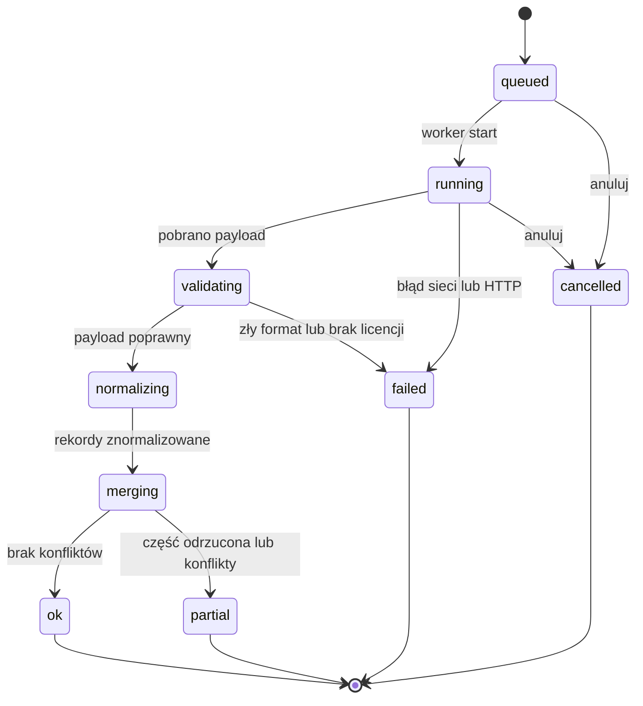

# Panel administracyjny: źródła, przebiegi i kolejka review

| | |
| --- | --- |
| Wersja | 1.0 |
| Zależy od | [`../aed-data-sources-common-schema.md`](../aed-data-sources-common-schema.md), sekcje 6, 9, 13 |
| Dotyczy | `src/routes/admin/**`, `src/routes/api/admin/**`, `src/db/schema.ts`, role w better-auth |
| Status | projekt do implementacji |

## 1. Cel i granice

Panel administracyjny ma pozwolić redakcji i administratorom na:

1. **Dodać i utrzymać źródło danych** wraz z licencją, zakresem referencyjnym i harmonogramem.
2. **Uruchomić, zatrzymać i ocenić przebieg pobierania** bez zaglądania do bazy przez `sqlite3`.
3. **Rozstrzygnąć konflikty i duplikaty** na podstawie dowodów źródłowych, nie przeczuć.
4. **Zobaczyć, co dokładnie trafi do eksportu i na dane.gov.pl** przed publikacją.
5. **Mieć ślad audytowy** każdej zmiany, zwłaszcza licencyjnej.

Panel **nie jest** miejscem tworzenia rekordów AED od zera. Do tego służy formularz opiekuna urządzenia i zgłoszenia publiczne. Panel może jedynie korygować rekord kanoniczny z zachowaniem obserwacji źródłowej.

## 2. Role i uprawnienia

Role są przechowywane w tabeli `user_role` (rozszerzenie tabeli użytkownika better-auth). Jedna osoba może mieć więcej niż jedną rolę.

| Rola | Kto | Może | Nie może |
| --- | --- | --- | --- |
| `admin` | właściciel systemu, osoba prawna | wszystko, w tym licencje, usuwanie źródeł, eksport, role | nic poza celowym usunięciem konta |
| `editor` | redakcja danych | dodawać i edytować źródła bez pól licencyjnych, uruchamiać przebiegi, rozstrzygać review, publikować eksport | zmieniać licencji, usuwać źródeł, zarządzać rolami |
| `steward` | opiekun urządzenia lub instytucji | edytować przypisane rekordy i zgłoszenia, dodawać zdjęcia, potwierdzać przegląd | dodawać źródeł, uruchamiać przebiegów, widzieć cudze zgłoszenia |
| `viewer` | audytor, osoba oceniająca | czytać wszystko poza polami ograniczonymi | cokolwiek zmieniać |

Publiczny użytkownik nie ma żadnej z tych ról. Publiczna mapa i API nie sprawdzają sesji.

### 2.1 Macierz uprawnień

| Akcja | admin | editor | steward | viewer | public |
| --- | --- | --- | --- | --- | --- |
| Podgląd dashboardu | TAK | TAK | TAK (tylko własne) | TAK | NIE |
| Lista źródeł | TAK | TAK | NIE | TAK | NIE |
| Dodanie źródła | TAK | TAK | NIE | NIE | NIE |
| Zmiana pól licencyjnych | TAK | NIE | NIE | NIE | NIE |
| Włączenie/wyłączenie harmonogramu | TAK | TAK | NIE | NIE | NIE |
| Ręczne uruchomienie przebiegu | TAK | TAK | NIE | NIE | NIE |
| Anulowanie przebiegu | TAK | TAK | NIE | NIE | NIE |
| Rozstrzygnięcie review | TAK | TAK | NIE | NIE | NIE |
| Edycja rekordu kanonicznego | TAK | TAK | TAK (własny) | NIE | NIE |
| Eksport i publikacja | TAK | TAK | NIE | NIE | NIE |
| Audyt | TAK | TAK | NIE | TAK | NIE |
| Zarządzanie rolami | TAK | NIE | NIE | NIE | NIE |

Guardy działają po stronie serwera. Ukrycie przycisku w UI jest tylko wygodą, nie zabezpieczeniem.

### 2.2 Zasada czterech oczu

Zmiana któregokolwiek z pól: `license_id`, `license_url`, `attribution`, `is_machine_readable`, `allowed_for_ingest` wymaga:

1. zapisu propozycji przez `editor` lub `admin`,
2. zatwierdzenia przez innego `admin`,
3. wpisu `audit_log` z `before_json`, `after_json`, `actor`, `approved_by`.

Na prototypie wystarczy jeden `admin` i jawne potwierdzenie w dialogu, ale schemat danych musi przewidywać `approved_by`.

## 3. Architektura informacji

```text
/admin
  /admin/sources
    /admin/sources/new
    /admin/sources/$sourceId        (tabs: przegląd, harmonogram, pola, licencja, historia)
  /admin/runs
    /admin/runs/$runId              (timeline, liczniki, błędy, próbka, diff)
  /admin/review
    /admin/review/$itemId
  /admin/submissions
    /admin/submissions/$submissionId
  /admin/licenses
  /admin/audit
  /admin/users                      (tylko admin)
```

Wszystkie trasy `/admin/**`:

- wymagają sesji i roli innej niż publiczna,
- mają `noindex, nofollow`,
- mają rate limit 60 żądań/min na sesję,
- zwracają `401` bez sesji i `403` przy braku roli (nie `404`, żeby nie mylić z błędem),
- logują `admin.action` z `actor_id`, `route`, `entity_type`, `entity_id`.

## 4. Ekrany

### 4.1 Dashboard `/admin`

Karty KPI (bez wykresów ozdobnych):

| Karta | Wartość | Próg ostrzeżenia |
| --- | --- | --- |
| Źródła aktywne | liczba `source` z `enabled=1` | 0 |
| Źródła w błędzie | `source` z ostatnim przebiegiem `failed` | > 0 |
| Dane nieświeże | rekordy `stale` / wszystkie publiczne | > 25% |
| Kolejka review | `review_item.status=pending` | > 100 |
| Odrzucenia 24h | suma `records_rejected` | > 10% pobranych |
| Ostatni eksport | czas i status | > 26h |
| Naruszenia licencji | otwarte `license_alert` | > 0 |

Poniżej: tabela „Źródła wymagające uwagi” (ostatni przebieg, wiek danych, powód) i „Ostatnie 10 przebiegów”. Każdy wiersz linkuje do szczegółów.

### 4.2 Lista źródeł `/admin/sources`

Kolumny: `id`, nazwa, wydawca, tier, licencja, format, częstotliwość, ostatni przebieg, status, wiek danych, akcje.

Filtry: tekst, tier, licencja, `enabled`, status ostatniego przebiegu. Sortowanie po `last_run_at`, `name`, `reliability_tier`.

Akcje wiersza: szczegóły, uruchom teraz, włącz/wyłącz harmonogram (z potwierdzeniem), eksport konfiguracji (JSON).

### 4.3 Szczegóły źródła `/admin/sources/$sourceId`

Zakładki:

1. **Przegląd**: nazwa, wydawca, strona, zakres TERYT, format, auth, tier, notatki, `last_checked_at`.
2. **Harmonogram**: częstotliwość (`manual`, `hourly`, `daily`, `weekly`), okno czasowe, strefa, limit równoległości, `enabled`, następne uruchomienie, historia zmian.
3. **Pola**: macierz pokrycia pól źródła względem modelu kanonicznego (na podstawie ostatniego snapshotu). Brak pola = `null`, nie `false`. Przycisk „pokaż mapowanie” otwiera tabelę `pole źródłowe → pole kanoniczne`.
4. **Licencja**: `license_id`, `license_url`, `attribution`, `share_alike`, `allowed_for_ingest`, `allowed_for_export`, `terms_hash`, `terms_checked_at`, `approved_by`, `approval_note`. Pola tylko do odczytu dla `editor`.
5. **Historia**: przebiegi, zmiany konfiguracji, alerty licencyjne.

Walidacja formularza źródła:

| Pole | Reguła |
| --- | --- |
| `id` | `^[a-z][a-z0-9_]{2,31}$`, unikalne, niezmienne po utworzeniu |
| `name` | 3 do 120 znaków |
| `publisher` | 2 do 200 znaków |
| `homepage_url` | HTTPS lub puste |
| `access_type` | `api`, `file`, `wms`, `wfs`, `manual`, `app` |
| `license_id` | SPDX lub alias z rejestru licencji; wymagane do `allowed_for_ingest=1` |
| `reliability_tier` | `authoritative`, `official_local`, `community`, `aggregator`, `derived`, `app` |
| `update_frequency` | `manual`, `hourly`, `daily`, `weekly`, `monthly` |
| `allowed_for_ingest` | tylko `admin`, domyślnie `0` |
| `allowed_for_export` | tylko `admin`, domyślnie `0` |

### 4.4 Lista przebiegów `/admin/runs`

Kolumny: `run_id` (skrót), źródło, start, czas trwania, status, HTTP, pobrane, przyjęte, odrzucone, błąd.

Filtry: źródło, status, zakres dat, „tylko z odrzuceniami”. Domyślnie 7 dni. Paginacja kursorowa.

### 4.5 Szczegóły przebiegu `/admin/runs/$runId`

Sekcje:

1. **Podsumowanie**: status, źródło, konfiguracja użyta w przebiegu (snapshot, nie aktualna), czasy, liczniki.
2. **Timeline**: `queued → fetching → validating → normalizing → merging → done|failed|cancelled`, z czasami i `request_id`.
3. **Błędy**: pogrupowane po kodzie (`HTTP_403`, `OUT_OF_POLAND`, `DUPLICATE_SOURCE_ID`, `BAD_LICENSE`), z liczbą i linkiem do próbki.
4. **Próbka odrzuconych**: maks. 20 rekordów, z `payload_sha256`, kodem i krótkim `payload_json` (bez danych wrażliwych).
5. **Diff**: liczba dodanych, zmienionych i usuniętych rekordów kanonicznych względem poprzedniego udanego przebiegu.
6. **Akcje**: ponów (nowy przebieg z tą samą konfiguracją), anuluj (tylko `running`), oznacz jako zaakceptowany lub odrzucony (dla `partial`), pobierz log (JSONL).

### 4.6 Kolejka review `/admin/review`

Jeden `review_item` na problem. Typy:

| Typ | Powód | Dane do decyzji |
| --- | --- | --- |
| `duplicate_candidate` | scoring 0,60 do 0,80 | dwa rekordy obok siebie, odległość, adres, operator, wynik |
| `coordinate_conflict` | dwa źródła, różne współrzędne > 100 m | mapa, oba punkty, źródła |
| `bad_coordinates` | poza Polską lub odwrócona kolejność osi | współrzędne, walidacja, sugestia korekty |
| `address_only` | rekord ma adres, ale brak punktu albo geokoder jest poniżej progu | adres, źródło, wynik geokodera, akcje „geokoduj ponownie” i „zostaw bez punktu” |
| `geocode_conflict` | punkt źródła i geokoder są > 1 km od siebie albo adresy się wykluczają | mapa z dwoma kandydatami, dowody, wybór punktu |
| `address_missing` | rekord ma tylko nazwę obiektu, bez adresu i punktu | nazwa, źródło, link do BIP, akcja „poproś o adres” |
| `field_conflict` | różne `status`, `access_type`, `operator` | wartości i źródła |
| `missing_license` | rekord bez licencji lub z `BAD_LICENSE` | źródło, payload |
| `removed_candidate` | źródło zniknęło, rekord nadal w bazie | ostatnie wystąpienie, źródła alternatywne |

Akcje: **scal**, **zostaw osobno**, **popraw**, **odrzuć rekord**, **oznacz do sprawdzenia w terenie**. Każda akcja wymaga uzasadnienia (min. 10 znaków) i tworzy `audit_log`. Decyzja jest nieodwracalna bez nowej akcji kompensacyjnej.

### 4.7 Zgłoszenia `/admin/submissions`

Lista zgłoszeń publicznych: typ (`new`, `correction`, `removal`, `photo`), status, data, miejscowość, przypisany steward. Szczegóły pokazują payload, zdjęcia, zgodę RODO i historię moderacji. Akcje: przyjmij, odrzuć, poproś o informacje, połącz z istniejącym rekordem.

### 4.8 Rejestr licencji `/admin/licenses`

Tabela licencji: `id`, nazwa, URL, SPDX, `share_alike`, `attribution_required`, `commercial_ok`, `derivative_ok`, `notes`. Nowa licencja wymaga `admin`. Źródło nie może wskazywać licencji spoza rejestru.

### 4.9 Audyt `/admin/audit`

Filtry: aktor, akcja, typ encji, zakres dat. Eksport CSV dla oceniającego. Retencja 24 miesiące, potem anonimizacja aktora.

## 5. Model danych panelu

Poza tabelami z dokumentu bazowego potrzebne są:

```sql
CREATE TABLE user_role (
  user_id     TEXT NOT NULL,
  role        TEXT NOT NULL CHECK (role IN ('admin','editor','steward','viewer')),
  granted_by  TEXT,
  granted_at  TEXT NOT NULL,
  PRIMARY KEY (user_id, role)
);

CREATE TABLE review_item (
  id            TEXT PRIMARY KEY,
  type          TEXT NOT NULL,
  status        TEXT NOT NULL DEFAULT 'pending',  -- pending | accepted | rejected | needs_info
  aed_id_a      TEXT REFERENCES aed(id),
  aed_id_b      TEXT REFERENCES aed(id),
  source_id     TEXT REFERENCES source(id),
  score         REAL,
  reason_json   TEXT NOT NULL,
  created_at    TEXT NOT NULL,
  resolved_by   TEXT,
  resolved_at   TEXT,
  resolution    TEXT,
  note          TEXT
);

CREATE TABLE license_alert (
  id            TEXT PRIMARY KEY,
  source_id     TEXT REFERENCES source(id),
  kind          TEXT NOT NULL,       -- terms_changed | missing_license | forbidden_field
  status        TEXT NOT NULL DEFAULT 'open',
  detail        TEXT,
  created_at    TEXT NOT NULL,
  resolved_at   TEXT
);

CREATE TABLE metric_snapshot (
  id            TEXT PRIMARY KEY,
  metric        TEXT NOT NULL,
  value         REAL NOT NULL,
  labels_json   TEXT,
  captured_at   TEXT NOT NULL
);
```

Rozszerzenia istniejących tabel:

| Tabela | Nowe kolumny |
| --- | --- |
| `source` | `enabled`, `schedule_cron`, `timezone`, `allowed_for_ingest`, `allowed_for_export`, `terms_hash`, `terms_checked_at`, `approved_by` |
| `sync_run` | `triggered_by`, `trigger_kind` (`manual`/`schedule`/`retry`), `config_json`, `request_id`, `duration_ms`, `records_changed`, `records_removed` |
| `aed` | `locked_by`, `locked_at` (blokada edycji w panelu) |
| `submission` | `assigned_to`, `consent_version`, `ip_hash` |

Migracje przez Drizzle. Indeksy: `review_item(status, type)`, `sync_run(source_id, started_at DESC)`, `license_alert(status)`.

## 6. API administracyjne

Wszystkie pod `/api/admin`, tylko dla zalogowanych, z CSRF dla mutacji. Odpowiedzi błędów w formacie problem+json.

| Metoda | Ścieżka | Rola | Opis |
| --- | --- | --- | --- |
| GET | `/api/admin/sources` | viewer | lista z filtrami |
| POST | `/api/admin/sources` | editor | utworzenie źródła |
| GET | `/api/admin/sources/:id` | viewer | szczegóły i pokrycie pól |
| PATCH | `/api/admin/sources/:id` | editor/admin | edycja; pola licencyjne tylko admin |
| POST | `/api/admin/sources/:id/run` | editor | ręczny przebieg, `Idempotency-Key` wymagany |
| POST | `/api/admin/sources/:id/schedule` | editor | włącz/wyłącz harmonogram |
| GET | `/api/admin/runs` | viewer | lista przebiegów |
| GET | `/api/admin/runs/:id` | viewer | szczegóły, błędy, próbka |
| POST | `/api/admin/runs/:id/cancel` | editor | anulowanie |
| POST | `/api/admin/runs/:id/retry` | editor | nowy przebieg |
| GET | `/api/admin/review` | editor | kolejka |
| POST | `/api/admin/review/:id/resolve` | editor | decyzja z uzasadnieniem |
| GET | `/api/admin/submissions` | editor | zgłoszenia |
| PATCH | `/api/admin/submissions/:id` | editor | moderacja |
| GET | `/api/admin/audit` | viewer | audyt |
| GET | `/api/admin/licenses` | viewer | rejestr licencji |
| POST | `/api/admin/licenses` | admin | nowa licencja |

### 6.1 Przykład żądania uruchomienia przebiegu

```http
POST /api/admin/sources/openaedmap/run
Authorization: session cookie
Idempotency-Key: 8f14e45f-ceea-467f-a1d1-6b0a4d2c9a01
Content-Type: application/json

{ "kind": "manual", "dry_run": false }
```

Odpowiedź `202 Accepted`:

```json
{
  "run_id": "run_01J8Z3K4Q9",
  "source_id": "openaedmap",
  "status": "queued",
  "queued_at": "2026-11-21T19:30:00Z",
  "links": { "self": "/api/admin/runs/run_01J8Z3K4Q9" }
}
```

`Idempotency-Key` zapobiega podwójnemu uruchomieniu po odświeżeniu strony. Ten sam klucz w ciągu 10 minut zwraca istniejący przebieg.

### 6.2 Przykład decyzji review

```json
{
  "action": "merge",
  "keep_aed_id": "aed_01J8Z3K4Q9",
  "note": "Ten sam budynek, odległość 8 m, zgodny operator i etykieta urządzenia."
}
```

## 7. Maszyna stanów przebiegu



Zasady:

- statusy `ok`, `partial`, `failed`, `cancelled` są końcowe i niezmienne,
- ponowienie tworzy nowy `sync_run` z `trigger_kind=retry` i `retry_of`,
- przebieg `running` starszy niż 2 godziny jest oznaczany `failed` przez watchdog z powodem `TIMEOUT`,
- anulowanie nie usuwa zapisanych snapshotów ani obserwacji,
- `partial` wymaga decyzji człowieka w panelu, ale nie blokuje publikacji, jeśli odrzucone rekordy nie dotyczą nowych punktów.

## 8. Zapis i współbieżność

1. **Jeden przebieg na źródło.** Unikalny częściowy indeks `UNIQUE(source_id) WHERE status IN ('queued','running')`. Próba drugiego uruchomienia zwraca `409 Conflict` z linkiem do aktywnego przebiegu.
2. **Blokada edycji rekordu.** `aed.locked_by` i `locked_at` zapobiegają nadpisaniu przez stewarda i przebieg jednocześnie. Blokada wygasa po 15 minutach.
3. **Zapis idempotentny.** Upsert po `(source_id, source_record_id)` i `aed_alias`. Powtórny import tego samego snapshotu nie tworzy nowych rekordów.
4. **Historia przed nadpisaniem.** Każda zmiana kanoniczna zapisuje `audit_log` i nową `observation`. Nie nadpisujemy `field_provenance` bez nowego wpisu.

## 9. UX, dostępność i bezpieczeństwo

- Formularze z etykietami `label`, opisem błędu powiązanym przez `aria-describedby`, fokusem widocznym i komunikatem `role="status"` po zapisie.
- Wszystkie tabele mają wersję kartową poniżej 768 px, nie tylko poziomy scroll.
- Akcje destrukcyjne w `alert-dialog` z nazwą encji w treści.
- Żadnych ikon bez tekstu dla akcji krytycznych.
- Komunikaty błędów po polsku, z kodem technicznym w drugiej linii.
- Panel nie wyświetla numerów seryjnych, kodów dostępu ani prywatnych e-maili; pokazuje `[ograniczone]`.
- Sesja wygasa po 8 godzinach bezczynności. Mutacje wymagają ponownego potwierdzenia po 30 minutach.
- Rate limit na logowanie: 5 prób/min na IP i 10 prób/godzinę na konto.

## 10. Kryteria akceptacji panelu

1. `editor` bez roli `admin` nie może zmienić `license_id` ani `allowed_for_ingest` (403 i brak pola w formularzu).
2. Ręczne uruchomienie tego samego źródła dwa razy w ciągu 10 minut z tym samym `Idempotency-Key` daje jeden przebieg.
3. Dwa równoległe przebiegi tego samego źródła: drugi dostaje 409.
4. Każdy przebieg ma komplet liczników: pobrane, przyjęte, odrzucone, zmienione, usunięte.
5. Odrzucenia są widoczne z kodem i próbką, bez ujawniania pól ograniczonych.
6. Decyzja review wymaga uzasadnienia i tworzy wpis w audycie.
7. Panel działa na 360 px bez utraty funkcji krytycznych.
8. Wszystkie trasy `/admin/**` zwracają `401` bez sesji, `403` bez roli i `noindex`.
9. Dashboard pokazuje co najmniej jeden alert, jeśli ostatni przebieg źródła P0 jest starszy niż 26 godzin.
10. Testy autoryzacji pokrywają macierz z sekcji 2.1 dla każdej roli.

## 11. Zadania implementacyjne

| ID | Zadanie | Zależność |
| --- | --- | --- |
| A1 | Tabele `user_role`, `review_item`, `license_alert`, `metric_snapshot` + migracja | model kanoniczny |
| A2 | Guardy sesji i ról dla `/admin/**` i `/api/admin/**` | A1, better-auth |
| A3 | Layout panelu, nawigacja, stany puste i błędy | A2 |
| A4 | CRUD źródeł z walidacją i zasadą czterech oczu | A1 |
| A5 | Lista i szczegóły przebiegów, akcje run/retry/cancel | A1 |
| A6 | Kolejka review i decyzje | A1 |
| A7 | Moderacja zgłoszeń | A1 |
| A8 | Audyt i eksport | A1 |
| A9 | Testy autoryzacji i idempotencji | A2 do A6 |
| A10 | Dokumentacja użytkownika panelu (krótka, po polsku) | A3 do A8 |
