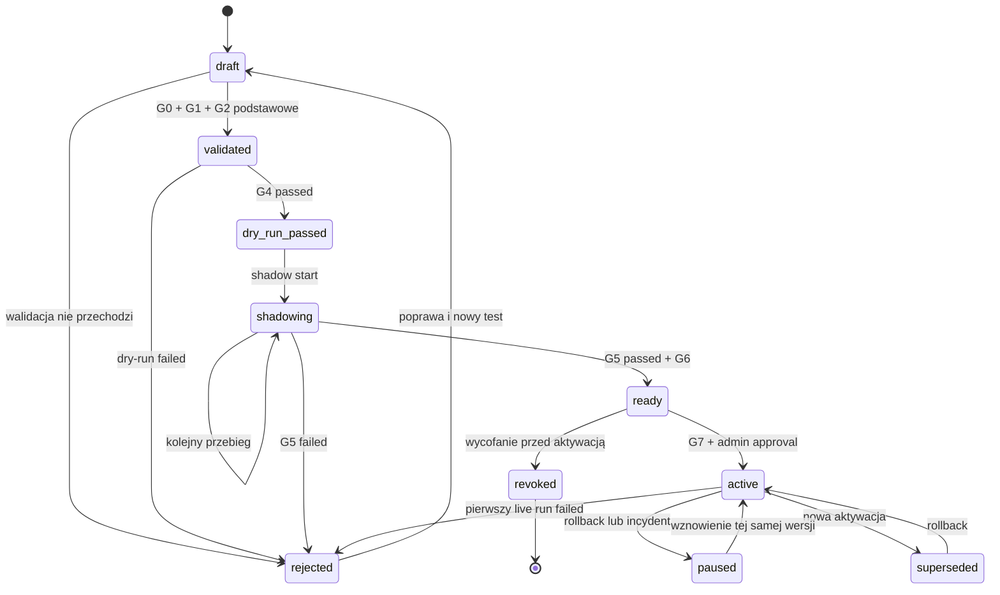

# Cykl życia konfiguracji źródła: CRUD, wersjonowanie, onboarding i bramki aktywacji

| | |
| --- | --- |
| Data | 2026-11-21 |
| Wersja | 1.0 (projekt do review) |
| Zależy od | [`../aed-data-sources-common-schema.md`](../aed-data-sources-common-schema.md), [`./admin-console.md`](./admin-console.md), [`../architecture/ingestion.md`](../architecture/ingestion.md), [`../architecture/persistence.md`](../architecture/persistence.md), [`../architecture/operations.md`](../architecture/operations.md) |
| Dotyczy | `src/routes/admin/sources/**`, `src/routes/api/admin/sources/**`, `src/server/config/**`, `src/server/ingest/**`, `src/db/schema.ts` |
| Schemat konfiguracji | [`../../backend/ingest/source-config.schema.json`](../../backend/ingest/source-config.schema.json) |
| Status | projekt do implementacji; nie zastępuje schematu konfiguracji, tylko definiuje jego cykl życia |

## 1. Cel i granice

Ten dokument rozstrzyga to, czego nie rozstrzyga ani model kanoniczny, ani sam schemat konfiguracji:

1. **Jak powstaje i zmienia się konfiguracja źródła w runtime**, bez edycji kodu i bez ręcznego SQL.
2. **Jak wersjonować konfigurację**, aby każdy przebieg był odtwarzalny, a zmiana mapowania nie mieszała danych.
3. **Jak przeprowadzić nowe źródło od URL-a do aktywacji** przez kreator, wnioskowanie pól i testy.
4. **Jakie bramki musi przejść konfiguracja** przed zapisem danych kanonicznych, jakie dowody zostają i kto je zatwierdza.
5. **Jak chronić system przed SSRF, wyciekiem sekretów, cichą zmianą licencji i nieudanym wdrożeniem**, wraz z audytem i wycofaniem.

Poza zakresem tego dokumentu:

- implementacja parserów i silnika scalania (lane `storage-pipeline`),
- kształt publicznego API i mapy ([`public-api-and-filters.md`](./public-api-and-filters.md)),
- katalog alertów i bramki licencyjne na poziomie eksportu ([`observability-licensing.md`](./observability-licensing.md)),
- plan faz wdrożenia ([`rollout-testing-acceptance.md`](./rollout-testing-acceptance.md)).

## 2. Zasady nadrzędne

1. **Konfiguracja jest danymi, nie kodem.** W runtime wolno używać wyłącznie rodzin connectorów i wyrażeń opisanych w schemacie. Nie ma `eval`, skryptów użytkownika, szablonów z dostępem do `process` i pluginów ładowanych z URL.
2. **Aktywna konfiguracja jest niezmienna.** Każda zmiana to nowa wersja. Wersja aktywna nie jest edytowana nigdy, nawet przez `admin`.
3. **Przebieg jest przypięty do wersji.** `sync_run` zapisuje `source_config_version_id` i `config_sha256`; ponowienie i replay używają tej samej wersji, a nie aktualnej.
4. **Brak zgody prawnej nie jest domyślnie naprawiany technicznie.** Wnioskowanie nie wypełnia pól licencyjnych. Źródło bez wpisu w rejestrze licencji nie przejdzie bramki.
5. **Dane z shadow nie są danymi publicznymi.** Shadow czyta i liczy, ale nie zapisuje rekordów kanonicznych, aliasów, obserwacji ani liczników nieobecności.
6. **Suchy przebieg nie jest testem aktywacyjnym.** Dry-run sprawdza format i mapowanie na próbce; shadow sprawdza zachowanie na pełnym wolumenie w izolacji. Dopiero komplet bramek pozwala aktywować.
7. **Każda decyzja jest atrybucyjna i odtwarzalna.** Wersja, bramka, aktywacja, rollback i sekret mają aktora, czas, powód i skrót dowodu.
8. **Bezpieczeństwo jest warunkiem, nie ostrzeżeniem.** URL nieprzechodzący polityki wychodzącej nie jest pobierany. Sekret w treści konfiguracji jest odrzucany, nie maskowany.
9. **Administrator widzi dowody, nie tylko przyciski.** Kreator pokazuje próbkę, wnioskowane mapowanie, stopień pewności i powód sugestii. Wartości sporne wymagają jawnego potwierdzenia.
10. **Wycofanie jest operacją pierwszoklasową.** Rollback konfiguracji, wycofanie danych z przebiegu i odtworzenie z kopii mają własne procedury i nie są ręcznym `DELETE`.

## 3. Decyzje projektowe

| ID | Decyzja | Uzasadnienie |
| --- | --- | --- |
| D11 | Źródła mają `managed_by = code \| runtime`. Rejestr w kodzie pozostaje ziarnem i źródłem zaufanym; źródła runtime są wersjonowane w bazie. UI może zrobić `fork` źródła kodowego do wersji runtime. | Nie zrywa istniejącego kontraktu z `ingestion.md`, a jednocześnie pozwala dodawać źródła bez deployu. |
| D12 | Wersja konfiguracji jest niezmiennym dokumentem JSON z `revision` rosnącym monotonicznie per źródło oraz `config_sha256` liczonym po kanonicznym JSON. `version: 1` w schemacie to `schema_version`, nie numer rewizji. | Rozdziela format dokumentu od historii zmian i pozwala porównywać wersje bez YAML-owych różnic. |
| D13 | Cykl wersji: `draft -> validated -> dry_run_passed -> shadowing -> ready -> active -> superseded`, z gałęziami `rejected`, `revoked`, `paused`. | Każde przejście ma dowód i nie da się przeskoczyć bramki. |
| D14 | Dry-run i shadow zapisują wyłącznie wyniki testu, metadane dokumentów testowych i próbki w obszarze `_tests/`. Nie tworzą `source_record`, `record_candidate`, `observation`, `aed_alias` ani `aed`. | Izolacja od danych publicznych i od liczników nieobecności. |
| D15 | Aktywacja wymaga roli `admin`, min. 2 udanych przebiegów shadow (lub 1 dla źródła `once`/`manual`/`weekly`), świeżego raportu bramek i zgodności hasha konfiguracji. | Chroni przed aktywacją konfiguracji, której nikt nie sprawdził na pełnych danych. |
| D16 | Rollback konfiguracji jest natychmiastowy dla nowych przebiegów. Przebieg już uruchomiony kończy się na przypiętej wersji. Dane z wadliwego przebiegu wycofuje się przez `retract` i rekompozycję, nie przez fizyczne kasowanie. | Odtwarzalność i brak osieroconych aliasów. |
| D17 | Sekrety są referencjami środowiskowymi `AED_*`; opcjonalny sejf zaszyfrowany (AES-256-GCM) jest rozszerzeniem dla wdrożeń bez dostępu do env. Wartość nigdy nie jest zwracana przez API. | Zgodność z `operations.md` i realna użyteczność kreatora. |
| D18 | Każdy host źródła musi przejść politykę URL i allowlistę; produkcyjnie ruch wychodzi przez proxy egress, a nie bezpośrednio z procesu aplikacji. | SSRF przy onboardingu z dowolnego URL-a jest realnym wektorem, nie teoretycznym. |
| D19 | Zmiana mapowania unieważnia kandydatów: `record_candidate` i `normalizer_version` muszą zawierać `config_revision` lub hash mapowania. Aktywacja wymusza pełny refresh. | Bez tego zmiana mapowania na tym samym payloadzie nie utworzy nowego kandydata. |
| D20 | Zmiana pól licencyjnych, pierwsza aktywacja źródła runtime oraz rollback po incydencie `license`/`security` wymagają czterech oczu, jeśli w systemie jest więcej niż jeden `admin`. Przy jednym administratorze zapisujemy `single_admin_override`. | Uczciwe zachowanie prototypu bez blokowania demo. |

## 4. Relacja do istniejących kontraktów

### 4.1 Rejestr kodowy a rejestr runtime

`ingestion.md` opisuje źródła deklarowane w kodzie i upsert do tabeli `source` przed przebiegiem. `admin-console.md` opisuje CRUD źródeł w bazie. Ten dokument godzi oba podejścia:

```text
source.managed_by = 'code'
  -> seed z rejestru w kodzie
  -> source_config_version #1, origin='code', active
  -> UI: tylko odczyt, przycisk "Utwórz wersję runtime" (fork)

source.managed_by = 'runtime'
  -> źródło utworzone kreatorem lub forkiem
  -> kolejne wersje wyłącznie przez API/panel
  -> brak zależności od deployu przy zmianie mapowania
```

Zasady:

1. Loader rejestru **nie nadpisuje** źródła `runtime`. Przy starcie pomija je i loguje `source.skipped_runtime`.
2. Źródło `code` może zostać przełączone na `runtime` wyłącznie przez `admin`, przez fork wersji. Od tego momentu rejestr kodowy jest ignorowany dla tego `source.id`.
3. `source.config_json` i `source.config_version` pozostają jako **zdenormalizowany mirror aktywnej wersji** dla kodu, który jeszcze ich używa. Są aktualizowane wyłącznie w transakcji aktywacji i nie są źródłem prawdy.
4. `source.id` jest niezmienne. Zmiana identyfikatora to nowe źródło i migracja historii, nigdy `UPDATE`.
5. Connector family i parser muszą istnieć w kodzie. Jeśli wnioskowanie wskaże format bez obsługi, kreator kończy się stanem `needs_connector`, a nie improwizowanym scraperem.

### 4.2 Wymagania integracyjne dla innych lane'ów

Te punkty nie są zmianą cudzego projektu, ale muszą wejść do wspólnego kontraktu:

| Obszar | Wymaganie | Dokument docelowy |
| --- | --- | --- |
| `source` | dodać `managed_by`, `active_config_version_id`, `config_state`, `activated_at`, `last_good_revision`, `paused_reason`, `owner`, `force_full_refresh`, `jitter_seconds` oraz mirror `schedule_cron`/`timezone` z wersji | `persistence.md` §3.1 |
| `sync_run` | dodać `source_config_version_id`, `config_sha256`, `run_mode` (`live`, `dry_run`, `shadow`), `gate_report_id` dla pierwszego przebiegu | `persistence.md` §3.2 |
| `record_candidate` | dodać `config_revision`, `sync_run_id` i status `revoked` dla retractu; rozszerzyć unikalność o `config_revision` albo o hash mapowania | `persistence.md` §3.5 |
| `observation`, `aed_alias`, `field_provenance` | dodać `sync_run_id`/`created_run_id` oraz możliwość oznaczenia `revoked_at`/`revoked_by`/`revoked_run_id`, żeby retract nie kasował historii i mógł znaleźć dane przebiegu | `persistence.md` §3.7-3.9 |
| Normalizacja | `normalizer_version` musi zawierać wersję kodu normalizera i `config_sha256[0:12]`, gdy zmienia się mapowanie | `ingestion.md` §7 |
| Fetch | przyjmować `UrlPolicy` i `SecretResolver` z tego dokumentu, nie własne wyjątki | `ingestion.md` §4, `operations.md` §9 |
| Eksport | nie eksportować pól z wersji, która nie jest `active` | `observability-licensing.md` |
| `source-config.schema.json` | dodać opcjonalny blok `activation` (`canary`, `auto_rollback`, `watch_window_runs`, `rollback_revision`), blok `schedule` (`cron`, `timezone`, `jitter_seconds`), `auth.user_env`/`auth.password_env` dla `basic`, a w `publish`: `allowed_for_ingest`, `allowed_for_export`, `terms_hash`, `terms_checked_at` | schemat konfiguracji |
| `access_type` i `update_frequency` | ujednolicić enum: schemat ma `file`, `api`, `html`, `kml`, `manual` oraz `continuous`, `daily`, `weekly`, `monthly`, `quarterly`, `once`, `unknown`, a `admin-console.md` używa też `wms`, `wfs`, `app`, `manual`, `hourly`. Do czasu migracji `app` traktujemy jak `manual`, a `hourly` jak `daily` | schemat, `admin-console.md` |
| `source.id` | ujednolicić wzorzec: schemat dopuszcza `^[a-z0-9][a-z0-9._-]*$`, a `admin-console.md` wymaga `^[a-z][a-z0-9_]{2,31}$`. Rekomendacja: schemat plus limit 32 znaków i zakaz `..` | schemat, `admin-console.md` |

### 4.3 Kontrakt licencyjny w wersji

Decyzja licencyjna musi być częścią wersjonowanego dokumentu, a nie tylko kolumną w `source`, inaczej rollback konfiguracji nie przywraca stanu prawnego. Dlatego `publish` w schemacie rozszerzamy o:

```yaml
publish:
  enabled: true
  license_id: CC-BY-4.0
  attribution: "Miasto Gdańsk, CC BY 4.0"
  allowed_for_ingest: true
  allowed_for_export: true
  terms_hash: "sha256:…"
  terms_checked_at: "2026-11-21T10:00:00Z"
  redact: [serial_number]
  exports: [csv, geojson]
```

Zasady:

1. `allowed_for_ingest` i `allowed_for_export` są w wersji, ale zmienia je wyłącznie `admin` i tylko przez nową rewizję z czterema oczami.
2. `terms_hash` dotyczy dokumentu regulaminu lub strony warunków, nie treści danych. Zmiana `terms_hash` wymaga nowej rewizji, bo jest decyzją prawną.
3. `terms_checked_at` jest datą sprawdzenia przez człowieka, nie datą pobrania.
4. `source` dostaje mirror tych pól w transakcji aktywacji, żeby stare zapytania i eksport działały bez zmian.
5. Raport bramki G2 wskazuje `revision`, `config_sha256`, `terms_hash` i `approved_by`. Brak któregokolwiek pola blokuje aktywację.

### 4.4 Harmonogram w wersji

Harmonogram jest częścią konfiguracji, bo rollback musi przywrócić także częstotliwość i strefę czasową:

```yaml
schedule:
  cron: "15 3 * * *"
  timezone: Europe/Warsaw
  jitter_seconds: 120
```

- `schedule` jest wymagany dla `api`, `file`, `html` i `kml`, a `null` dla `manual`.
- `cron` musi być poprawnym 5-polowym wyrażeniem. `timezone` jest nazwą IANA.
- `jitter_seconds` jest deterministyczny i nie wpływa na `run_key`, który używa slotu w UTC.
- Aktywacja kopiuje `schedule` do `source.schedule_cron`, `source.timezone` i `source.jitter_seconds`; rollback przywraca poprzednie wartości.
- `source.enabled` z konfiguracji jest mirrorowany do `source.enabled`. Canary tymczasowo ustawia `source.enabled=0`, ale nie zmienia wersji konfiguracji.

## 5. Model danych

### 5.1 `source_config_version`

Niezmienny dokument konfiguracji. Każdy wiersz jest wersją jednego źródła.

```sql
CREATE TABLE source_config_version (
  id                TEXT PRIMARY KEY,              -- ULID
  source_id         TEXT NOT NULL REFERENCES source(id),
  revision          INTEGER NOT NULL,              -- 1..n per source
  schema_version    INTEGER NOT NULL,              -- version: 1 ze schematu
  config_json       TEXT NOT NULL,                 -- kanoniczny JSON, bez komentarzy YAML
  config_sha256     TEXT NOT NULL,
  yaml_source       TEXT,                          -- oryginał importu, tylko do podglądu
  origin            TEXT NOT NULL CHECK (origin IN ('code','admin','import','fork')),
  state             TEXT NOT NULL CHECK (state IN (
                      'draft','validated','dry_run_passed','shadowing','ready',
                      'active','superseded','paused','rejected','revoked')),
  parent_revision   INTEGER,
  gate_report_id    TEXT REFERENCES source_gate_report(id),
  created_by        TEXT,
  created_at        INTEGER NOT NULL,
  validated_at      INTEGER,
  activated_at      INTEGER,
  deactivated_at    INTEGER,
  notes             TEXT,
  UNIQUE (source_id, revision)
);
```

Uwagi:

- `config_sha256` liczymy po kanonicznym JSON: klucze sortowane, brak `undefined`, liczby bez `-0`, stringi NFC. Ten sam dokument zaimportowany z YAML i JSON ma ten sam hash. Komentarze YAML nie wchodzą do hasha i nie są przechowywane w `config_json`; oryginał zostaje w `yaml_source` tylko dla audytu.
- Hash nie jest globalnie unikalny w obrębie źródła: `fork` i rollback muszą móc odtworzyć tę samą treść w nowej rewizji. API domyślnie wykrywa identyczną treść i zwraca `409 identical_config` ze wskazaniem istniejącej rewizji; `fork` oraz jawne `allow_duplicate=true` tworzą nowy draft. Aktywna może być tylko jedna wersja, więc duplikat treści nie jest niebezpieczny.
- `state` jest cache'em stanu dla szybkich zapytań. Prawda o przejściach jest w `source_config_event`.
- Wiersze `active` i `superseded` nie są usuwane. `revoked` dotyczy tylko draftów i wersji, które nigdy nie były aktywne.
- `yaml_source` może zawierać sekrety? Nie. Import odrzuca sekrety przed zapisem. Jeśli użytkownik wkleił wartość, żądanie kończy się `422 secret_in_config`, a treść nie jest logowana.

### 5.2 `source_config_event`

Append-only dziennik przejść i zmian, z łańcuchem hashów per źródło.

```sql
CREATE TABLE source_config_event (
  id              TEXT PRIMARY KEY,
  source_id       TEXT NOT NULL REFERENCES source(id),
  revision        INTEGER,
  action          TEXT NOT NULL,       -- created, edited, validated, dry_run, shadow,
                                       -- activation_requested, activated, rollback,
                                       -- paused, resumed, revoked, retracted,
                                       -- secret_set, secret_rotated
  actor_id        TEXT NOT NULL,
  actor_role      TEXT NOT NULL,
  approved_by     TEXT,
  reason          TEXT,
  before_sha256   TEXT,
  after_sha256    TEXT,
  detail_json     TEXT,                -- kody błędów, różnice, referencje, bez sekretów
  request_id      TEXT NOT NULL,
  ip_hash         TEXT,
  user_agent      TEXT,
  created_at      INTEGER NOT NULL,
  prev_event_hash TEXT,
  event_hash      TEXT NOT NULL
);
```

- `event_hash = SHA-256(prev_event_hash || canonical_json(event_bez_hash))`.
- Per źródło obowiązuje unikalny łańcuch: `UNIQUE (source_id, COALESCE(prev_event_hash, ''))`. `verify-audit` wykrywa przerwanie lub podmianę.
- Zdarzenia są serializowane per źródło; dwa równoległe zdarzenia z tym samym `prev_event_hash` powodują konflikt, a drugie jest ponawiane z nowym poprzednikiem.
- `reason` jest wymagane (min. 10 znaków) dla `activation_requested`, `activated`, `rollback`, `paused`, `revoked`, `retracted`, `secret_rotated`.
- `detail_json` nigdy nie zawiera wartości sekretu, nagłówka `Authorization` ani pełnego URL-a z tokenem w query.
- Trigger SQLite blokuje `UPDATE` i `DELETE` na tej tabeli. Poprawka to nowy event kompensacyjny, nie edycja historii.

### 5.3 `source_gate_report`

Dowód oceny bramek dla konkretnego hasha konfiguracji.

```sql
CREATE TABLE source_gate_report (
  id              TEXT PRIMARY KEY,
  source_id       TEXT NOT NULL REFERENCES source(id),
  revision        INTEGER NOT NULL,
  config_sha256   TEXT NOT NULL,
  policy_version  TEXT NOT NULL,       -- wersja reguł bramek
  status          TEXT NOT NULL CHECK (status IN ('passed','failed','warning')),
  gates_json      TEXT NOT NULL,       -- wynik G0..G7 z dowodami
  stats_json      TEXT NOT NULL,       -- liczniki, próbki, czasy
  created_by      TEXT NOT NULL,
  created_at      INTEGER NOT NULL,
  expires_at      INTEGER NOT NULL
);
```

Raport jest ważny 7 dni. Aktywacja sprawdza, że `config_sha256` bieżącej wersji jest równy raportowi i że raport nie wygasł. Zmiana choćby jednego znaku konfiguracji unieważnia raport. Raportów może być wiele dla tego samego hasha i `policy_version`; wybieramy najnowszy nieprzeterminowany, dlatego nie ma unikalności na tych kolumnach.

### 5.4 `source_test_result`

Wynik pojedynczego testu: walidacji, dry-runu albo shadow.

```sql
CREATE TABLE source_test_result (
  id              TEXT PRIMARY KEY,
  source_id       TEXT NOT NULL REFERENCES source(id),
  revision        INTEGER NOT NULL,
  config_sha256   TEXT NOT NULL,
  kind            TEXT NOT NULL CHECK (kind IN ('schema','probe','dry_run','shadow')),
  status          TEXT NOT NULL CHECK (status IN ('passed','failed','warning','running')),
  started_at      INTEGER NOT NULL,
  finished_at     INTEGER,
  duration_ms     INTEGER,
  stats_json      TEXT,
  findings_json   TEXT,                -- kody, ścieżki pól, liczby, bez payloadów
  sample_ref      TEXT,                -- ścieżka do zredagowanej próbki
  artifact_ref    TEXT,                -- dokument testowy w _tests/
  shadow_run_id   TEXT REFERENCES shadow_run(id) ON DELETE SET NULL,
  created_by      TEXT NOT NULL
);
```

### 5.5 `source_probe`

Wynik bezpiecznego sprawdzenia URL-a w kreatorze.

```sql
CREATE TABLE source_probe (
  id              TEXT PRIMARY KEY,
  url_hash        TEXT NOT NULL,
  requested_url   TEXT NOT NULL,       -- zredagowany query
  final_url       TEXT,
  resolved_ips    TEXT,                -- JSON, tylko publiczne adresy
  status          INTEGER,
  content_type    TEXT,
  content_length  INTEGER,
  body_sha256     TEXT,
  detected_format TEXT,                -- csv, xlsx, geojson, json, kml, html_table, unknown
  sample_json     TEXT,                -- maks. 20 rekordów / 64 KiB, zredagowane
  headers_json    TEXT,                -- wybrane nagłówki, bez Set-Cookie i Authorization
  findings_json   TEXT,
  created_by      TEXT NOT NULL,
  created_at      INTEGER NOT NULL,
  expires_at      INTEGER NOT NULL     -- domyślnie 24 h
);
```

Surowe body nie jest przechowywane w `source_probe`. Jeśli jest potrzebne do inferencji, trafia do `_tests/probes/<sha>.bin` z TTL 24 h i uprawnieniami `0640`.

### 5.6 Shadow, izolowany od kanonicznych tabel

Shadow nie może pisać do `source_record`, bo aktywny przebieg używa tego samego klucza `(source_id, source_record_id)`. Dlatego shadow ma własne tabele, o tym samym kształcie co produkcyjne, ale z kluczem `shadow_run_id`.

```sql
CREATE TABLE shadow_run (
  id                    TEXT PRIMARY KEY,
  source_id             TEXT NOT NULL REFERENCES source(id),
  revision              INTEGER NOT NULL,
  config_sha256         TEXT NOT NULL,
  baseline_revision     INTEGER,
  status                TEXT NOT NULL CHECK (status IN ('running','passed','failed','cancelled')),
  started_at            INTEGER NOT NULL,
  finished_at           INTEGER,
  stats_json            TEXT,
  diff_json             TEXT,          -- added/updated/removed, histogramy pól, przesunięcia
  created_by            TEXT NOT NULL
);

CREATE TABLE shadow_source_record (
  shadow_run_id     TEXT NOT NULL REFERENCES shadow_run(id) ON DELETE CASCADE,
  source_record_id  TEXT NOT NULL,
  payload_json      TEXT NOT NULL,
  payload_sha256    TEXT NOT NULL,
  PRIMARY KEY (shadow_run_id, source_record_id)
);

CREATE TABLE shadow_candidate (
  shadow_run_id     TEXT NOT NULL REFERENCES shadow_run(id) ON DELETE CASCADE,
  source_record_id  TEXT NOT NULL,
  status            TEXT NOT NULL,     -- valid, rejected
  reason_code       TEXT,
  candidate_json    TEXT,
  candidate_hash    TEXT,
  PRIMARY KEY (shadow_run_id, source_record_id)
);
```

Retencja shadow: 30 dni, potem `prune-shadow`. Shadow nie tworzy `observation`, `aed_alias`, `review_item` ani nie rusza `missing_streak`. Kandydatów do review pokazuje w `diff_json` i w UI jako „propozycje”, nie jako kolejkę review.

### 5.7 Sekrety i allowlista hostów

```sql
CREATE TABLE source_secret (
  id              TEXT PRIMARY KEY,
  source_id       TEXT REFERENCES source(id),
  name            TEXT NOT NULL,       -- np. AED_WARSZAWA_TOKEN
  provider        TEXT NOT NULL CHECK (provider IN ('env','sealed')),
  fingerprint     TEXT NOT NULL,       -- HMAC-SHA256(pepper, value)[0:12]
  key_version     INTEGER,
  ciphertext      BLOB,                -- tylko provider=sealed
  nonce           BLOB,
  created_by      TEXT NOT NULL,
  created_at      INTEGER NOT NULL,
  rotated_at      INTEGER,
  last_used_at    INTEGER,
  last_ok_at      INTEGER,
  UNIQUE (source_id, name)
);

CREATE TABLE source_host_allowlist (
  id              TEXT PRIMARY KEY,
  host            TEXT NOT NULL,
  port            INTEGER NOT NULL,
  source_id       TEXT NOT NULL DEFAULT '*',  -- '*' oznacza wpis globalny
  approved_by     TEXT NOT NULL,
  approved_at     INTEGER NOT NULL,
  expires_at      INTEGER,
  notes           TEXT,
  UNIQUE (host, port, source_id)
);
```

Dla `provider='env'` wiersz nie zawiera wartości, tylko nazwę i fingerprint liczony przy sprawdzeniu obecności. To pozwala wykryć rotację i brak sekretu bez ujawniania treści.

### 5.8 Dodatki do `source`

```sql
ALTER TABLE source ADD COLUMN managed_by TEXT NOT NULL DEFAULT 'code'
  CHECK (managed_by IN ('code','runtime'));
ALTER TABLE source ADD COLUMN active_config_version_id TEXT
  REFERENCES source_config_version(id);
ALTER TABLE source ADD COLUMN config_state TEXT NOT NULL DEFAULT 'active';
ALTER TABLE source ADD COLUMN activated_at INTEGER;
ALTER TABLE source ADD COLUMN last_good_revision INTEGER;
ALTER TABLE source ADD COLUMN paused_reason TEXT;
ALTER TABLE source ADD COLUMN owner TEXT;
ALTER TABLE source ADD COLUMN force_full_refresh INTEGER NOT NULL DEFAULT 0;
ALTER TABLE source ADD COLUMN jitter_seconds INTEGER NOT NULL DEFAULT 0;
```

`config_state` przyjmuje `draft`, `active`, `paused`, `disabled`, `retired`. Nie mylić z `state` wersji: źródło może być `active` z jedną wersją `active` i wieloma `superseded`.

### 5.9 Indeksy i ograniczenia

```sql
CREATE INDEX source_config_version_source ON source_config_version(source_id, revision DESC);
CREATE UNIQUE INDEX source_config_one_active
  ON source_config_version(source_id) WHERE state = 'active';
CREATE INDEX source_gate_report_lookup
  ON source_gate_report(source_id, config_sha256, created_at DESC);
CREATE INDEX shadow_run_source ON shadow_run(source_id, started_at DESC);
CREATE UNIQUE INDEX shadow_run_one_active
  ON shadow_run(source_id) WHERE status = 'running';
CREATE INDEX source_event_source ON source_config_event(source_id, created_at DESC);
CREATE UNIQUE INDEX source_event_chain
  ON source_config_event(source_id, COALESCE(prev_event_hash, ''));
```

`source_config_one_active` jest twardym warunkiem: aktywacja musi w jednej transakcji ustawić poprzednią wersję na `superseded`, a nową na `active`. Inaczej constraint przerwie transakcję.

### 5.10 `inference_feedback`

Lokalny ranking korekt kreatora, bez payloadów źródłowych.

```sql
CREATE TABLE inference_feedback (
  id              TEXT PRIMARY KEY,
  canonical_field TEXT NOT NULL,
  header_norm     TEXT NOT NULL,       -- znormalizowana nazwa pola źródłowego
  decision        TEXT NOT NULL CHECK (decision IN ('accepted','changed','rejected')),
  source_id       TEXT REFERENCES source(id),
  created_by      TEXT NOT NULL,
  created_at      INTEGER NOT NULL
);
CREATE INDEX inference_feedback_lookup ON inference_feedback(canonical_field, header_norm);
```

`inference_feedback` nie zawiera wartości komórek, tylko nazwy pól i decyzję. Nie jest używana do automatycznej zmiany konfiguracji, tylko do sortowania sugestii.

## 6. Wersjonowanie i niezmienność

### 6.1 Numeracja i tożsamość

- `revision` rośnie od 1 w obrębie `source_id`, bez luk i bez reużycia. Numer jest przydzielany w transakcji `BEGIN IMMEDIATE`.
- `id` wersji jest ULID i służy do linków; API może przyjmować `revision` albo `id`, ale w odpowiedziach zawsze zwraca oba.
- `config_sha256` jest tożsamością treści. Dwie wersje o tym samym hashu mogą istnieć tylko jako fork/duplikat draftu; aktywna jest co najwyżej jedna, a bramki są liczone per hash.
- `schema_version` pochodzi z pola `version` dokumentu. Loader odrzuca wersje schematu, których nie zna, z kodem `unsupported_schema_version`. Nie ma „best effort” dla nieznanych pól: `additionalProperties: false` obowiązuje.

### 6.2 Operacje

| Operacja | Efekt | Dozwolony stan |
| --- | --- | --- |
| `create draft` | nowa wersja `revision = max+1`, `state='draft'`; identyczna treść domyślnie zwraca `409 identical_config` | source istnieje lub jest tworzony w tej samej transakcji |
| `edit draft` | podmiana `config_json`, nowy hash, ten sam `revision` | tylko `draft`/`rejected` |
| `fork` | nowa wersja z treści `active`, `origin='fork'`, `parent_revision` | `active`/`superseded` |
| `validate` | walidacja schematu i bezpieczeństwa, `state='validated'` | `draft` |
| `dry-run` | test na próbce, `state='dry_run_passed'` | `validated` |
| `shadow` | uruchomienie shadow, `state='shadowing'` | `dry_run_passed` |
| `ready` | komplet bramek, oczekiwanie na akceptację | `shadowing` |
| `activate` | atomowa zmiana aktywnej wersji | `ready` |
| `rollback` | nowa aktywna wersja = wskazana wcześniejsza | `active`/`paused` |
| `revoke` | draft lub nieaktywna wersja oznaczona `revoked` | `draft`, `validated`, `dry_run_passed`, `ready` |

Zakazane:

- `PATCH` aktywnej wersji zwraca `409 version_immutable`.
- `DELETE` wersji, która kiedykolwiek była `active`, jest zabronione. Do wycofania służy `revoke` lub `superseded`.
- Nie można aktywować wersji, której `parent_revision` jest nowszy niż ona sama, ani wersji z innego źródła.
- Nie można zmienić `source.id` ani `schema_version` w istniejącej wersji.

### 6.3 Kanoniczny JSON i diff

Do hasha i diffu używamy tego samego stabilnego stringifiera co w `ingestion.md`:

- klucze obiektów sortowane leksykograficznie,
- tablice zachowują kolejność, chyba że schemat deklaruje zbiór,
- `undefined` pomijane, `null` zachowane,
- liczby w jednej reprezentacji (bez `1.0` vs `1`),
- daty już jako stringi ISO z connectora, bez automatycznych konwersji.

Endpoint `GET /api/admin/sources/:id/versions/:from/diff/:to` zwraca diff semantyczny po JSON Patch plus czytelne podsumowanie:

```json
{
  "from_revision": 4,
  "to_revision": 5,
  "config_sha256": "…",
  "summary": {
    "fetch_url_changed": true,
    "map_fields_added": ["manufacturer"],
    "map_fields_removed": [],
    "license_changed": false,
    "schedule_changed": true,
    "mapping_affects_coordinates": false
  },
  "operations": [
    { "op": "replace", "path": "/fetch/url", "value": "https://…" },
    { "op": "add", "path": "/map/manufacturer/field", "value": "Producent" }
  ],
  "risk_flags": ["full_refresh_required", "shadow_required"]
}
```

`risk_flags` sterują bramkami: zmiana `map` wymaga nowego shadow i pełnego refreshu, zmiana `fetch.url` wymaga ponownego probe i allowlisty, zmiana `license` wymaga czterech oczu.

## 7. API CRUD

Wszystkie trasy pod `/api/admin/sources`, z sesją, CSRF dla mutacji, `noindex`, limitem 60 żądań/min na sesję oraz `Idempotency-Key` dla operacji uruchamiających test lub aktywację. Błędy w `application/problem+json`.

### 7.1 Endpointy

| Metoda | Ścieżka | Rola | Opis |
| --- | --- | --- | --- |
| GET | `/api/admin/sources` | viewer | lista źródeł z `managed_by`, aktywną rewizją, stanem, zdrowiem |
| POST | `/api/admin/sources` | editor | źródło + pierwszy draft w jednej transakcji |
| GET | `/api/admin/sources/:id` | viewer | szczegóły, aktywna wersja, ostatnie testy |
| PATCH | `/api/admin/sources/:id` | editor | tylko metadane nielicencyjne (nazwa, notatki); nie zmienia konfiguracji |
| GET | `/api/admin/sources/:id/versions` | viewer | historia rewizji, stan, autor, hash |
| POST | `/api/admin/sources/:id/versions` | editor | nowy draft z aktywnej wersji lub z body; `allow_duplicate=true` omija `409 identical_config` |
| GET | `/api/admin/sources/:id/versions/:rev` | viewer | pełny dokument, bez sekretów |
| PATCH | `/api/admin/sources/:id/versions/:rev` | editor | edycja wyłącznie draftu; wymaga `If-Match` |
| POST | `/api/admin/sources/:id/versions/:rev/fork` | editor | kopia aktywnej/superseded do draftu |
| POST | `/api/admin/sources/:id/versions/:rev/validate` | editor | walidacja schematu i bezpieczeństwa |
| POST | `/api/admin/sources/:id/versions/:rev/dry-run` | editor | test na próbce, zwraca `202` |
| POST | `/api/admin/sources/:id/versions/:rev/shadow` | editor | pełny test izolowany, zwraca `202` |
| GET | `/api/admin/sources/:id/tests` | viewer | lista testów i shadow z wynikami |
| GET | `/api/admin/tests/:testId` | viewer | szczegóły testu, findings, próbka |
| GET | `/api/admin/shadow/:shadowId` | viewer | diff i statystyki shadow |
| POST | `/api/admin/sources/:id/versions/:rev/ready` | editor | zamknięcie shadow i zlecenie oceny bramek |
| POST | `/api/admin/sources/:id/versions/:rev/activate` | admin | aktywacja po bramkach, wymaga `approved_by` i `reason` |
| POST | `/api/admin/sources/:id/rollback` | admin | powrót do wskazanej rewizji |
| POST | `/api/admin/sources/:id/pause` | editor | pauza harmonogramu, dane zostają |
| POST | `/api/admin/sources/:id/resume` | editor | wznowienie po pauzie |
| POST | `/api/admin/sources/:id/versions/:rev/revoke` | editor/admin | wycofanie nieaktywnej wersji |
| GET | `/api/admin/sources/:id/audit` | viewer | łańcuch zdarzeń i weryfikacja |
| GET | `/api/admin/sources/:id/audit/verify` | viewer | przeliczenie łańcucha i wskazanie pierwszego złego zdarzenia |
| POST | `/api/admin/runs/:id/retract` | admin | wycofanie danych przebiegu i rekompozycja |
| GET | `/api/admin/sources/:id/gates` | viewer | ostatni raport bramek |
| GET | `/api/admin/sources/hosts` | admin | allowlista hostów z datami i źródłami |
| POST | `/api/admin/sources/hosts` | admin | zatwierdzenie hosta i portu po sprawdzeniu IP |
| POST | `/api/admin/sources/probe` | editor | bezpieczne sprawdzenie URL-a |
| POST | `/api/admin/sources/infer` | editor | inferencja na podstawie `probe_id` |
| GET | `/api/admin/sources/:id/secrets` | admin | tylko nazwy, provider, fingerprint, daty |
| PUT | `/api/admin/sources/:id/secrets/:name` | admin | ustawienie/rotacja wartości (write-only) |
| DELETE | `/api/admin/sources/:id/secrets/:name` | admin | usunięcie referencji, jeśli nieużywana |

`PATCH` źródła nie może zmienić `license_*`, `allowed_for_ingest`, `allowed_for_export` ani `schedule`. Te pola żyją w wersji konfiguracji i przechodzą przez bramki.

Ten dokument zaostrza `admin-console.md` §6: `PATCH /api/admin/sources/:id` nie może zmieniać pól licencyjnych ani harmonogramu, bo omijałby wersjonowanie i bramki. `POST /api/admin/sources/:id/run` nadal uruchamia **aktywną** konfigurację; testy wersji roboczej idą przez `/versions/:rev/dry-run` i `/versions/:rev/shadow`. Trasy literalne (`/probe`, `/infer`) rejestrujemy przed `/sources/:id`, żeby nie zostały przechwycone jako identyfikator źródła.

### 7.2 Przykład: utworzenie źródła i draftu

```http
POST /api/admin/sources
Content-Type: application/json
Idempotency-Key: 0f0b0f9a-4b8e-4b1a-9f36-2c9d0f3a7e11

{
  "onboarding_session_id": "ob_01J8Z3K4Q9",
  "config": {
    "version": 1,
    "source": {
      "id": "gdansk",
      "name": "Defibrylatory AED w Gdańsku",
      "publisher": "Miasto Gdańsk",
      "homepage_url": "https://www.gdansk.pl/",
      "access_type": "api",
      "reliability_tier": "official_local",
      "license": {
        "id": "CC-BY-4.0",
        "url": "https://creativecommons.org/licenses/by/4.0/",
        "attribution": "Miasto Gdańsk, CC BY 4.0",
        "share_alike": false
      }
    },
    "connector": { "family": "http_json_api", "parser": "json" },
    "fetch": { "url": "https://api.gdansk.pl/aed", "method": "GET" },
    "parse": {},
    "records": { "path": "/data", "identity": { "source_record_id": { "field": "id" } } },
    "map": { "name": { "field": "nazwa" }, "lat": { "field": "lat" }, "lon": { "field": "lon" } },
    "validate": { "required": ["name", "lat", "lon"] },
    "drift": { "volume": { "min_records": 10 } },
    "schedule": { "cron": "15 3 * * *", "timezone": "Europe/Warsaw" },
    "publish": { "allowed_for_ingest": true, "allowed_for_export": true }
  }
}
```

Źródło i pierwszy draft powstają z **jednego** dokumentu. Serwer wyprowadza kolumny `source` z `config.source`, a nie z osobnych pól w body, żeby nie powstały dwie prawdy. `onboarding_session_id` jest opcjonalny i pozwala powiązać draft z sesją kreatora.

Odpowiedź `201 Created`:

```json
{
  "source_id": "gdansk",
  "managed_by": "runtime",
  "revision": 1,
  "state": "draft",
  "config_sha256": "6f1c…",
  "links": {
    "self": "/api/admin/sources/gdansk/versions/1",
    "validate": "/api/admin/sources/gdansk/versions/1/validate"
  }
}
```

`Idempotency-Key` jest wymagany także dla `dry-run`, `shadow` i `activate`. Ten sam klucz w ciągu 10 minut zwraca istniejący test lub aktywację, nie tworzy drugiej.

### 7.3 Przykład aktywacji

```http
POST /api/admin/sources/gdansk/versions/2/activate
If-Match: "gdansk:2:6f1c9a2e"
Idempotency-Key: 7a2f8b1c-0e4d-4c2f-9b11-3d9e6a5c8f20

{
  "gate_report_id": "gr_01J…",
  "approved_by": "user_admin_2",
  "reason": "Shadow 3 przebiegi, odrzucenia 0,3%, licencja potwierdzona, mapowanie zgodne z umową."
}
```

Możliwe odpowiedzi:

- `202 Accepted`: aktywacja przyjęta, nowy przebieg `activation` zakolejkowany.
- `409 gates_incomplete`: brakuje bramki, raport wygasł lub hash się nie zgadza. Treść zawiera listę brakujących gates.
- `409 version_not_ready`: zły stan wersji.
- `409 approval_required`: `approved_by` równa się autorowi przy wymaganej zasadzie czterech oczu.
- `409 source_locked`: trwa przebieg live; aktywacja może poczekać lub wymagać `force_after_run=true`.
- `423 license_hold`: źródło ma otwarty `license_alert`.

### 7.4 ETag i współbieżność

- `GET` wersji zwraca `ETag: "<source>:<revision>:<hash[0:8]>"`.
- `PATCH` draftu wymaga `If-Match`. Brak lub niezgodność daje `412 Precondition Failed`.
- Dwa równoległe `POST /versions` na tym samym źródle: jeden dostaje `revision = n+1`, drugi `n+2`, ale oba są draftami. To jest dozwolone, dopóki nie próbują aktywować. Aktywacja jest serializowana przez `source_config_one_active`.
- `activate` i `rollback` używają `BEGIN IMMEDIATE`. Wersja `ready` może stracić ważność, jeśli w międzyczasie powstała nowsza; wtedy `409 superseded_by_newer`.

## 8. Kreator nowego źródła

### 8.1 Przebieg i stany

Kreator jest sesją roboczą, nie wersją konfiguracji. Dopóki użytkownik nie kliknie „Zbuduj konfigurację”, nie powstaje `source_config_version`.

```text
[1] Start ──► [2] Probe ──► [3] Format ──► [4] Rekordy ──► [5] Mapowanie
                                                              │
[9] Podgląd JSON ◄── [8] Publikacja i licencja ◄── [7] Walidacja ◄── [6] Dry-run
        │
        └──► [10] Shadow ──► [11] Gotowe do aktywacji
```

Tabela `source_onboarding`:

```sql
CREATE TABLE source_onboarding (
  id              TEXT PRIMARY KEY,
  source_id       TEXT,                -- NULL, dopóki nie ma nazwy i ID
  step            INTEGER NOT NULL DEFAULT 1,
  data_json       TEXT NOT NULL,       -- odpowiedzi kreatora, bez sekretów
  probe_id        TEXT REFERENCES source_probe(id) ON DELETE SET NULL,
  created_by      TEXT NOT NULL,
  created_at      INTEGER NOT NULL,
  updated_at      INTEGER NOT NULL,
  expires_at      INTEGER NOT NULL
);
```

Zasady:

- Autosave po 500 ms bezczynności, ale tylko gdy krok jest poprawny.
- Sesja wygasa po 7 dniach. Wznowienie możliwe do tego czasu.
- Krok można cofnąć. Cofnięcie z mapowania do formatu unieważnia inferencję i wymaga ponownego probe, jeśli zmienił się URL.
- Kreator nie wymaga wypełnienia wszystkich pól naraz. „Zapisz i wyjdź” zostawia sesję, nie draft konfiguracji.
- Każdy krok ma wersję tekstową, nie tylko wykres. Osoba oceniająca ma widzieć, co się stanie.

### 8.2 Kroki

#### Krok 1: tożsamość i cel

Pola: `source.id`, nazwa, wydawca, homepage, `access_type`, `reliability_tier`, zakres TERYT, częstotliwość, notatki.

Walidacja:

- `id`: `^[a-z][a-z0-9_]{2,31}$`, unikalne, niezmienne. Podpowiedź generowana z nazwy, ale zawsze do potwierdzenia.
- `name`: 3 do 120 znaków.
- `publisher`: 2 do 200 znaków.
- `homepage_url`: HTTPS.
- `access_type`: jedna z wartości schematu. `app` i `manual` nie przechodzą do automatycznego harmonogramu.
- `reliability_tier`: wpływ na precedencję i domyślne progi driftu. UI pokazuje wyjaśnienie.

#### Krok 2: probe

Użytkownik podaje URL danych (nie tylko homepage). Serwer wykonuje `POST /probe` z polityką SSRF z sekcji 11.

Wynik pokazuje:

- finalny URL po redirectach, status HTTP, `Content-Type`, rozmiar,
- wykryty format i 3 najlepsze kandydatury connectora,
- pierwsze 20 rekordów lub pierwsze 20 wierszy jako tabelę,
- nagłówki kolumn z typami,
- ostrzeżenia: BOM, mieszane kodowanie, wiodące spacje, cytowanie, HTML w komórkach, podejrzana kolejność osi,
- informację, czy host jest już na allowliście, czy wymaga zatwierdzenia.

Probe nigdy nie uruchamia parsera z konfiguracji użytkownika. Używa wbudowanych detektorów na ograniczonym buforze.

#### Krok 3: format i connector

UI pokazuje rodzinę connectora i parser. Użytkownik może wybrać inną rodzinę tylko spośród obsługiwanych. Dla formatów nierozpoznanych:

```text
Stan: needs_connector
Powód: body nie jest CSV, JSON, GeoJSON, XLSX, KML ani tabelą HTML.
Akcja: zgłoś potrzebę nowego connectora; nie scrapuj strony bez zgody.
```

Dla HTML tabel wymagany jest selektor tabeli i potwierdzenie, że regulamin i `robots.txt` pozwalają na pobieranie. Brak potwierdzenia blokuje dalsze kroki.

#### Krok 4: rekordy i tożsamość

Ustawienia:

- `records.path`: ścieżka do tablicy (JSON dot-path/JSON Pointer, XPath, `/` dla CSV/XLSX).
- `records.identity.source_record_id`: wyrażenie.
- `dataset_id`: opcjonalny dyskryminator.
- `dedupe`: klucz, `keep`, `on_duplicate`.

Inferencja ID:

1. Kolumny o nazwach `id`, `uuid`, `guid`, `identyfikator`, `numer id`, `nr`, `lp` są kandydatami.
2. Sprawdzamy unikalność i brak nulli na próbce. `lp` ma obniżoną pewność, bo jest numerem wiersza.
3. Brak stabilnego ID oznacza `identity.stable=false`. Taki draft można uruchomić w dry-run, ale aktywacja wymaga jawnego `allow_unstable_identity` i wpisu w audycie. Domyślnie bramka G3 blokuje.
4. Jeśli ID jest złożone, kreator proponuje `template` z pól i pokazuje przykład wyniku. Użytkownik musi zobaczyć co najmniej 5 wygenerowanych identyfikatorów.

#### Krok 5: mapowanie pól

Macierz: pole kanoniczne, pole źródłowe, typ, pewność, dowód, wymagalność, akcja.

- Sugestie są posortowane po pewności. Każda ma „dlaczego”: dopasowanie nazwy, typ, zakres, geometria.
- Pola wymagane (`name`, `lat`, `lon`) muszą być potwierdzone jawnie. Nie ma „akceptuj wszystko” dla współrzędnych.
- `status`, `access_type`, `verification_status` i `confidence` nie są wnioskowane jako `active`/`true` z pustych wartości. Domyślnie `unknown`, zgodnie z zasadą „brak danych nie jest danymi negatywnymi”.
- Mapowanie może używać wyłącznie operatorów ze schematu: `field`, `pointer`, `builtin`, `const`, `func`, `coalesce`, `template`, `regex`, `map`, `when/then/else`, `coord`, `json`, `first`, `lookup`. `lookup.file` może wskazywać wyłącznie plik z zatwierdzonego katalogu `backend/ingest/lookups`, nie dowolny URL.
- `func` jest zamkniętą listą funkcji w kodzie. Kreator pokazuje listę dozwolonych funkcji i przykłady. Nie ma funkcji użytkownika.

#### Krok 6: walidacja i drift

Kreator generuje domyślne reguły na podstawie próbki, ale ich nie ukrywa:

- `validate.required`, `coords.bbox` (Polska), `enums`, `on_error`.
- `drift.baseline` powstaje z **dry-runu**, nie z ręcznie wpisanej liczby. Do czasu dry-runu pole jest puste i oznaczone `pending`.
- `drift.volume.min_records` nie może być wyższe niż 50% zaobserwowanego wolumenu w dry-runie.
- `golden_sample` jest generowany z pierwszych N rekordów o stabilnym ID i zapisywany jako hash zredagowanej próbki.

#### Krok 7: dry-run

Uruchomienie przez `POST /dry-run`. UI pokazuje postęp i wynik:

- HTTP, rozmiar, czas, format,
- liczba rekordów odczytanych, poprawnych, odrzuconych,
- pokrycie wymaganych pól,
- rozkład błędów po kodach,
- próbka odrzuconych z powodem,
- porównanie z baseline, jeśli istnieje,
- wynik bramki G4.

Wynik jest powiązany z `config_sha256`. Każda zmiana konfiguracji po dry-runie unieważnia wynik i wymaga ponownego uruchomienia.

#### Krok 8: licencja i publikacja

- Wybór z rejestru `license`; nie ma wolnego tekstu dla `license_id`.
- `attribution` wymagane, jeśli licencja wymaga atrybucji.
- `terms_hash` i `terms_checked_at` są wymagane dla źródeł `runtime`. Hash dotyczy zapisanego dokumentu regulaminu lub strony, nie treści zmieniającej się co godzinę. UI pozwala wkleić URL i zapisuje hash odpowiedzi.
- `allowed_for_ingest` i `allowed_for_export` domyślnie `false`. Włączenie tylko `admin`, z powodem.
- `publish.redact` musi zawierać `serial_number`, jeśli źródło je publikuje.
- Zmiana pól licencyjnych w istniejącej wersji tworzy nowy draft i przechodzi przez cztery oczy.

#### Krok 9: podgląd i eksport

- Podgląd pełnego JSON i równoważnego YAML.
- Przycisk „pobierz konfigurację” zwraca JSON bez sekretów i bez `yaml_source`.
- Przycisk „skopiuj diff” względem aktywnej wersji, jeśli istnieje.
- Ostrzeżenia risk flags: `full_refresh_required`, `shadow_required`, `license_approval_required`, `secret_missing`.

#### Krok 10: shadow

Shadow uruchamiany ręcznie lub przez harmonogram testowy. UI pokazuje:

- status i czas,
- liczbę rekordów, kandydatów, odrzuceń,
- diff względem aktywnej wersji: dodane, zmienione, usunięte, przesunięcia współrzędnych,
- kolizje aliasów i potencjalne duplikaty,
- porównanie z progami driftu,
- listę bramek, które przeszły i które czekają.

#### Krok 11: gotowe do aktywacji

Podsumowanie:

- autor, data, hash konfiguracji,
- historia testów z linkami,
- lista bramek z dowodami,
- wymagany approver,
- ryzyka i otwarte pytania,
- przycisk „Poproś o aktywację” dla `editor` i „Aktywuj” dla `admin`.

### 8.3 Dostępność i UX

- Każdy krok jest osiągalny klawiaturą, fokus widoczny, błędy powiązane przez `aria-describedby`.
- Tabele próbek mają wersję kartową poniżej 768 px i działają na 360 px.
- Postęp testu ogłasza `role="status"`, a błąd `role="alert"`.
- Nie ma ikon bez tekstu dla akcji krytycznych.
- Komunikaty po polsku, kod techniczny w drugiej linii.
- Wszystkie wartości próbki są zredagowane: e-maile osób fizycznych, telefony, numery seryjne i tokeny.
- Kreator nie pokazuje pełnego body odpowiedzi, tylko znormalizowaną próbkę.

## 9. Inferencja

### 9.1 Zasady

1. Inferencja jest deterministyczna i lokalna. Nie wysyła danych źródła do modelu zewnętrznego ani do usługi chmurowej.
2. Każda sugestia ma `confidence` w `0..1`, `evidence` i `source_path`.
3. Wnioskowanie nie wypełnia: `license`, `allowed_for_ingest`, `allowed_for_export`, sekretów, `publisher`, `attribution`.
4. Wnioskowanie nie ustawia `status=active`, `access_type=public`, `is_24_7=true` ani `verification_status=confirmed` bez dowodu w danych.
5. Współrzędne są zawsze potwierdzane przez człowieka, nawet przy wysokiej pewności. Błąd osi jest zbyt kosztowny.
6. Wynik inferencji jest zapisywany w sesji kreatora, nie w aktywnej konfiguracji.

### 9.2 Słowniki pól

Podstawowy słownik wielojęzyczny, rozszerzalny w kodzie:

| Pole kanoniczne | Wzorce nazw (bez rozróżniania diakrytyków i wielkości liter) |
| --- | --- |
| `lat` | `lat`, `latitude`, `szerokosc`, `szerokosc geograficzna`, `wgs84 lat`, `y` |
| `lon` | `lon`, `lng`, `long`, `longitude`, `dlugosc`, `dlugosc geograficzna`, `x` |
| `name` | `name`, `nazwa`, `nazwa obiektu`, `lokalizacja`, `obiekt`, `title` |
| `address_text` | `adres`, `address`, `lokalizacja adresowa`, `ulica` |
| `street` | `ulica`, `street`, `ul` |
| `house_number` | `nr domu`, `numer budynku`, `house_number`, `nr` |
| `postcode` | `kod pocztowy`, `postcode`, `zip` |
| `city` | `miejscowosc`, `miasto`, `city` |
| `operator_name` | `operator`, `zarzadca`, `dysponent`, `instytucja`, `właściciel` |
| `phone` | `telefon`, `phone`, `tel` |
| `email` | `email`, `e-mail`, `mail` |
| `opening_hours` | `godziny otwarcia`, `opening_hours`, `dostepnosc` |
| `status` | `status`, `stan`, `aktywny`, `czy_dziala` |
| `source_record_id` | `id`, `uuid`, `guid`, `identyfikator`, `numer id`, `nr ewidencyjny` |

Dopasowanie:

- normalizacja Unicode NFKD, usunięcie diakrytyków, `lower`, zamiana `_` i `-` na spację,
- dokładne dopasowanie: confidence 0.95,
- dopasowanie po tokenach: 0.8,
- podobieństwo Levenshteina ≥ 0.85: 0.65,
- brak dopasowania: 0.

### 9.3 Detekcja typów i geometrii

- GeoJSON: `geometry.type == Point`, `coordinates[0]` to lon, `[1]` to lat. Wykrycie `lat/lon` w odwrotnej kolejności daje `COORD_ORDER_SUSPECT`.
- KML: `Point/coordinates` to `lon,lat[,alt]`. `gx:coord` wymaga osobnej obsługi.
- Para kolumn: sprawdzamy zakresy. Wartości w `14..24` pasują do lon, `49..55` do lat. Jeśli nagłówek mówi inaczej niż wartości, kreator pokazuje ostrzeżenie i wymaga wyboru `order`.
- WKT: `POINT(lon lat)`. `POINT(lat lon)` poza bbox Polski jest odrzucany.
- `coord.pick` pozwala wybrać tylko `lat` lub `lon`, gdy drugie pochodzi z innego pola. Domyślnie `both`.
- `axis_policy`: rekomendowane `declared`; `auto_detect` tylko z ostrzeżeniem; `swap_if_invalid` tylko gdy bbox źródła jest wąski i znany.

Przykład Marki: nagłówek deklaruje `Długość geograficzna, Szerokość geograficzna`, a 7 z 8 wierszy ma wartości odwrotnie. Inferencja musi:

1. oznaczyć `COORD_ORDER_SUSPECT` z liczbą podejrzanych wierszy,
2. nie zgadywać automatycznie,
3. pokazać obie interpretacje na mapie podglądowej,
4. wymagać wyboru i zapisać uzasadnienie w `source_onboarding.data_json`.

### 9.4 Detekcja identyfikatora

```text
unique_ratio = liczba unikalnych / liczba niepustych
null_ratio   = liczba pustych / liczba rekordów
```

- `unique_ratio = 1` i `null_ratio = 0`: kandydat wysokiej pewności.
- `unique_ratio = 1`, `null_ratio > 0`: możliwy, ale wymaga uzupełnienia z innego pola lub `template`.
- `unique_ratio < 1`: nie jest identyfikatorem; pokaż duplikaty.
- `lp`/`row_index`: nigdy nie jest domyślnym ID, bo zmienia się przy sortowaniu. Dozwolone tylko jako część composite z ostrzeżeniem.

### 9.5 Detekcja formatu

Kolejność:

1. `Content-Type` i rozszerzenie URL-a.
2. Sniffing pierwszych 4 KiB: BOM, `{`/`[`, `<?xml`, `<kml`, `<html`, separator CSV.
3. Parsowanie próbki ograniczonej do 256 KiB.
4. Walidacja kształtu: GeoJSON `FeatureCollection`, JSON API `data[]`, CKAN `records[]`, ArcGIS `features[]`, KML `Document/Placemark`, HTML `<table>`.

Wynik zawiera `format`, `confidence`, `evidence` i `warnings`. Dla `text/html` bez potwierdzenia regulaminu dalsze kroki są zablokowane.

### 9.6 Korekty i uczenie

- Ręczne korekty mapowania zapisujemy w `inference_feedback` (pole, wzorzec nazwy, decyzja, źródło) bez payloadów.
- Ranking sugestii może korzystać z tej tabeli lokalnie, ale nie może automatycznie zmieniać aktywnych konfiguracji.
- Nie uczymy się na danych osobowych ani nie wysyłamy próbek poza instancję.

## 10. Bramki: dry-run, shadow, aktywacja

### 10.1 Macierz bramek

| Gate | Nazwa | Dowód | Blokuje aktywację, gdy |
| --- | --- | --- | --- |
| G0 | Schema | walidacja JSON Schema, `schema_version` znana, brak nieznanych pól | błąd walidacji lub nieznana wersja |
| G1 | Security | URL policy, allowlista hosta, brak sekretów w konfiguracji, poprawne referencje sekretów, dozwolone nagłówki | host niezatwierdzony, sekret w treści, brak sekretu, nagłówek zabroniony |
| G2 | Legal | licencja z rejestru, `allowed_for_ingest=1`, atrybucja, `terms_hash`, `terms_checked_at`, cztery oczy | brak licencji, brak zgody, wygasły `terms_hash`, brak approvera |
| G3 | Identity | unikalny `source.id`, stabilne `source_record_id`, brak duplikatów ID | `identity.stable=false` bez override, duplikaty > 0 |
| G4 | Dry-run | udany pobór, parsowanie, mapowanie, statystyki, próbka | HTTP błąd, parse error, required fields, odrzucenia > próg, coord invalid > próg |
| G5 | Shadow | min. 2 udane przebiegi (1 dla `once`/`manual`), diff w progach, brak anomalii | mniej przebiegów, przekroczony delta, kolizje aliasów, drift |
| G6 | Operations | poprawny cron/timezone, budżet, retencja, runbook, owner | niepoprawny cron, brak ownera dla źródła P0/P1, brak limitu |
| G7 | Approval | `admin` inny niż autor (jeśli możliwe), powód, świeżość raportu, hash zgodny | brak approvera, wygasły raport, hash niezgody |

### 10.2 G0: walidacja schematu

- `Ajv` w trybie `strict: true`, `allErrors: true`, formaty `uri`.
- Odrzucane są nieznane właściwości, nieznane funkcje, nieznane builtiny i nieobsługiwane parsery.
- `fetch.url` musi przejść parser URL i politykę SSRF, ale bez wykonywania żądania.
- `fetch.headers` nie może zawierać nagłówków zabronionych: `Host`, `Content-Length`, `Transfer-Encoding`, `Connection`, `Proxy-*`, `X-Forwarded-*`.
- `auth.env`, jeśli występuje, musi pasować do `^AED_[A-Z0-9_]{3,64}$`.
- `lookup.file` musi być relatywną ścieżką bez `..` i wskazywać istniejący plik z allowlisty.
- `publish.license_id` musi istnieć w rejestrze licencji.

Kod wyniku: `schema_valid` albo lista `{path, keyword, message}` bez echa całego dokumentu.

### 10.3 G4: dry-run

Dry-run wykonuje:

1. `UrlPolicy.check` dla każdego URL-a i redirectu.
2. Pobór z limitem `timeout_ms`, `max_bytes`, `max_redirects`, `rate_limit`.
3. Snapshot wyłącznie do `_tests/dry_run/<source>/<sha>.bin` z TTL 7 dni.
4. Parsowanie i normalizację w pamięci, bez zapisu `source_record`.
5. Walidację i statystyki.
6. Porównanie z `drift.baseline`, jeśli istnieje.
7. Skan sekretów w payloadzie i nagłówkach.
8. Zapis `source_test_result` i zredagowanej próbki.

Czego dry-run nie robi:

- nie tworzy `source_document` ani `sync_run` w normalnym strumieniu,
- nie aktualizuje `cursor_json`, `last_success_at`, `missing_streak`,
- nie tworzy `observation`, `aed_alias`, `review_item`,
- nie uruchamia harmonogramu,
- nie wysyła powiadomień do odbiorców danych.

Uwaga: CLI `run --dry-run` z `operations.md` nie zapisuje nawet `source_test_result`; wariant administracyjny zapisuje wynik testu i zredagowaną próbkę, bo są dowodem bramki G4. Oba warianty nie dotykają tabel pipeline'u.

Progi G4:

| Metryka | Próg domyślny | Uwaga |
| --- | --- | --- |
| HTTP | 2xx lub 304 | 401/403 oznacza zły sekret, nie „brak danych” |
| `records_seen` | ≥ `drift.volume.min_records` lub ≥ 1 dla `once` | dla nowego źródła brak baseline, więc ≥ 1 |
| `records_rejected_ratio` | ≤ 0,10 | powyżej: `warning`, powyżej 0,25: `failed` |
| `required_field_coverage` | 100% wśród rekordów przyjętych dla `name`, `lat`, `lon` | odrzucone liczy osobno; brak pokrycia w przyjętych = failed |
| `coord_invalid_ratio` | ≤ 0,01 | dla Małych Miast i wąskich bbox ≤ 0,0 |
| `duplicate_id_ratio` | 0,0 | chyba że `dedupe.on_duplicate` jawnie obsługuje duplikaty |
| `unknown_schema_fields` | 0 dla `fail`, raport dla `review` | zgodnie z `drift.schema` |
| czas | ≤ 60 s lub ≤ 2× deklarowany budżet | przekroczenie = failed dla API |

Próbka:

- maks. 20 rekordów, maks. 64 KiB,
- e-maile osób fizycznych, telefony i numery seryjne zredagowane,
- tokeny i nagłówki `Authorization` usunięte,
- zapisana jako JSON z `sample_ref`, nie w `findings_json`.

### 10.4 G5: shadow

Shadow wykonuje pełny pipeline w izolacji:

```text
fetch -> test snapshot -> parse -> shadow_source_record
      -> shadow_candidate -> read-only match -> shadow_diff
```

Nie wykonuje merge. Nie zapisuje `aed`, `facility`, `operator`, `observation`, `aed_alias`, `field_provenance`, `review_item`, `missing_streak`.

Wymagania:

- Shadow uruchamia się po `dry_run_passed`.
- Dla źródła bez aktywnej wersji: 2 udane przebiegi, jeśli źródło ma harmonogram co najmniej dzienny; 1 przebieg dla `once`/`manual`/`weekly` (bo drugi przebieg nie wnosi nowej informacji w tym samym tygodniu).
- Dla nowej wersji istniejącego źródła: 1 przebieg wystarcza, jeśli diff mieści się w progach i nie ma zmian współrzędnych; 2 przebiegi, jeśli zmienia się `map.lat`/`map.lon`, `records.identity` lub `fetch.url`.
- Shadow nie może działać równolegle z live na tym samym źródle. Używa osobnej blokady `shadow_run_one_active`; jeśli live trwa, czeka lub kończy się `skipped`.
- Shadow ma budżet 2× live i limit 100 tys. rekordów. Powyżej: `failed` z `SHADOW_LIMIT`.
- Snapshot testowy ma TTL 7 dni i nie wchodzi do polityki retencji produkcyjnej.

Progi G5:

| Metryka | Próg | Działanie |
| --- | --- | --- |
| udane przebiegi | ≥ 2 lub 1 dla `once`/`manual` | mniej: blokada |
| `records_rejected_ratio` | ≤ 0,10 i nie więcej niż +0,05 vs baseline | powyżej: failed |
| `volume_delta_ratio` | ≤ `drift.volume.max_delta_ratio` i ≥ `min_records` | powyżej: failed dla `fail`, warning dla `review` |
| `coord_shift_p95_m` | ≤ 50 m dla tego samego `source_record_id` | powyżej: failed, chyba że zmiana dotyczy znanej korekty osi potwierdzonej przez `admin` i zapisanej w `findings_json` |
| `new_duplicate_pairs` | ≤ 1% rekordów | powyżej: failed |
| `alias_collisions` | 0 | powyżej: failed |
| `would_remove_ratio` | ≤ 1% lub ≤ 100 rekordów | powyżej: failed, bo grozi masowym usunięciem; override tylko `admin` z `allow_mass_removal=true` i powodem |
| `unmapped_required_fields` | 0 | powyżej: failed |
| `secret_leaks` | 0 | jakikolwiek: failed i incydent bezpieczeństwa |

`shadow_diff` liczymy względem aktywnej wersji na tych samych danych wejściowych, a jeśli to możliwe, względem ostatniego udanego live runu. Dla nowego źródła baseline to zero i diff pokazuje wyłącznie `added`.

G5 jest ostrzejsza niż G4: wynik G4 `warning` przy odrzuceniach 0,10-0,25 nie wystarcza do aktywacji, bo shadow widzi cały wolumen. Wyjątki (`coord_shift`, `allow_mass_removal`) nie są ciche: muszą być wpisane w `findings_json`, mieć aktora i powód, a aktywacja pokazuje je jako `acknowledged_warning`.

### 10.5 G6: operacje

- `schedule` musi być poprawnym cronem 5-polowym w strefie IANA. `manual`/`once` nie mają crona.
- Źródło P0/P1 musi mieć `owner` i krótki runbook w `source.notes` lub linku.
- `rate_limit.requests_per_minute` nie może być wyższe niż limit zadeklarowany przez wydawcę w `terms`.
- `fetch.timeout_ms` w przedziale 1 s do 120 s.
- `max_bytes` w konfiguracji lub globalny limit 25 MiB.
- Dla `access_type=app` wymagane jest potwierdzenie prawne; domyślnie źródło jest zablokowane do ingestii, zgodnie z D7 w `README.md`.

### 10.6 G7: aktywacja

Aktywacja jest transakcją:

1. Sprawdź rolę `admin` i CSRF.
2. Sprawdź `state='ready'` i `gate_report_id`.
3. Sprawdź `gate_report.config_sha256 == version.config_sha256`.
4. Sprawdź `gate_report.expires_at > now`.
5. Sprawdź `G0..G7` wszystkie `passed` lub `warning` z jawnym `acknowledged_warning`.
6. Sprawdź cztery oczy, jeśli wymagane.
7. Sprawdź brak `license_alert` w stanie `open`.
8. Sprawdź brak aktywnego live runu lub zastosuj `force_after_run`.
9. W `BEGIN IMMEDIATE`:
   - poprzednia aktywna wersja: `state='superseded'`, `deactivated_at=now`,
   - nowa wersja: `state='active'`, `activated_at=now`,
   - `source.active_config_version_id`, `config_state='active'`, `activated_at`, `last_good_revision = poprzednia aktywna rewizja` (lub bieżąca po udanym canary),
   - `source.config_json = version.config_json`, `source.config_version = version.revision`,
   - `source.enabled = 0` na czas pierwszego przebiegu, jeśli `activation.mode='canary'`,
   - `source_config_event` z `action='activated'`, `approved_by`, `reason`,
   - `source_gate_report` pozostaje bez zmian.
10. Po commicie: usuń lub unieważnij `cursor_json` dla tego źródła, ustaw `force_full_refresh=1`, zakolejkuj przebieg `trigger='activation'`.
11. Jeśli `activation.canary=true`, harmonogram włączamy dopiero po pierwszym udanym live runie. Jeśli nie, `enabled` wraca do wartości z konfiguracji.

Aktywacja nie może:

- aktywować wersji, która nie przeszła shadow,
- zmienić `schema_version` na nieobsługiwaną,
- ominąć `source_config_one_active`,
- użyć raportu bramek z innym hashem,
- zaakceptować `warning` bez `acknowledged_warning` i aktora.

### 10.7 Canary i pierwszy live run

Po aktywacji:

- pierwszy przebieg jest `trigger='activation'`, `run_mode='live'`,
- jeśli zakończy się `failed`, źródło wraca do poprzedniej wersji, a nowa dostaje `state='rejected'` z `reason_code='ACTIVATION_RUN_FAILED'`,
- jeśli zakończy się `partial` powyżej progów, harmonogram pozostaje wyłączony i tworzony jest `license_alert`/`drift_alert` zależnie od przyczyny,
- jeśli zakończy się `ok`, `source.enabled` przyjmuje wartość z konfiguracji, a `last_good_revision` się aktualizuje.

## 11. Maszyna stanów



Zasady przejść:

- `draft -> validated` wymaga walidacji schematu i bezpieczeństwa. Nie wymaga shadow.
- `validated -> dry_run_passed` wymaga wyniku G4 powiązanego z hashem.
- `dry_run_passed -> shadowing` wymaga jawnego uruchomienia shadow, nie dzieje się automatycznie w tle bez zgody użytkownika.
- `shadowing -> ready` wymaga minimum przebiegów i oceny bramek.
- `ready -> active` tylko `admin`.
- `active -> superseded` tylko w transakcji aktywacji nowej wersji.
- `active -> rejected` tylko gdy canary live run zakończy się `failed`; źródło wraca do poprzedniej aktywnej wersji, a odrzucona wersja zostaje w historii.
- `active -> paused` przy rollbacku, otwartym alercie licencyjnym lub ręcznej pauzie. Wersja `paused` była kiedyś aktywna, ale nie obsługuje nowych przebiegów; nie mylić jej z `source.config_state='paused'`, który tylko wyłącza harmonogram.
- `rejected -> draft` tworzy **nową** rewizję, nie edytuje odrzuconej. Odrzucona pozostaje w historii.
- `revoked` jest końcowe. Do ponownej próby służy nowa rewizja.

## 12. SSRF i polityka URL

### 12.1 Zagrożenie

Kreator przyjmuje URL od administratora lub redaktora. Nawet zaufany użytkownik może przez pomyłkę wkleić URL do sieci wewnętrznej, a skompromitowane konto może próbować odczytać metadane chmury. Źródło może też odpowiedzieć redirectem do `169.254.169.254` lub do `localhost`. Polityka URL jest obowiązkowa dla probe, dry-run, shadow i live.

### 12.2 Dozwolone schematy i porty

- Produkcja: tylko `https`. `http` dozwolone wyłącznie dla `localhost` w `NODE_ENV=development` i tylko gdy `AED_ALLOW_INSECURE_HTTP=1`.
- Porty: `443` dla HTTPS, `80` dla HTTP w dev. Inne porty wymagają wpisu w allowliście i zatwierdzenia `admin`.
- Odrzucane: `file:`, `ftp:`, `gopher:`, `data:`, `javascript:`, `ws:`, `wss:`, `blob:`.
- URL nie może zawierać `user:password@`, fragmentu ani nieznanego schematu.
- Hostname normalizujemy do punycode, usuwamy końcową kropkę, odrzucamy znaki kontrolne i procentowo zakodowane separatory w hoście.

### 12.3 Klasyfikacja adresów IP

Blokujemy, chyba że host jest jawnie na allowliście i wpis został zatwierdzony:

- IPv4 prywatne: `10.0.0.0/8`, `172.16.0.0/12`, `192.168.0.0/16`,
- loopback: `127.0.0.0/8`,
- link-local i metadata: `169.254.0.0/16`, w szczególności `169.254.169.254`,
- carrier-grade NAT: `100.64.0.0/10`,
- dokumentacyjne i testowe: `192.0.2.0/24`, `198.51.100.0/24`, `203.0.113.0/24`,
- multicast, reserved, broadcast: `224.0.0.0/4`, `240.0.0.0/4`, `0.0.0.0/8`,
- IPv6: `::1`, `fc00::/7`, `fe80::/10`, `ff00::/8`, `2001:db8::/32`, IPv4-mapped `::ffff:0:0/96`.
- Nazwy specjalne: `localhost`, `*.localhost`, `*.local`, `*.internal`, `metadata.google.internal`.

Jeśli hostname rozwiązuje się na wiele adresów, **każdy** musi być publiczny lub jawnie dozwolony. Mieszany wynik (jeden publiczny, jeden prywatny) jest blokowany.

### 12.4 Redirecty i DNS rebinding

- `redirect: manual`, maks. 5 skoków.
- Każdy hop walidowany od nowa: schemat, port, host, IP.
- Zmiana hosta w redirectcie wymaga wpisu w allowliście dla nowego hosta. Domyślnie cross-host redirect jest blokowany.
- Nagłówki `Authorization`, `Cookie` i inne sekretne są usuwane przy zmianie origin.
- DNS rozwiązujemy przed połączeniem i zapisujemy `resolved_ips`. Przy każdym hopie porównujemy nowy wynik. Zmiana IP dla tego samego hosta w krótkim czasie daje `DNS_REBIND_SUSPECT`.
- Łączymy się z rozwiązaniem IP, a nie ponownie z nazwą, jeśli runtime na to pozwala. Jeśli nie, wymagany jest proxy egress, który robi to po swojej stronie.
- Cache DNS: 60 s, bez negatywnego cache'owania na dłużej niż 5 min.

### 12.5 Limity odpowiedzi

- `max_bytes` 25 MiB na dokument, `max_records` 100 tys. dla probe/dry-run.
- Probe: maks. 2 równoległe żądania, 5 na minutę na użytkownika, 30 na minutę globalnie; wynik cache'owany po `url_hash` przez 10 minut.
- `Content-Length` powyżej limitu: odrzuć bez czytania.
- Kompresja: maks. współczynnik 20:1 i twardy limit po dekompresji.
- JSON: maks. głębokość 64, maks. 1 mln węzłów.
- HTML: parser tabel z limitem komórek i czasu.
- Nagłówki odpowiedzi: nie przekazujemy `Set-Cookie`, `WWW-Authenticate` ani wewnętrznych nagłówków serwera do UI.

### 12.6 Allowlista hostów

- Nowy host w produkcji wymaga `source_host_allowlist` z `approved_by`.
- Wpis zawiera host, port, opcjonalnie `source_id`, datę i wygaśnięcie.
- Probe pokazuje rozwiązane IP i prosi o zatwierdzenie, jeśli hosta nie ma. Dla niezatwierdzonego hosta probe wykonuje tylko `inspect` (DNS + klasyfikacja IP), bez żądania HTTP, i zwraca `URL_HOST_NOT_ALLOWED` z podglądem adresów. `editor` nie może sam zatwierdzić hosta; robi to `admin` w `/admin/sources/hosts`, widząc rozwiązane adresy i powód.
- Allowlista jest sprawdzana przy każdym żądaniu, także redirectach.
- Dla `dane.gov.pl` i znanych portali seedujemy wpisy w migracji, ale nadal sprawdzamy IP.
- Wpis wygasa po 12 miesiącach i wymaga przeglądu.

### 12.7 Proxy egress

Produkcyjnie rekomendowane:

```text
AED_EGRESS_PROXY=http://egress-proxy:3128
AED_EGRESS_MODE=proxy
```

W trybie `proxy` proces nie wykonuje bezpośrednich połączeń. Proxy wymusza allowlistę, rozwiązuje DNS i blokuje prywatne adresy. Aplikacja nadal waliduje URL, żeby błąd był widoczny w UI, a nie tylko w proxy.

W trybie `direct` (dev, małe wdrożenie) aplikacja wykonuje pełną walidację sama. Oba tryby mają te same kody błędów.

### 12.8 Kody błędów

| Kod | Znaczenie |
| --- | --- |
| `URL_SCHEME` | niedozwolony schemat |
| `URL_CREDENTIALS` | dane logowania w URL |
| `URL_PORT` | port spoza allowlisty |
| `URL_HOST_INVALID` | zły host, IDN, znaki kontrolne |
| `URL_HOST_NOT_ALLOWED` | host spoza allowlisty |
| `URL_PRIVATE_IP` | adres prywatny, loopback, link-local, metadata |
| `URL_DNS_MIXED` | mieszane publiczne i prywatne adresy |
| `URL_DNS_REBIND` | podejrzenie DNS rebinding |
| `URL_REDIRECT_LIMIT` | przekroczono liczbę redirectów |
| `URL_REDIRECT_CROSS_HOST` | redirect na host spoza allowlisty |
| `URL_RESPONSE_TOO_LARGE` | przekroczono `max_bytes` |
| `URL_COMPRESSION_BOMB` | podejrzany współczynnik kompresji |
| `URL_TIMEOUT` | przekroczono czas |

Kod trafia do `source_test_result.findings_json` i do UI z krótkim wyjaśnieniem po polsku.

## 13. Sekrety

### 13.1 Model referencji

Konfiguracja zawiera wyłącznie referencję:

```yaml
fetch:
  auth:
    type: bearer
    env: AED_WARSZAWA_TOKEN
```

Zasady:

- `env` to nazwa zmiennej, nie wartość.
- Dozwolone typy: `none`, `bearer`, `header`, `basic`.
- `header` wymaga `header` i `env`; `prefix` jest opcjonalny.
- `basic` wymaga dwóch referencji: `AED_<SOURCE>_USER` i `AED_<SOURCE>_PASSWORD`. Schemat rozszerzamy o `user_env` i `password_env`; jeśli schemat tego nie ma, używamy `env` + `password_env` i dokumentujemy.
- Wartość nigdy nie trafia do `config_json`, `yaml_source`, `source_probe`, logów, `source_test_result` ani eksportu konfiguracji.
- Skaner sekretów sprawdza konfigurację pod kątem wzorców: `Bearer `, `Basic `, `ghp_`, `github_pat_`, `sk-`, `AKIA`, `xoxb-`, długie ciągi base64/hex o wysokiej entropii. Trafienie daje `422 secret_in_config`, a wartość jest redagowana w odpowiedzi.

### 13.2 Rozwiązywanie

```ts
type SecretRef = { provider: "env" | "sealed"; name: string };

interface SecretResolver {
  check(ref: SecretRef): Promise<{ present: boolean; fingerprint: string | null }>;
  resolve(ref: SecretRef): Promise<string>; // nigdy nie logowane
}
```

- `env`: `process.env[name]`. Brak daje `ConfigError('SECRET_MISSING')`, ale tylko dla tego źródła.
- Sprawdzenie obecności i `resolve` wykonuje proces ingestii (worker/CLI), nie handler HTTP, bo web może nie mieć env. Endpoint aktywacji zleca `secret.check` i czeka na wynik; w single-process dev robi to bezpośrednio.
- `sealed`: odszyfrowanie AES-256-GCM kluczem `AED_SECRET_KEK` (32 bajty base64), AAD = `source_id || name || key_version`.
- `fingerprint = HMAC-SHA256(AED_SECRET_PEPPER, value)[0:12]`. Pepper jest osobnym sekretem. Jeśli go brak, fingerprint liczymy z solą źródła i oznaczamy `fingerprint_weak`.
- `check` nie zwraca wartości. UI pokazuje „sekret obecny, fingerprint `a1b2c3d4e5f6`, ostatnio użyty…”.

### 13.3 Sejf opcjonalny

Domyślnie `provider='env'`. Sejf włączamy tylko, gdy:

- `AED_SECRET_STORE=sealed`,
- `AED_SECRET_KEK` jest ustawiony i ma 32 bajty,
- wdrożenie nie ma możliwości wstrzyknięcia env bez restartu.

API:

```http
PUT /api/admin/sources/warszawa/secrets/AED_WARSZAWA_TOKEN
Content-Type: application/json

{ "value": "…", "reason": "Rotacja tokena po wygaśnięciu, zgoda administratora." }
```

- Wartość jest zapisywana jako ciphertext i nigdy nie jest zwracana.
- Odpowiedź zawiera tylko `fingerprint`, `key_version`, `rotated_at`.
- Rotacja tworzy nowy `key_version`, ale stary ciphertext zostaje do czasu re-encryptu.
- Usunięcie sekretu jest możliwe tylko, gdy żadna wersja `active`, `ready` ani `shadowing` go nie używa. Inaczej `409 secret_in_use`.
- Klucz `AED_SECRET_KEK` nie jest przechowywany w bazie ani w repozytorium.

### 13.4 Nagłówki i redirecty

- Dozwolone nagłówki własne: `Accept`, `Accept-Language`, `User-Agent`, `X-Request-Id` i nagłówki autoryzacji wskazane przez `auth`.
- Zabronione: `Host`, `Content-Length`, `Transfer-Encoding`, `Connection`, `Proxy-*`, `X-Forwarded-*`, `Forwarded`.
- `User-Agent` musi zawierać kontakt organizacyjny. Domyślnie `AED-PL-ingest/0.1 (+https://…; contact: …)`.
- Przy redirectcie na inny origin usuwamy sekretne nagłówki.
- Nie używamy cookies. Źródła wymagające sesji cookies są poza zakresem automatycznej ingestii bez osobnej decyzji.

### 13.5 Rotacja i incydenty

Runbook:

1. `GET /secrets` pokazuje fingerprint i `last_ok_at`.
2. Jeśli `last_ok_at` jest starsze niż 2× częstotliwość źródła, UI pokazuje ostrzeżenie.
3. `401`/`403` w dry-run lub live daje `AUTH` i nie jest retry'owane.
4. Rotacja: nowa wartość, test `probe` lub dry-run z `auth_check=true`, potem live.
5. Wyciek: unieważnij sekret u wydawcy, usuń referencję, uruchom `secret_incident` w audycie, sprawdź logi i snapshoty pod kątem wartości. Nie usuwaj historii, dopóki incydent nie jest zamknięty.
6. Logi nigdy nie zawierają wartości. `--json` przechodzi przez ten sam redaktor.

## 14. Audyt i zasada czterech oczu

### 14.1 Co jest audytowane

Każde z poniższych zdarzeń tworzy `source_config_event` i wpis w ogólnym `audit_log`:

- utworzenie źródła i draftu,
- edycja draftu (hash przed i po),
- walidacja, dry-run, shadow, gotowość,
- aktywacja, rollback, pauza, wznowienie, wycofanie,
- zmiana licencji, `allowed_for_ingest`, `allowed_for_export`, `attribution`,
- zmiana hosta, URL-a, harmonogramu i sekretu,
- ręczne uruchomienie przebiegu i retencja,
- `retract` danych z przebiegu,
- nieudana próba aktywacji i powód.

### 14.2 Pola wymagane

| Pole | Uwaga |
| --- | --- |
| `actor_id`, `actor_role` | z sesji, nie z body |
| `request_id` | z nagłówka lub generowany |
| `source_id`, `revision` | jeśli dotyczy |
| `action` | zamknięty enum |
| `before_sha256`, `after_sha256` | dla zmian konfiguracji |
| `reason` | min. 10 znaków dla akcji wysokiego ryzyka |
| `approved_by` | dla czterech oczu |
| `gate_report_id` | dla aktywacji |
| `ip_hash` | hash IP z solą, nie raw IP |
| `prev_event_hash`, `event_hash` | łańcuch |

### 14.3 Cztery oczy

Wymagane dla:

- zmiany pól licencyjnych,
- pierwszej aktywacji źródła runtime,
- aktywacji po rollbaku z powodu incydentu,
- rollbacku, jeśli powód to `license` lub `security`,
- ustawienia/rotacji sekretu w sejfie.

Zasady:

- `approved_by != created_by` i `approved_by` ma rolę `admin`.
- Jeśli w systemie jest tylko jeden `admin`, akcja jest dozwolona z `single_admin_override=true` i powodem. UI pokazuje wyraźne ostrzeżenie, audyt zachowuje fakt obejścia.
- Approver widzi hash konfiguracji i raport bramek. Zatwierdzenie jest ważne 24 h; po tym czasie wymaga ponownego potwierdzenia.
- Zmiana konfiguracji po zatwierdzeniu unieważnia zatwierdzenie.

### 14.4 Weryfikacja łańcucha

`GET /api/admin/sources/:id/audit/verify`:

- sprawdza ciągłość `prev_event_hash`,
- przelicza `event_hash` dla każdego zdarzenia,
- porównuje z `audit_log`,
- zwraca `{ ok, checked, first_bad_event_id, anchored_at }`.

`audit_anchor` dziennie zapisuje ostatni hash źródła do osobnego pliku lub tabeli. To nie jest blockchain, ale wykrywa ciche usunięcie lub edycję wiersza.

### 14.5 Retencja

- `source_config_event`: 24 miesiące, potem anonimizacja `actor_id` i `ip_hash`, bez usuwania faktu i hashy.
- `source_gate_report` i `source_test_result`: 24 miesiące dla aktywacji, 12 miesięcy dla nieudanych testów.
- `source_probe`: 24 h, potem usuń próbkę i metadane.
- `shadow_run` i tabele shadow: 30 dni.
- Eksport audytu CSV/JSON dla oceniającego, bez sekretów i bez payloadów.

## 15. Rollback i odtwarzanie

### 15.1 Rodzaje wycofania

| Rodzaj | Kiedy | Efekt |
| --- | --- | --- |
| Rollback konfiguracji | nowa wersja daje złe wyniki | aktywna wersja wraca do wskazanej; nowe przebiegi używają starej |
| Pauza źródła | incydent, alert licencyjny, brak ownera | harmonogram wyłączony, dane zostają, publiczne rekordy bez zmian |
| Retract przebiegu | wadliwe dane trafiły do kanonicznych tabel | obserwacje i aliasy z przebiegu oznaczone `revoked`, rekordy przeliczone |
| Odtworzenie bazy | katastrofa, uszkodzenie, błąd migracji | restore z backupu i `verify`, potem replay |
| Replay z snapshotu | błąd mapowania, ale dane źródłowe są dobre | ponowne przetworzenie bez sieci, z poprzednią lub nową wersją |

### 15.2 Rollback konfiguracji

`POST /api/admin/sources/:id/rollback`:

```json
{
  "target_revision": 4,
  "reason": "Nowa wersja 5 zgłasza 38% odrzuceń i przesuwa współrzędne o 300 m; wracamy do 4.",
  "mode": "immediate"
}
```

Zasady:

- `target_revision` musi istnieć i mieć stan `active` w przeszłości (`superseded`) albo `paused` i być zgodna ze `schema_version`.
- Jeśli docelowa wersja używa innego `schema_version` niż bieżący silnik, rollback jest zablokowany. Wymagany deploy kodu.
- Transakcja: nowa aktywna = target, bieżąca = `paused` lub `superseded`, `source` mirror zaktualizowany, `cursor_json` wyczyszczony, `force_full_refresh=1`.
- Przebieg w toku kończy się na przypiętej wersji. Nie zabijamy go, chyba że operator użyje `cancel`.
- Rollback nie usuwa wersji 5. Zostaje jako `superseded`/`paused` z powodem.
- Jeśli `mode='after_current_run'`, rollback czeka na zakończenie aktywnego runu i wykonuje się w kolejnym slocie.

### 15.3 Retract przebiegu

Gdy wadliwa konfiguracja zapisała dane kanoniczne:

1. Zidentyfikuj `sync_run_id` i wersję, która go utworzyła.
2. `POST /api/admin/runs/:id/retract` z powodem.
3. W transakcji oznacz:
   - `record_candidate` jako `revoked`,
   - `observation` jako `revoked`,
   - `aed_alias` z tego runu jako `revoked` (jeśli alias został utworzony),
   - `field_provenance` z tego runu jako `revoked`.
4. Dla każdego dotkniętego `aed_id` wykonaj rekompozycję z pozostałych ważnych obserwacji przez ten sam silnik merge. Nie usuwaj rekordu, jeśli ma inne źródła.
5. Jeśli rekord nie ma już żadnej ważnej obserwacji, ustaw `status='removed'` z `status_reason='retracted_run'`, nie kasuj wiersza.
6. Zapisz `aed_merge`/`audit_log` i nowy `observation` dla skorygowanej wartości.
7. Uruchom `verify` pod kątem osieroconych aliasów i duplikatów.

Ograniczenia:

- Retract nie może usunąć danych z innych źródeł.
- Retract nie może zmienić `public_code` ani `ext_ident`.
- Retract nie jest dostępny dla `editor`; wymaga `admin` i powodu.
- Jeśli nie da się odtworzyć spójnego stanu, wymagany jest restore z backupu, a nie kolejne łatki.

### 15.4 Automatyczny rollback

Konfiguracja źródła może mieć:

```yaml
activation:
  canary: true
  auto_rollback: true
  watch_window_runs: 2
  rollback_revision: 4
```

Automatyczny rollback jest dozwolony tylko, gdy:

- poprzednia wersja miała `last_good_revision` i co najmniej 7 dni zdrowia,
- incydent jest wykrywalny maszynowo (nie „zła jakość” bez progu),
- `auto_rollback=true` zostało włączone przez `admin` i jest w audycie.

Wyzwalacze:

| Warunek | Próg |
| --- | --- |
| `AUTH` lub `HTTP_401/403` | 1 przebieg |
| `failed` | 2 kolejne przebiegi |
| `records_rejected_ratio` | > 0,25 lub +0,15 vs baseline |
| `volume_delta_ratio` | poza `min_records`/`max_delta_ratio` |
| `coord_invalid_ratio` | > 0,05 |
| `duplicate_source_id_ratio` | > 0,01 |
| `alias_collision` | > 0 |
| `would_remove_ratio` | > 0,05 |
| `review_queue_growth` | > 3× baseline w 24 h |
| `secret_leak` | jakikolwiek |

Działanie:

1. `pause` źródła, alert P1.
2. Jeśli warunki auto-rollbacku spełnione: aktywuj `rollback_revision`, wyczyść cursor, wymuś full refresh.
3. Zapisz `source_config_event` z `action='rollback'`, `actor='system'`, `reason=trigger`.
4. Nie usuwaj danych z wadliwego runu automatycznie. To wymaga decyzji człowieka i `retract`.

### 15.5 Odtworzenie z backupu

Gdy retract nie wystarcza:

1. Zatrzymaj worker ingestii i zapisz bieżący stan.
2. Wybierz backup z przed złego wdrożenia.
3. Odtwórz bazę i snapshoty w katalogu tymczasowym.
4. Uruchom `verify` i `PRAGMA integrity_check`.
5. Porównaj liczby rekordów i hashe z oczekiwanymi.
6. Podmień bazę atomowo, uruchom aplikację, sprawdź health.
7. Wykonaj replay brakujących dokumentów od czasu backupu, jeśli są dostępne.
8. Zapisz incydent i przyczynę w `audit_log`.

### 15.6 Zmiana mapowania a kandydaci

To wymaganie z D19 jest krytyczne:

- `record_candidate` musi mieć `config_revision` albo `mapping_sha256`.
- Unikalność: `(source_record_id, payload_sha256, normalizer_version, config_revision)`.
- Aktywacja nowej wersji z innym `map` wymusza `force_full_refresh=1`.
- Stare kandydaty zostają dla audytu, ale nie są używane, jeśli `config_revision` nie odpowiada aktywnej.
- Replay z poprzednią wersją używa `config_revision` przypiętej do runu, nie aktywnej.

## 16. Uprawnienia

| Akcja | admin | editor | steward | viewer |
| --- | --- | --- | --- | --- |
| Podgląd źródeł i wersji | TAK | TAK | NIE | TAK |
| Utworzenie źródła/draftu | TAK | TAK | NIE | NIE |
| Edycja draftu | TAK | TAK | NIE | NIE |
| Walidacja, dry-run, shadow | TAK | TAK | NIE | NIE |
| Oznaczenie `ready` | TAK | TAK | NIE | NIE |
| Aktywacja | TAK | NIE | NIE | NIE |
| Rollback | TAK | NIE | NIE | NIE |
| Retract przebiegu | TAK | NIE | NIE | NIE |
| Zmiana pól licencyjnych | TAK (+ cztery oczy) | NIE | NIE | NIE |
| Ustawienie/rotacja sekretu | TAK | NIE | NIE | NIE |
| Pauza/wznowienie | TAK | TAK | NIE | NIE |
| Podgląd audytu | TAK | TAK | NIE | TAK |
| Weryfikacja łańcucha audytu | TAK | TAK | NIE | TAK |

Guardy działają po stronie serwera. Ukrycie przycisku nie jest zabezpieczeniem. Brak roli daje `403`, brak sesji `401`, a nie `404`.

## 17. Obserwowalność po aktywacji

Metryki konfiguracji:

| Metryka | Znaczenie | Alert |
| --- | --- | --- |
| `aed_source_config_active{source,revision}` | aktywna rewizja | zmiana bez eventu |
| `aed_source_config_gate_failures_total{gate}` | nieudane bramki | trend |
| `aed_source_config_dry_run_duration_seconds` | czas testu | > 2× baseline |
| `aed_source_config_shadow_diff_ratio{source}` | różnica względem aktywnej | > próg |
| `aed_source_config_activation_total{result}` | aktywacje | każda porażka |
| `aed_source_config_rollback_total{trigger}` | rollbacki | każdy |
| `aed_source_secret_age_days{source,name}` | wiek sekretu | > 180 dni |
| `aed_source_secret_missing{source}` | brak sekretu | 1 |
| `aed_source_audit_chain_ok{source}` | ciągłość łańcucha | 0 |
| `aed_source_shadow_runs_pending{source}` | niezakończone shadow | > 24 h |

Dodatkowo:

- `verify-config` porównuje `source.active_config_version_id` z wierszem `active`, hash z `config_json` i brak dwóch aktywnych wersji.
- `drift` działa po aktywacji zgodnie z konfiguracją: `warn` loguje, `review` quarantines rekordy, `fail` pauzuje źródło i tworzy alert.
- Każdy przebieg ma `config_sha256` w logach i metrykach, więc można porównać zachowanie wersji bez zaglądania do bazy.
- UI pokazuje „ostatni udany przebieg na tej wersji” i „ostatni udany przebieg w ogóle”, żeby odróżnić problem źródła od problemu konfiguracji.

## 18. Kryteria akceptacji

1. `editor` tworzy draft, uruchamia walidację, dry-run i shadow, ale `POST /activate` zwraca `403`. `admin` może aktywować.
2. `PATCH` aktywnej wersji zwraca `409 version_immutable`, a `DELETE` wersji historycznej jest zabronione.
3. Ten sam dokument w innym porządku kluczy JSON ma ten sam `config_sha256`; zmiana komentarza YAML nie tworzy nowej wersji, ale zmiana wartości pola tak.
4. Dry-run nie tworzy wierszy w `source_record`, `record_candidate`, `observation`, `aed_alias` ani `aed`. Powtórzenie z tym samym `Idempotency-Key` zwraca ten sam wynik.
5. Shadow nie zmienia tabel kanonicznych. Próba uruchomienia shadow równolegle z live kończy się `skipped` bez pobierania.
6. Aktywacja bez `gate_report` lub z raportem dla innego hasha zwraca `409 gates_incomplete` z listą brakujących bramek.
7. Aktywacja z `approved_by == created_by` przy wymaganych czterech oczach zwraca `409 approval_required`, chyba że zapisano `single_admin_override`.
8. Probe do `http://127.0.0.1`, `http://169.254.169.254`, `http://[::1]`, `http://10.0.0.1` i hosta `localhost` zwraca odpowiednio `URL_PRIVATE_IP` lub `URL_SCHEME`, bez wykonania żądania.
9. Redirect z publicznego hosta do `169.254.169.254` jest zablokowany na drugim hopie, a łańcuch redirectów jest widoczny w wyniku.
10. Host rozwiązujący się na publiczny i prywatny adres dostaje `URL_DNS_MIXED`.
11. Konfiguracja z `Authorization: Bearer abc123` w `fetch.headers` zwraca `422 secret_in_config`; logi i odpowiedź nie zawierają `abc123`.
12. Brak `AED_WARSZAWA_TOKEN` blokuje aktywację z `SECRET_MISSING`, ale nie blokuje innych źródeł.
13. `GET /audit/verify` wykrywa ręczną edycję wiersza `source_config_event` i wskazuje pierwsze złe zdarzenie.
14. Rollback aktywuje wskazaną wcześniejszą wersję, czyści `cursor_json`, wymusza full refresh i nie zmienia historii wersji.
15. `retract` wadliwego runu oznacza obserwacje jako `revoked`, przelicza dotknięte rekordy i nie osieroca aliasów.
16. Kreator na przykładach `krosno`, `marki`, `przemysl`, `openaedmap` proponuje oczekiwane mapowanie, a dla Marek zgłasza `COORD_ORDER_SUSPECT` z liczbą podejrzanych wierszy.
17. Kreator działa na 360 px, klawiaturą, z komunikatami `role="status"` i `role="alert"`.
18. Zmiana mapowania po aktywacji tworzy nowych kandydatów dzięki `config_revision`; sam nowy `payload_sha256` nie jest wymagany.
19. Raport bramek wygasa po 7 dniach i wymusza ponowny dry-run/shadow.
20. `source_config_one_active` uniemożliwia dwie aktywne wersje nawet przy równoległych żądaniach.

## 19. Zadania implementacyjne

| ID | Zadanie | Zależność | Lane |
| --- | --- | --- | --- |
| SC1 | Migracje: `source_config_version`, `source_config_event`, `source_gate_report`, `source_test_result`, `source_probe`, `shadow_*`, `source_onboarding`, `inference_feedback`, `source_secret`, `source_host_allowlist`, dodatki do `source` | model kanoniczny | storage |
| SC2 | Repozytorium konfiguracji: kanoniczny JSON, hash, numeracja rewizji, niezmienność, `BEGIN IMMEDIATE` | SC1 | backend |
| SC3 | API CRUD wersji, ETag, `Idempotency-Key`, diff, problem+json | SC2 | backend |
| SC4 | `UrlPolicy`, resolver DNS, manual redirect, allowlista, kody błędów | SC1 | security/backend |
| SC5 | `SecretResolver` env + sealed, fingerprint, redakcja logów i błędów | SC1 | security/backend |
| SC6 | Probe i detektory formatu, ograniczona próbka, TTL | SC4 | backend |
| SC7 | Inferencja pól, ID, współrzędnych, słowniki, `inference_feedback` | SC6 | backend |
| SC8 | Kreator UI: kroki 1-11, autosave, dostępność, podgląd JSON/YAML | SC3, SC6, SC7 | frontend |
| SC9 | Runner dry-run i `source_test_result`, progi G4 | SC2, SC4, SC5 | backend |
| SC10 | Runner shadow w izolowanych tabelach i diff | SC9 | backend |
| SC11 | Ewaluator bramek G0-G7, raport, wygaśnięcie | SC9, SC10 | backend |
| SC12 | Aktywacja, canary, rollback, pauza, `retract` | SC11, merge engine | backend |
| SC13 | Łańcuch audytu, `verify`, cztery oczy, eksport | SC1, SC12 | backend |
| SC14 | Testy bezpieczeństwa SSRF i sekretów, fixtures `krosno`/`marki`/`przemysl`/`openaedmap` | SC4-SC7 | QA |
| SC15 | Testy wersjonowania, idempotencji, rollbacku i retractu | SC2, SC12 | QA |
| SC16 | Dokumentacja użytkownika kreatora i runbook rollbacku | SC8, SC12 | docs |

## 20. Otwarte pytania

1. **Czy źródła runtime mają zastąpić rejestr kodowy, czy współistnieć?** Rekomendacja: współistnieć przez `managed_by`, z forkiem jako jawną migracją. Rejestr kodowy daje szybki bootstrap i testy, runtime daje autonomię redakcji.
2. **Czy włączyć sejf sekretów w MVP?** Rekomendacja: env-only w MVP, sealed jako opcja po pierwszym wdrożeniu. Pozwala uniknąć zarządzania KEK w prototypie.
3. **Ile przebiegów shadow dla źródła dziennego?** Rekomendacja: 2, ale jeśli źródło zmienia się rzadko, dopuścić 1 z dłuższym oknem obserwacji. Dla `once`/`manual` 1 jest jedynym sensownym minimum.
4. **Czy aktywacja zawsze wymaga innego admina?** Rekomendacja: tylko dla licencji, bezpieczeństwa i pierwszej aktywacji runtime. Zwykła zmiana mapowania może mieć jednego admina z powodem, żeby nie blokować małego zespołu.
5. **Czy `retract` ma być dostępny w UI, czy tylko CLI?** Rekomendacja: UI z potwierdzeniem i powodem, bo to operacja naprawcza, ale z ostrzeżeniem o nieodwracalności.
6. **Czy allowlista hostów ma być globalna, czy per źródło?** Rekomendacja: per źródło dla nowych źródeł, globalna dla znanych portali. Wpis globalny nie zwalnia z walidacji IP.
7. **Jak długo trzymać snapshoty testowe?** Rekomendacja: dry-run 7 dni, shadow 7 dni, probe 24 h. Dłużej tylko przy otwartym incydencie.
8. **Czy dopuścić HTML scraping?** Rekomendacja: tylko z potwierdzeniem regulaminu i `robots.txt`, i tylko dla tabel. Domyślnie źródła `app` pozostają zablokowane zgodnie z D7.
9. **Czy wnioskowanie może korzystać z zewnętrznego modelu?** Rekomendacja: nie. Deterministyczne reguły są wystarczające dla obecnych formatów i nie wprowadzają ryzyka wycieku danych.
10. **Jak traktować źródła, które wymagają cookies?** Rekomendacja: poza automatyczną ingestią do czasu osobnej decyzji prawnej i technicznej. Sekrety cookie w konfiguracji są zabronione.

## 21. Słownik pojęć tego dokumentu

| Pojęcie | Znaczenie |
| --- | --- |
| wersja konfiguracji (`source_config_version`) | niezmienny dokument JSON jednej rewizji źródła |
| rewizja (`revision`) | numer porządkowy wersji w obrębie źródła |
| hash konfiguracji (`config_sha256`) | tożsamość treści konfiguracji |
| gate | warunek z dowodem, bez którego nie ma aktywacji |
| dry-run | pobór i parsowanie próbki bez zapisu danych pipeline'u |
| shadow | pełny pipeline w izolacji, bez zapisu kanonicznego |
| aktywacja | atomowe wskazanie wersji jako źródła prawdy dla nowych przebiegów |
| rollback | powrót do wcześniejszej aktywnej wersji |
| retract | wycofanie danych konkretnego przebiegu i rekompozycja |
| allowlista hostów | zatwierdzone hosty i porty dla ruchu wychodzącego |
| sealed secret | sekret zaszyfrowany w bazie kluczem z env |
| canary | aktywacja z wyłączonym harmonogramem do pierwszego udanego live runu |
