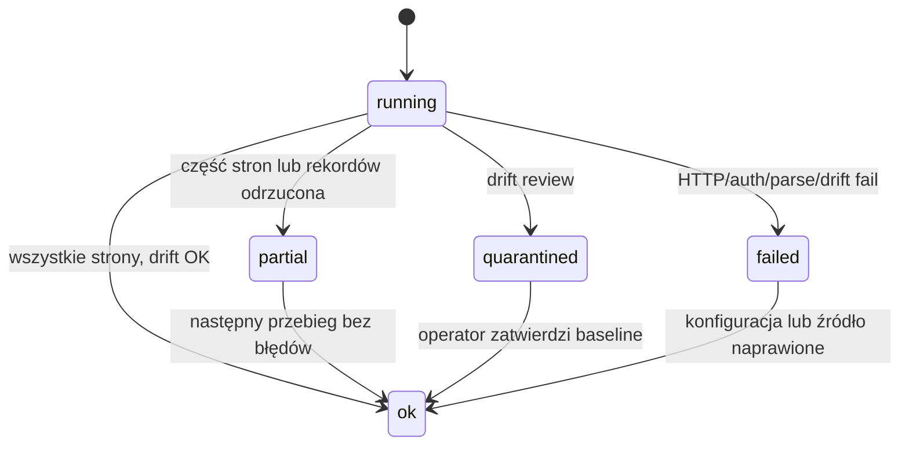

# Konfiguracja źródeł, mapping DSL i wykrywanie dryfu

**Status:** projekt do review, brak kodu wykonawczego
**Data:** 2026-11-21
**Zakres:** warstwa `backend/ingest` i `backend/normalize`
**Powiązane dokumenty:**
[`aed-data-sources-common-schema.md`](./aed-data-sources-common-schema.md),
[`research/raw/`](./research/raw/),
[`../backend/ingest/README.md`](../backend/ingest/README.md)

Pliki tego projektu:

| Plik | Rola |
| --- | --- |
| [`../backend/ingest/datasources-config.json`](../backend/ingest/datasources-config.json) | Pojedynczy rejestr źródeł: OpenAEDMap, Przemyśl, Krosno, Marki, Warszawa, konfiguracje HTML/PDF, KML i manualne |
| [`../backend/ingest/datasources-config.schema.json`](../backend/ingest/datasources-config.schema.json) | JSON Schema 2020-12 dla rejestru i wpisu źródła |

Znormalizowany inwentarz 69 źródeł, z przypisaniem `source_id`, priorytetu,
rodziny connectora, parsera, licencji, statusu TERYT i blockerów, znajduje się w
[`research/source-inventory/README.md`](./research/source-inventory/README.md).

Wszystkie konfiguracje przechodzą walidację względem schematu. Użyty
sposób sprawdzenia:

```bash
cd AED/backend/ingest
python3 - <<'PY'
import json, jsonschema
schema = json.load(open("datasources-config.schema.json"))
jsonschema.Draft202012Validator.check_schema(schema)
v = jsonschema.Draft202012Validator(schema)
v.validate(json.load(open("datasources-config.json")))
print("OK datasources-config.json")
PY
```

---

## 0. TL;DR

1. **Jedno źródło to jeden wpis w rejestrze JSON plus jeden z rodziny connectorów.**
   Nie piszemy osobnego kodu dla Krosna, Marek i Przemyśla. Różnice są w konfiguracji.
2. **Konfiguracja jest danymi, nie kodem.** Mapping DSL nie ma `eval`, nie ma
   JavaScriptu, nie ma dostępu do sieci. Wykonuje tylko white-listowane funkcje.
3. **Schemat kanoniczny jest kontraktem.** Klucze w `map` pochodzą z zamkniętej
   listy pól z dokumentu wspólnego schematu. Literówka w nazwie pola to błąd
   walidacji, nie cichy `null`.
4. **Brak danych to `null`, nie `false`.** DSL nie zgaduje statusu, dostępności
   ani operatora. `unknown` jest poprawną wartością.
5. **Każdy fetch zapisuje surowy snapshot i hash.** Normalizacja działa na
   snapshotcie, więc awaria źródła nie blokuje reszty.
6. **Drift jest obywatelem pierwszej klasy.** Schema, wolumen, jakość współrzędnych
   i kolejność osi mają osobne progi i akcje. Krytyczny dryf quarantinuje przebieg
   zamiast publikować śmieci.
7. **Pięć gotowych konfiguracji pokrywa wszystkie warianty transportu, które są
   potrzebne teraz:** duży GeoJSON, REST z paginacją, CSV z BOM, wadliwy CSV
   i POST z tokenem.

---

## 1. Inwentarz formatów i pułapek

### 1.1. Tabela zbiorcza

| Źródło / rodzina | Transport | Format | Rekordy | Klucz rekordu | Najważniejsze pułapki | Obsługa w configu |
| --- | --- | --- | ---: | --- | --- | --- |
| OpenAEDMap PL | `GET` plik | GeoJSON | 18 298 | `@osm_type/@osm_id` | tylko node, brak statusu, `addr:*` ok. 0,4%, `check_date` 32,7% | `file_static` + `geojson`, `coord`, `map`, `date_age_days` |
| OSM Overpass | `POST` API | JSON | zależny od bbox | `type/id` | timeouty, limity, tagi rzadkie | `http_json`, paginacja `none`, `validate.bbox` |
| Przemyśl SOD `/structured` | `GET` API | JSON | 21 | `id` | CSV to JSON string, domyślnie 10 wierszy, duplikat etykiety AED 7639 | `http_json` + `page`, `records.path=/rows` |
| Przemyśl GeoJSON | `GET` plik | GeoJSON | 21 | `id` | inny kontrakt niż CSV, geometria poprawna | `file_static` + `geojson` |
| Krosno dane.gov.pl | `GET` plik | CSV | 21 | `Numer Id` | BOM, wiodące spacje w 4 nagłówkach, `Adres` jednym polem | `utf-8-sig`, `trim_headers`, `address_text` |
| Marki dane.gov.pl | `GET` plik | CSV, XLSX | 8 | `Numer Id` | cały wiersz w cudzysłowie, podwojone cudzysłowy, osie zamienione, wiersz 7 poza Markami | `unwrap_outer_quotes`, `repair_double_quotes`, wąski `bbox`, `review` |
| Warszawa API | `POST` API | JSON | nieznane bez tokena | `properties.defibrillator_id` | 403 bez tokena, `coordinates` czasem zagnieżdżone, `attachment` Base64 | `auth.header`, `unwrap_single`, `enabled=false` do testu |
| dane.gov.pl API 1.4 | `GET` API | JSON:API | metadane | `dataset_id` | opisuje zbiory, nie rekordy, różne formaty zasobów | `http_json_api`, tylko rejestr źródeł |
| Google My Maps | `GET` KML | KML | 12-165 | `Placemark/name` lub indeks | nieudokumentowany endpoint, część map bez geometrii, polygon zamiast point, ToS Google | `google_my_maps_kml` + `kml` |
| e-mapa / HTML gminny | `GET` HTML | HTML, JS | 0-100 | nietrwały | dane ładowane JS, współrzędne w treści w różnej kolejności, brak licencji | `html_table` tylko po zgodzie, inaczej `manual` |
| ArcGIS REST | `GET` API | JSON | zależny | `OBJECTID` | różne nazwy pól, `geometry` w SR 4326 lub 2180 | `arcgis_query`, `coord` |
| Geoportal WMS `Defibrylatory` | WMS | PNG | 0 | brak | to rendering OSM, brak WFS, brak eksportu | nie jest źródłem danych, tylko overlay |
| KSRG/OSP, RPWDL, NFZ, RSPO | PDF, API, XLSX | różny | 0 AED | `Lp.`, NIP, REGON, RSPO | brak pola AED, tylko kandydaci i operatorzy | `register`, `manual`, `verification_status=candidate` |

### 1.2. Katalog pułapek

**Q1. BOM i wiodące spacje w nagłówkach (Krosno).**
Plik jest UTF-8 z BOM. Cztery nazwy kolumn mają spację na początku. Bez
`encoding: utf-8-sig` i `trim_headers: true` mapping nie znajdzie pól, a błąd
będzie wyglądał jak brak danych.

**Q2. Podwójne cytowanie całego wiersza (Marki).**
Każdy fizyczny wiersz jest owinięty w jeden cudzysłów, a wewnętrzne cudzysłowy
są podwojone. Standardowy parser CSV widzi jedną kolumnę. Kolejność naprawy:

1. zdejmij jedną parę cudzysłowów z każdego wiersza,
2. zamień `""` na `"`,
3. dopiero potem parsuj CSV.

Flagi `unwrap_outer_quotes` i `repair_double_quotes` opisują dokładnie te kroki.

**Q3. Kolejność osi niezgodna z nagłówkiem (Marki).**
Nagłówek mówi `Długość geograficzna, Szerokość geograficzna` (lon, lat), ale
7 z 8 wierszy ma `lat, lon`. Nie wolno ufać nagłówkowi. Config mapuje kolumnę
`Długość geograficzna` na `lat`, a `Szerokość geograficzna` na `lon`, i używa
wąskiego bbox Marki. Wiersz `Numer Id=7` (`21.720344, 49.718809`) wypada poza
bbox i trafia do `review`. To jest poprawne zachowanie: lepszy review niż punkt
w Rzeszowie podpisany jako Marki.

**Q4. Zagnieżdżone współrzędne (Warszawa).**
`geometry.coordinates` bywa `[lon, lat]`, a bywa `[[lon, lat]]`. Flaga
`unwrap_single: true` zdejmuje jedną zbędną warstwę tablicy przed odczytem.

**Q5. CSV zwracany jako JSON-owy literał stringa (Przemyśl).**
`GET /resources/15/data?format=csv` zwraca `Content-Type: text/csv`, ale body
jest JSON stringiem z escapowanym BOM i `\n`. To nie jest CSV. Konfiguracja
Przemyśla świadomie używa `/structured`, a nie `format=csv`. Gdyby ktoś chciał
CSV, musi najpierw zrobić `json.loads`, a potem parsować CSV.

**Q6. Domyślny limit 10 wierszy (Przemyśl).**
Bez `limit` API zwraca 10 z 21 wierszy. To najbardziej zdradliwy błąd, bo plik
wygląda poprawnie. `pagination.page_size` i `total_path=/total_rows` wymuszają
pobranie całości i wykrycie niezgodności liczby wierszy.

**Q7. Duplikat etykiety urządzenia (Przemyśl).**
Numery AED 7639 występują w rekordach 757 i 764. To nie jest duplikat `id`.
Config deduplikuje po `id` i oznacza `on_duplicate: reject`. Duplikat etykiety
jest sygnałem jakościowym dla driftu i dla kolejki scalania, nie powodem
odrzucenia rekordu.

**Q8. Rzadkie tagi OSM (OpenAEDMap).**
`addr:*` pokryte ok. 0,4%, `operator` ok. 32,8%, `check_date` ok. 32,7%,
`opening_hours` ok. 37,1%. Mapping nie może wymagać tych pól. `validate.required`
ogranicza się do `name`, `lat`, `lon`, a `confidence` jest niska.

**Q9. KML bez geometrii i KML z polygonami (Google My Maps).**
Probe 2026-11-21: Bydgoszcz ma 114 `Placemark`, w tym 111 bez `coordinates`,
1 `Point`, 1 `LineString` i 1 `Polygon`. Piła ma 97 `Placemark`, w tym 25
`Point`, 9 `Polygon` i 63 bez geometrii; wcześniejszy audyt opisywał ją jako
czyste polygony. Samo `mid` nie wystarcza. Connector `google_my_maps_kml` musi
sprawdzić nazwę dokumentu, typ geometrii i udział punktów. Mapy bez punktów
kończą jako `review` albo `reject`, nie jako źródło. Polygony zasięgu osiedli
nigdy nie stają się rekordami `aed`.

**Q10. e-mapa ładuje dane JavaScriptem.**
Bez headless browsera nie ma prostego eksportu. `html_table` nie widzi danych.
Domyślnie takie źródła są `manual` albo `disabled`, dopóki wydawca nie udostępni
CSV/API. Nie omijamy zabezpieczeń.

**Q11. Współrzędne w HTML w różnej kolejności.**
W treści gminnej bywa `lat, lon` i `lon, lat`. Przed importem trzeba sprawdzić
zakres i znak. `axis_policy` i `drift.axis` istnieją właśnie dla takich źródeł.
W configach HTML dopuszczalne jest tylko `review`, nigdy automatyczny `swap`.

**Q12. Brak licencji w rejestrach gminnych.**
Brak informacji o licencji nie oznacza domeny publicznej. Oznacza, że ponowne
użycie wymaga kontaktu z wydawcą. `source.license.id` przyjmuje `NOASSERTION`,
a `publish.enabled` jest `false` do czasu uzyskania zgody.

**Q13. Geoportal WMS nie jest źródłem wektorowym.**
Warstwa `Defibrylatory` jest zasilana OSM i służy do wizualizacji. `GetFeatureInfo`
nie zwraca danych, `WFS` jest wyłączony. Nie budujemy na tym ingestii.

**Q14. Metadane mówią "codziennie", plik jest stary (Przemyśl).**
Deklaracja `update_frequency: daily` nie oznacza świeżości. `last_verified_at`
bierzemy z daty danych, nie z daty importu. Drift volume i golden sample wykryją
brak zmian.

**Q15. GML ma kolejność `lat lon` bez `srsName` (Przemyśl).**
To kolejny wariant osi. Dla GML ustawiamy `format: pair`, `order: lat_lon`,
`axis_policy: declared`. Nie polegamy na domyślnej interpretacji biblioteki.

### 1.3. Wniosek dla modelu

Wspólny schemat musi mieć pola opcjonalne i poziom pewności. Konfiguracja nie
może wymagać od każdego źródła tych samych danych. Pola, których źródło nie ma,
pozostają `null`, a nie są zgadywane.

---

## 2. Model konfiguracji źródła

### 2.1. Zasady projektowe

1. Jeden plik na źródło, wersjonowany w git.
2. Brak sekretów w pliku. Tokeny wyłącznie przez `fetch.auth.env`.
3. Brak kodu wykonywalnego. Tylko deklaratywne wyrażenia.
4. Deterministyczne mapowanie: ten sam snapshot i ta sama konfiguracja dają ten
   sam wynik.
5. Każde pole kanoniczne ma proweniencję. `field_provenance` zapisuje, z którego
   źródła i którego wyrażenia powstało.
6. Konfiguracja jest walidowana przy starcie. Błąd schematu blokuje uruchomienie
   connectora, nie kończy się cichym `null`.

### 2.2. Szkielet pliku

```yaml
version: 1
source:      # tożsamość, wydawca, licencja, tier, pokrycie
connector:   # rodzina i parser
fetch:       # URL, metoda, auth, timeout, retry, paginacja
parse:       # kodowanie, CSV/JSON/XLSX/KML
records:     # ścieżka do rekordów, identity, dedupe
map:         # mapowanie na pola kanoniczne
validate:    # wymagane pola, bbox, enumy
drift:       # baseline, progi, akcje
publish:     # licencja eksportu, redakcja, formaty
```

### 2.3. Pola najwyższego poziomu

| Sekcja | Wymagana | Rola |
| --- | --- | --- |
| `version` | tak | wersja kontraktu, teraz `1` |
| `source` | tak | rejestr źródeł: `id`, wydawca, licencja, tier, pokrycie |
| `connector` | tak | `family` i `parser`, patrz sekcja 4 |
| `fetch` | tak | sposób pobrania, także dla plików statycznych |
| `parse` | tak | dekodowanie i naprawy formatu |
| `records` | tak | gdzie są rekordy i jak liczyć tożsamość |
| `map` | tak | DSL mapowania na model kanoniczny |
| `validate` | tak | reguły odrzucenia i review |
| `drift` | tak | baseline i progi dryfu |
| `publish` | nie | udział w eksporcie, redakcja, licencja |

### 2.4. `source`

Mapowanie na tabelę `source` z dokumentu wspólnego schematu:

| Config | Tabela `source` | Uwagi |
| --- | --- | --- |
| `source.id` | `id` | slug, stabilny, np. `openaedmap` |
| `source.publisher` | `publisher` | wydawca lub społeczność |
| `source.reliability_tier` | `reliability_tier` | `authoritative`, `official_local`, `community`, `aggregator`, `derived`, `app`, `register` |
| `source.license.id` | `license_id` | SPDX/alias, np. `ODbL-1.0`, `CC0-1.0`, `NOASSERTION` |
| `source.license.attribution` | `attribution` | tekst wymagany w UI i eksporcie |
| `source.license.share_alike` | brak w tabeli | pochodna `true` dla ODbL |
| `source.coverage.teryt` | `coverage_teryt` | lista TERYT lub puste dla całego kraju |
| `source.update_frequency` | `update_frequency` | deklaracja, nie dowód świeżości |

### 2.5. `fetch`

Obsługiwane pola:

| Pole | Znaczenie |
| --- | --- |
| `url` | pełny URL zasobu, zawsze `https` |
| `method` | `GET` lub `POST` |
| `headers` | nagłówki statyczne, bez sekretów |
| `query` | parametry zapytania |
| `body` | ciało JSON dla `POST` |
| `auth` | `none`, `bearer`, `header`, `basic`; wartość z `env` |
| `timeout_ms` | limit czasu, domyślnie 30 s |
| `retries` | liczba prób i backoff |
| `rate_limit.requests_per_minute` | uczciwy limit |
| `conditional` | `ETag` i `If-Modified-Since` |
| `pagination` | `none`, `page`, `offset`, `cursor`, `link_header` |
| `user_agent` | identyfikacja klienta i kontakt |

Zasady:

- `auth.env` wskazuje zmienną środowiskową. Wartość nigdy nie trafia do YAML.
- `pagination.total_path` pozwala wykryć, że API oddało mniej rekordów niż
  deklaruje. Dla Przemyśla to `total_rows`.
- `conditional` jest domyślnie włączone dla plików, które mają ETag.
- `robots.txt` i regulaminy są sprawdzane poza configiem, w loaderze connectora.

### 2.6. `parse`

| Pole | Znaczenie |
| --- | --- |
| `encoding` | `utf-8`, `utf-8-sig`, `iso-8859-2` |
| `trim_headers` | usuwa spacje i BOM z nazw kolumn |
| `csv.delimiter` | separator, domyślnie `,` |
| `csv.quote` | znak cudzysłowu |
| `csv.skip_rows` | liczba wierszy do pominięcia przed nagłówkiem |
| `csv.header` | czy pierwszy wiersz to nagłówek |
| `csv.unwrap_outer_quotes` | zdejmij zewnętrzną parę cudzysłowów z wiersza |
| `csv.repair_double_quotes` | zamień `""` na `"` przed parsowaniem |
| `csv.empty_as_null` | puste stringi na `null` |
| `json.unwrap_string` | body jest JSON stringiem, nie obiektem |
| `xlsx.sheet` | nazwa lub indeks arkusza |
| `xlsx.header_row` | indeks wiersza nagłówka |
| `kml.point_only` | odrzuć polygon/linestring |
| `kml.document_name_must_match` | zabezpieczenie przed podmianą mapy |
| `kml.document_name_pattern` | regex dla nazwy dokumentu, gdy dokładny string jest zbyt kruchy |
| `kml.placemark_name_pattern` | filtr nazw placemarków, np. prefiks `defibrylator - ` |
| `kml.require_coordinates` | placemark bez `Point/coordinates` nie tworzy rekordu AED |
| `kml.on_missing_geometry` | `reject`, `review` albo `skip` dla braku geometrii |
| `kml.on_non_point_geometry` | `reject`, `review` albo `skip` dla polygonu/linii |
| `kml.min_point_ratio` | minimalny udział punktów wśród placemarków z geometrią |
| `kml.on_low_point_ratio` | `warn`, `review` albo `fail`, gdy udział punktów spada |
| `kml.extended_data_as_object` | `ExtendedData/Data[@name]` jako obiekt `ExtendedData` |
| `kml.strip_cdata` | usuń `CDATA` z `name` i `description` |
| `kml.description_format` | `text` albo `html` |
| `html_table.*` | tabela HTML: `orientation` (`rows`/`key_value`), `columns`, `require_headers`, `require_keys` |
| `html_list.*` | lista/bloki tekstowe: `select`, `record_filter`, `fields`, `item_text_separator` |
| `pdf_table.*` | PDF z warstwą tekstową: `columns`, `row_anchor`, `row_tolerance`, `multi_line` |

Pełny kontrakt pól i decyzja dla PDF: [`ingest-html-pdf-sources.md`](./ingest-html-pdf-sources.md).

### 2.7. `records` i tożsamość

`records.path`:

- `$` oznacza całą tablicę lub wszystkie wiersze,
- JSON: dot-path (`/features`, `/rows`) albo JSON Pointer (`/properties/0`),
- KML/XML: XPath (`//Placemark`),
- CSV/XLSX: `$`.

`records.identity.source_record_id` jest wyrażeniem DSL. Przykłady:

```yaml
# OSM
template: "{@osm_type}/{@osm_id}"

# Przemyśl
template: "przemysl:15:{id}"

# Krosno
template: "krosno:{Numer Id}"

# Warszawa
template: "warszawa:{properties.defibrillator_id}"
```

`identity.stable: true` oznacza, że identyfikator nie zmienia się między
snapshotami. Jeśli źródło nie gwarantuje stabilności, ustawiamy `false`, a
normalizacja liczy `aed_id` jako `UUIDv5(namespace, "{source_id}:{source_record_id}")`.

`records.dedupe` działa w obrębie jednego przebiegu:

| Pole | Wartość |
| --- | --- |
| `key` | lista wyrażeń tworzących klucz |
| `keep` | `first` lub `last` |
| `on_duplicate` | `warn`, `reject`, `merge` |

### 2.8. `validate`

| Pole | Znaczenie |
| --- | --- |
| `required` | lista pól kanonicznych, bez których rekord jest odrzucany lub do review |
| `require_location` | `none`, `address_or_point`, `point`; dla źródeł adresowych `address_or_point` |
| `coords.bbox` | `[minLon, minLat, maxLon, maxLat]` |
| `coords.on_invalid` | `reject`, `review`, `null` |
| `coords.on_missing` | `accept`, `review`, `reject`; domyślnie `review` |
| `enums` | walidacja słowników kontrolnych |
| `on_error` | domyślna akcja dla błędu pola: `reject` lub `review` |

Dla Marki bbox jest wąski i celowo odrzuca wiersz 7 do review. Dla OSM bbox
obejmuje całą Polskę. Dla Warszawy i Przemyśla także.

### 2.9. `geocoding`

Dla źródeł bez `lat/lon` konfiguracja może zawierać sekcję `geocoding`. To
deklaracja kaskady, progów i cache, nie kod.

| Pole | Znaczenie |
| --- | --- |
| `enabled` | czy uruchamiać geokodowanie dla rekordów `address_only` |
| `strategy` | `structured_first`, `text_first`, `structured_only` |
| `provider_order` | kolejność `prg`, `uug`, `nominatim` |
| `address_template` | szablon adresu z pól strukturalnych |
| `required_components` | minimalne składniki adresu, np. `city`, `street` |
| `min_confidence` | próg dla `location_status=geocoded`, domyślnie 0.8 |
| `precision_m` | precyzja dla `building`, `street`, `locality` |
| `on_failure` | `address_only`, `review` lub `reject` |
| `cache_ttl_days` / `refresh_after_days` | cache i odświeżanie |
| `verification` | porównanie z OSM i limit promocji weryfikacji |

Zasady:

- Geokodowanie nie zmienia `verification_status` i nie daje `confirmed`.
- Dopasowanie do miejscowości daje `address_only`, nie punkt na mapie.
- `address_only` nie trafia do GeoJSON; w API tylko z `include_address_only=true`.
- Model i testy: [`design/address-only-sources.md`](./design/address-only-sources.md).

---

## 3. Mapping DSL

### 3.1. Gramatyka

Wyrażenie (`Expr`) jest jednym z:

```text
Expr := string                       # skrót do { field: "..." }
      | number | boolean | null      # stała
      | { field: string }            # dot-path
      | { pointer: string }          # JSON Pointer RFC 6901
      | { builtin: string }          # fetched_at, now, row_index, source_id
      | { const: scalar }
      | { func: string, args: [Expr] }
      | { coalesce: [Expr, ...] }
      | { template: string, vars: {name: Expr} }
      | { regex: {in: Expr, pattern: string, group?: int, flags?: string} }
      | { map: {value: Expr, cases: {string: scalar}, default?: scalar} }
      | { when: Condition, then: Expr, else?: Expr }
      | { coord: CoordSpec }
      | { json: Expr }
      | { first: Expr }
      | { lookup: {file: string, key: Expr, default?: scalar} }
```

`Condition`:

```text
{ op: eq|neq|in|not_in|exists|missing|empty|non_empty|regex|gt|gte|lt|lte,
  left: Expr,
  right?: scalar | [scalar, ...] }
```

`CoordSpec`:

```text
{ from?: Expr | [Expr, Expr], lat?: Expr, lon?: Expr,
  format: geojson|kml|pair|object|wkt,
  order?: lat_lon|lon_lat,
  delimiter?: string,
  pick?: lat|lon|both,
  unwrap_single?: boolean,
  precision_m?: number|null,
  axis_policy?: declared|auto_detect|swap_if_invalid,
  on_invalid?: reject|review|null }
```

### 3.2. Składnia ścieżek

- kropka rozdziela segmenty: `properties.location_city`,
- nawiasy kwadratowe indeksują tablice: `gallery[0].url`,
- klucze z dwukropkiem są dozwolone w cudzysłowie: `"defibrillator:location:pl"`,
- `pointer` obsługuje klucze ze znakami specjalnymi i `/`,
- brak pola daje `null`, nie wyjątek.

### 3.3. Semantyka `null` i pustych wartości

1. Brak pola i `null` są równoważne.
2. `empty_as_null: true` zamienia `""` i same białe znaki na `null`.
3. `coalesce` pomija `null`, `""` i puste tablice.
4. `map` bez dopasowania zwraca `default`, a bez `default` zwraca `null`.
5. `to_bool` rozumie `yes/no`, `true/false`, `1/0`, `tak/nie`. Inne wartości
   dają `null`, nie `false`.
6. `to_float` i `to_int` przy błędzie dają `null`, a walidacja decyduje, czy to
   `review`, czy `reject`.
7. `when` bez `else` zwraca `null`.

To jest kluczowe dla zasady "brak danych to nie dane negatywne".

### 3.4. Katalog funkcji

| Grupa | Funkcje |
| --- | --- |
| String | `trim`, `lower`, `upper`, `collapse_ws`, `strip_prefix`, `strip_suffix`, `replace`, `substring`, `concat`, `split`, `join`, `pad_postcode`, `strip_html` |
| Typy | `to_string`, `to_float`, `to_int`, `to_bool`, `to_date`, `to_datetime` |
| Kolekcje | `first`, `length`, `json`, `stable_hash` |
| Daty | `date_age_days`, `date_is_before`, `date_is_after` |
| Adresy | `normalize_address`, `parse_house_number`, `normalize_postcode` |
| Kontakt | `normalize_phone`, `normalize_email`, `normalize_url` |
| Domenowe | `derive_location_name`, `derive_device_identifier`, `map_access`, `map_status`, `derive_facility_type` |
| Słowniki | `lookup` (plik YAML/CSV w repo) |

Funkcje są implementowane w `backend/normalize`, nie w configu. Każda funkcja
jest czysta, bez I/O i bez dostępu do sieci. `lookup` czyta tylko plik wskazany
w repo i cache'uje go.

Przykład `derive_location_name` dla Przemyśla:

```text
"Defibrylator (AED 9485) w ADM Centrum" -> "ADM Centrum"
"Defibrylator (AED 7664) ul. Zamkowa 1" -> "ul. Zamkowa 1"
```

Przykład `derive_device_identifier`:

```text
"Defibrylator (AED 9485) w ADM Centrum" -> "AED 9485"
```

### 3.5. Współrzędne

Trzy warianty, wszystkie w jednym typie `coord`:

```yaml
# GeoJSON Feature
lat:
  coord: {from: geometry, format: geojson, pick: lat, on_invalid: reject}

# KML Placemark
lat:
  coord: {from: coordinates, format: kml, pick: lat, on_invalid: review}

# Dwie kolumny CSV
lat:
  func: to_float
  args: [{field: "Szerokość geograficzna"}]
lon:
  func: to_float
  args: [{field: "Długość geograficzna"}]
```

Zasady:

- `format: geojson` zawsze czyta `[lon, lat]`.
- `format: kml` zawsze czyta `lon,lat,alt`.
- `format: pair` wymaga `order`.
- `axis_policy: declared` ufa configowi.
- `axis_policy: auto_detect` wykrywa prawdopodobną zamianę i oznacza rekord.
- `axis_policy: swap_if_invalid` zamienia tylko wtedy, gdy po zamianie punkt
  mieści się w bbox. Dla Marki tego nie używamy, bo wiersz 7 po zamianie
  wygląda poprawnie, ale jest w złym mieście.
- `on_invalid: review` jest domyślne dla źródeł, którym nie ufamy.

### 3.6. Proweniencja i pewność

Każde pole mapowane z `map` dostaje wpis w `field_provenance`:

```text
entity_type = aed | facility
entity_id
field_name
source_record_id
expression_hash
```

`confidence` jest liczone na poziomie rekordu według wzoru z dokumentu wspólnego
schematu albo nadpisane w configu (`confidence: {const: 0.85}`). Config nie
wylicza pełnego wzoru, bo zależy on od wielu źródeł. Config podaje tylko
`verification_status` i bazową pewność.

### 3.7. Przykłady mapowania

**OSM access_type:**

```yaml
access_type:
  when:
    op: eq
    left: {field: locked}
    right: "yes"
  then: key
  else:
    map:
      value: {field: access}
      cases: {"yes": public, permissive: permissive, customers: customers, private: private, "no": private}
      default: unknown
```

**OSM verification_status:**

```yaml
verification_status:
  when:
    op: lte
    left:
      func: date_age_days
      args: [{field: check_date}, {builtin: fetched_at}]
    right: 365
  then: probable
  else: unverified
```

**Przemyśl telefon:**

```yaml
phone:
  func: normalize_phone
  args: [{field: phone}]
```

**Marki współrzędne:**

```yaml
lat:
  func: to_float
  args: [{field: "Długość geograficzna"}]
lon:
  func: to_float
  args: [{field: "Szerokość geograficzna"}]
```

---

## 4. Rodziny connectorów

### 4.1. Kontrakt connectora

Każdy connector implementuje ten sam interfejs:

```ts
type ConnectorResult = {
  records: unknown[];
  meta: {
    httpStatus?: number;
    contentType?: string;
    etag?: string;
    lastModified?: string;
    payloadSha256: string;
    bytes: number;
    pages: number;
    recordsDeclared?: number;
  };
  warnings: DriftSignal[];
};

interface Connector {
  family: ConnectorFamily;
  fetch(config: SourceConfig, ctx: FetchContext): Promise<ConnectorResult>;
}
```

Zasady:

1. Connector nie zna modelu kanonicznego. Zwraca surowe rekordy i metadane.
2. Connector nie zapisuje do bazy. Snapshot zapisuje `store`.
3. Connector jest izolowany. Wyjątek jednego źródła nie zatrzymuje innych.
4. Connector respektuje `robots.txt`, `rate_limit` i `User-Agent`.
5. Connector nie omija logowania, CAPTCHA ani blokad.

### 4.2. Tabela rodzin

| Rodzina | Kiedy używać | Parser | Zachowanie |
| --- | --- | --- | --- |
| `file_static` | CSV, XLSX, JSON, GeoJSON, KML z jednego URL | `csv`, `xlsx`, `json`, `geojson`, `kml` | jedno pobranie, opcjonalny ETag, cały plik w pamięci lub stream |
| `http_json` | REST zwracający JSON, własna paginacja | `json` | paginacja `page/offset/cursor`, retry, auth |
| `http_json_api` | JSON:API 1.x (dane.gov.pl) | `jsonapi` | `data/relationships`, `links.next`, `meta.total` |
| `google_my_maps_kml` | osadzone mapy Google My Maps | `kml` | zamiana `mid` na URL KML, walidacja typu Placemark |
| `arcgis_query` | ArcGIS REST `/query` | `json` | `where`, `outFields`, `returnGeometry`, `resultOffset` |
| `ckan_datastore` | CKAN `datastore_search` | `json` | `limit/offset`, `total`, `fields` |
| `html_table` | oficjalna tabela HTML bez API | `html_table` | tylko po zgodzie; heurystyka kolumn, zawsze `review` |
| `html_list` | oficjalna lista HTML bez tabeli | `html_list` | tylko po zgodzie; selektor + filtr + regex pól |
| `pdf_table` | urodzony cyfrowo PDF z tabelą i warstwą tekstową | `pdf_table` | bez OCR; rekonstrukcja po pozycjach słów |
| `manual` | PDF, dokument, arkusz bez stabilnego URL | brak | import ręczny z kontrolą człowieka |

### 4.3. Macierz zgodności rodzin i parserów

| Rodzina | dozwolone parsery |
| --- | --- |
| `file_static` | `csv`, `xlsx`, `json`, `geojson`, `kml` |
| `http_json` | `json` |
| `http_json_api` | `jsonapi`, `json` |
| `google_my_maps_kml` | `kml` |
| `arcgis_query` | `json` |
| `ckan_datastore` | `json` |
| `html_table` | `html_table` |
| `html_list` | `html_list` |
| `pdf_table` | `pdf_table` |
| `manual` | brak |

Loader waliduje tę macierz. Para `file_static` + `jsonapi` jest błędem.

### 4.4. Izolacja błędów i stany przebiegu



`sync_run.status` przyjmuje `running`, `ok`, `partial`, `quarantined`, `failed`.
`partial` nie blokuje publikacji rekordów zaakceptowanych, ale nie aktualizuje
baseline. `quarantined` i `failed` blokują publikację całego źródła.

---

## 5. Wykrywanie dryfu

### 5.1. Definicja

Dryf to każda zmiana źródła, która nie jest zwykłą zmianą danych w ramach
ustalonego kontraktu. Może dotyczyć transportu, schematu, wolumenu, jakości,
semantyki albo konkretnego rekordu.

### 5.2. Warstwy wykrywania

| Warstwa | Sygnały | Przykład |
| --- | --- | --- |
| Transport | HTTP status, `Content-Type`, rozmiar, ETag, redirect, TLS | zamiast `application/json` przyszło HTML 403 |
| Schema | nowe/brakujące kolumny, zmiana typu, kolejność nagłówków | Krosno usunęło `Adres` |
| Volume | liczba rekordów, delta względem baseline, `total_rows` vs pobrane | Przemyśl zwrócił 10 z 21 |
| Quality | null ratio, invalid coords, duplicate id, enum unknown ratio | 80% `lat` jest `null` |
| Axis | udział punktów, które po zamianie osi mieszczą się w bbox | Marki podmieniło kolejność kolumn |
| Semantic | znane etykiety, operator, Facility type, słownik dostępu | `access` przestał być mapowany |
| Golden sample | stała próbka rekordów i ich pól | rekord 744 zmienił współrzędne o 2 km |
| Freshness | `source_updated_at` i wiek danych | plik nie zmienił się od 24 miesięcy |

### 5.3. Progi i akcje

Każdy próg ma akcję: `ignore`, `warn`, `review`, `fail`.

| Sygnał | Próg domyślny | Akcja domyślna |
| --- | --- | --- |
| HTTP 4xx/5xx | każde | `fail` |
| `Content-Type` niezgodny | każde | `fail` |
| nowa kolumna | każde | `review` |
| brakująca kolumna | każde | `fail` dla wymaganej, `review` dla opcjonalnej |
| zmiana typu pola | każde | `fail` |
| zmiana kolejności nagłówków | każde | `review` |
| liczba rekordów poniżej `min_records` | np. 15/21 | `fail` |
| delta liczby rekordów | np. > 50% | `review` |
| invalid coords ratio | np. > 1% | `review` lub `fail` |
| duplicate id ratio | np. > 0% | `review` |
| null ratio pola wymaganego | np. > 0% | `fail` |
| null ratio pola opcjonalnego | np. > 90% | `warn` |
| axis suspicious ratio | np. > 0.5% | `review` |
| golden sample match | np. < 95% | `review` |

Progi są per źródło, bo 21 rekordów Przemyśla i 18 298 rekordów OSM mają inną
naturalną wariancję.

### 5.4. Baseline

Baseline to zapisany kontrakt źródła:

```yaml
drift:
  baseline:
    record_count: 21
    schema_fields: [id, name, ...]
    generated_at: "2026-11-21"
```

Zasady:

1. Baseline aktualizuje się tylko po przebiegu `ok`, nigdy po `partial`.
2. Zmiana baseline wymaga jawnej akceptacji operatora dla `review` i `fail`.
3. Baseline jest wersjonowany razem z konfiguracją. `source_config` przechowuje
   `config_sha256` i `baseline_sha256`.
4. Golden sample to 10-25 rekordów wybranych deterministycznie (np. po
   `sha256(source_record_id)`), z polami wymaganymi i współrzędnymi.

### 5.5. Golden sample

Przykład pliku `golden/openaedmap-pl.json`:

```json
{
  "generated_at": "2026-11-21",
  "source_id": "openaedmap",
  "records": [
    {
      "source_record_id": "node/13323246101",
      "lat": 52.2275002,
      "lon": 20.9742602,
      "name": "w budynku przedszkola"
    }
  ]
}
```

Golden sample nie służy do porównania całego rekordu, tylko pól krytycznych:
tożsamości, współrzędnych, nazwy i statusu. Drobne zmiany opisowe nie powinny
blokować publikacji.

### 5.6. Tabele do dodania

```sql
CREATE TABLE source_config (
  source_id      TEXT PRIMARY KEY REFERENCES source(id),
  version        INTEGER NOT NULL,
  config_yaml    TEXT NOT NULL,
  config_sha256  TEXT NOT NULL,
  baseline_json  TEXT,
  baseline_sha256 TEXT,
  active         INTEGER NOT NULL DEFAULT 1,
  loaded_at      TEXT NOT NULL
);

CREATE TABLE drift_event (
  id             TEXT PRIMARY KEY,
  source_id      TEXT NOT NULL REFERENCES source(id),
  sync_run_id    TEXT REFERENCES sync_run(id),
  layer          TEXT NOT NULL,          -- transport | schema | volume | quality | axis | semantic | sample
  signal         TEXT NOT NULL,
  severity       TEXT NOT NULL,          -- warn | review | fail
  observed       TEXT,
  baseline       TEXT,
  action         TEXT NOT NULL,
  message        TEXT NOT NULL,
  created_at     TEXT NOT NULL
);
```

`sync_run` rozszerzamy o:

```sql
ALTER TABLE sync_run ADD COLUMN records_declared INTEGER;
ALTER TABLE sync_run ADD COLUMN drift_events INTEGER NOT NULL DEFAULT 0;
ALTER TABLE sync_run ADD COLUMN quarantined INTEGER NOT NULL DEFAULT 0;
ALTER TABLE sync_run ADD COLUMN config_sha256 TEXT;
```

### 5.7. Runbook operatora

1. `drift_event` z `severity=fail` wyłącza źródło i zostawia ostatni dobry
   snapshot w publikacji.
2. `severity=review` quarantinuje nowy snapshot. Stary snapshot nadal jest
   widoczny, ale UI pokazuje wiek danych.
3. Operator sprawdza raport: nowe kolumny, liczby, sample.
4. Jeśli zmiana jest legalna, aktualizuje config i baseline, potem uruchamia
   przebieg ponownie.
5. Jeśli to błąd źródła, zgłasza do wydawcy i zostawia `enabled=false`.
6. Nie ma automatycznego "naprawiania" przez zgadywanie. Wyjątkiem jest
   `axis_policy: swap_if_invalid`, ale tylko z `on_invalid: review` i w bbox.

---

## 6. Przykładowe konfiguracje

| Plik | Źródło | Rodzina | Rekordy | Kluczowe decyzje |
| --- | --- | --- | ---: | --- |
| `openaedmap-pl.yaml` | OpenAEDMap PL | `file_static` / `geojson` | 18 298 | duży plik, ODbL, `unverified/probable`, niska pewność, `check_date` |
| `przemysl-sod.yaml` | Przemyśl `/structured` | `http_json` / `json` | 21 | paginacja `page/per_page`, `total_rows`, `derive_*`, CC BY |
| `krosno-dane-gov-pl.yaml` | Krosno CSV | `file_static` / `csv` | 21 | `utf-8-sig`, `trim_headers`, `Adres` jako `address_text`, CC0 |
| `marki-dane-gov-pl.yaml` | Marki CSV | `file_static` / `csv` | 8 | naprawa cytowania, ręczne osie, wąski bbox, `review` dla wiersza 7 |
| `warszawa-api.yaml` | Warszawa API | `http_json` / `json` | brak baseline | POST, token z env, `unwrap_single`, `enabled=false` do testu |

### 6.1. OpenAEDMap

Najważniejsze decyzje:

- `records.path: /features`,
- `source_record_id: "{@osm_type}/{@osm_id}"`,
- `name` z `coalesce` tagów, bo OSM nie ma jednego pola nazwy,
- `access_type` z `access` i `locked`,
- `verification_status` z `check_date` i `date_age_days`,
- `confidence: 0.55`, bo to źródło społecznościowe,
- `drift.schema.on_missing_field: warn`, bo tagi są rzadkie i ich brak nie jest
  błędem,
- `drift.axis.enabled: false`, bo GeoJSON ma jednoznaczną kolejność.

### 6.2. Przemyśl

Najważniejsze decyzje:

- `/structured`, nie `format=csv`,
- `pagination.type: page`, `limit_param: per_page`, `total_path: /total_rows`,
- `derive_location_name` i `derive_device_identifier` zamiast dwóch osobnych
  pól, których źródło nie ma,
- `last_verified_at: "2024-11-05"` z daty danych, nie z daty importu,
- `confidence: 0.85`, bo źródło oficjalne, ale małe i bez statusu,
- `drift.quality.max_null_ratio` wysokie dla `phone`, `email`, `website`,
- duplicate `id` jest błędem, duplicate etykiety AED jest ostrzeżeniem.

### 6.3. Krosno

Najważniejsze decyzje:

- `encoding: utf-8-sig` i `trim_headers: true`,
- `name` z `Lokalizacja`, nie z `Nazwa`, bo `Nazwa` to zawsze "Defibrylator",
- `label` z `Nazwa`,
- `address_text` z `Adres`, bez rozbioru na części w configu. Rozbiór robi
  `normalize_address` w normalizacji,
- `drift.schema.on_header_order_change: review`, bo kolejność kolumn jest częścią
  kontraktu.

### 6.4. Marki

Najważniejsze decyzje:

- `unwrap_outer_quotes: true` i `repair_double_quotes: true`,
- mapowanie `lat` z kolumny `Długość geograficzna` i `lon` z
  `Szerokość geograficzna`, bo nagłówek kłamie,
- bbox `[21.05, 52.28, 21.18, 52.38]`,
- `coords.on_invalid: review`, nie `reject`, bo chcemy zobaczyć wiersz 7 w
  kolejce, a nie zgubić go,
- `drift.axis.max_suspicious_ratio: 0.13`,
- `source.notes` opisuje podwójny błąd, żeby przyszły operator nie "naprawił"
  osi z powrotem.

### 6.5. Warszawa

Najważniejsze decyzje:

- `enabled: false` i `publish.enabled: false`, bo tryb listowania nie jest
  potwierdzony,
- `auth.env: WARSZAWA_API_TOKEN`,
- `unwrap_single: true` dla `geometry.coordinates`,
- `access_type` z `device_public_access` z `default: unknown`,
- `is_24_7` tylko dla wartości zawierającej "24", inaczej `null`,
- `attachment` nie jest mapowany na `photo_url`, bo to Base64, nie URL,
- `redact: [serial_number, phone]`.

### 6.6. Czego te konfiguracje nie robią

- Nie pobierają danych z HTML, PDF ani e-mapa. To osobna rodzina i osobna zgoda.
- Nie publikują niczego, dopóki `drift` nie przejdzie.
- Nie zastępują decyzji o licencji. `publish.enabled` i `license.id` trzeba
  potwierdzić przed eksportem.
- Nie zawierają tokenów. Tokeny są w env.

---

## 7. Integracja z backendem

### 7.1. Przepływ

```text
config YAML
   |
   v
loader + JSON Schema  ->  source_config (DB)
   |
   v
connector (fetch)     ->  source_record (raw payload + sha256) + sync_run
   |
   v
normalize (DSL)       ->  aed / facility / observation / field_provenance
   |
   v
drift (signals)       ->  drift_event + quarantine
   |
   v
store                 ->  publish (CSV/GeoJSON) -> dane.gov.pl harvester
```

### 7.2. Kolejność normalizacji

1. Walidacja konfiguracji względem JSON Schema.
2. Odczyt snapshotu po `sync_run_id`.
3. Parsowanie według `parse`.
4. Wybór rekordów według `records.path`.
5. Obliczenie `source_record_id` i dedupe.
6. Wykonanie `map` na każdym rekordzie.
7. Walidacja `validate` i odrzucenie/review.
8. Uzupełnienie `country_code`, `coord_precision_m`, `license_id`, `fetched_at`.
9. Zapis `source_record` i `observation`.
10. Deduplikacja między źródłami według algorytmu z dokumentu wspólnego schematu.
11. Drift i decyzja o publikacji.

### 7.3. Ładowanie konfiguracji

- Rejestr `backend/ingest/datasources-config.json` w produkcji i testach.
- Loader waliduje schemat i macierz rodzin przy starcie.
- `source_config.config_sha256` pozwala odtworzyć, która wersja wygenerowała
  dany `sync_run`.
- Zmiana konfiguracji bez migracji jest dozwolona tylko dla pól `notes`,
  `drift` i `publish`. Zmiana `map`, `records` lub `parse` wymaga nowego
  `config_sha256` i przebiegu testowego na golden sample.

### 7.4. Bezpieczeństwo

- `auth.env` jest czytane tylko po stronie serwera.
- Tokeny nie trafiają do logów. `sync_run.error` redaguje nagłówki.
- `user_agent` zawiera kontakt, zgodnie z dobrymi praktykami.
- `html_table` i `manual` wymagają wpisu w rejestrze zgód.
- Nie omijamy `robots.txt`, CAPTCHA ani 403.

---

## 8. Plan wdrożenia

### Faza 1: fundament

- [ ] dodać `datasources-config.schema.json` do CI i walidować rejestr JSON,
- [ ] napisać loader konfiguracji w `backend/ingest`,
- [ ] dodać testy schematu: poprawny config, literówka w polu, zła para
      rodzina/parser, brak wymaganej sekcji,
- [ ] dodać tabelę `source_config` i migrację.

### Faza 2: pierwsze dwa connectory

- [ ] `file_static` z parserami `csv` i `geojson`,
- [ ] `http_json` z paginacją `page`,
- [ ] uruchomić OpenAEDMap, Przemyśl, Krosno, Marki,
- [ ] porównać liczbę rekordów i pola z dokumentem researchu,
- [ ] dodać `drift_event` i baseline.

### Faza 3: źródła wymagające ostrożności

- [ ] `google_my_maps_kml` dla Łodzi, Bełchatowa, Pawłowic, Zielonej Góry,
- [ ] `html_table` tylko po zgodzie wydawcy,
- [ ] `arcgis_query` i `ckan_datastore` dla przyszłych źródeł,
- [ ] Warszawa po potwierdzeniu trybu listowania i tokenu.

### Faza 4: automatyzacja dryfu

- [ ] golden sample dla każdego źródła,
- [ ] automatyczne quarantine i alert,
- [ ] raport dzienny: ile źródeł OK, ile review, ile fail,
- [ ] procedura zatwierdzania nowego baseline.

### Kryteria akceptacji

1. Wszystkie konfiguracje przechodzą walidację schematu.
2. Ten sam snapshot i config dają identyczny wynik (determinizm).
3. Odrzucony rekord ma czytelny powód i nie trafia do publikacji.
4. Brak danych nie jest mapowany na `false` ani `0`.
5. Drift `fail` nie publikuje nowych danych.
6. Tokeny nie występują w repo ani w logach.
7. Każdy rekord ma `source_record_id`, `license_id` i `fetched_at`.

---

## 9. Pytania otwarte

1. **Warszawa:** czy API bez `defibrillator_id` zwraca całą listę, czy trzeba
   enumerować ID? Do potwierdzenia przed włączeniem.
2. **Przemyśl:** która licencja obowiązuje, CC BY 4.0 z portalu czy CC0 1.0 z
   mirrora dane.gov.pl? Do potwierdzenia u wydawcy.
3. **Marki:** czy wiersz `Numer Id=7` to błąd danych, czy punkt poza Markami?
   Do decyzji operatora. Config kieruje go do review.
4. **OSM:** czy importować także waye z `emergency=defibrillator`? OpenAEDMap
   ich nie zawiera. Overpass może je zwrócić, ale to osobna decyzja.
5. **Licencje mieszane:** czy publikować całość na ODbL, czy rozdzielić eksporty
   OSM i lokalne? To decyzja `publish`, nie `ingest`.
6. **e-mapa:** czy wydawcy udostępnią CSV/API? Bez tego pozostaje `manual`.
7. **Golden sample:** kto zatwierdza zmiany i jak często? Proponuję operatora
   danych i akceptację przy każdym `review`.
